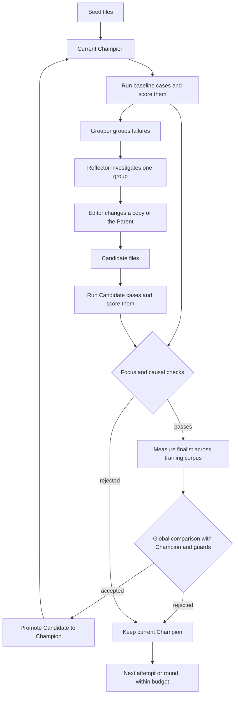

# How Evolution works

Evolution runs controlled experiments on the files your agent reads. A campaign starts with a directory of those files, tests proposed changes and keeps the selected versions with their evidence. The model behind the agent does not need to be the model that edits its instructions.

Start with the [Quickstart](../QUICKSTART.md) to see this happen. This page explains the v2 tree workflow. The separate task/skill commands have their own [manual workflow architecture](manual-architecture.md).

## The pieces you provide

| Piece | Responsibility | Example |
|---|---|---|
| Seed tree | Starting files, including the paths an editor may change | `seed/skills/SKILL.md` |
| Target Service | Load a version of those files and run your agent | A service wrapping your agent harness |
| Corpus | Cases on which the agent will be evaluated | Questions, task inputs and private expected answers |
| Environment | Decide what message to send next and when the interaction ends | Send each case's `public.text` once |
| Scorer | Turn an interaction into metrics and criterion verdicts | Score correctness and report missing required steps |
| Grouper | Group the baseline's failing observations before reflection; `/16` can also propose cause hypotheses | Put every case that missed the same required step into one group |
| Reflector | Investigate failing cases and propose a diagnosis | Identify an instruction that causes repeated omissions |
| Editor | Change permitted files in a candidate workspace | Add a general checklist to a skill |
| Manifest | Connect all these pieces and set the budgets | `manifest.json` |

Evolution provides scheduling, artifact copies, comparisons, promotion, journals and recovery. You start the Target Service before the campaign. The [reference target](reference-target.md) supplies an offline example of all the pieces so you can learn them before building your own.

## One campaign, step by step

A **campaign** is the whole experiment stored in one run directory. It contains **rounds**. Each round starts from a fixed **Parent** and can try several **Candidates**. One **Attempt** is an editor call and the evaluation of the resulting Candidate. A **sample**, or rollout, is one agent interaction for one case and repeat. A **measurement** collects these samples for a version of the files.

The **Champion** is the version currently selected by the campaign. At the start it is the seed. After a successful promotion it is the selected Candidate. The original seed is never overwritten by promotion.

The baseline identifies failing cases. The **Grouper** groups their observations using an offline policy, a model or an agent CLI. Under `/15`, groups state what failed together without diagnosing why. Under `/16`, the Grouper can propose cause hypotheses for the Reflector to check; it does not prescribe a repair. The Reflector investigates a bounded part of one group and sends its diagnosis to the Editor.

If reflection declines, finds nothing or produces unusable content, the round closes as `unplanned` without an Editor call. Provider and unexplained failures suspend the campaign (see [Failures and recovery](#failures-and-recovery)). Each Attempt starts from the same Parent; sequential feedback can share lessons from earlier closed Attempts without inheriting their files.

If the baseline has no failing cases to investigate, the round can close without calling the Reflector or editor. A completed campaign therefore does not necessarily make edits or promote anything.

## Who sees what

The target receives the case's public inputs and the files it must load. The scorer also receives the private expected answer or evaluation data, called the **oracle**. The Reflector can inspect bounded evaluation evidence to explain failures. The editor receives a prepared brief, a diagnosis and permitted observations, not the raw oracle or target address.

Keep expected answers in the corpus's `oracle` field, rather than embedding them in `public`. Scorer feedback that is intended for the editor must be safe to publish. Evolution checks boundaries, but a scorer that puts an answer into a public feedback code has already exposed it.

A scorer has two distinct outputs: numeric **metrics** support quality comparisons, while criterion **verdicts** identify failures for the Reflector. A low metric with no failing verdicts does not give the Reflector the same signal as an explicit failed criterion.

## How promotion is decided

An edit is a proposal, not proof of improvement. In the current manifest `/15`, Evolution first compares the Candidate with the Parent on the focus cases it aims to improve and on the other cases its edit can affect, called causal cases. A Candidate that passes these checks becomes a finalist. Evolution then measures the finalist afresh across the training corpus and compares it with the Champion under the `global` rule. Critical-case failures, incomplete evidence or failed identity checks can prevent acceptance. Test cases stay in separate evaluation runs.

With `stability: stable`, the final comparison uses the stored Champion measurement; `unstable` measures the Champion again. With `round_stop: first_accepted`, the first accepted finalist is promoted and the round ends. With `all_attempts`, every Attempt runs before the finalists are measured together and a winner is selected. The scaffold uses `stable` and `first_accepted`, and refreshes a stored baseline after three rounds that keep it.

In `statistical` mode, uncertain comparisons can keep the Champion even when the Candidate’s observed average is higher. When repeats show no within-case variation in the compared quantity, `/15` decides on the observed effect and reports `exact_contrast`; this does not prove that the agent is deterministic. In `observe` mode, numeric checks are diagnostic only, so promotion is not evidence of improvement; critical, completeness and identity checks still apply.

`target.seed_mode` describes what the target can honestly guarantee. `exact` confirms the requested seed for both versions. `unpaired` reports a seed chosen by the target. `none` reports no seed. Do not select `exact` just to get paired statistics when the agent cannot confirm the seed it used.

The [stable-family reference](manifest-v2.md#stable-family-keys-manifest-15) defines the `/15` comparison settings, focus margin and tolerated causal regression; [independent controls](manifest-v2.md#independent-controls-manifest-16) define `/16`. File loaders accept only those schemas, and campaign readers support only families 14 and 15. Read removed-family runs with `2.0.0b9`, or seed a new unlinked `/15` campaign from the Champion copy. Interpret a promotion under the declared mode, cases and conditions; evaluate the exported files on separate application tests before deploying them.

## Independent measurement and acceptance

Opt-in manifest `/16` writes family 15 and leaves `/15` unchanged. It separates repeat count (R>=1), point/confidence/unfiltered acceptance, declared execution-noise allowance and reuse/fresh verification. Promotion is always automatic. The recommended point/reuse workflow completes the Candidate across train by importing its own sealed gate slots and measuring only missing slots before eligibility. Fresh verification buys a distinct full-train measurement; stable/unstable chooses a stored/fresh Champion independently. `all_attempts` freezes its finalist set at the full Attempt barrier before final work and deterministic ranking.

Comparisons bind their cases, weights, policy and authenticated evidence. Journals record decisions; train/test separation and role privacy still apply. Numerical results do not trigger extra repeats or suspend the campaign.

See [independent acceptance](running-campaigns.md#choose-independent-acceptance-manifest-16) and [storage](run-storage-layout.md#the-v2-run-directory).

## Failures and recovery

A wrong answer and an unavailable service are different evidence. A deterministic defect in the agent can be scored; a timeout or broken connection cannot be treated as a quality score.

Current campaigns retry transient target calls within declared limits. With the default enforced checks, a connection probe of the Champion through Target and scorer must match the metric contract before the baseline, or the campaign suspends. Too much instability, target contract violations and other infrastructure problems also suspend: repair the cause and rerun the same command with the same run directory.

An unusable grouping answer can fall back to a simpler policy with a `grouping_fallback` caveat. Provider failures suspend, as do consecutive full fallbacks at the declared limit: two by default, configurable in `/16` through [role-loop limits](manifest-v2.md#role-loop-limits-manifest-16). By default, a run secret in the grouping text also suspends; `/16` can change this and the connection checks through [check modes](manifest-v2.md#checks-manifest-16). A changed prompt or damaged evidence suspends in every mode. Cancelling during grouping stops the campaign as an orderly finished run. Changed bound inputs may still need authorization or a linked run. The Reflector and Editor use the same resilience principle: only a failure proven to be about diagnosis or edit content closes a round or Attempt; provider and unexplained failures suspend.

A finished campaign uses a linked successor when you want more rounds. See [Running campaigns](running-campaigns.md) for the operator procedure, exit codes and examples.

## Why the run directory matters

Three records work together:

| Record | What it tells you |
|---|---|
| `campaign.jsonl` | Round, attempt and selection decisions; why the campaign stopped or suspended |
| `measurements/*/events.jsonl` | What happened while evaluating each version |
| `artifacts.jsonl` and `artifacts/` | Which file snapshots were published and selected |

The journals are the source of truth. Inspection reconstructs a report from them, and verification checks the cited evidence. Do not edit a journal to repair a run. Use the [run inspection example](running-campaigns.md#inspect-a-run-without-running-it-again) and [storage reference](run-storage-layout.md#the-v2-run-directory).

Evolution freezes the inputs that define the experiment, including file and program identities. This prevents an accidental edit to a scorer or manifest from silently changing what an existing run means. The CLI explains detected changes and any available authorization.

## Further reading

Use [Running campaigns](running-campaigns.md) for operating instructions, [the manifest reference](manifest-v2.md) for settings and role contracts, and [Contributing](../CONTRIBUTING.md) to propose a change.
