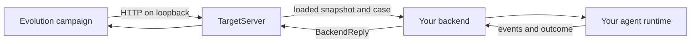

# Connecting your agent

A Target Service lets Evolution run your agent against a particular version of its files. You bring an agent runtime, the editable skills or prompts it reads, evaluation cases and a scorer. Evolution supplies a snapshot of those files and the case inputs; your backend runs the agent and returns what happened. You keep control of its provider and tools.

Run the [Quickstart](../QUICKSTART.md) first to see the complete offline flow. To connect your own agent, implement a small Python backend that loads the supplied snapshot, opens a case, runs each turn and closes its resources. The packaged `TargetServer` handles the HTTP protocol, request IDs, replay, identity checks and snapshot creation. The [complete offline backend](target-server.md#a-complete-offline-backend) gives you a working callback example to adapt.

The crucial step is reading instructions from `LoadedTree.root` in `backend.load(tree)`. Evolution creates a different snapshot for each version it tests. If your agent keeps reading files from your original checkout, every comparison runs the same instructions, even after an edit. [Load the files Evolution gives you](#load-the-files-evolution-gives-you) shows the read.

## The integration you are building



The Target Service and your agent's model endpoint are different things. `target.base_url` points to the local service that wraps your agent. Your backend can call the agent's provider internally. Editor and Reflector providers are configured separately in the manifest; pointing them at a model does not connect the target agent.

## Start from the working backend example

The [complete offline backend](target-server.md#a-complete-offline-backend) implements the whole callback chain without an LLM. Save its Python block as `my_target.py` in your integration project. You can then replace its simple answer generation with your own agent call.

Before pairing that example with a generated manifest, match its `ArtifactPolicyV1` to the manifest's `artifacts` section. The API example uses a smaller policy than the scaffold: the scaffold also excludes `build/**` and identifies `uv.lock` as a dependency. A mismatch is refused; it is not an instruction to remove your agent's real dependencies.

The following launcher reads the policy from a fresh demo manifest. Save it beside `my_target.py` as `serve_my_agent.py`:

```python
import json
from pathlib import Path

from evolution.tree import ArtifactPolicyV1, TargetServer, serve_target
from my_target import SkillLineBackend

root = Path("demo").resolve()
manifest = json.loads((root / "manifest.json").read_text())
artifacts = manifest["artifacts"]
server = TargetServer(
    SkillLineBackend(),
    allowed_artifact_root=root,
    policy=ArtifactPolicyV1(
        tuple(artifacts["excludes"]),
        tuple(artifacts["dependency_paths"]),
        tuple(artifacts["writable_paths"]),
    ),
    seed_mode="exact",
    target_id="my-agent-demo",
    contract_digest="my-agent-demo-contract-1",
    settings_hash="my-agent-demo-settings-1",
    runtime_ref_digest="my-agent-demo-runtime-1",
)
http = None
try:
    http = serve_target(server, port=8765)
    print("Target listening on http://127.0.0.1:8765", flush=True)
    http.serve_forever()
except KeyboardInterrupt:
    pass
finally:
    if http is not None:
        http.server_close()
    server.close()
```

From the directory containing these two files, with the Evolution environment active:

```bash
evo-target init ./demo
python serve_my_agent.py
```

Use a fresh directory for this example. Stop any earlier `evo-target serve` on port 8765 first. Leave your launcher running and use a second terminal to check it:

```bash
evo tree conformance --manifest ./demo/manifest.json
evo tree evolve --manifest ./demo/manifest.json --run-dir ./demo/run-backend
```

This still runs the deterministic skill-line backend, now in a server you own. A passing conformance report and a completed campaign give you a working starting point before you introduce provider calls. Change the launcher identity and seed mode when you replace the demo behavior.

## Implement the backend callbacks

Implement these callbacks:

| Callback | Your responsibility |
|---|---|
| `backend.load(tree)` | Build an instance using files under `tree.root` |
| `instance.open(public, seed)` | Create isolated state for one case and confirm the seed you can actually use |
| `session.turn(message)` | Run one turn and return its events, usage and outcome |
| `session.close()` | Release per-case resources |
| `instance.close()` | Release resources shared by that loaded version |

An instance may also implement `describe()` to report a small set of non-secret facts about how it assembled the agent. This is optional diagnostic information, not a substitute for correct loading.

A turn should also report which parts of the loaded tree the agent had in context, and an instance may name those parts with `components()`. The protocol accepts a turn without this report, but the scaffold's manifest relies on it to measure a Candidate only on the cases its edit can reach. [Report what the agent used](#report-what-the-agent-used) explains what to report and what a missing report costs.

## Load the files Evolution gives you

`tree.root` is a private, read-only snapshot owned by the server. It is the source of truth for the version under evaluation. Read prompts, skills and other declared files from there:

```python
skill_path = tree.root / "skills" / "SKILL.md"
instructions = skill_path.read_text(encoding="utf-8")
```

Pass those instructions to your agent runtime. Do not point it at a fixed checkout or a cached copy of the original skill. Keep mutable session state, generated files and provider caches outside the snapshot.

The server verifies the bytes it gives your backend. It cannot prove that your agent actually used them. A useful integration check is to change a known input file, create a new instance and confirm that its answer changes for the expected reason.

## Create isolated sessions and report seeds honestly

Each `open()` receives the case's `public` object. It does not receive the oracle. Use it to initialize the case and start a fresh history; one sample must not inherit a previous sample's conversation.

| Mode | When it fits | What `effective_seed` reports |
|---|---|---|
| `exact` | Your runtime can use and confirm the requested seed | The requested integer |
| `unpaired` | Your runtime chooses a seed instead | The integer it chose |
| `none` | Your runtime has no confirmable seed | `None` |

Set the same mode in the server and `target.seed_mode` in the manifest. Do not report a seed that the provider ignored. The server rejects a session whose reported seed violates the mode's contract.

Conformance also opens sessions with `public = {"conformance": true}`. Handle this as a neutral probe, not a business request: return a well-formed response without requiring your normal case fields. The input-limit probe can send a long string of `c` characters, so do not interpret every probe message as a real user task.

## Return useful events and the right outcome

A successful turn returns a `BackendReply` containing a `TurnResult`. For example, after your runtime produces `answer`:

```python
from evolution.tree import BackendReply, TurnResult, Usage

reply = BackendReply(TurnResult(
    events=({"type": "assistant_message", "content": answer},),
    usage=Usage(prompt=prompt_tokens, completion=completion_tokens),
    latency_ms=0,
    outcome="ok",
))
```

Here `answer`, `prompt_tokens` and `completion_tokens` come from your runtime. The server measures turn latency. Include useful structured events, such as tool calls or skill reads, when your runtime provides them. The [event reference](target-server.md#replies-and-events) lists which fields the editor can see.

Choose the outcome based on what happened:

| Outcome | Meaning |
|---|---|
| `ok` | The turn completed; the scorer still decides answer quality |
| `candidate_failed` | The target is healthy, but the agent has a deterministic defect such as invalid output format |
| `target_failed` | The interaction could not be judged because of a runtime or infrastructure problem |

An incorrect answer can be `ok` with a low score. A timeout is never evidence of a deterministic Candidate defect, even if it is a timeout inside your own agent. If you cannot distinguish the causes, report `target_failed`. You may attach a short structured `reason`; see the API reference for its grammar. Also set `provenance` on every turn, whatever its outcome; [Report what the agent used](#report-what-the-agent-used) explains it.

Use bounded provider calls and clean up sessions reliably. Backend callbacks are synchronous on HTTP handler threads. Calls on the same instance are serialized, while different instances may run concurrently. An asynchronous agent runtime needs a deliberate synchronous bridge and lifecycle in your integration; the server will not await an async callback for you.

## Report what the agent used

The scaffold's manifest declares `"provenance": {"kind": "reported"}` under `campaign.gate`. This narrows the Attempt's initial gate measurement to cases the edit can reach; a finalist still receives verification across the training corpus. Each turn reports the parts of the loaded tree that were in the agent's context, in `TurnResult.provenance`. The campaign keeps the union of a sample's turns. When an edit changes a part, the gate measures the cases whose baseline samples used that part, plus every case whose provenance is unknown.

### What goes into `used`

List every part of the loaded tree that was in the agent's context during the turn, not only the files the agent opened:

- the system prompt files, and any file the prompt is built from;
- skills, instructions or examples loaded into the prompt before the conversation started;
- files the agent or one of its tools read during the turn.

Write each file as a path relative to the tree root, the same path you read under `tree.root`, for example `skills/deposits.md`. Do not use absolute paths. Report `[]` only for a turn whose context held no file of the tree.

Report the turn's context, not your guess about what the answer depended on. A case whose baseline samples did not report a file counts as unaffected by an edit to that file, so the gate does not measure that case for the edit. If the file was in the agent's prompt anyway, the edit can change that case's answer without the gate seeing it. Reporting too much only costs measurement time.

Set `provenance` on every turn, including turns that end `target_failed` or `candidate_failed`. One turn without it makes its whole sample unknown.

Keep run secrets out of these identifiers. If any entry in the sample's `used` union contains a run secret, Evolution omits the whole union and records `provenance_overflow: true`. The sample's provenance is unknown, so its case counts as affected. It does not keep just the public entries, because that could hide a dependency.

### Example: a shared prompt and one skill file per topic

Suppose your agent builds its system prompt from `prompt/prompts.yaml` and adds the skill file for the conversation's topic: `skills/<topic>.md` in text conversations and `voice_skills/<topic>.md` in voice conversations. A text turn about deposits returns:

```python
used = ["prompt/prompts.yaml", "skills/deposits.md"]
reply = BackendReply(TurnResult(
    events=({"type": "assistant_message", "content": answer},),
    usage=Usage(prompt=prompt_tokens, completion=completion_tokens),
    latency_ms=0,
    outcome="ok",
    provenance={"used": used},
))
```

Build `used` from the files your loader actually put into the context, rather than from a hand-written table per topic, so the report stays correct when the loader changes. If a conversation switches topic, each turn reports the skill files in its own context.

With these reports, the initial gate measures only the text cases about deposits for an edit to `skills/deposits.md`. The voice copy is a separate file, so an edit to `voice_skills/deposits.md` sends only the voice cases about deposits to the gate. An edit to `prompt/prompts.yaml` sends every case to the gate, because every case had that file in context.

### Name parts of a file with `components()`

A path names a whole file. If one file holds a section for each topic, an edit to any section changes the file, and the gate measures every case that used it. To narrow this, implement `components()` on the instance. It names parts of the agent's context, such as `prompt/prompts.yaml#deposits`, with a hash of the text the agent renders for each part and the files each part is built from. A turn then lists those component identifiers in `used` instead of the file path, and the gate measures cases that used a component whose hash changed, plus cases whose provenance is unknown.

Every file the editor may change must then appear in some component's `sources` or in some baseline turn's `used`. An edit to a file that is in neither measures every case, with the fallback `unaccounted_path`. A Target must also render the same component map for the same tree. The format, the limits and that rule are in [The optional `components()` callback](target-server.md#the-optional-components-callback). Start with file paths, and add components when most edits change a file that every case uses.

Keep run secrets out of component IDs and `sources` paths too. Evolution omits an ID that contains a run secret from every published map, including the Candidate inspection, and records the number omitted as `components_withheld` only when positive. If either the baseline or Candidate map has withheld components, every case counts as affected, with fallback reason `components_withheld`. The omitted ID does not by itself make every sample's provenance unknown; a sample that reports it in `used` has a secret in its union and becomes unknown under the rule above. This protection applies to both `/15` and `/16`, including a secret inside an ID or equal to a real component name, without replacement tokens.

When anything is withheld, stderr and the process log show one warning per measurement or inspection with counts of samples and omitted components, never their values. A secret in a component's `sources` path is still refused by the journal guard and ends the run `persistence_failed`; use paths that contain no secrets.

### What happens without a report

A turn without `provenance` is still valid, and the campaign runs. Its sample's provenance is unknown, and an unknown case always counts as affected. A Target that never reports provenance therefore makes every case affected by every edit. Each Attempt then measures the round's focus cases and every other case as a causal case, which costs about as much as measuring the whole corpus. Nothing fails, and the report gives no fallback reason for it: in the Attempt's [`affected` block](running-campaigns.md#read-the-affected-block), `fallback_reason` stays `null` while `layer_one` and `layer_two` together cover the corpus.

If your Target cannot report what the agent used, declare a different source in `campaign.gate.provenance` before the campaign starts:

- `{"kind": "metadata", "path": "/uses"}` reads a list of globs you write into each corpus row's `reflection_metadata`, such as `["prompt/**", "skills/deposits.md"]`. Grouping and the Reflector can read these labels.
- `{"kind": "none"}` treats every case as affected. It costs the same as a Target that reports nothing, but the report then says so with the fallback `none`.

The rules for each kind are in [the manifest reference](manifest-v2.md#affected-case-gate-keys-manifest-13). Validation step 4 below shows how to check that your reports reached the run.

## Wire the server to your manifest

Your application constructs `TargetServer` with your backend and then calls `serve_target`. The [constructor reference](target-server.md#constructor) lists every argument. Pay attention to these settings:

- **Allowed root:** it must contain the seed and the run-owned copies that Evolution asks the target to load. With `my-experiment/seed` and `my-experiment/runs`, use a suitable shared parent such as `my-experiment`.
- **Artifact policy:** match the manifest's excludes, dependency paths and writable paths.
- **Identity:** choose identifiers for the target contract, settings and runtime. Update them when the corresponding behavior changes; do not reuse example identity strings for an unrelated agent. Derive the settings hash from the provider and model your agent calls, so that a provider switch is visible to a running campaign ([Running campaigns](running-campaigns.md#change-the-provider-mid-campaign)).
- **Capacity:** declare limits the backend can support, and keep campaign concurrency within them.
- **Address:** bind the local service, then set `target.base_url` to that address. The packaged server is loopback-only.

Start the target yourself. Evolution does not launch your server process. Ensure shutdown stops the HTTP server and closes the `TargetServer` so instances and temporary snapshots are released.

Credentials for your agent belong in its process environment or its own credential system. Credentials for in-process editor and Reflector backends are separately named by the manifest. Keep secret values out of the manifest, corpus, events and `describe()` output.

## Replace the demo evaluation and improvement roles

The sample scorer rewards the word `IMPROVED`; replace it with a scorer for your task. It reads one JSON request from stdin and writes one JSON object to stdout. Use stderr for diagnostic logs. Return the configured primary metric and meaningful criterion verdicts. Return the primary metric as a number between 0 and 1. The [scorer contract](manifest-v2.md#what-the-scorer-program-reads-and-writes) includes the request and response rules.

The sample editor and Reflector are also scripted demonstrations. For real use, each role supports `subprocess`, `chat` or `agent_cli`. Choose a role backend appropriate to your environment and follow the complete [editor](manifest-v2.md#editor) and [Reflector](manifest-v2.md#reflector) configuration examples. Both roles are part of the campaign; replacing only the editor leaves the demo diagnosis logic in place.

The Grouper groups the failing cases before the Reflector sees them. The sample uses `kind: fields`, which groups offline by equal failed criteria and needs no model. For grouping by meaning, declare `command`, `chat` or `agent_cli` instead; see the [`grouper` reference](manifest-v2.md#grouper).

The static Environment sends `public.text` once. If your agent needs a multi-turn case, configure the [scripted Environment](manifest-v2.md#environment) and its private script. Keep answer checking in the scorer so it remains separate from the agent interaction.

## Check the connection before the baseline (manifest /15)

A `/15` manifest, the one the scaffold writes, adds three declarations that concern your integration ([the `/15` keys](manifest-v2.md#stable-family-keys-manifest-15)).

`scorer.metric_contract` lists what your scorer reads from the Target's events. Your Target must emit each declared event, with a value of the declared kind at the declared pointer, in every completed rollout. The check reads the last event of each declared type. The reference target emits `{"type": "assistant_message", "content": ...}`, so the scaffold declares:

```json
"metric_contract": {
  "version": "metric_contract/1",
  "kind": "pointwise",
  "target_fields": [
    {"event": "assistant_message", "pointer": "/content", "value": "nonempty_string"}
  ]
}
```

Declare the fields your own scorer depends on, or `[]` if it reads none. Before the baseline, and again after each accepted condition change, the campaign runs one real rollout of the Champion on the first train case, scores it and checks it against this contract. A mismatch measures nothing and suspends the campaign, for example with `connection_incompatible` and the field that failed. The same probe refuses an instance `description` that holds the value of a secret the run forwards (`connection_description_secret`); report a hash from `describe()`, not the value. Fix the Target or the scorer and run the same command ([when the connection preflight suspends](running-campaigns.md#when-the-connection-preflight-suspends)). The probe opens an ordinary session with the case's real `public` payload, so answer it like any case.

`role_visibility.readable_paths` decides which files of the tree the Reflector and the Editor can read, in addition to the writable paths. Your Target still loads every file. List the files a diagnosis needs, such as the agent's prompts and configuration; leave out what the roles should not see ([`role_visibility`](manifest-v2.md#rolevisibility)).

The scorer's criterion ids can reach the Editor in family 14: a criterion id the scorer published in a verdict may appear in the groups and the Reflector's diagnosis. As the scorer author, make sure that no published field, criterion ids in particular, contains or encodes the reference answer, the oracle or another private hint. Evolution does not check this ([criterion ids](manifest-v2.md#criterion-ids-are-the-scorers-publication)).

## Validate the integration in stages

1. Test the callbacks locally: load a snapshot, open a case, send a turn and close both session and instance.
2. Start the service and run `evo tree conformance --manifest PATH`. Resolve protocol failures before running a long campaign.
3. Run a small real corpus with conservative concurrency. Under `/15` the connection preflight checks your events against `scorer.metric_contract` first. Check target events, scorer metrics and verdicts, and that changed files really reach the agent.
4. Check that your provenance reached the baseline measurement. The campaign stores each sample's `used` union in the first baseline's journal, `measurements/m-r00-champion/events.jsonl` under the run directory, as the `provenance` key of the sample's `rollout_finished` record (`sample_imported` for a row carried over from a linked run). Once the baseline has finished, count the records with and without it:

   ```bash
   jq -r 'select(.event == "rollout_finished" or .event == "sample_imported")
     | if .payload | has("provenance") then "reported" else "unknown" end' \
     ./my-experiment/run-1/measurements/m-r00-champion/events.jsonl | sort | uniq -c
   ```

   Each record is one finished try of a sample. For the Quickstart demo, with `./demo/run-1` in place of `./my-experiment/run-1`, the command prints `      6 reported`. If every line is `unknown`, your Target reports no provenance and every case counts as affected; fix the Target as described in [Report what the agent used](#report-what-the-agent-used) or declare another provenance kind. To see which parts the samples used, print their lists:

   ```bash
   jq -c 'select(.event == "rollout_finished" or .event == "sample_imported")
     | .payload.provenance' \
     ./my-experiment/run-1/measurements/m-r00-champion/events.jsonl | sort | uniq -c
   ```

   The demo prints `      6 ["skills/SKILL.md"]`. A `null` line is a try with unknown provenance. Compare the lists with the files your agent loads for those cases.
5. Run the actual editor and Reflector. Inspect the proposed diff and selected version before increasing the campaign budget.
6. Exercise an outage and recovery path. Keep turn resends disabled until you can justify that a failed turn is safe to retry.

Conformance tests protocol behavior; it does not certify your scorer, your agent's isolation or the quality of its answers. Record integration limitations with your experiment so colleagues know what the measurements mean.

Next: [Running campaigns](running-campaigns.md), [target server API](target-server.md), and [Contributing](../CONTRIBUTING.md) if the integration needs a change in Evolution itself.
