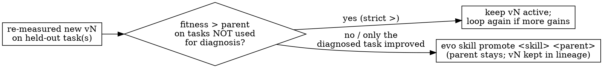

# Evolving Skills with the Evolution Framework

## Overview

Evolution is **trace-driven procedural memory management**. You improve a skill by *measuring* it, not by guessing.

The `SKILL.md` body is the genome. A task's `tests/test_outputs.py` is the fitness function. Evolution solves, inspects failures, revises the body, versions it, re-measures it, and selects it. A change improves a skill only when held-out fitness increases. Lineage is durable. Supersede versions instead of deleting them.

You (the agent) can *be* the diagnosis-and-rewrite intelligence by reading traces and editing the SKILL.md yourself. `evo evolve reflect` / `evo evolve rewrite` are the *automated* alternative that delegates that step to an LLM. Both feed the same versioning and selection machinery.

## Accuracy note

The supported Python surface is `evolution.workflow`, documented in `docs/api-usage.md`. `EvolutionEngine`, `FitnessCalculator`, `SkillRetriever`, and `Crossover` are not public package APIs.

## Mental model

| Evolution concept | Concrete artifact |
|---|---|
| Genome (what mutates) | the markdown **body** of `.agents/skills/<name>/SKILL.md` (not frontmatter) |
| Fitness function | a task: `task.toml` + `instruction.md` + `inputs/` + `tests/test_outputs.py` (pytest) |
| Fitness value | pass rate from traces, preferred by `evo skill history`, with lineage metadata as a fallback |
| Evidence | `.agents/skills/<name>/.traces/<id>/` (prompt, response, solve.py, result.json) — written when a solve uses a skill binding |
| Generations / lineage | `.agents/skills/<name>/.evolution/` (lineage.json + versions/) |
| Mutation | you hand-edit the body, **or** `evo evolve reflect` + `evo evolve rewrite` |
| Selection | `evo skill promote` / `evo skill discard`; promote only on measured improvement |

## Prerequisites (the step agents skip)

1. Install and run from the **repo root** (the `evo` store defaults to `./.agents/skills` and tasks to `./tasks`):
   ```bash
   python -m pip install -e ".[llm]"    # editable install with model backends
   ```
No install needed either — the CLI is runnable as a module:
   ```bash
   PYTHONPATH=src python -m evolution.cli <command>     # identical to `evo <command>`
   ```
(`evo …` throughout this guide means either form.)
2. Choose an LLM backend for `evo run solve`.
   - Use a real model, such as `-m openrouter/anthropic/claude-sonnet-4`, `-m claude`, `-m gigachat`, or `-m openai/...` with `--api-base`.
   - Use `-m mock` for an offline dry run. It records a deliberately failing trace.
   - Use a real model for `evo evolve reflect` and `evo evolve rewrite`. Mock output is not valid reflection JSON or a skill body.
3. **Provide a fitness function.** Add at least one task whose `required` skills include the skill. Use `evo task list` or read `[skills] required` in `tasks/<task>/task.toml`. For a new skill, run `evo skill create <name> -d "..."` or `evo skill import <path>`. Then add a task directory under `tasks/`. It needs `task.toml`, `instruction.md`, `inputs/`, and `tests/test_outputs.py`.
4. **Check the skill lineage before evolving.** A degraded `.evolution/lineage.json` makes history, lineage, commit, and promote commands fail. The error names `evo skill repair`. Detect and fix:
   ```bash
   evo skill history <skill>            # prints a table = well-formed; clear error = degraded
   evo skill repair <skill> --dry-run   # preview the lineage rebuilt from on-disk snapshots
   evo skill repair <skill>             # write it (provenance-light: origin=import)
   ```
`evo skill repair` reconstructs lineage from the `versions/` snapshots and remaps a dangling `current_version` to the newest existing one (it reports the remap). Prefer `evo skill history` over `evo skill lineage` for picking versions — it shows the `STATUS` column; `evo skill lineage` renders poorly in non-TTY output.

## The loop

1. **Measure baseline and current.** Run the task with and without the skill. This shows whether the skill caused the delta:
   ```bash
   evo run solve <task> -m <model> --no-skill      # baseline
   evo run solve <task> -m <model>                 # with the skill (auto-selected from task)
   evo skill history <skill>                          # fitness per version, from traces
   ```
For multiple tasks or trials, loop `evo run solve`, or use `evo run bench run`. Run `evo run bench --help` for options. Older `./runs/*.sh` wrappers are not part of the committed interface.
2. **Inspect failures.** Look at what actually went wrong — never guess:
   ```bash
   evo trace list <skill>                                  # list; add --task / --model / --version
   evo trace show <skill> --last -s response           # the model's reasoning/output
   evo trace show <skill> --last -s code               # the extracted solve.py
   evo trace show <skill> --last -s result             # pass/fail + diagnostics
   ```
Classify each failure: wrong library, wrong API, missing step, logic error.
3. **Diagnose.** Either reason over the traces yourself, **or** automate it:
   ```bash
   evo evolve reflect <skill> -m <model> [-t <task>] [--limit N] [--trace-model sonnet]
   ```
`reflect` saves a structured `reflection.json` per failing trace (root_cause, skill_gap, suggested_fix, severity, pattern). Needs a real model (the mock backend returns non-JSON and will error).
4. **Mutate** — pick ONE:
   - *Agent-driven (works offline):* edit `.agents/skills/<skill>/SKILL.md` and fix the **root cause** in the general guidance.
   - *Automated:* `evo evolve rewrite <skill> -m <model> [--dry-run]` consumes saved reflections and finalizes a candidate body. The edit brake runs before an update. A brake rejection keeps the parent. Only that rejection can start another editor attempt. `--dry-run` prints the body and writes its audit sidecar without updating the skill or lineage.
5. **Review the change:** `evo skill diff <skill>`.
6. **Version it:** `evo skill commit <skill> -m "what changed and why"`. This validates the SKILL.md, snapshots a new `vN`, records lineage, and (without `--no-promote`) makes it active. No commit ⇒ the change is invisible to selection and will be lost by `evo skill discard`.
7. **Re-measure:** repeat step 1 for the new version. Fitness uses fresh traces. It is not declared.
8. **Select** (see flowchart). Read `evo skill history <skill>` — the `STATUS` column shows the `active` version and the `retired` parent to roll back to. Improvement on held-out tasks → keep. Regression → roll back: `evo skill promote <skill> <parent_version>` (or `evo skill discard <skill>` if you have not committed yet).



## Integrity discipline (hard rules — violating these silently destroys results)

- **Never delete skills or versions.** Supersede or roll back; lineage is the experimental record. `evo skill delete-version` exists but is leaf-only/`--force` and is not part of the loop — do not use it to "clean up".
- **Promote only on measured improvement over the parent**, strict `>` (the δ-gate principle; see `reference.md`). Validate on a pool **disjoint** from the traces you diagnosed on. One task improving while others regress is *not* an improvement.
- **Keep the skill general and transferable.** Do not embed expected values, evaluator assertions, task-only constants, names, or input paths. The skill must work on unseen instances.
- **Fix root causes by revising guidance, not by appending transcripts** or pasting the best trace's code.
- **Diagnose on training traces.** Do not let validation or test traces influence content. With `--manifest`, scope is enforced and leakage fails the run.
- **Editors see training evidence only.** Validation can only retain or reject at the promotion gate; test evaluation is post-selection reporting. Neither can guide another edit. See [the reference](reference.md#traces-and-editing-evidence). A brake-rejected Candidate is not a Skill version.

## Offline quickstart (no API key, `-m mock`)

`-m mock` returns canned text, so the quickstart attempt may fail — enough to verify trace mechanics without API cost or network. The acceptance criterion is trace creation, not task success.

```bash
mkdir my-evolution-project
cd my-evolution-project
evo quickstart -m mock
evo trace list hello-skill --task hello-evolution
evo trace show hello-skill --last -s result
evo trace show hello-skill --last -s code
```

If you want to test rollback/versioning mechanics after manually editing `.agents/skills/hello-skill/SKILL.md`, continue with:

```bash
# Diagnose from the trace, then (agent IS the intelligence) fix the ROOT CAUSE
# in the general guidance by editing .agents/skills/hello-skill/SKILL.md
evo skill diff hello-skill
evo skill commit hello-skill -m "clarify the reusable procedure"
evo skill history hello-skill
evo skill promote hello-skill <parent_version>
```

`evo evolve reflect` and `evo evolve rewrite` need a real model. Canned mock text is not valid reflection JSON or a skill body. The other commands use the exact surface described above.

## Quick command reference

| Command | Purpose |
|---|---|
| `evo skill list [--status ...]` / `evo skill show <s> [--version vN]` | browse skills / view a version |
| `evo skill validate <s>` | check SKILL.md is spec-valid (commit also validates) |
| `evo task list` / `evo task eval <t> -w <dir>` | list fitness tasks / run a task's pytest |
| `evo run solve <t> -m <model> [--no-skill] [-s <skill>] [-w <dir>]` | run task, evaluate, record a trace |
| `evo trace list <s> [--task ..] [--model ..] [--version ..]` | list usage traces |
| `evo trace show <s> --last\|<i> [-s prompt\|response\|code\|result]` | inspect a trace |
| `evo evolve reflect <s> -m <model> [-t <task>] [--limit N]` | LLM diagnoses failing traces → reflection.json |
| `evo evolve rewrite <s> -m <model> [--dry-run]` | LLM rewrites body from reflections |
| `evo skill diff <s> [<v1> <v2>]` | uncommitted changes / version diff |
| `evo skill commit <s> -m "msg" [--no-promote]` | snapshot new version (validates first) |
| `evo skill promote <s> <vN>` / `evo skill discard <s>` | switch active version / drop uncommitted edits |
| `evo skill history <s>` / `evo skill lineage <s>` | fitness per version (from traces) / version tree |
| `evo skill repair <s> [--dry-run]` | rebuild a malformed `.evolution/lineage.json` from on-disk snapshots |
| `evo skill create <s> -d "..."` / `evo skill import <path>` | scaffold / import a skill to evolve |
| `evo skill status` | population overview |

Run `evo <group> <command> --help` for the full, authoritative flag list.

## Common mistakes

| Mistake | Reality |
|---|---|
| Used `EvolutionEngine` / `runner.evaluate()` | These are not public APIs. Use the `evo` loop or `evolution.workflow`. Confirm commands with `evo --help`. |
| `evo skill history`/`commit` errored: `lineage.json` malformed | Degraded `.evolution/lineage.json`. The error itself tells you to run `evo skill repair <s>` — preview with `--dry-run`, then run it (Prerequisites §4). |
| Edited SKILL.md but never `evo skill commit` | Change is uncommitted: invisible to `history`/selection, erased by `discard`. |
| Promoted because the diagnosed task passed | Overfitting. Re-measure on held-out tasks; promote only on strict improvement there. |
| Pasted expected values / test names / a passing trace's code into the skill | Leakage. Discard the Candidate; copied train details do not transfer to unseen tasks. |
| Read `evo skill history` expecting a number without re-solving | Fitness is computed from `.traces/` for that version — run `evo run solve` on the new version first. |
| Expected `-m mock` to pass tasks, or to `reflect`/`rewrite` | Mock returns fixed canned text. `evo run solve -m mock` records a failing trace for offline loop checks. `evo evolve reflect` and `evo evolve rewrite` need a real model because canned text is not valid reflection JSON or a skill body. |
| Reflected on stale or seeded `.traces/` | Diagnose on fresh, current-run training traces only (see `reference.md`). |

## Going deeper

- **`reference.md`** — promotion, evidence compatibility, leakage controls, manifests, containers, backends, and the verified Python API.
- **`trace-analysis.md`** (next to this file) — step-by-step methodology for analyzing a skill's `.traces/` and proposing a targeted SKILL.md diff.
- **[Manual workflow](../manual-workflow.md)** — installation and a complete command sequence.
- **[CLI reference](../cli.md)** — command flags and JSON output.
