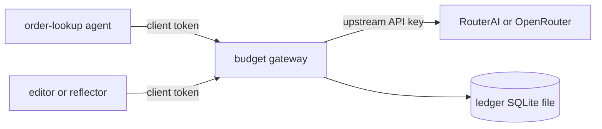

# Budget and cost control

[Русский](ru/budget.md)

**Goal:** limit model requests using your declared prices and token bounds.
**You are done when** every paid model call of your run goes through the
budget gateway, the gateway's `/health` shows your limit, and you know what
to do when it stops.

Choose the [Lab-managed execution policy](#execution-policy-and-budget-gateway)
workflow below or keep the [operator-run gateway steps](#steps). The existing
reference material explains accounting for both paths.

Your agent, and in a campaign also the Editor and Reflector, may call paid
language models. A campaign can make hundreds of such calls, and a bug in a
loop can make thousands. The optional **budget gateway** (`evolution_lab.budget`)
can run with a human-confirmed policy under Lab, or under your own script.
Without a policy, Owner and service start no gateway. Only routed calls are
limited; without a gateway, use the campaign's scale settings and your
provider's caps ([What costs money](campaign.md#what-costs-money-and-how-to-cap-it)).

Some steps carry two marks. **To run** is what the gateway requires to accept
a call at all. **For correct results** is what it additionally assumes so that
its reservations cover the cost. The bound depends on accurate prices,
token limits and provider usage reports; the gateway cannot prevent a provider
from billing outside those assumptions.

## Will a role request fit its context window?

Use a checkout that includes `lab preflight` to inspect a prepared `/16` campaign before a paid run. Use the digest returned by `lab prepare` and the same state directory you passed to `lab serve --state`. The command reads local files and works with the service stopped.

```sh
lab preflight "$STATE/prepared/$PREPARED"
lab preflight "$STATE/prepared/$PREPARED" --operation "$OPERATION" --scenario route.json --json
```

The first command shows the Bundle's limits and the sizes of scripted Editor and Reflector requests at the first turn, after reading a page, and after compaction when reached. The default scenario assumes the modern tool protocol. To inspect saved evidence, add a matching campaign operation, a local campaign trace export (`--trace FILE`), or a saved training evaluation (`--baseline DIR`). The report labels the source of each measurement. Text removed from a disclosed trace stays unknown. For operation and baseline evidence, use a checkpointed Lab state, for example after stopping its service normally. Prepared inputs alone can be read without opening the operation database.

For a saved campaign in `shadow` mode, `repeated_read_shadow_matches` counts repeated reads without progress for each role. The count stays unavailable while the role is running. If an invocation is interrupted, cancelled or stops responding, Core saves no final count for it. The total for that role stays unknown even after a successful retry. The separate repair count shows how often Core asked the role to correct a repeated read.

For a route comparison, save a `route.json` like the following. Use the identifiers of the responding model and provider and their documented token window. To inspect both roles, add an `editor` entry for its route.

```json
{"schema":"lab-context-scenario/1","roles":{"reflector":{
  "model":"example-model","upstream":"example-provider","styles":["modern"],
  "window_tokens":131072,"reserve_tokens":14384,"source":"operator route specification"
}}}
```

With 116,678 input tokens reported by this provider and a configured reserve of 16,384, the request is 1,990 tokens over its window. The same observed input with the example reserve leaves 10 tokens. Before a run, request sizes are available in bytes and characters. To estimate a token range, supply a calibrated `bytes_per_token` interval for that route and serialization. If usage, calibration or window is missing, the corresponding token result is unknown. A negative balance is a diagnostic and does not prevent starting the campaign.

## Execution policy and budget gateway

A human-confirmed execution policy lets Lab run a gateway with a Target Service and
choose upstream routes outside the Bundle. It is optional. Without a policy,
Lab starts no gateway and the existing target, Core role and operator-run
`evolution_lab.budget` paths remain available. Limits cover only calls routed
through the gateway; prices, model bounds and provider billing remain the
operator's responsibility.

### Write the policy

Save the complete example below as `policy.json` **outside the Bundle**.
It declares a keyless local target and a router-backed Editor pinned with
`only`; this example assumes a subprocess Reflector and a non-chat Grouper.
These names, prices and bounds are illustrative, not a current tariff
or instructions to make a paid call. Review them for your integration before
confirmation. Parsing or calculating a digest makes no upstream call.

```json
{
  "schema": "lab-execution-policy/1",
  "gateway": {
    "host": "127.0.0.1",
    "port": 8790,
    "ledger_path": "/private/lab-run/budget.sqlite3",
    "limit_units": 50000000000,
    "ledger_identity": "neutral-campaign",
    "currency": "RUB"
  },
  "routes": {
    "target": {
      "client_model": "target-client",
      "endpoint": "http://127.0.0.1:18880/v1",
      "api_key_secret": null,
      "model": "local-model",
      "price": {
        "input_per_million": 0,
        "output_per_million": 0,
        "context_tokens": 4096
      },
      "max_tokens": 512,
      "timeout_seconds": 30
    },
    "editor": {
      "client_model": "editor-client",
      "endpoint": "https://routerai.ru/api/v1",
      "api_key_secret": "UPSTREAM_ROUTER_KEY",
      "model": "vendor/example-model",
      "price": {
        "input_per_million": 1,
        "output_per_million": 2,
        "context_tokens": 4096
      },
      "max_tokens": 512,
      "timeout_seconds": 60,
      "provider": {
        "only": [
          "provider-a"
        ]
      }
    }
  },
  "target_token_name": "TARGET_GATEWAY_TOKEN"
}
```

The form is closed: required top-level keys are `schema`, `gateway`, `routes`;
optional keys are `target_token_name`, `scorer_token_names`, `role_groups`.
Every `gateway` key and every route key shown above is required, except
`provider`. `gateway.host` must be loopback, `ledger_path` absolute, currency
`RUB` or `USD`; `limit_units` uses 1,000,000,000 units per currency unit.
Each route requires `price` with exactly `input_per_million`,
`output_per_million`, `context_tokens`. Prices are nonnegative; token bounds
and timeout are positive. Endpoints accept HTTP(S), without embedded
credentials, query or fragment. Secret values never belong in the policy.
`api_key_secret: null` sends no upstream authorization header.

`provider` is optional and is exactly `{"only": ["provider-a"]}` or
`{"order": ["provider-a", "provider-b"], "allow_fallbacks": false}` (the
boolean may be `true` when the human chooses router fallback). Names must be
unique. Pins are supported only for recognized RouterAI/OpenRouter endpoints,
not an arbitrary OpenAI-compatible server; local fake protocol URLs use
`/routerai/api/v1` or `/openrouter/api/v1`. A pinned upstream model cannot use
an `@provider` suffix. Price multiple providers at their most expensive rate.
Optional `balance_floor` is positive and needs a key and a recognized protocol
whose currency matches the gateway (RouterAI RUB, OpenRouter USD). The keyless
local route above has neither a pin nor a balance floor.

`reasoning_effort` stays in the campaign manifest: it affects model behavior
and Core identity. It is refused in the policy. The gateway passes the
client's `reasoning` field to the upstream; the library's existing
`Route.reasoning_effort` option remains available to operator-run callers.

### Bind clients and keep secrets separate

The Bundle retains stable client model aliases and gateway URLs. For the
example, the target's launch `env` configures its adapter to call
`http://127.0.0.1:8790/target/v1` with model `target-client`; launch
`secret_names` declares `TARGET_GATEWAY_TOKEN`. The adapter's URL/model setting
names are integration-defined. A chat Editor declares
`base_url: "http://127.0.0.1:8790/editor/v1"`, `model: "editor-client"` and
`api_key_env: "EDITOR_GATEWAY_TOKEN"` in the manifest. That name must be in the
Bundle's declared secrets. Set its output bound no higher than the route's
`max_tokens`. Bind every chat Editor, Reflector and chat Grouper in a policy
campaign to a matching route or group; an unmatched role is refused before
calls with `policy_route_mismatch`.

Lab generates a fresh token per route on every gateway start. It fills
`target_token_name` for the target; Core chat roles use their declared
`api_key_env`, selected by gateway URL and `client_model`. Optional
`scorer_token_names` maps scorer environment names to route names, for example
`{"SCORER_GATEWAY_TOKEN": "editor"}`; those names must be in the scorer's
`allowed_env` and Bundle secret declaration. Optional `role_groups`, for
example `{"roles": ["editor", "reflector"]}`, exposes
`http://127.0.0.1:8790/roles/v1`; member `client_model` values must be distinct.
A group completion uses the token of its selected member.

One environment name may be shared only by consumers of the same route.
Names used for upstream keys must not collide with Lab-filled token names.
Do not supply any Lab-filled token in target/start/resume secrets: Lab refuses
it. Supply upstream key values only at target start using the policy's secret
names; only the gateway receives them. Keep unrelated target/role/scorer
secrets in their existing declared scopes. Lab records names and confirmation
metadata, never key or token values.

For roles routed under a policy, `provider_only`, `provider_order` and even an
explicit `allow_fallbacks: false` in the manifest are refused before calls as
`manifest_provider_pin`. Put those pins in the policy before sealing the
Bundle. Without a policy, manifest provider settings keep their existing Core
pass-through behavior. An old Bundle containing pins cannot be edited for
this continuation; this workflow does not migrate old campaigns.

### Review, confirm and start

Review the actual policy file, including endpoints, prices, limit, key names
and fallback choice. Compute its canonical SHA-256 offline:

```bash
lab exec-policy digest policy.json
```

The command prints a bare digest and needs no service or socket. Save that
reviewed digest as `POLICY_DIGEST`. With the pair's local service running,
confirm exactly the reviewed bytes and start the target explicitly:

```bash
lab exec-policy confirm policy.json --expect "$POLICY_DIGEST" --author operator --channel terminal --note "Reviewed routes and bounds"
lab exec-policy show "$POLICY_DIGEST"
lab agent start CONNECTION --execution-policy "$POLICY_DIGEST" --secrets-file /private/target-secrets.json --wait
```

`CONNECTION` is the connection of the sealed Bundle. The private secrets file
contains the upstream key named `UPSTREAM_ROUTER_KEY` and any ordinary target
secrets, with no generated client tokens. Replace all IDs and paths with your
own. Confirmation stores the policy plus its original author, channel, note
and time in the **pair state**, not the Lab home. `--expect` must match the
file's canonical digest (`digest_mismatch` writes no policy); an unconfirmed
digest cannot start a target (`policy_unconfirmed`). `lab exec-policy list` and
`show` read saved confirmations. Confirmation is a human approval record,
not a check that the upstream serves the claimed model.

Lab uses the Owner's interpreter with the `gateway` extra to start the gateway
in the target's helper scope, waits for health, then starts the target. Target
stop/cleanup also stops the gateway and waits for its cleanup receipt. There
is no automatic gateway restart. A gateway failure stops the target; a running
campaign follows its infrastructure suspension path. The target's Reflector
probe inherits the target secrets, including its generated token, without
changing the probe's own lifecycle or `on_unavailable` rules.

Start the prepared campaign/evaluation using the resulting ready target and
its generation in the ordinary `lab start` command. Generated role/scorer
tokens are supplied by Lab; pass only ordinary execution secrets. Interactive
probe sessions use the target's policy as well.

The equivalent Python API, inside an already open Owner and with an existing
connection, is:

```python
from evolution_lab.execution_policy import parse_policy, policy_digest

# document is loaded from the reviewed policy.json; neither call contacts upstream.
parse_policy(document)
assert policy_digest(document) == reviewed_digest
record = await owner.confirm_execution_policy(
    document, expected_digest=reviewed_digest,
    author="operator", channel="python", note="Reviewed routes and bounds",
)
task = await owner.start_target(
    connection, secrets=upstream_and_target_secrets, execution_policy=record.digest,
)
```

Use the existing task wait/status API before using the target; `start_target`
returns a task, not a ready-target promise. `owner.execution_policy(digest)`
and `owner.execution_policies()` read immutable confirmations.

### Change a suspended campaign's provider

1. Check the operation is suspended, its worker has settled and cleanup is
   confirmed. Stop its target explicitly and wait for target/gateway cleanup:
   `lab agent stop OLD_TARGET --generation OLD_GENERATION --wait`.
2. Write policy B outside the Bundle, changing only routes, key names or
   token/group bindings compatible with the existing clients. Keep the whole
   `gateway` block identical, including host, port, ledger path, identity,
   limit and currency. Review B, run `lab exec-policy digest policy-b.json`, then
   `lab exec-policy confirm policy-b.json --expect "$POLICY_B_DIGEST" --author operator --channel terminal`.
3. Start a new target of the **same Bundle**:
   `lab agent start CONNECTION --execution-policy "$POLICY_B_DIGEST" --secrets-file /private/target-b-secrets.json --wait`.
4. Resume explicitly with the new ready target:
   `lab resume OPERATION --target NEW_TARGET --generation NEW_GENERATION --secrets-file /private/execution-secrets.json`.

The Bundle digest, prepared execution, Core identity and measurement stay the
same. Core does **not** see the route change. Lab does not check that two
endpoints/providers serve the same model or quantization; the human must
establish that equivalence before preserving the experiment. This is the
accepted cost of keeping operational routes outside Core identity.

A changed `gateway` block is refused as `policy_gateway_changed`. Adding or
removing policy presence on continuation is `policy_continuation_mismatch`:
a no-policy campaign cannot be moved under a policy or back. No running
operation is rerouted in place. Existing Core resume requirements, Bundle
checks and infrastructure/quality separation still apply.

### Inspect routing and unavailable evidence

`await owner.operation_routing(ResourceRef("operation", operation_id))`,
`GET /v1/operations/OPERATION/routing` and
`lab routing OPERATION --json` expose `lab-operation-routing/1`.
Owner JSON report `/13` conditionally includes `routing` for policy operations;
the read-only panel shows it too. No-policy reports omit the field. Direct
no-policy reads return `available: false`, `reason: "no_policy"`. `report.md`
has no routing, policies, starts or usage audit.

The read preserves all starts and confirmation metadata (`start`,
`policy_digest`, `author`, `channel`, `confirmed_at`, `lab_version`). Available
role rows contain `endpoint`, `upstream_model`, `client_model`, `requested`,
`reported_provider`, `calls`, `mismatched`. `upstream_model` is the configured
model sent upstream, not an independent observation of the served weights.
`reported_provider` is what the response reported; an absent provider is
unknown, not evidence that the pin matched. Known reported providers outside
the requested set increase `mismatched` and remain visible.

Requests attributed to exactly one operation start contribute to its role
rows. Overlapping uses that include this operation count as `shared`, without
assigning a role call to it; valid empty-use requests count as ledger-global
`outside`. This is a request-count audit, without money or per-attempt detail.
A legacy, missing, corrupt or unattributable ledger makes the read unavailable
(`ledger_unsupported`, `ledger_unreadable` or `ledger_invalid`), with history
retained and `roles`, `shared`, `outside` null. Unknown evidence is never
silently treated as zero. The reader never creates or migrates a ledger;
only opening the gateway performs its normal ledger migrations.

### Operator-run gateway and accounting

Existing `Route`, `Gateway`, `BudgetLedger` and `create_app` callers keep their
behavior and operator-owned lifecycle. A policy does not replace the ledger's
rules: reserve at the declared tariff for bounded input/output; settle from
eligible provider cost with valid token usage and matching protocol currency,
otherwise from tariff; missing usable usage holds the reservation. Reported
tokens beyond a bound are counted in full; settlement above
`max(reserved, tariff_actual)` stops further dispatch as an overrun.

HTTP 400–499 (including 429) releases the reservation to zero under the
unbilled-refusal assumption, with failure and release audit. 5xx, transport
failure, timeout and invalid successful replies hold reservations. The Python
operator flow `ledger.release_refused_reservations(authorization=...)` releases
only older held recorded 4xx, idempotently, without lifting a stop;
`ledger.authorize_resume(authorization=...)` separately authorizes resuming a
stopped ledger. Neither restarts a target or campaign; there are no new Lab
commands for these actions. Read the
[accounting details](pitfalls.md#gateway-accounting) and
[model-role setup](campaign.md#budget-gateway-for-model-roles).

## Before you start

- You know which parts of your run call a paid model: your agent, and in a
  campaign possibly the Editor, Reflector and a model-judge scorer
  ([Run a campaign](campaign.md)).
- For each of them: the provider URL, the model name, its price per million
  input and output tokens, and its context window.
- The upstream API key is in your own secret store, not in the agent's
  settings.
- To serve the gateway over HTTP, the Lab wheel is installed with the
  `gateway` extra (`...whl[gateway]`, which adds FastAPI and uvicorn; see
  [Install](install.md#extras-what-to-add-and-why)). The ledger and pricing
  classes work without it.

## Steps

1. [Decide the limit, the prices and the bounds](#step-1-decide-the-limit-the-prices-and-the-bounds)
2. [Create the ledger and the routes](#step-2-create-the-ledger-and-the-routes)
3. [Start the gateway](#step-3-start-the-gateway)
4. [Point your agent and the roles at the gateway](#step-4-point-your-agent-and-the-roles-at-the-gateway)
5. [Run, and watch the ledger](#step-5-run-and-watch-the-ledger)
6. [When the gateway stops, find the cause and resume](#step-6-when-the-gateway-stops-find-the-cause-and-resume)

### Step 1. Decide the limit, the prices and the bounds

**Do:** fill in this worksheet for every model your run uses (one *route*
per role, for example `target` and `editor`):

- [ ] Price per million input tokens and per million output tokens, in RUB or
  USD.
- [ ] `context_tokens`: the real maximum input size for the model and your
  requests.
- [ ] `max_tokens`: the real maximum output your callers ask for.
- [ ] Reservation per call = `min(context_tokens, request JSON bytes)` × input
  price + the request's `max_tokens` × output price (per million).
- [ ] The limit: plan for settled costs **plus** the reservations of every
  call that can run at the same time.

*For correct results:* take the bounds from the model and your callers, not
from what fits the budget. Shrinking them to fit more calls makes the "upper
bound" a guess ([Declared bounds must be real](#declared-bounds-must-be-real)).
If you pin several providers, price the route at the **most expensive** one.

The [worked example](#reserve-first-settle-later) reserves 3 RUB per call
for a 2,000-byte request at 300/1200 RUB per million and 2,000 output tokens.
A 50 RUB limit initially allows sixteen such calls in flight at once.

**Done when:** you have, per route, a price, `context_tokens` and
`max_tokens`, and one limit that covers your concurrency.

### Step 2. Create the ledger and the routes

These steps describe the operator-run library path. Under a Lab execution
policy, Lab creates client tokens and owns the gateway lifecycle instead.

**Do:** write a small Python script that builds the ledger (the SQLite file
that books the money) and one `Route` per role. Generate a client token for
each route (for example with `python -c "import secrets;
print(secrets.token_urlsafe(32))"`) and keep it in your secret store next to
the upstream key.

```python
import os
from pathlib import Path

import uvicorn

from evolution_lab.budget import BudgetLedger, Gateway, Price, Route, create_app

RUB = 1_000_000_000  # accounting units per rouble

ledger = BudgetLedger(
    Path("/home/you/lab-run/budget/order-lookup.sqlite3"),
    limit_units=50 * RUB,
    identity="order-lookup-eval-2026-09",
)
routes = {
    "target": Route(
        base_url="https://routerai.ru/api/v1",
        api_key=os.environ["ROUTERAI_API_KEY"],             # upstream key: only the gateway has it
        model="vendor/some-model",
        price=Price(input_per_million=300, output_per_million=1200, context_tokens=32_000),
        max_tokens=2_000,
        client_token=os.environ["TARGET_GATEWAY_TOKEN"],    # what your agent sends
    ),
}
gateway = Gateway(ledger, routes, currency="RUB")
uvicorn.run(create_app(gateway), host="127.0.0.1", port=8790, access_log=False)
```

- [ ] One ledger file per experiment. Reopening it with a different
  `identity` or `limit_units` raises `ValueError`, so the limit cannot change
  silently.
- [ ] Optional: pin providers with `provider=` or `providers=` (RouterAI and
  OpenRouter only), and group routes with `role_groups`
  ([Routes, providers and roles](#routes-providers-and-roles)).
- [ ] The client token differs from the upstream key; if it does not,
  `Route` raises `ValueError`. Without `client_token=`, each `Route` object
  gets a fresh random token, which only helps if you run everything in one
  process.

**Done when:** the script builds the ledger and routes without an error.
Before spending anything you can also try the whole path with a fake
provider ([A small offline example](#a-small-offline-example)).

### Step 3. Start the gateway

**Do:** run the script from step 2 with the upstream key and the client
token in its environment. It serves on the loopback interface with access
logs off. Keep it running for the whole run.

*For correct results:* in a campaign, the `base_url` of a model-backed Editor
or Reflector is part of the run's identity, so keep the gateway's host and
port fixed for the whole campaign.

**Done when:** `curl -s http://127.0.0.1:8790/health` answers with your limit
and `"budget_exhausted": false`, for example:

```json
{"limit_units":50000000000,"reserved_upper_units":0,"available_units":50000000000,
 "requests":0,"unknown_requests":0,"overrun_requests":0,"bound_observations":0,
 "settled_upstream_units":0,"settled_tariff_units":0,"usage_cost_missing":0,
 "released_refusals":0,
 "refusals":0,"failed_requests":0,"failed_by_status":{"transport":0},
 "budget_exhausted":false,"currency":"RUB","balance_floor":null}
```

### Step 4. Point your agent and the roles at the gateway

Each role calls `http://127.0.0.1:8790/<role>/v1/chat/completions` with
`Authorization: Bearer <client token>`. The upstream key never leaves the
gateway ([why](#keep-the-real-api-key-away-from-your-agent)).

**Do:**

- [ ] **Your agent.** In the launch file, set the model base URL your agent
  reads to `http://127.0.0.1:8790/target/v1` (in `env`) and add the name of
  the variable holding the client token to `secret_names`. Pass the token's
  value in `start_target(..., secrets=...)`. Its `model` must be the route's
  model.
- [ ] **A `chat` Editor or Reflector.** Set its `base_url` to
  `http://127.0.0.1:8790/<role>/v1`, its `model` to the route's model, and
  its `api_key_env` to the name of a secret holding that route's client token;
  pass the value in `start(..., secrets=...)`.
- [ ] **A model-judge scorer.** Point it at its own route the same way,
  through the names in its `allowed_env`.
- [ ] *To run:* every request sets `max_tokens` (or `max_completion_tokens`)
  between 1 and the route's `max_tokens`, sends plain text only, and uses only
  the usual chat fields; anything else is refused
  ([What the gateway accepts](#what-the-gateway-accepts)). For Core's
  `chat` Editor this means: its `max_output_tokens` (default 8192) must not
  exceed the route's `max_tokens`, and provider pinning or
  `reasoning_effort` go on the `Route`, not on the Editor — the Editor would
  send them as extra request fields.
- [ ] *For long requests:* keep three limits in order. The route's
  `timeout_seconds` (default 300) must be at least the longest request you
  expect; the role's `retry.total_budget_seconds` (which also cuts one role
  request) at least that route timeout; `reflection_timeout_seconds` and
  `editor_timeout_seconds` above the retry budget. Each retried request gets
  its own reservation; an upstream 4xx, including 429, releases it.
- [ ] Your agent's adapter returns `target_failed` when it gets a `429`, as
  for any provider error ([why](#using-the-ledger-with-your-runs)).

**Done when:** a first real call from each role is accepted, and `/health`
shows `requests` growing while `refusals` stays `0`.

### Step 5. Run, and watch the ledger

**Do:** start your evaluation or campaign as usual. While it runs, read
`GET /health` (or `ledger.summary()`):

- `reserved_upper_units` / `available_units`: what is used or held, and what
  is left, in units of 10⁻⁹ of the currency;
- `unknown_requests`: calls whose real cost is not known, which keep their
  full reservation;
- `settled_upstream_units` / `settled_tariff_units`: amounts settled from
  provider cost and from the declared tariff, respectively;
- `usage_cost_missing`: known-protocol replies with usable tokens whose cost
  could not be used, including a currency mismatch;
- `released_refusals`: upstream 4xx reservations released automatically or by
  the operator;
- `failed_requests`, `failed_by_status`: calls with a recorded failure cause,
  by received HTTP status (`transport`: no HTTP response). These include
  released 4xx calls. A `402` usually means the provider account is out of
  money; `404` often means the provider refused the route;
- `bound_observations`: calls that exceeded declared token bounds or settled
  above their reservation within the reported-token tariff — review them;
- `refusals`, `overrun_requests`: any value above `0` means the gateway has
  stopped (next step).

**Done when:** the run finishes. The Owner's report does not include cost
(`cost: null`); to put the ledger's numbers into a campaign report, build it
yourself as described in [Using the ledger with your
runs](#using-the-ledger-with-your-runs).

### Step 6. When the gateway stops, find the cause and resume

After a refusal or an overrun, every call gets HTTP `429` with code
`budget_exhausted`, even small ones
([When the gateway stops](#when-the-gateway-stops)). Nothing is retried for
you.

**Do:**

- [ ] Read `/health`. `refusals` > 0: a call did not fit into the remaining
  budget — the limit is too small for your concurrency. `overrun_requests` >
  0: a call settled above both its reservation and the tariff for its
  reported tokens — check your declared prices.
- [ ] Fix the cause: lower the concurrency, or start a new experiment with a
  new ledger file and a larger limit.
- [ ] Lift the stop with a written reason, from a Python session that opens
  the same ledger file with the same `identity` and `limit_units`:

```python
ledger.authorize_resume(authorization="Checked: concurrency lowered to 2")
```

- [ ] Start a new run explicitly. Resuming the ledger never restarts a
  stopped evaluation or campaign.

**Done when:** `/health` shows `"budget_exhausted": false`. If the cause
still holds, the next call stops the gateway again.

**Next:** [Read the results](results.md) explains the campaign report,
including its `cost` field, and how to get the final version out as a diff
or ZIP.

---

## Reference material

### The idea in one picture

The gateway is a small HTTP proxy that speaks the usual chat-completions
API. Your agent sends its model calls to the gateway instead of to the
provider. The gateway checks the budget, forwards the call with the real API
key, and books the cost in a local ledger.



It can forward to any HTTP(S) chat-completions endpoint. Two routers get
extra support (provider pinning and the balance floor, below): **RouterAI**
(`https://routerai.ru/api/v1`, RUB) and **OpenRouter**
(`https://openrouter.ai/api/v1`, USD). The ledger counts in RUB or USD.

You own the gateway: you build it in your own Python code and run it
yourself. The HTTP part (`create_app`) needs the `gateway` extra, which adds
FastAPI and uvicorn: install the Lab wheel as `...whl[gateway]` (see
[Install](install.md#extras-what-to-add-and-why)). The ledger and pricing
classes work without it.

### Reserve first, settle later

The main question is: *how can you promise a limit before you know what a
call will cost?* The gateway answers with **reservations**.

1. **Before** forwarding a call, it reserves
   `price.units(min(context_tokens, len(encoded)), max_tokens)`. `encoded` is
   the gateway's UTF-8 JSON serialization after provider/reasoning injection
   and output-bound normalization, also used for `request_hash`.
2. If already-used money plus this reservation would exceed the limit, the
   call is refused and nothing is sent to the provider.
3. **After** a usable reply, it settles to the provider's cost when eligible,
   otherwise to the tariff for the reported tokens.

The input estimate assumes no more than one token per text byte, with chat
formatting covered by the JSON syntax. The gateway accepts only text message
content. Reservations depend on those assumptions and your declared prices;
already-running calls can settle above their reservations and exceed the
limit. Further calls are checked against the updated settled total.

Money is counted in integer *units*: one unit is 10⁻⁹ of the currency, so
`1_000_000_000` units is 1 RUB (or 1 USD).

**Settlement conditions.** Both `usage.prompt_tokens` and
`usage.completion_tokens` must be nonnegative integers, excluding booleans.
With valid tokens, a finite nonnegative numeric `usage.cost` (also excluding
booleans) is accepted only when the route's recognized protocol currency
matches `Gateway.currency`: OpenRouter → USD, RouterAI → RUB. The recognized
URLs are `https://openrouter.ai/api/v1` and `https://routerai.ru/api/v1`, plus
loopback URLs ending in `/openrouter/api/v1` or `/routerai/api/v1`.
The amount is `ceil(Decimal(str(cost)) * 10**9)` and already includes any
provider cache discount. Other protocols, missing/invalid cost or currency
mismatch use the declared tariff for reported tokens. Known-protocol tariff
fallbacks increment `usage_cost_missing`. Cost without valid tokens leaves
the reservation held and records `usage_missing`.

`requests.settled_source` records `upstream_cost`, `tariff` or `refused`.
Opening an old ledger adds this column without rewriting old rows; settled
rows with NULL source count toward `settled_tariff_units`. Unsettled rows
keep NULL source. `reserved_upper_units` remains settled amounts plus held
reservations; `available_units` is the limit minus that total.

**A worked example.** At 300 RUB per million input tokens and 1200 RUB per
million output tokens, with `context_tokens=32_000`, a 2,000-byte JSON request
asking for 2,000 output tokens reserves:

- 2,000 × 300/10⁶ + 2,000 × 1200/10⁶ = **3 RUB**;
- a reply reporting 1,200 input and 300 output tokens has a tariff of
  **0.72 RUB**; eligible `usage.cost=0.3` instead settles **0.30 RUB**.

A 50 RUB limit initially fits sixteen such in-flight reservations. Plan for
settled amounts plus all simultaneous reservations.

**Upstream refusals release the reservation.** HTTP 400–499, including
429, settles to zero with source `refused`, even when the body is invalid.
The original failure remains recorded. `released_reservations` audits each
release with request ID, upstream status, original reserved units, timestamp
and authorization (NULL for automatic releases). This assumes upstream 4xx
calls are unbilled; a provider charge for one will not appear in the ledger.
Gateway refusals before upstream dispatch create no reservation.

5xx, connection failures, timeouts, invalid successful bodies and responses
without valid token usage keep the full reservation. They count as
`unknown_requests`. Recorded failure causes follow this priority:

1. no HTTP response: `upstream_unavailable` (no status);
2. HTTP 400 or above: the short `error.code` or `error.type` token, or
   `http_error`, with the received status;
3. a successful body that is not JSON or not an object: `upstream_invalid`;
4. a successful object without usable token counts: `usage_missing`.

Only a token is stored, never the message text. `failed_requests` counts
recorded failures, including released 4xx; it is no longer a subset of
`unknown_requests`. Cancelled calls and rows from before failure recording
was introduced may have no cause recorded.

**Old held refusals.** In Python, open the same ledger with the same
`identity` and `limit_units`, then explicitly authorize release:

```python
released = ledger.release_refused_reservations(
    authorization="Reviewed historical upstream 4xx refusals"
)
```

This releases only unsettled requests with a recorded upstream status
400–499. It preserves already settled rows and other held reservations,
returns the count released, and audits both each release and the
authorization/count, including a zero-result invocation. Repeating it
releases zero. Blank authorization is refused. This is a Python API only;
there is no release CLI. It does not lift an accounting stop: use
`authorize_resume` separately after addressing the cause.

### Declared bounds must be real

The reservation is only as honest as the numbers behind it:

- `Price.context_tokens` must be the real maximum input size for the model
  and your requests.
- `Route.max_tokens` must be the real maximum output your callers may ask
  for. Each request must set `max_tokens` (or `max_completion_tokens`) to a
  value from 1 up to that bound; otherwise it is refused with
  `invalid_request_bounds`.

Do not shrink these numbers just so that more calls fit into the budget at
once. That makes the "upper bound" a guess.

If reported tokens exceed declared bounds, the gateway records
`bound_observations`. Let `tariff_actual` be the route tariff for all reported
tokens. A settlement above its reservation but at most `tariff_actual` is
also an observation, with no stop: extra tokens explain the extra money.
Only settlement **above `max(reserved, tariff_actual)`** records an
`overrun_requests` entry and stops the gateway. Tariff settlement equals
`tariff_actual`, so it never causes an overrun by itself. The gateway still
books the full settlement, including an overrun; it cannot undo the charge.

### When the gateway stops

The gateway enters a stopped state after either:

- a **refusal** — some call did not fit into the remaining budget, or
- an **overrun** — a call settled above both its reservation and the tariff
  for its reported tokens.

From then on every call gets HTTP `429` with code `budget_exhausted`, even
small calls that would still fit. In Python, `BudgetLedger.reserve` raises
`BudgetExhausted`. The stop is deliberate: something unexpected happened, and
a person should look before more money is spent.

To lift it, an operator calls `ledger.authorize_resume(authorization="…")`
with a short written reason. The ledger archives the refusals and overruns,
records your reason, and accepts calls again. If the cause still holds (the
budget is still too small), the next call stops it again. Resuming the
*ledger* never restarts a stopped run: a new run is a new, explicitly started
operation.

### Keep the real API key away from your agent

Each route has two different credentials:

| Credential | Who holds it | Used for |
|---|---|---|
| `Route.api_key` | only the gateway | calling the provider |
| `Route.client_token` | your agent, Editor or scorer | calling the gateway |

The gateway accepts only `Authorization: Bearer <client_token>` and answers
`401 invalid_gateway_credentials` to anything else, including the upstream
key. By default `client_token` is a fresh random token for each `Route`
object; keep that object alive (or pass your own token) for as long as the
route is used. The token must differ from every upstream key.

This is credential separation, not a sandbox. A malicious process on the
same machine is not stopped by it.

### Routes, providers and roles

A `Route` describes one role's model: endpoint, key, model name, prices and
bounds. The gateway maps a role name in the URL to a route:
`POST /<role>/v1/chat/completions`. For the order-lookup agent you might
use the role `target`, so the agent's base URL becomes
`http://127.0.0.1:<port>/target/v1`.

A router can send one model to several upstream providers. You can pin this:

- `provider="name"` — only this provider;
- `providers=("a", "b")` — only these, tried in this order.

Use one or the other, never both. The gateway sends them to the router as
`only`/`order` with `allow_fallbacks: false`, and records the requested set
and the provider the reply names. Pinning works only with the RouterAI and
OpenRouter URLs, and the model name must not contain `@`. The reservation
uses the route's single `Price`, so price a provider set at its **most
expensive** member.

`Gateway(..., role_groups={"editor": ("editor-a", "editor-b")})` lets one
role name choose between several routes by the request's `model` field.
Completion requests still require the selected route's client token.

`GET /<role>/v1/models` uses `Authorization: Bearer <client_token>` and lists
the configured model locally, without an upstream call or reservation:

```json
{"object": "list", "data": [{"id": "vendor/some-model", "object": "model", "owned_by": "lab-gateway"}]}
```

For a role group, a client token from any member authenticates the catalogue,
and all member models are listed in declared member order. Unknown roles get
`404 invalid_role_or_model`; missing or wrong tokens get
`401 invalid_gateway_credentials`.

### A small offline example

This builds the ledger and route, estimates one request, then books one
tariff-settled call by hand. It makes no network calls. The model name and
provider names are placeholders.

```python
import hashlib
import json
from pathlib import Path

from evolution_lab.budget import BudgetLedger, Gateway, Price, Route

RUB = 1_000_000_000  # accounting units per rouble

ledger = BudgetLedger(
    Path("/home/you/lab-run/budget/order-lookup.sqlite3"),
    limit_units=50 * RUB,
    identity="order-lookup-eval-2026-09",
)
route = Route(
    base_url="https://routerai.ru/api/v1",
    api_key="UPSTREAM-KEY-FROM-YOUR-SECRET-STORE",
    model="vendor/some-model",
    price=Price(input_per_million=300, output_per_million=1200, context_tokens=32_000),
    max_tokens=2_000,
    providers=("provider-a", "provider-b"),
)
gateway = Gateway(ledger, {"target": route}, currency="RUB")

# Match the gateway's request serialization, including injected provider data.
request = {
    "model": route.model,
    "messages": [{"role": "user", "content": "Hello"}],
    "max_tokens": 2_000,
    "provider": {"only": list(route.providers), "order": list(route.providers), "allow_fallbacks": False},
}
encoded = json.dumps(request, sort_keys=True, ensure_ascii=False, allow_nan=False).encode()
reserved = route.price.units(min(route.price.context_tokens, len(encoded)), request["max_tokens"])
print(reserved / RUB)

request_id = ledger.reserve(
    reserved, role="target", model=route.model,
    request_hash=hashlib.sha256(encoded).hexdigest(),
)
actual = route.price.tariff_units({"prompt_tokens": 1200, "completion_tokens": 300})
ledger.settle(request_id, actual, source="tariff", tariff_actual=actual)
summary = ledger.summary()
print(summary["reserved_upper_units"] / RUB)  # 0.72
print(summary["settled_tariff_units"] / RUB)  # 0.72
print(summary["settled_upstream_units"])      # 0
```

In normal use you do not call `reserve` and `settle` yourself; the gateway
does it around each call. Opening the same ledger file with a different
`identity` or `limit_units` raises `ValueError`, so a limit cannot be
changed silently. Use a new ledger file for a new experiment.

To test the whole path without a provider, pass
`transport=httpx.MockTransport(handler)` to `Gateway` and call
`await gateway.complete("target", body, "Bearer " + route.client_token)`.

To serve it for real, run the app yourself on the loopback interface with
access logs off, for example
`uvicorn.run(create_app(gateway), host="127.0.0.1", port=8790, access_log=False)`.
`GET /health` returns the ledger summary (including `failed_requests` and
`failed_by_status`) plus `budget_exhausted`, `currency` and `balance_floor`.

### What the gateway accepts

To keep every call priceable, the gateway refuses what it cannot bound:

- streaming (`"stream": true`) and missing or too large `max_tokens`
  (`invalid_request_bounds`);
- request fields outside the usual chat set, such as extra provider options
  (`unpriced_request_features`);
- message content other than plain text (`unpriced_message_content`);
- a model other than the route's model (`invalid_role_or_model`).

### Using the ledger with your runs

- Point every paid role at the gateway: the agent through its own settings
  ([Connect your agent](connect-agent.md)), and the Editor, Reflector or
  scorer through their base URLs. Give each one only its client token, as a
  declared secret.
- In a campaign, the `base_url` of a model-backed Editor or Reflector is part
  of the run's identity, so keep the gateway's host and port fixed for the
  whole campaign.
- The Owner does not read the ledger (a probe session does, read-only; see
  [Probe sessions](#probe-sessions)). When the gateway stops, your agent's
  model calls get `429` responses, and your adapter decides what that turn
  reports. Return `target_failed`, as for any provider error (see
  [Choosing a turn outcome](connect-agent.md#choosing-a-turn-outcome)): the
  sample is then indeterminate, not a low score. Fixed evaluation follows Core's
  retry rule and its declared `sample_retries`, then continues after an unmeasured
  sample unless a global stop applies. Global stops include the configured consecutive
  unmeasured threshold (default 3, `"off"` disables that stop); see [Evaluation reports](results.md#evaluation-reports).
  Raising an exception instead is a fault that stops a campaign at once.
- The older single-campaign client and the legacy runner accept a
  `dispatch_guard` callback; a guard that raises `BudgetExhausted` (for
  example when `gateway.exhausted()` is true) stops the run with
  `budget_exhausted`.
- Lab's reports do not include cost by themselves. To add the ledger's
  numbers to a campaign report, build it yourself with
  `read_campaign_report(run_directory, cost=CostSummary.from_budget(ledger.summary(), currency="RUB"))`
  from `evolution_lab.report`. The report then labels the amount as an upper
  estimate, or as accounted cost if an overrun happened. Use the ledger's
  settlement-source totals to distinguish provider cost from tariff fallback.

An optional **balance floor** (`ledger.activate_balance_floor(floor_rub, authorization=...)`)
also checks the account balance before each call and refuses when it
reaches the floor. The balance is a safety net, never permission to spend:
the explicit limit still applies.

### Probe sessions

A probe session (`lab probe`, see the [projects API](../../lab/docs/api/projects.md#probe-sessions))
sends real user turns to a started target, so a turn may spend a paid model.
Tokens always come from the turn's `usage`. Cost **in money** appears only if
you declare the gateway for the session:

```sh
lab probe start <project> <implementation> --max-turns 10 --max-cost 1.00 \
  --budget-ledger /abs/path/ledger.sqlite3 --budget-role agent --budget-currency RUB
```

- `--budget-ledger` is an absolute path to the gateway's ledger; `--budget-role`
  (repeatable, at least one) names the gateway roles the target's agent uses;
  `--budget-currency` is `RUB` or `USD`. The ledger holds no currency, so you
  declare it. `--max-cost` needs these three. Lab only reads the ledger,
  read-only and with a timeout; it never starts a gateway and never changes
  the agent's provider URL.
- A turn's cost is the sum of `COALESCE(settled, reserved)` over the ledger rows
  with a declared role whose `rowid` falls in the window between the ledger's
  highest `rowid` before the turn and after it. The turn shows
  `cost: {amount, currency, attribution: "ledger_window", upper_bound}`.
  `upper_bound` is `true` when the window holds an unsettled reservation: the
  real cost is at most that amount.
- `ledger_window` is honest **only while the declared roles belong to this
  target**. If another process uses the same roles at the same time, its calls
  fall into the window too. Give the target its own roles.
- Turns of all sessions on one target are serialized (a turn waits for the
  previous one, whether or not the sessions declared a gateway), so windows
  never overlap.
- If the ledger cannot be read, the turn still runs with `cost: null` and the
  session gets `cost_unavailable: true`; a `--max-cost` ceiling then refuses
  the next turn with `probe_ceiling_unverifiable`. Tokens work the same way: a
  turn without `usage` sets `tokens_incomplete` and blocks the next turn under
  `--max-tokens`.
- The ceiling is checked before each turn and spans a whole `reset` chain. One
  turn can overshoot a token or cost ceiling; the turn's `ceiling` field shows
  it. The gateway's own limit still applies and is independent of the ceiling.

### What it does not do

- **No call plan up front.** There is no preflight that lists all planned
  calls and gets a confirmed spending limit before the run. The limit is
  checked call by call.
- **No control over providers.** A provider can still bill more than its
  advertised bounds. The ledger records it; it cannot prevent it.
- **Not an invoice reconciliation.** Eligible provider cost is trusted as
  reported. Tariff fallbacks can exceed the billed amount because cache
  discounts are not modelled separately. Released 4xx calls count as zero
  even if the provider charges them.
- **Errors hidden in a successful reply keep the full reservation.** Some
  routers report an overload as HTTP 200 with an error body and no usage;
  such calls count as unknown, hold their worst case and are recorded as
  `usage_missing` in `failed_requests`.
- **No automatic replay.** After a stop, nothing is retried for you.

## Reference

- [Budget gateway API note](../../lab/docs/api/budget-gateway.md) — the compact rules this page explains.
- Code: `src/evolution_lab/budget.py` (`BudgetLedger`, `Price`, `Route`, `Gateway`, `create_app`),
  `src/evolution_lab/report.py` (`CostSummary`).
- [Owner guide](../../lab/src/evolution_lab/guides/owner/README.md) — secrets and what the Owner runs.

### Upstream error in a successful HTTP response (prepared dev72)

When a 2xx response is a JSON object with an `error` key and no `choices`, the gateway treats it
as an explicit upstream refusal for accounting and releases the reservation at zero. It records
the upstream status and a safe error code, not the message. The response body is forwarded
unchanged: Core `/16` (since b17) handles it as a provider refusal; `/15` has its own classification.
