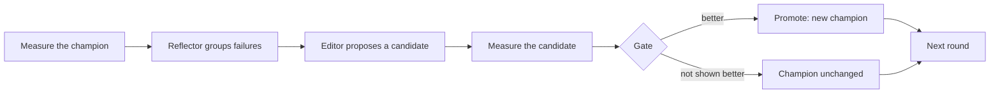

# Run a campaign

[Русский](ru/campaign.md)

Use the same project you measured with `lab evaluate`. Lab prepares the campaign, starts its Target Service, runs the declared conformance check, waits for Core and stops the target. Core decides which Candidates become Champions.

## Steps

From `lab/` after `just setup`:

```sh
just new-project ~/my-agent-lab
just evaluate ~/my-agent-lab
just campaign ~/my-agent-lab
```

If you already have the project, start with the last command. The untouched skeleton runs offline; no model or key is needed. Its sample Editor may finish without a promotion. Replace the stub in `agent/my_agent.py`, corpus and scorer before judging your own agent.

The installed command is:

```sh
lab campaign ~/my-agent-lab --wheel LAB_WHEEL --wheel CORE_WHEEL
```

Pass the exact wheels installed in the current Python. `--python /absolute/path/to/python` selects another prepared environment for the target and subprocess roles. `--json` prints the validated `lab-campaign-summary/1` readout.

## Configure the project

`evaluation-input.json` configures a fixed measurement; `manifest.json` configures the campaign. They start with the same seed, corpus, target and scorer. When you change these inputs, keep both files consistent. `launch.json` starts the evaluation target; `campaign-launch.json` starts the campaign target and names `manifest.json` as its policy.

In `manifest.json`, set the writable files (`artifacts.writable_paths`), Editor, Reflector, Grouper and campaign budget. The skeleton uses Core's statistical `/15` gate. Keep that gate for a quality experiment; the offline demo alone uses `observe` to show the wiring. The project's README lists every failure-tolerance key and the `retry`, `no_retry` and `fail_fast` variants. Model roles need your endpoint, declared credential variables and a [cost cap](budget.md).

## Choose the first baseline

From dev77/b20 on, `lab campaign DIR` on `/16` uses the project's latest fixed evaluation with retained results and a measurement journal. Lab considers earlier version-pair states too. The default imports when that evaluation has readable scorer traces. The campaign measures any scheduled pairs the source does not supply.

- `just campaign DIR --baseline fresh` measures the whole baseline by request.
- `just campaign DIR --baseline-from RUN` takes a numbered evaluation run such as `001` or its evaluation operation ID. On `/15`, imported verdict-only failures can be diagnosed after the first baseline refresh (#208). With no readable traces, imported rows carry no source verdicts. Lab warns before either explicit import.
- The `/15` skeleton measures the whole baseline by default. On `/16` the readout gives a reason for measuring in full when there is no eligible evaluation or its traces are unavailable.

For a Target with `seed_mode: exact`, set the evaluation's `repeat_seeds` to `[random_seed + 1, …, random_seed + R]`, where `R` is the campaign's `repeats_per_question`. With a campaign seed of 7 and three repeats, use `[8, 9, 10]`. Core measures unmatched seeds.

Core decides whether an import is admissible. A source containing held-out cases or a difference in the scorer, metric plan or seed tree can require an explicit decision. Read each finding before accepting it with `--continue --accept CODE:DIGEST --reason TEXT`. A hard source refusal stops the run and offers `--baseline fresh` and `--baseline-from RUN` for a new start. If Core reports `baseline_import_inputs_changed`, rerun once the inputs are stable.

`--from OPERATION` chooses a linked successor. Use `--baseline-from` on a new start without `--from`. `--continue` reuses the saved choice. Keep `baseline_import` out of Bundle manifests.

## Read the outcome

The command prints the outcome, final Champion, diff path, files to open and the next command. Runs share the evaluation layout:

```text
my-agent-lab/.lab/
  state-<pair>/          producing-pair state
  runs/001/source/      resolved copy; the project itself is unchanged
  runs/001/resolved.json
  runs/001/summary.json
  runs/001/report.md
  runs/001/changes.diff
  runs/001/campaign.log
  latest                most recent run
```

Evaluation and campaign runs use the same numbered sequence. Open `report.md` for Core's rounds and decisions, `changes.diff` for the file change and `summary.json` for the machine readout. Treat these as private experiment data. Lab does not apply the diff to your agent repository.

| Exit | Meaning |
|---|---|
| `0` | Finished with a promotion |
| `1` | Finished without a promotion |
| `2` | Project input or preparation error |
| `3` | Target, execution, persistence or cleanup failure |
| `4` | Suspended |
| `5` | Refused by Core |

For `4` or `5`, read the saved reason before continuing. Keep the state and producing wheels. Ctrl+C stops this invocation's work and prints its state path.

For a deterministic score change, run `just demo-campaign`; [The demo](demo.md) explains its synthetic agent and observe profile. For integration from Python, continue below.

## Continue and link

Repair a suspended campaign, then continue the project's latest campaign with its saved prepared inputs:

```sh
lab campaign ~/my-agent-lab --continue --wheel LAB_WHEEL --wheel CORE_WHEEL
```

When Core reports an authorizable refusal, the readout lists every finding, its digest, offered effects and the Lab command to accept it. Supply your reason explicitly:

```sh
lab campaign ~/my-agent-lab --continue --accept CODE:DIGEST --reason "why this change is acceptable" --wheel LAB_WHEEL --wheel CORE_WHEEL
```

Omitting `--effect` writes Core's `default`; Lab prints which offered effect it resolves to before writing. `--effect rebaseline` or another offered effect selects it explicitly. Acceptances apply only to named findings of the last Core start. A later failure before Core preserves the refusal and saved decisions, so continuation can retry after cleanup. A later Core start without a refusal clears that exception. Automatic resume never authorizes.

After editing the project, run `lab campaign DIR --continue --reprepare --wheel LAB_WHEEL --wheel CORE_WHEEL` to prepare its current files and continue the same operation. Core may refuse the changed inputs; accept only the offered findings on the next `--continue` call, which reuses those new saved inputs. Alternatively, `--prepared ID` selects an already prepared campaign input of this project state. `--reprepare` and `--prepared` are mutually exclusive; without either, editing project files does not change a continuation's inputs. Core decides admission. Cleanup and target requirements still apply. `inputs.json` records the prepared and Bundle identities per start; `refusal.json` keeps all refusal findings.

Build on a finished campaign with a linked successor:

```sh
lab campaign ~/my-agent-lab --from OPERATION --wheel LAB_WHEEL --wheel CORE_WHEEL
```

The default starts from that operation's final Champion and asks Core to inherit compatible baseline evidence. `--baseline fresh` measures a fresh baseline. `--seed project` deliberately starts from the project seed; read Core's condition-change caveat in the readout and report. The predecessor must be a campaign operation of this state with retained results. Keep `linked_from` out of Bundle manifests; it is an Owner start condition. For service clients, use `lab resume OPERATION --accept ... --reason ... [--prepared ID]` or `lab start PREPARED --linked-from OPERATION`, with the usual target, generation and secrets options.

## Advanced: Owner API and Core reference

The following explicit preparation/service path is for integrations. It also retains the Core scaffold reference and historical producing-pair notes. The main project path above keeps the statistical gate; the observe conversion below belongs to the offline demo.

**Goal:** let Lab and the Evolution Core try to improve your agent: propose
changes to its files, measure each change against the current version, and
keep a change only when the measurements show it is better. **You are done
when** a campaign has finished with confirmed cleanup, you have read its
outcome, and you hold the resulting change as a diff or ZIP (or know that
nothing beat your agent).

The page has two parts. **[Steps](#steps)** is the checklist to follow.
**[Reference material](#reference-material)** below it explains what a
campaign does, the manifest, costs and outcomes. The steps link into it when
you need detail.

Some steps carry two marks. **To run** is what Lab requires for the campaign
to start at all. **For correct results** is what Lab additionally assumes so
that the outcome means what it says.

This guide follows the current pair, Lab `0.0.3.dev81` on exact
`evo-skills==2.0.0b22` (tag `lab-v0.0.3.dev81`); it is not a pair-acceptance record.
Owner schema 14 stores action approvals.
Use a fresh private state directory such as `~/lab-state/dev81-b22`. Keep old runs with their producing wheels and state.
The following earlier-pair notes are historical provenance, not acceptance
of this pair.
The preceding released pair before dev61 was dev60/b12, tag `v0.0.3.dev60` (2026-10-26). Earlier dev58/b10
evidence and its separate residual
pack-index/RSS acceptance remain in the b10 pair note.
For exact dev58/b10 the user separately accepted that residual limit on 2026-10-22; dev57/b9 acceptance did not transfer.
For exact dev59/b11 the user separately accepted it on 2026-10-23; dev58/b10 acceptance did not transfer.
Core reader modules are unchanged: nofollow and 32 MiB per selected section remain, with no overall
pack-index/RSS cap or owner-file immutability promise. For exact dev60/b12 the user separately accepted this same residual limit on
2026-10-25; b11 acceptance did not transfer. Every next pair needs its own assessment.

For exact dev61/b13, the user conditionally accepted this residual on
2026-10-27 under ADR-0019. The exact-tag audit confirmed unchanged reader/storage
modules, so that condition is satisfied: nofollow and 32 MiB per selected
section remain, with no aggregate pack-index/RSS cap or owner-file immutability.
This is a separate acceptance; dev60/b12 acceptance did not transfer.
It does not authorize release, migration or state creation.

### Before you start

- You have run [your first evaluation](first-evaluation.md) and know Bundles,
  prepared executions and targets ([How Lab works](concepts.md)).
- Your agent is connected: its adapter and launch file exist and Lab can
  start it. If you chose conformance, read its protocol check results
  ([Connect your agent](connect-agent.md)).
- You have a corpus and a scorer for it ([Evaluation inputs](evaluation-inputs.md)).
- For a model-driven Editor or Reflector: a model endpoint and an API key for
  each, and a spending plan ([Budget and cost control](budget.md)).

### Steps

1. [Run the offline example campaign](#step-1-run-the-offline-example-campaign)
2. [Write the manifest from Core's scaffold](#step-2-write-the-manifest-from-the-cores-scaffold)
3. [Set the editable scope](#step-3-set-the-editable-scope)
4. [Choose the Editor and the Reflector](#step-4-choose-the-editor-and-the-reflector)
5. [Set the scale and the per-conversation limits](#step-5-set-the-scale-and-the-per-conversation-limits)
6. [Estimate the cost and cap it](#step-6-estimate-the-cost-and-cap-it)
7. [Create the Bundle and prepare the campaign](#step-7-create-the-bundle-and-prepare-the-campaign)
8. [Start the Target Service and the campaign, and wait for it](#step-8-start-the-target-and-the-campaign-and-wait-for-it)
9. [Read the outcome](#step-9-read-the-outcome)
10. [Get the change: diff and export](#step-10-get-the-change-diff-and-export)

#### Step 1. Run the offline example campaign

**Do:** run [`examples/owner/campaign.py`](../../lab/examples/owner/campaign.py)
once, with fresh directories and a free port. It needs no model, network or
key and finishes in a few seconds. What it sets up is described in
[What a finished campaign looks like](#what-a-finished-campaign-looks-like).
Run from `lab/` after `just setup`. The `--python` path
must not contain `..`, or preparation fails with `environment_invalid`:

```sh
.lab/venv/bin/python examples/owner/campaign.py \
  --python "$PWD/.lab/venv/bin/python" \
  --lab-wheel "$(just --evaluate lab_wheel)" \
  --core-wheel "$(just --evaluate core_wheel)" \
  --state-directory campaign-state \
  --source-directory campaign-source \
  --port 18766
```

[A tour of the examples](examples.md) shows the files the script writes
(manifest, agent, Editor, Reflector, scorer) and which of them to read first.

**Done when:** the campaign process has finished and cleanup is confirmed.
Read the actual Core outcome, rounds, final Champion and diff/export states in
the output; promotion and a changed Champion depend on Core's decisions.
Keep the script open: steps 7–10 are the same calls with your own inputs.

<a id="step-2-write-the-manifest-from-the-cores-scaffold"></a>

#### Step 2. Write the manifest from Core's scaffold

Use `lab new-project DIR` for the ordinary project, including `manifest.json`, `campaign-launch.json`, the sample Editor and Reflector. Keep its statistical gate for real measurements. The public Core scaffold shown in the reference below is useful for direct Core integration; it is not another required setup step. The offline demo alone applies the observe profile.

Continue with the same project's editable scope below. See [Configure the project](#configure-the-project) for the two input and launch files.

#### Step 3. Set the editable scope

**Do:** fill `artifacts` in the manifest. Patterns are relative to the seed
root and work like `.gitignore`. Details: [Editable scope](#editable-scope).

```json
"artifacts": {
  "writable_paths": ["skills/**"],
  "dependency_paths": ["uv.lock"],
  "excludes": ["build/**"]
}
```

- [ ] `writable_paths`: only the files the campaign may change (for the
  order-lookup assistant, its skill files; the tool code stays fixed).
- [ ] `dependency_paths`: plain paths the Candidate depends on but never
  changes, such as a lock file. No wildcards.
- [ ] `excludes`: anything to leave out of the Candidate.

**Done when:** no writable pattern overlaps a dependency or an exclusion, and
everything you do not want changed is outside `writable_paths`.

<a id="step-4-choose-the-editor-and-the-reflector"></a>

#### Step 4. Choose the Editor and the Reflector

**Do:** pick a kind for each role ([Editor and Reflector](#editor-and-reflector)):
`subprocess` (your own program), `chat` (a model behind an OpenAI-compatible
endpoint) or `agent_cli` (a coding-agent command-line tool). For a `chat`
role:

- [ ] Set `model`, `base_url` and `api_key_env` — the *name* of the secret
  that holds the key, never the key itself.
- [ ] Add that name to `secret_names` when you create the Bundle (step 7) and
  pass its value when you start the campaign (step 8).
- [ ] For the Reflector, also keep the five required keys
  (`environment_docs`, `probe`, `grouping`, `selection`, `families`); copy
  their shapes from the scaffold.
- [ ] For a long-running `chat` role, set the context limits and keep the three
  timeouts in order; see
  [Editor and Reflector](../../lab/src/evolution_lab/guides/campaign-package/SKILL.md#editor-and-reflector).

*For correct results:* a role's `base_url` is part of the campaign's
identity, so pin it to a fixed host and port
([Pitfalls](pitfalls.md)).

**Done when:** each role has a kind, its required keys, and every secret it
names is on your list of secret names.

#### Step 5. Set the scale and the per-conversation limits

**Do:** set the `campaign` section. Start small; the meaning of each setting
is in [Campaign scale](#campaign-scale).

- [ ] `rounds`, `attempts_per_round`, `parallel_attempts` (at most
  `attempts_per_round`).
- [ ] `max_concurrency`, `max_scorer_concurrency` — also capped by your
  launch file's `limits.max_instances`.
- [ ] `budget.max_turns`, `budget.timeout_seconds` and the required
  `budget.max_failed_turns`. This `budget` limits one conversation; it is not
  money.
- [ ] Choose the [failure variant](#run-failures); the neutral scaffold uses `sample_retries: 3`.
- [ ] The repeats per question: `campaign.evaluation.repeats_per_question`, and the gate mode, `observe` (one repeat,
  no gate, a wiring check) or `statistical` (R ≥ 2 repeats and confidence levels); see
  [the confidence gate](../../lab/src/evolution_lab/guides/campaign-package/SKILL.md#confidence-gate).

For comparable fixed-evaluation and campaign settings, choose the same explicit
[failure variant](#run-failures) in each; evaluation does not inherit the manifest.
The following is an explicit small budget, not the scaffold's retry default.

```jsonc
"campaign": {
  "rounds": 1, "attempts_per_round": 1, "parallel_attempts": 1,
  "budget": {"max_turns": 2, "timeout_seconds": 30, "max_failed_turns": 1},
  "sample_retries": 1
  // ...the other keys as in the scaffold
}
```

**Done when:** you can name what drives the number of measurements the campaign makes
(see Step 6) and how many samples each one runs
(train cases × repeats).

#### Step 6. Estimate the cost and cap it

**Do:** list who calls a paid model — the target, the Editor, the Reflector,
a model-judge scorer, plus retries
([What costs money](#what-costs-money-and-how-to-cap-it)) — and multiply out:
corpus size × repeats × number of measurements. Then choose your caps:

- [ ] the scale settings from step 5;
- [ ] a spending limit at your model provider;
- [ ] optionally, the [budget gateway](budget.md) between the roles and the
  provider, to reserve costs against a declared limit. The bound depends on
  your prices and token limits matching the provider's billing.

*To run:* nothing here is required. Lab does not track spend or enforce a
money limit on this path, so without your own caps nothing stops the
spending.

**Done when:** you have a number for the worst case, and a cap that stops the
run below the amount you are willing to pay.

#### Step 7. Create the Bundle and prepare the campaign

**Do:** freeze your inputs and save the campaign plan. This is the same as in
the evaluation, with `CampaignSource` and `prepare_campaign`:

```python
store = PreparationStore(state)
bundle = store.create_bundle(
    source=CampaignSource(manifest_path, launch_path),   # launch "policy": "manifest.json"
    environments=(environment_input,), env={}, secret_names=("EDITOR_API_KEY",),
    roots=(SourceRoot("project", source),),
)
prepared = store.prepare_campaign(bundle.digest)          # saves the plan, runs nothing
```

`secret_names` lists every secret any part of the campaign reads: the names
from the launch file's `secret_names` and the names the roles use (step 4).

**Done when:** `create_bundle` and `prepare_campaign` return without an
error, and you have `bundle.digest` and `prepared.digest`.

#### Step 8. Start the target and the campaign, and wait for it

**Do:** open the Owner, start the target, optionally check it, start the
campaign and poll until it leaves the active states:

```python
async with Owner.open(state) as owner:
    connection = await owner.bind(bundle.digest)
    started = await owner.wait(await owner.start_target(connection, secrets=target_secrets))
    target_ref = TargetRef(started.ref.id, started.owner_generation)

    check = await owner.wait(await owner.check(connection, target_ref=target_ref))  # optional

    operation = await owner.start(prepared.digest, target_ref=target_ref,
                                  secrets=execution_secrets)
    operation_ref = ResourceRef("operation", operation.id)
    while operation.control_state in {"reserved", "running", "stopping"}:
        await asyncio.sleep(0.5)
        operation = await owner.status(operation_ref)

    report = await owner.report(operation_ref)
    if (await owner.target(target_ref)).state == "ready":
        await owner.wait(await owner.stop_target(target_ref))
```

- [ ] `target_secrets`: exactly the secrets named in the launch file.
- [ ] `execution_secrets`: exactly the secrets the roles use
  ([Two secret sets](#points-to-know-when-running)). A name in both sets must
  have the same value. Lab never reads your shell environment.
- [ ] To stop early, call `await owner.stop(operation_ref)` and keep polling.

**Done when:** `operation.control_state` is `finished` and the target is
`stopped`. If it is `cleanup_required` or `orphaned` instead, clean up first
([Read the results](results.md#step-5-resolve-anything-left-uncertain)).

From a shell, the same wait is one command: `lab watch OPERATION` prints a line per change and exits `0` when the
campaign finished, `3` when Core paused it and `4` when it ended abnormally. This works for family 14 (`/15`) and
family 15 (`/16`); see [Watch a campaign](watch-campaign.md).

#### Step 9. Read the outcome

**Do:** read Core's decision and the measurements behind it from the
report (inside the same `async with` block, or later from a new
`Owner.open(state)`, where `await owner.list_operations()` finds the
operation):

```python
report = await owner.report(operation_ref)
core = report.report["core"]
print(report.state, core["campaign_outcome"]["outcome"], core["campaign_outcome"]["reason"])
print([r["outcome"] for r in core["rounds"]], core["final_champion"]["version"])
for m in report.report["measurements"]:
    print(m["coverage"]["state"], m["coverage"]["scored"], "/", m["coverage"]["expected"],
          m["metrics"]["score"]["mean"])   # "score": your metric.primary
```

On the offline example this printed `available completed rounds_exhausted`,
`['promoted', 'clean'] v1`, then two measurements, `complete 6 / 6 0.0` (the
seed) and `complete 6 / 6 1.0` (the promoted Candidate).

- [ ] `campaign_outcome` is `null`? The outcome is *unknown*, not a failure.
- [ ] Every measurement's coverage is `complete`? If not, fewer samples were
  scored than planned; read the report's details before trusting the metric.
- [ ] Final Champion still `v0`? Nothing was promoted; see
  [When nothing is promoted](#when-nothing-is-promoted).

The meaning of each outcome is in [Words you will meet in the
report](#words-you-will-meet-in-the-report) and
[Campaign reports](results.md#campaign-reports).

**Done when:** you know the campaign outcome, the final Champion and whether
every measurement was complete.

#### Step 10. Get the change: diff and export

**Do:** read the change from the seed to the final Champion, and export it as
a ZIP if there is one:

```python
diff = await owner.diff(operation_ref)
print(diff.state)                 # "changed" or "no_change"
print(diff.text)                  # unified diff of text files

export = await owner.wait(await owner.export(operation_ref))
if (export.state != "succeeded" or export.persistence.state != "saved"
        or export.result is None):
    raise RuntimeError("Export unavailable; inspect task failure and persistence")
payload = export.result.payload
if payload["state"] == "ready":
    data = await owner.read_export(operation_ref, payload["export_id"])
    with open("champion.zip", "xb") as stream:  # new file in your current directory
        stream.write(data)
```

Then decide yourself whether to apply it: Lab never applies a change to your
project. A ZIP says the files differ, not that the agent improved — the
outcome from step 9 says that. To build on the result, apply the change and
start a new campaign from it.

**Done when:** you have the diff (or `no_change`) and, for a changed
Champion, a ZIP file. Details on both:
[Read the results](results.md#step-4-get-a-campaigns-changes).

**Next:** [Read the results](results.md) for everything the status and report
contain, and [Budget and cost control](budget.md) before a campaign on a real
model.

---

### Reference material

#### What happens in a campaign

A fixed evaluation ([Run your first evaluation](first-evaluation.md)) tells
you how good your agent is. A **campaign** tries to make it better. Proposed
changes are measured against the current version, and a change is kept only
when the measurements show it is better.

A campaign works on a copy of your agent's files called the **seed tree**.
Only the files you mark as editable can change. Four roles take part:

- **Editor**: proposes a change to the editable files, usually with a model.
  One try is an **attempt**; the changed tree is a **Candidate**.
- **Target**: your agent, run from each Candidate on your corpus.
- **Scorer**: turns each finished conversation into metrics.
- **Reflector**: reads the measurements, groups the failures and gives the
  Editor a diagnosis to work from.

The **Evolution Core** runs the loop. Each round starts from a measurement of
the current **Champion** (in round 1, the seed), which is the **parent** of
every Candidate proposed in that round. The Reflector analyses its failures,
the Editor makes attempts, and Core measures each Candidate on the same
cases. A statistical **gate** (Core's test of whether a Candidate is
clearly better) then compares Candidate and parent sample by sample. If the
gate finds the Candidate better, Core **promotes** it: it becomes the new
Champion and the parent in the next round. [How Lab works](concepts.md#campaign--let-the-core-improve-the-agent)
has a fuller diagram of the loop.



**Who owns what.** Core owns the campaign journal, the statistics, the
promotion decision and the choice of the final Champion. Lab never overrides
them. Lab freezes your inputs into a Bundle, starts and stops the processes,
confirms cleanup, and shows you Core's results. When this guide says
"promoted", it reports Core's decision.

<a id="manifest-16"></a>
#### Manifest `/16`: independent acceptance (family 15)

`/16` is opt-in and `/15` keeps its meaning. Choose it when the number of repeats R must not depend on the rule that
judges a Candidate. The gate keys are `gate.mode` (`point`, `confidence` or `unfiltered`), `gate.execution_noise`
(`{kind: negligible | bounded | observed}`), `gate.verification` (`reuse` or `fresh`), `gate.fresh_parent` and, with
`confidence`, `gate.statistics`; R stays `evaluation.repeats_per_question`. The field-by-field reading is in the bundled
campaign-package guide (`lab guides`, `campaign-package`), which is the authority for these keys.

- With R = 1 and `confidence`, even a perfect 0 to 1 gain needs at least 4 focus units to pass at confidence 0.9 (5 at
  0.95, from Core's `passes_bound`). Many attempts may then close as `comparison_preflight_failed` with no numbers.
- Promotion is automatic. Core b13 has no manual promotion: a `campaign.promotion` key is refused as `unknown_key`, and
  Lab offers no promotion decision. `linked_from` inside the Bundle manifest is refused as `linked_run_unsupported`. See [Continue and link](#continue-and-link) for linking on start.
- Lab reads what Core recorded: per scope a gain with "with c confidence not below L" and a threshold (`bound`), a point
  and a threshold (`point`), a gain with no threshold, or Core's status. Never a two-sided interval. Comparisons are
  against the round's Champion, labelled stored, fresh or not recorded ([Results](results.md)).
- Both recorded comparison levels remain visible: nullable `gate_comparison` and `global_comparison`, each with
  its own scopes and nullable `reference_measurement_id`. Core's `comparison` is global when present, otherwise gate;
  Lab copies each field independently. CLI, markdown and panel omit only absent levels.
- The view shows a one-sided lower bound. Promotion is automatic and L3 is unavailable.

Core b13 adds these `/16` settings; Core validates them and owns their rules:

- `evidence` controls the role evidence volume; see [Core evidence](../manifest-v2.md#evidence-manifest-16).
- `checks` selects policy-check modes; see [Core check modes](../manifest-v2.md#checks-manifest-16).
- Role-loop limits bound repairs, tool failures, grouping fallbacks and skipped rounds; see [Core role-loop limits](../manifest-v2.md#role-loop-limits-manifest-16).
- `campaign.indeterminate.<owner>.*` controls each owner's indeterminate policy; see [Core campaign settings](../manifest-v2.md#campaign).
- `target.preflight_sample_retries` controls connection preflight sample retries; see [Core target settings](../manifest-v2.md#schema-seed_root-target-and-artifacts).
- `reflector.probe.string_body` controls JSON-string probe bodies; see [Core live probes](../manifest-v2.md#optional-live-probes).

Core's b13 delivery reports that `qwen/qwen3.8-flash` sends the probe body as a
JSON string even with the typed schema; use `string_body: "parse"` in
`reflector.probe` for that model.

Lab shows non-`enforce` check modes and Core's shadow hit counts in the campaign
view, CLI, markdown report and panel, even when independent acceptance data is
unavailable. Start and resume logs explain each non-`enforce` mode's consequence.
Counts from different checks are not comparable; do not add them into a total.

Finish `/16` campaigns started on dev60/b12 with their producing pair and state.
Do not continue them on dev61/b13: Core cannot roll back a `/16` run touched by b13.

#### The campaign manifest

A campaign is described by one JSON file, Core's manifest. Lab writes
`evolution-v2-manifest/15` and accepts it and `/16` on the Owner paths (Bundle and preparation, Owner, service, CLI, project form; H1 and the legacy runner take `/15` only); other versions, including `/11` and `/14`, are refused before side effects (`unsupported_schema` in Bundle/service preparation, `manifest_invalid` through H1 `connect()`). A `/15` manifest whose `grouper.kind` is `agent_cli` is refused with `grouper_kind_unsupported` (HTTP 422, stage `bundle`; message "Lab supports grouper kinds fields, command, chat (grouper.kind)."); every preparation path (Bundle, project form, the legacy `recipe.prepare_inputs`, H1 `connect()`) checks it before any side effect. The quickest
way to see a complete one is to generate Core's neutral demonstration:

```sh
.lab/venv/bin/evo-target init ../campaign-demo   # from the Lab checkout; fresh path
```

It writes `manifest.json`, a seed tree, a two-case corpus and sample scorer,
Editor and Reflector programs. (Its `--help` may still say "/5"; Core 2.0.0b13
writes `/15`.) The annotated `/15` below shows the offline demo's observe profile, including all Grouper features and the metric contract. Ordinary `lab new-project` campaigns keep the statistical gate instead.
JSON has no comments; remove them in a real file.

```jsonc
{
  "schema": "evolution-v2-manifest/15",
  "seed_root": "seed",                       // the tree the campaign evolves
  "target": {"base_url": "http://127.0.0.1:8765", "seed_mode": "exact"},
  "artifacts": {                             // the editable scope, see below
    "writable_paths": ["skills/**"],
    "dependency_paths": ["uv.lock"],
    "excludes": ["build/**"]
  },
  "role_visibility": {"version": "role_visibility/1", "readable_paths": []}, // role-visible tree paths
  "campaign": {
    "rounds": 2,                             // how many rounds
    "attempts_per_round": 1,                 // editor attempts per round
    "parallel_attempts": 1,                  // attempts run at once (≤ attempts_per_round)
    "evaluation": {"repeats_per_question": 1},   // repeats of each question; R >= 2 with the statistical gate
    "round_stop": "first_accepted",            // stop attempts at the first accepted final decision, or use "all_attempts"
    "baseline_refresh_after_rounds": 3,        // re-measure baseline after this many rounds
    "indeterminate": {                       // how many unclear samples are tolerated
      "target":      {"max_count": 20, "max_rate": "1"},
      "environment": {"max_count": 20, "max_rate": "1"},
      "scorer":      {"max_count": 20, "max_rate": "1"},
      "rollout":     {"max_count": 20, "max_rate": "1"}
    },
    "budget": {"max_turns": 2, "timeout_seconds": 30, "max_failed_turns": 2},  // per sample, not money
    "call_retries": {"max_attempts": 3, "turn_max_attempts": 2},
    "sample_retries": 3,  // extra attempts for an unmeasured sample
    "max_concurrency": 2,                    // conversations running at once
    "max_scorer_concurrency": 2,             // scorer calls at once
    "metric": {"primary": "score"},          // the metric the gate compares
    "random_seed": 7,
    "editor_timeout_seconds": 60,
    "editor_context": null,                 // shared by Editor and Reflector; no role-only instructions
    "reflection_timeout_seconds": 60,
    "gate": {"mode": "observe",              // wiring check; set "statistical" explicitly for the confidence gate
             "stability": "stable",          // "unstable" re-measures the Champion in every final
             "focus": {"margin": 0},         // required effect threshold; observe omits confidence
             "causal": {"tolerance": "measured_noise"},
             "provenance": {"kind": "reported"}, "fresh_parent": true, "global": "off"},
    "attempt_feedback": "sequential"         // later attempts see earlier ones' feedback
  },
  "environment": {"kind": "static", "input_text_key": "text"},
  "scorer":  {"argv": ["python3", "score.py"], "cwd": "scorer", "timeout_seconds": 30,
              "dependency_paths": [], "allowed_env": [],
              "metric_contract": {"version": "metric_contract/1", "kind": "pointwise",
                                  "target_fields": [{"event": "assistant_message", "pointer": "/content",
                                                     "value": "nonempty_string"}]}}, // what the scorer needs
  "editor":  {"kind": "subprocess", "argv": ["python3", "edit.py"], "cwd": "editor",
              "dependency_paths": [], "allowed_env": []},
  "grouper": {"kind": "fields",             // top-level grouping; free, no model calls
              "features": [{"name": "failed_criteria", "source": "observation",
                            "path": "/failed_criteria", "description": "Failed criteria."},
                           {"name": "terminal", "source": "observation",
                            "path": "/terminal", "description": "Terminal observation status."}]},
  "reflector": {"kind": "subprocess", "argv": ["python3", "reflect.py"], "cwd": "reflector",
                "dependency_paths": [], "allowed_env": [],
                "environment_docs": null, "probe": null,
                "max_consecutive_failures": 5,   // required, integer 1–20
                "selection": {"focus_cases": 16, "representatives_per_case": 2, "context_page_size": 32},
                "families": {"kind": "none"}},
  "corpus": {"path": "corpus.jsonl"}
}
```

The `target`, `environment`, `scorer` and `corpus` sections mean the same as
in an evaluation input; see [Evaluation inputs](evaluation-inputs.md). Two
practical notes:

- Replace `python3` in each `argv` with the interpreter path from
  `describe_environment(...).executable`, as the evaluation example does for
  the scorer. With a bare `python3`, `create_bundle` refuses the manifest
  (`unsupported_input`): Lab wants the pinned interpreter called directly.
- `target.base_url` must match the launch file's `endpoint.base_url`, and the
  launch file's `policy` points at this manifest.

**The corpus may be split.** Every `/15` corpus row may carry `split: "train"` or `"test"`
(all rows or none; a group never crosses splits). The campaign sees only train; a fixed
evaluation measures the split named in its prepare request (`train` by default).

#### Editable scope

`artifacts` decides what the Editor may touch. Patterns are relative to the
seed root and work like `.gitignore` (`**` matches any depth):

- `writable_paths`: files the Editor may change. Everything else stays fixed.
- `dependency_paths`: plain file paths the Candidate depends on but never
  changes, such as a lock file. No wildcards.
- `excludes`: files left out of the Candidate. Core adds its own defaults
  (version-control folders, virtual environments, caches, `.env` files, logs).

A writable pattern may not overlap a dependency or an exclusion. For the
order-lookup assistant, `writable_paths: ["skills/**"]` lets the campaign
rewrite the agent's skill files, while the code of the `lookup_order` tool
stays outside the writable set and cannot change.

<a id="editor-and-reflector"></a>

#### Editor and Reflector

Custom subprocess Reflectors must accept `reflect_brief/5` for `/15`
and `reflect_brief/6` for `/16`. Editors receive `edit_brief/4` for `/15`
(or `edit_brief/5` with sequential attempt feedback), and `edit_brief/6`
for `/16` (or `edit_brief/7` with that feedback).
Keep older role programs and runs in their producing environments; do not
upgrade an old run in place.

On exact dev61/b13, Lab delegates corpus placement to
`evolution.tree.evolve.check_corpus_placement(manifest)` without `run_root` or
`environ`. It checks Core's declared role/grouping paths; it does not look
up an agent CLI on `PATH`. Runtime CLI resolution/checks remain Core-owned.
A placement refusal keeps `corpus_inside_role_workspace`. Other helper failures
are not a successful check: H1 uses `manifest_invalid`/`io_error`; legacy recipe
uses `PreparationArtifactsInvalid`; Bundle uses `manifest_invalid`/`io_error`
with existing source-drift precedence; project package checks use
`manifest_invalid`/`unsupported_input`, with safe details. A missing corpus stays
with the existing corpus-validation stage. This exact-pin import is not a
promise of a stable beta facade.

`campaign.editor_context` is shared context: Core shows it to both the Editor
and the Reflector, so it must not contain instructions meant for one role only.
Put role-specific instructions in that role's prompt or program.

Both roles come in three kinds:

- `subprocess`: your own program (`argv`, `cwd`, `dependency_paths`,
  `allowed_env`). The scaffold's sample programs are this kind.
- `chat`: a model behind an OpenAI-compatible endpoint. Requires `model`,
  `base_url` and `retry`; `api_key_env` is optional (the *name* of a secret,
  required for roles routed through a policy gateway). Other optional keys include `system_prompt` and `reasoning_effort`.
- `agent_cli`: a coding-agent command-line tool (as Editor, one run per
  attempt).
  Requires `model`; optional keys include `system_prompt`, `allowed_env` and
  `reasoning_effort`.

For the order-lookup assistant, a model-driven Editor could look like this
(model and URL are placeholders):

```json
"editor": {
  "kind": "chat",
  "model": "your-model-name",
  "base_url": "https://llm.example.com/v1",
  "api_key_env": "EDITOR_API_KEY",
  "system_prompt": "You improve the skills of an order-lookup assistant.",
  "retry": {"version": "role_call_retry/1", "max_attempts": 3, "total_budget_seconds": 600,
            "backoff": {"initial_seconds": 5, "multiplier": 2, "max_seconds": 60, "jitter": "full"}}
}
```

On `/15` a `chat` role without `retry` is refused as `missing_key`.

With a chat Editor, `editor_timeout_seconds` (and, for a chat Reflector,
`reflection_timeout_seconds`) must be greater than the role's
`retry.total_budget_seconds` — the 600 above needs more than the 60 of the annotated manifest.

The Reflector takes the same kinds plus `environment_docs` and `probe` (each may be `null`),
`selection`, `families` and `max_consecutive_failures` (integer 1–20, no default).
Grouping belongs to the top-level `grouper` (`fields`, `command` or `chat`). Copy their
shapes from the scaffold. A role's `base_url` is
part of the campaign's identity, so pin it (see [Pitfalls](pitfalls.md)).

#### Budget gateway for model roles

An optional [execution policy](budget.md#execution-policy-and-budget-gateway)
lets Lab run the gateway with the target. The Bundle keeps stable gateway
URLs and `client_model` aliases; the policy stores upstream endpoints,
models, secret names and provider pins. Lab fills fresh route tokens into the
target, declared Core role `api_key_env` and mapped scorer names. Give upstream
keys only at target start; do not supply generated tokens yourself.
`reasoning_effort` stays in the manifest. Provider fields `provider_only`,
`provider_order` and explicit `allow_fallbacks` in routed chat roles are refused
as `manifest_provider_pin`; put them in the policy before sealing the Bundle.
Without a policy, Core's existing provider-pin pass-through remains available.

To change a suspended campaign's provider: stop the target and wait for cleanup,
confirm policy B with the reviewed expected digest, start a new target of the
same Bundle under B, then resume explicitly. Keep the entire `gateway` block
unchanged. Policy presence cannot change on continuation. Bundle, Core identity
and measurement remain; Core does not see the route change. Lab does not check
model or quantization equivalence: the human must establish it. Existing
campaigns with pins sealed into their Bundle are not migrated by this flow.

Owner JSON report `/13`, `lab routing OPERATION` and the read-only
panel show policy history and request counts, including provider mismatches,
shared and outside uses. Missing provider evidence means unknown; an unreadable
or unattributable ledger retains confirmation history but makes routing
unavailable. There is no money/per-attempt routing audit or routing in
`report.md`. The [policy workflow](budget.md#execution-policy-and-budget-gateway)
has complete JSON, confirmation and start commands, and accounting limitations.

<a id="run-failures"></a>
#### Failures during execution

Choose before starting a campaign or fixed evaluation. The variant describes the
following explicit values; `max_turns` is the selected per-conversation budget.
For `campaign.indeterminate.<каждый>`, apply the values to every owner.

| | `retry` «С повтором» (умолчание) | `no_retry` «Без повтора» | `fail_fast` «Остановка на первом сбое» |
|---|---|---|---|
| `campaign.sample_retries` | 3 | 0 | 0 |
| `campaign.indeterminate.<каждый>.max_count` | 20 | 20 | 0 |
| `campaign.indeterminate.<каждый>.max_rate` | `"1"` | `"1"` | `"0"` |
| `reflector.max_consecutive_failures` | 5 | 5 | 1 |
| `campaign.call_retries.max_attempts` | 3 | 3 | 1 |
| `campaign.call_retries.turn_max_attempts` | 2 | 1 | 1 |
| `campaign.budget.max_failed_turns` | = `max_turns` | = `max_turns` | 1 |
| оценка: `sample_retries` | 3 | 0 | 0 |
| оценка: `min_coverage` | 0.95 | 0.95 | 1 |
| оценка: `max_consecutive_unmeasured` | 3 | 3 | 1 |
| оценка: `call_retries` | 3 / 2 | 3 / 1 | 1 / 1 |
| оценка: `max_failed_turns` | = `max_turns` | = `max_turns` | 1 |

**`retry` «С повтором» (default).** Unmeasured samples can be attempted again,
transient target calls can be retried, and failed turns can continue within the
conversation budget. Scored coverage still has to reach 0.95. Setting
`sample_retries > 0` or `turn_max_attempts > 1` asserts that resending a question
to the agent is safe; confirm that before choosing these values. Retries can
repeat side effects and add work. Turn retries require the target to resend the
same `request_id`; see [Turn outcomes](../../lab/src/evolution_lab/guides/target-connector/SKILL.md#turn-outcomes).

**`no_retry` «Без повтора».** Use this for agents whose repeated turn changes
the world. Sample and turn resending are disabled; transient-call attempts stay
at 3 with `turn_max_attempts: 1`. A failed sample may remain unmeasured while
other samples continue, subject to coverage and consecutive-unmeasured limits.
This setting is not an exactly-once guarantee for external side effects.

**`fail_fast` «Остановка на первом сбое».** Sample and turn retries are disabled;
one failed turn ends its rollout, and one consecutive unmeasured sample stops a
fixed evaluation. The campaign's indeterminate allowance is zero and evaluation
requires full scored coverage. An execution failure gives no score for that sample;
it is not evidence of poor quality.

On exact Core b15, `max_rate < 1` can make a failure on the first questions fatal:
Core counts the rate from the first denominator, so the first failed try has
rate 1 even if `max_count` is still below its limit. Optional manifest `/16`
`campaign.indeterminate.<owner>.min_tries` provides a warm-up before the rate
check; Lab does not write it or other `/16` settings for you.

The builder writes campaign keys into the immutable manifest; Lab does not
substitute them or check the manifest against the chosen variant. Lab's neutral
campaign scaffold writes `retry`. Fixed evaluation has its own request/input
settings and does not inherit campaign failure settings. New preparations use
`retry` for omitted/default-null evaluation values; explicit values override them.
See [Evaluation budget](evaluation-inputs.md#the-fixed-evaluation-budget).

Changing the variant before start creates a new Bundle, but does not by itself
require a new first measurement when the measurement basis stays equal. Use
[measurements for a Bundle](../../lab/docs/api/service-s5.md#bundle-measurements) and the shared
project facts to assess saved evidence. Running or suspended campaigns do not
change variant in place. Start a new campaign, then [choose a baseline](campaign.md#choose-the-first-baseline) using the project's saved evaluations.

#### Campaign scale

| Setting | What it controls |
|---|---|
| `rounds` | Number of rounds. |
| `attempts_per_round` | Editor attempts per round. |
| `parallel_attempts` | Attempts run at the same time. |
| `max_concurrency` | Conversations in flight across the whole campaign. |
| `max_scorer_concurrency` | Scorer calls in flight. |
| `budget.max_turns`, `budget.timeout_seconds` | Limits for one conversation. |
| `evaluation.repeats_per_question` | Repeats of each question (R). `observe` takes 1; `statistical` needs R ≥ 2. |
| `gate.mode` | `observe` (no gate applied, a wiring check, not evidence of quality) or `statistical` (the confidence gate). |

<a id="target-capacity"></a>
Concurrency is also capped by your target's declared capacity (`limits.max_instances`
in the launch file). Preparation checks `/15` before any spend through Core's own
`admit_capabilities`. Lab asks for the least `max_instances` Core admits and keeps no
formula of its own. If the launch file declares fewer instances, `lab prepare` is
refused with `artifacts_invalid` and `target capacity: the campaign needs N instances,
the target declares M`.

The levers include `max_concurrency`, `parallel_attempts`, `gate.fresh_parent`,
`attempts_per_round` and the target's actual `limits.max_concurrent_sessions`.
The observe smoke profile above (`max_concurrency: 2`, `parallel_attempts: 1`,
`fresh_parent: true`) needs 4 instances when each instance serves one session.
Revisit admission when changing these values; the gate mode and final measurements
also affect Core's policy.

`budget` limits a conversation; it is not a money limit. Choose sample retries,
turn-failure limits and indeterminate allowances in
[Failures during execution](#run-failures). Fixed evaluation resolves its own
settings, separately from the campaign manifest.

<a id="linked-runs-are-refused"></a>
#### Linked successors

Use `lab campaign DIR --from OPERATION` or `Owner.start(..., linked_from=OPERATION)` as described [above](#continue-and-link). A manifest inside a Bundle that declares `linked_from` still refuses as `linked_run_unsupported`. Core owns lineage and baseline admission.

#### Suspension

**Goal:** know what a suspended campaign is and what to do about it.

An infrastructure failure inside a rollout no longer closes the campaign as
`infrastructure_failed`. Core suspends it instead — a non-terminal
`campaign_suspended {reason, owner, evidence}` record — and keeps the run
directory: the campaign is not finished, and `campaign_outcome` stays `null`
(unknown, not failed).

1. **Do:** read `status.result.core.suspended` before treating
   `status.process.exit_code == 1` as a failure; `status.result.core.suspensions`
   names the reason, owner and evidence kind for each one.
   `lab suspensions OPERATION [--json]` (also `Owner.suspensions(ref)` and
   `GET /v1/operations/OPERATION/suspensions`) reads the closed
   `lab-suspension-evidence/1` history with the returned fault/final/Champion
   rows or threshold/stage evidence. Rows explain what caused that pause,
   not all samples still to execute; count/truncated preserve Core's
   bounded prefix. Empty, unavailable and deleted results are distinct
   ([contract](../../lab/docs/api/owner-s4.md#suspension-evidence)). After resume this remains
   history; current status is separate. The panel reads current evidence on
   opening and historical evidence on disclosure, marking stale reads and
   clearing deleted data. No private disclosure is added. `lab status`
   prints two extra lines for this state (`suspended:`, `continuation:`);
   the report has a `suspensions` table. Full field-by-field detail:
   [Read the results](results.md#suspended-campaigns).
2. **Do:** decide how to proceed. Owner, service and CLI runs continue
   explicitly on any `ready` target of the same Bundle, even from a later
   Owner generation: fix the target (or bring up another one), then
   `Owner.resume(ResourceRef('operation', id), target_ref=..., secrets=...)`
   / `lab resume <id> --target … --generation …`. This needs the operation to
   be `finished` or `released` with confirmed target cleanup; a
   `cleanup_required`/`orphaned` operation needs `lab cleanup operation <id>`
   first, and a `released` operation after a manual `lab release-operation` has no
   continuation. A legacy-runner run (`<run>-lab-logs/supervisor.lock`
   exists) instead continues with `runner.resume_native` in the same folder,
   without this admission check — see the [legacy runner
   reference](../../lab/docs/api/legacy-runner.md). H1 runs have no continuation. In any
   case, once you no longer need the run directory, delete the results.
3. **Done when:** either the legacy run reaches `campaign_finished`, the
   Owner/service/CLI run reaches `complete` on a later start, or you have
   accepted that the run stops here.

On a `/15` campaign (Core family 14) there are more pauses, each with a `hint:` line in `lab status` and `lab campaign`:
`final_incomplete` (the round's final measurement is unfinished: continue, Core measures the missing pairs),
`connection_incompatible`, `connection_preflight_unavailable` and `connection_preflight_inconclusive` (Core's connection
check of the target and the scorer), and `grouper_provider_failed` and `grouper_failing` (fix the Grouper's provider or
host, then continue). None of them needs a fresh target. `connection_incompatible` and `connection_preflight_inconclusive` have **two exits**: if the cause is outside the
Bundle (the agent's provider, the target's environment), fix it and continue; if the error is in the agent, the scorer or
`metric_contract` (all in the Bundle), prepare corrected inputs and select them with `--prepared ID`. Core may report a finding that needs explicit acceptance, or require a linked successor. `connection_preflight_unavailable`
has one exit: fix the target or the scorer and continue.

On dev61/b13, reflection `input_too_large` remains the journal's exact
`error_class` and `reason`; Core's internal `unknown` classification does not
replace those codes. The existing suspension is `reflector_failing`.
Retrying the same oversized Bundle does not fix it. Authorization or editing
sealed inputs is not a remedy; use a corrected package and a new campaign under
the existing continuation rules.

#### Points to know when running

The run flow (steps 7 and 8) mirrors the evaluation. The differences are the
source type, `prepare_campaign`, and the secrets you pass.

- **Two secret sets**, passed as `{name: value}` dicts. `start_target` needs
  exactly the secrets named in the launch file. `start` needs exactly the
  secrets the campaign's roles use: names in the scorer's `allowed_env`, the
  Editor's and Reflector's `api_key_env`/`proxy_env` (for `chat`) or
  `allowed_env` (other kinds), a command grouping's `allowed_env`, and a few
  names Core forwards to `agent_cli` tools, all limited to the secret
  names you declared in `create_bundle`. A name in both sets must have the
  same value. Lab never reads your shell environment.
- **Check is optional.** `check` asks the running target for health,
  capabilities and identity. It is not conformance and not permission to spend
  money.
- **Stop is a request.** `await owner.stop(operation_ref)` asks the campaign to
  stop cooperatively; keep polling until it finishes. If something is left
  uncertain, the operation needs an explicit `owner.cleanup(operation_ref)`.
  See [Pitfalls](pitfalls.md) and the
  [diagnostics guide](../../lab/src/evolution_lab/guides/diagnostics/SKILL.md#cleanup_required-and-release).
- **Watching a long campaign.** Leave `lab watch OPERATION` running (`nohup … >> watch.log &`); what each line means
  and what to do when it stops: [Watch a campaign](watch-campaign.md).
- **The report is private.** `report.report` holds Core's full campaign
  report and may contain your data.

All of these calls, in order, are in
[`examples/owner/campaign.py`](../../lab/examples/owner/campaign.py): prepare a
campaign Bundle from the project skeleton, start the target, `check`, `start`,
poll, report, `diff`, `export`, stop the target.

#### What a finished campaign looks like

The [campaign demo](demo.md#just-demo-campaign-improving-an-agent) builds on the same project skeleton. Its sample Editor marks the skill `IMPROVED: reference skill`, after which the synthetic agent answers the corpus's three code-word questions correctly. The ordinary exact-match scorer then gives `1.0`. The observe gate shows the wiring; it is not evidence of quality. The command is in [step 1](#step-1-run-the-offline-example-campaign).

The earlier producing pair recorded the following example output; this is
historical provenance, not a dev52/b6 capture or a promised promotion. Current
family14 attempts become finalists before Core's final contrast decides acceptance.
The earlier run printed `campaign.outcome: "completed"`, `reason: "rounds_exhausted"`,
`rounds: ["promoted", "clean"]`, `final_champion: "v1"`, `diff.state:
"changed"`, `export.state: "succeeded"` and `blocker_count: 0`. In detail,
`operation.result.core` shows:

- round 1: attempt `r01-a01` `accepted` (`lower_bound_positive`), round
  outcome `promoted`;
- round 2: no attempts, round outcome `clean` (the parent showed no failures,
  so there was nothing to fix);
- `campaign_outcome`: `completed`, reason `rounds_exhausted`;
- `final_champion`: version `v1`, origin `promoted_attempt`.

`owner.diff(operation_ref)` then showed the one-line change to
`skills/SKILL.md`.

With an agent that ignores its skill file, every attempt was `rejected`, each
round ended `stalled`, the final Champion stayed `v0` (the seed), and `diff`
returned `no_change`.

#### Words you will meet in the report

| Level | Outcomes |
|---|---|
| Attempt | `finalist` (final contrast decides acceptance), `accepted`, `rejected`, `insufficient_evidence`, `abandoned` (for example the Editor declined, failed or changed nothing) |
| Round | `promoted`, `stalled`, `clean`, `unscored`, `unmeasurable` |
| Campaign | `completed`, `stopped`, `budget_exhausted`, `infrastructure_failed` |

#### When nothing is promoted

"No promotion" means Core did not find enough evidence that any Candidate
beats its parent. It does **not** mean the campaign failed, and it does not
prove the candidates were worse. Common reasons:

- the Editor's changes did not affect what the scorer measures;
- the corpus or number of repeats is too small for the gate to see a real but
  small improvement;
- changes improved the targeted cases but hurt others by more than
  the causal tolerance;
- too many samples were unclear (infrastructure failures), so an attempt ended
  with `insufficient_evidence`;
- a finalist did not pass Core's final contrast, or the final measurement was
  unavailable. Gate passage alone does not accept a family14 attempt. Read the
  final decision and Core's reason in `lab campaign`; Lab computes no verdict.

In that case the final Champion is the seed, `diff` reports `no_change`, and
`export` produces no archive.

#### What costs money, and how to cap it

On a real agent, money is spent by model calls:

- **the target**: your agent's own model calls, for every sample of every
  measurement (the parent's and each Candidate's);
- **the Editor**: one run per attempt;
- **the Reflector**: its analysis of the measurements;
- **the scorer**, if it calls a model judge;
- **retries**: extra samples when `sample_retries` > 0 and samples fail.

The biggest lever is train-corpus size × repeats (`evaluation.repeats_per_question`)
× number of measurements. In family14, measurements include fresh parents
(when `fresh_parent` is on), each round's final and any baseline refresh.
There is no simple upper bound here; the drivers include rounds,
attempts per round, fresh parents, finalists, stability and refresh settings.

With `gate.mode: "statistical"` every measurement runs each question R times (`evaluation.repeats_per_question`),
so the spend is R times that of `observe`.
**Lab does not track spend or enforce a money limit on this path.** Cap cost
with the scale settings above and with limits at your model provider. Start
with a tiny campaign (one round, one attempt, a few cases) and look at the
bill before scaling up. [Budget and cost control](budget.md) has the details.

#### After the campaign: diff and export

Once the operation is finished, `owner.diff(operation_ref)` shows what changed
between the seed and the final Champion, and `owner.export(operation_ref)`
packs the changed files into a ZIP (`lab-change-set/1`). Lab never applies the
change to your project; that is your decision. A ZIP does not mean the agent
improved: check the recorded outcome and completeness. Details and the
meaning of each field are in [Read the results](results.md).

### Reference

- [Campaign package guide](../../lab/src/evolution_lab/guides/campaign-package/SKILL.md): manifest `/15`, editable scope, roles, scale, suspension
- [Preparation guide](../../lab/src/evolution_lab/guides/preparation/SKILL.md): creating a campaign Bundle
- [Owner guide](../../lab/src/evolution_lab/guides/owner/README.md): lifecycle, secrets, Stop, cleanup
- [Diagnostics guide](../../lab/src/evolution_lab/guides/diagnostics/SKILL.md): reading reports, cleanup states, diff and export
- [Owner results API](../../lab/docs/api/owner-s4.md): resume, diff, export, delete
- [`_manifest_schema.py`](../../lab/src/evolution_lab/_manifest_schema.py): the accepted schema, in code

<a id="reflector-probe"></a>

### Reflector probe launch (`lab-target-launch/3`)

This is the HTTP environment copy used by the campaign's Reflector, separate
from interactive target probe sessions. The manifest's `reflector.probe`
declares its API URL and health path; launch `/3` declares how to run it.
Lab does not verify that the probe and target serve the same data snapshot or
pass the current Champion to the probe. Arrange matching data in your integration.

For example, the manifest's `reflector.probe` object can be:

```json
{"base_url": "http://127.0.0.1:8781", "health_path": "/health", "request_timeout_seconds": 10}
```

Core validates the declaration; Lab reads the loaded manifest rather than
parsing new `/16` keys itself. At campaign Bundle creation the declarations must agree:

| Manifest `reflector.probe` | Launch `reflector_probe` | Result |
|---|---|---|
| Absent or `null` | `null` | Valid; no probe launch or health check |
| Declared | Object | Lab starts and cleans up the probe |
| Declared | `null` | Operator runs it by hand; Lab checks startup health once |
| Absent or `null` | Object | Refused with `manifest_invalid` |

`/1` and `/2` remain accepted; their absent launch field means no managed probe.
Evaluation-kind and interactive probe-kind Bundles refuse a non-null
`reflector_probe` with `invalid_request`. Custom command-form `/1` targets do
not get a managed Reflector probe.

The campaign scaffold writes `/3` with `"reflector_probe": null` and
`"turn": {"empty_answer": "target_failed"}`. To launch a neutral HTTP
emulator-shaped service from your own package, replace the null with:

```json
{
  "environment_ref": "<Bundle environment digest>",
  "executable": "<that environment's interpreter>",
  "args": [
    {"bundle_path": "local/probe_server.py"},
    {"literal": "--port"}, {"probe_port": null},
    {"literal": "--data"}, {"bundle_path": "data/reference"}
  ],
  "startup_timeout_seconds": 60,
  "stop_grace_seconds": 5,
  "max_restarts": 3
}
```

All six fields are required; 60 seconds, 5 seconds and 3 restarts are guide
values, not runtime defaults. Timeouts must be positive finite numbers and
`max_restarts` an integer ≥ 0. `environment_ref` names a declared Bundle
environment and `executable` must match its interpreter. `args` accepts only
`literal`, `bundle_path` and `probe_port` tagged objects. `bundle_path` relocates
scripts/data into the Bundle; literals are passed unchanged. The working
directory is private Owner state, so a literal relative script/data path does
not resolve from the Bundle. The process receives the target launch's declared
`env` and supplied secrets.

`{"probe_port": null}` takes the port from `reflector.probe.base_url`, the
single source of truth and part of Core's campaign identity. It may occur
zero or more times; do not duplicate the port as a literal. An active listener
refuses start with `reflector_probe_port_busy`; TCP `TIME_WAIT` after cleanup
can be reused. The bind/listen check is not an atomic reservation: the actual
server bind remains authoritative, and a reusable bound socket that is not
listening may pass the check.

On start and explicit resume, after matched target health and before worker
dispatch, Owner starts the probe and waits for a 2xx response from
`GET <base_url><health_path>` within `startup_timeout_seconds`. **On exact b13,
all declared probes use `suspend` admission:** unavailable health refuses with
`reflector_probe_unavailable` before the campaign worker or model spend, and
Lab cleans up its probe. For an operator-run probe, Lab makes exactly one GET
using the manifest's `reflector.probe.request_timeout_seconds`; it neither
continuously monitors nor stops that external process. A manifest without a
probe needs no probe server.

**Conditional after the b14 repin:** `/15` and `/16`'s default
or explicit `on_unavailable: suspend` keep that refusal; `/16` with
`on_unavailable: continue` may start with an unavailable-probe note and Core
can continue reflections without it. This behavior is not delivered on b13.
Core owns the consequence of a probe outage during the campaign.

Each Lab launch/restart gets its own Owner helper scope and cleanup receipt.
If the child exits while the worker runs, Owner fully reaps it before trying
a replacement on the same port, at most `max_restarts` times per worker run.
Exhaustion stops replacement attempts; it does not make Lab resume the
campaign. Explicit resume starts a fresh probe with a fresh restart count.
When the worker finishes, suspends or fails, Owner sends STOP and waits for
helper cleanup; Owner-death cleanup uses the existing scope mechanism.

Launch, exit, restart and exhaustion notes go to private worker `stderr.log`;
they are not streamed as CLI events. CLI campaign/watch/report show aggregate
probe facts, and the panel shows all four fields beside checks. Current
`lab-campaign-view/15` and `lab-owner-report/15` have a top-level triplet:
`reflector_probe`, `reflector_probe_state` (`present` or `unavailable`) and
`reflector_probe_reason` (null or `unreadable`). A present record is exactly
`{launched_by, state, restarts, last_exit}`: attribution is `lab` or `operator`,
state is `running`, `stopped` or `exhausted`, restarts counts replacement
attempts and last_exit is a signed integer exit code or null. These are Owner
facts independent of Core/report availability. Only an explicit
`{launched_by: null, state: not_declared, restarts: 0, last_exit: null}` means
no declaration; missing or malformed evidence is unavailable, never inferred
absence. For an operator server, `running`/`stopped` records this start's
participation; `stopped` does not mean Lab killed it, and `last_exit` stays null.
Markdown retains its existing unavailable result when there is no Core report
to render.


For `/2` and `/3`, the Lab turn layer converts an empty or whitespace-only `ok`
answer to `target_failed` with reason `lab/empty_answer` before fitting the
response budget, preserving events and usage. This changes the meaning of
measurements that used to count empty successes. `/3` can explicitly opt out
with `turn.empty_answer: "ok"`; `/1` is outside this automatic policy.

### Automatic resume in prepared dev72

Dev72 adds optional automatic continuation for selected Core suspension reasons. Confirm a
`lab-execution-policy/2` with `auto_resume` on the target before starting: supply a nonempty
`reasons` list, `max_resumes` (at least 1), `delay_seconds` (0–31,536,000), and optionally
`busy_recheck_seconds` (1–31,536,000; default 60). The interval bounds are inclusive. A `/1`
policy or `/2` without the block leaves this off. These rules come from the target of the last
start; a manual resume on a compatible target can change them. Previous automatic starts still
count against the new limit. See [execution policy](../../lab/docs/api/execution-policy.md).

Owner waits, performs required cleanup and chooses a compatible target before using the ordinary
resume admission rules. Busy resources delay a recheck without consuming an attempt. `lab status`
shows the state, used and maximum attempts, next check and any blocked reason; `starts` identifies
human and automatic starts. Stop while waiting cancels the wait. Manual resume remains available
under its normal admission rules. This feature does not override Core outcomes, admission, or
promotion decisions, and does not survive Owner exit as a background daemon. Secrets are kept in
Owner memory; after exit, supply them again on manual resume. Core b18 masks run secrets in subprocess
role stderr, but scorer traces are still stored unmasked (Core #200), so components must not print
secrets there. The panel does not show the new block in this wave. Dev72 uses fresh
Owner state v11; v10 is refused without migration. Keep existing runs with their producing pair.

#### Baseline provenance notice

A campaign notice `baseline_provenance_unknown` means Core stored no provenance for any sample in the latest completed baseline: the target may have omitted it, including on some turns. With `reported`, every attempt then treats all cases as affected. Check that every turn reports its actual inputs and that the response limit is sufficient, then run a new campaign baseline. The notice is informational; partial baseline provenance does not produce it. With Core's evaluation provenance support, `lab evaluate` also warns when a project using `reported` has a finished sample but the Target reported no provenance. Older evaluations are identified by `provenance_not_recorded`.
