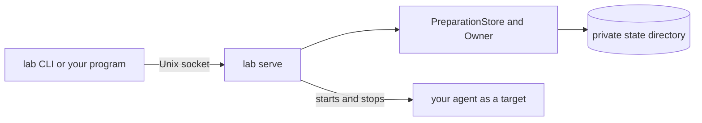

# CLI and local service

[Русский](ru/cli.md)

Everything Lab does can be driven from Python (`PreparationStore` and
`Owner`). The `lab` command is a second way in: a small command-line client
for a **local Lab service** that exposes the same actions. Use it when you
prefer a shell, or when another program (such as the auto-evolve app) needs
to drive Lab without importing it.

**Measuring your own agent for the first time?** You do not need the service
for that. `lab new-project DIR` and `lab evaluate DIR` are offline commands
(new in 0.0.3.dev72): see
[Measure your own agent](first-evaluation.md#measure-your-own-agent) and
[Offline commands](#offline-commands-lab-new-project-and-lab-evaluate) below.
Come back here when another program needs to drive Lab step by step.

This page explains what the service is, how to start and stop it, and walks
through a full evaluation with the order-lookup assistant from the other
pages. Outputs marked "real" were captured on `evolution-lab 0.0.3.dev32` with
`evo-skills 0.3.0a21`; they remain historical producing-pair examples. The current
working pair is `evolution-lab 0.0.3.dev81` / exact `evo-skills 2.0.0b22`.
Use fresh state `~/lab-state/dev81-b22`; keep old runs/state with their producing
wheels. Owner schema 14 stores action approvals. The pair is released as tag
`lab-v0.0.3.dev81`; see `docs/RELEASES.md` for wheel checksums and source provenance.
For the concepts behind the commands, see [How Lab works](concepts.md).

For this page, activate the environment from Install so `lab` is on your
PATH. From the Lab checkout in that page's layout:

```bash
source .lab/venv/bin/activate
```

Replace `/home/you` in the paths below with your own home directory. These
are example absolute paths; Lab does not create the agent project or secret
files for you.

To check how much room a prepared campaign leaves for a model response, run `lab preflight`. It reads local inputs and can run with the service stopped. [Check a role’s context window](budget.md#will-a-role-request-fit-its-context-window)

## Find a command

`lab --help` groups commands by task: Start here; Run step by step;
Follow and inspect; Results; Agent processes and policies; Projects;
Service and maintenance. Start with `lab evaluate DIR`, `lab campaign DIR`
or `lab trace DIR --out FILE --disclose-private`. Use `lab view OPERATION`
to inspect a saved campaign.

### Old names

Existing scripts keep working: `lab target` → `lab agent`, `lab policy` →
`lab exec-policy`, `lab operation routing` → `lab routing`, `lab task` →
`lab job`, `lab release operation ID` → `lab release-operation ID`,
`lab target probe` → `lab probe`, and `lab campaign OPERATION` →
`lab view OPERATION`. The legacy `lab release KIND ID` also accepts target
and task references for manual cleanup attestation.

## What the service is (and is not)

`lab serve` starts one process that wraps a preparation store and an Owner
around one state directory, and listens on a **Unix-domain socket** (a file
on disk, not a network port). The `lab` client commands send HTTP requests
over that socket.



It is deliberately small:

- **Optional.** The Python API works without it.
- **One user, one machine.** No TCP listener, no remote access, no users.
- **Foreground, not a daemon.** It runs in your terminal until you stop it.
- **Nothing implicit.** It never starts a Target Service, check, conformance or run
  on its own, and it never retries a request for you.

Only `lab serve` needs the `service` extra (FastAPI and uvicorn; see
[Install](install.md)). The client commands, the help and `lab guides` work
with the base package.

## Start and stop the service

The state directory and the socket's parent directory must belong to you
and have mode `0700`. Paths must be absolute. Use a fresh state directory
for each version pair ([why](results.md#results-belong-to-their-version-pair)).

```bash
mkdir -m 700 -p /home/you/lab-run
lab serve --socket /home/you/lab-run/lab.sock --state /home/you/lab-run/state
```

`--socket` is optional. Leave it out and the service listens on
`<home>/service.sock` instead — the same Lab home that holds the project
registry ([Projects and scenarios](projects.md#the-socket-lives-in-the-lab-home)).
Client commands resolve the socket the same way, so a bare `lab serve --state
… --execution-wheel …` and bare `lab …` commands find each other without
either side naming a socket path.

The service creates the state directory if it is missing, and the socket
with mode `0600`. When it is ready it prints one line on stdout,
`lab serve: listening on <socket>`; its stderr stays JSON, so scripts can wait for
that line. Useful options of `lab serve`:

| Option | Meaning |
|---|---|
| `--socket PATH` | Socket to create. Optional; default `<home>/service.sock`. Refused with `socket_path_exists` if anything is already there. |
| `--state DIR` | The state directory. |
| `--home DIR` | The Lab home: the project registry that outlives version pairs, and its lock. Default `$LAB_HOME`, else `$XDG_DATA_HOME/evolution-lab`, else `~/.local/share/evolution-lab`. One service per home; a second one exits with `home_busy` ([details](../../lab/docs/api/service-s5.md#lab-home)). |
| `--durability VALUE` | `relaxed` or `strict`; overrides `EVOLUTION_DURABILITY` for the whole service. Default: the variable, else `relaxed`. |
| `--shutdown-wait-seconds N` | How long an orderly shutdown waits (default 30). A shutdown can take up to about twice this: first the operation it stopped settles, then the Owner closes, each within N. |
| `--execution-wheel PATH` | Repeatable. Exact Lab and Core wheel archives of the service's own interpreter; see below. |
| `--execution-runtime-file PATH` | Repeatable. Extra runtime files; needs at least one `--execution-wheel`. |

> **Tip: keep the socket path short.** The maximum Unix socket path is 107 bytes on Linux and 103 on macOS. A longer path is refused rather than silently rewritten: `lab serve` with `socket_path_too_long` (stage
> `transport`; the message names `--socket`), the CLI client with a usage
> error. A deep `--home` (or `$XDG_DATA_HOME`) is the usual cause when no
> `--socket` was given; pass `--socket` with a shorter path instead.
> `lab guides`, `lab scenarios`, `lab new-project` and `lab evaluate` never
> open a socket and reject both `--socket` and `--home`.

**Service environment.** With `--execution-wheel`, the service records its
own interpreter and the given wheels as "the service environment" at
startup, before it creates anything. Bundle requests can then say
`{"kind": "service"}` instead of listing interpreter and wheel paths, and
`lab health` shows the environment (real, trimmed):

```json
"service_environment": {"schema": "lab-service-environment/2",
  "digest": "be29fd17…", "executable": "/home/you/lab-venv/bin/python",
  "python_version": "3.14.7",
  "distributions": [{"name": "evo-skills", "version": "0.3.0a21", "wheel_sha256": "60cc05bc…"},
                    {"name": "evolution-lab", "version": "0.0.3.dev28", "wheel_sha256": "cbda1a3d…"}],
  "runtime_files": [], "proof_profile": "wheel-members/1"}
```

Put `digest` into your launch file's `environment_ref`
([Connect your agent](connect-agent.md#the-launch-file)); the target then runs
under that interpreter. If a wheel
changes after startup, Bundle creation fails with `environment_invalid`;
restart the service with the intended archives.

The `evo-skills` line above is real, captured on this pair. The
`evolution-lab` `wheel_sha256` is illustrative: bundled-guide edits (this
very page included) change the Lab wheel's bytes, so its hash is not a fixed
value to check against.

**Stopping.** Send `SIGTERM` (or `SIGINT`) to the service's PID only, for
example `kill -TERM <pid>`. The service stops admitting requests, asks
running work to stop, closes the Owner, removes its socket and prints its
shutdown result on stderr (real):

```json
{"schema":"lab-owner-shutdown/1","owner_generation":"3e2e5cde…","cleanup":{"state":"confirmed","complete":true},"blockers":[]}
```

Pressing Ctrl-C in the terminal signals the whole foreground process group,
so the target and workers may be stopped at the same time; cleanup is less
orderly. If the service died and left its socket behind, remove that file
by hand only after you are sure the old service is gone.

Every start of the service opens a new **Owner generation**. Connections
disappear on restart and must be made again; task and target references keep
the generation that produced them.

### Durability

Lab and Core default to `EVOLUTION_DURABILITY=relaxed`: a process crash is covered, but a host crash or power loss can lose recent work. Set `EVOLUTION_DURABILITY=strict` before starting Lab to restore the previous fsync calls and database settings. `lab serve --durability strict` overrides the variable for the whole service, including file receipts and workers; without the flag, the service uses the variable, else `relaxed`. Unknown variable values are refused at CLI startup with exit 2.

Relaxed SQLite databases use WAL with `synchronous=NORMAL`; their `-wal` and `-shm` sidecars are expected. Lab keeps its store connections open so operations do not checkpoint on each close. SQLite still syncs during initialization and checkpoints. Strict uses DELETE+FULL for Owner, probes and the budget ledger; the project registry keeps WAL+FULL. Switching WAL to DELETE needs the only connection: stop other users of the file first; a failed switch refuses the open.

Lab sets the effective durability in each Core or Lab process it launches, replacing a carried Bundle or prepared-environment value at launch. It also supplies its own `TMPDIR` when that launch environment lacks one. These additions change no Bundle or prepared-execution digest. The gateway receives durability through its private configuration. Keep the process setting fixed while Lab runs. See [host crashes](../running-campaigns.md#host-crashes-and-durability).

## Global flags

Global flags go **before** the command:

```bash
lab --socket /home/you/lab-run/lab.sock --json --timeout 60 status OPERATION
```

| Flag | Meaning |
|---|---|
| `--socket PATH` | The service socket. Without it, Lab resolves the same default `lab serve` would use: `--home`, else `$LAB_HOME`, else `$XDG_DATA_HOME/evolution-lab`, else `~/.local/share/evolution-lab`, plus `service.sock` ([the Lab home](../../lab/docs/api/service-s5.md#lab-home)). Neither is needed for `guides` or `scenarios`, which reject both. |
| `--home DIR` | The Lab home, when you are not relying on `$LAB_HOME` or the default and are not passing `--socket`. Same resolution both `lab serve` and every client command use. |
| `--json` | Print the complete public response as JSON. With `--wait`, the output is two JSON lines (NDJSON): the task reference `lab-task-ref/1`, then the final `lab-task-status/1` — read the last line (on exit 124, a local wait timeout, only the task reference was printed). Without it you get a one-line summary. |
| `--timeout SECONDS` | Limit for the request, and for the whole wait when a command has `--wait`. |
| `--request-id ID --generation G` | Use your own retry key for a mutating command (see [Safe retries](#safe-retries-after-a-lost-reply)). |
| `--no-request-id` | Send a mutating command without a retry key. |

Use `--json` when following this walkthrough: it includes the IDs and result
fields used by later commands. The one-line human summary is useful for a
quick glance, but does not include every field.

**Exit codes:**

| Code | Meaning |
|---|---|
| `0` | Success. With `--wait`: the task succeeded and its persistence did not fail. |
| `1` | The service refused (error JSON on stderr), or a waited task failed, ended `unknown` or could not save its result; for `lab watch`, also ten minutes without reconnecting or an unknown class after a failed final status read. |
| `2` | Usage error (bad flags, relative path, missing `--socket`). |
| `3` | Only `lab watch`: the campaign paused (Core suspended it); fix it by the `hint:` line, `lab resume`, then watch again. |
| `4` | Only `lab watch`: the operation ended abnormally (cleanup not confirmed, a failure including `core_refused`, or the result not saved); the `abnormal:` line names the cause. |
| `124` | The local wait or request timed out. Accepted work continues. |
| `125` | `acceptance_unknown`: a change may or may not have been accepted. |
| `130` | You interrupted the local wait. Accepted work continues. |

## Walkthrough: evaluate the order-lookup assistant

Use the [assembled order-lookup project](first-evaluation.md#assemble-the-files-for-your-own-agent),
with `evaluation-input.json` and `launch.json` at its root. This walkthrough
uses `/home/you/order-lookup` for that directory. Keep the same launch
settings and `seed_mode: "none"` throughout.

In one terminal, from the Lab checkout, start the service with its two wheel
archives (stop an earlier service before reusing its socket):

```bash
mkdir -m 700 -p /home/you/lab-run
lab serve --socket /home/you/lab-run/lab.sock --state /home/you/lab-run/state \
  --execution-wheel "$(realpath ../wheels)/evolution_lab-0.0.3.dev81-py3-none-any.whl" \
  --execution-wheel "$(realpath ../wheels)/evo_skills-2.0.0b22-py3-none-any.whl"
```

In a second terminal, activate the same environment, then:

```bash
S=/home/you/lab-run/lab.sock
lab --socket "$S" --json health
```

Copy `service_environment.digest` into `launch.json.environment_ref` and
use `service_environment.executable` as the scorer's `argv[0]`. The service
and target share that environment in this example. Each command below
performs one action.

**1. Freeze the inputs into a Bundle.** Save this request as
`/home/you/lab-run/bundle.json` (no `schema` field; the CLI adds it).
Paths are on the service's machine:

```json
{
  "source": {"kind": "evaluation",
             "input_path": "/home/you/order-lookup/evaluation-input.json",
             "launch_path": "/home/you/order-lookup/launch.json"},
  "environments": [{"kind": "service"}],
  "env": {"ORDER_ASSISTANT_MODEL": "example-model",
          "ORDER_ASSISTANT_TURN_TIMEOUT": "20"},
  "secret_names": ["ORDER_ASSISTANT_API_KEY"],
  "roots": [{"alias": "project", "source_path": "/home/you/order-lookup"}],
  "path_bindings": []
}
```

For a campaign, use `{"kind": "campaign", "manifest_path": ..., "launch_path": ...}`
as the source. Every key must be present. Then:

```bash
lab --socket $S --json bundle create --request /home/you/lab-run/bundle.json
lab --socket $S bundle show BUNDLE_DIGEST
```

Real human output: `lab-bundle-summary/2 36a0ff81…`. The JSON summary
lists `source_kind`, `launch_digest`, `environment_digests`, `secret_names`,
`entry_count`, `limitations` and `warnings`. Creating the same Bundle again
returns the same digest.

Use the response's `digest` as `BUNDLE_DIGEST` below. Keep
request and secret files outside the copied project root.

**2. Prepare the run conditions.** A prepare file for an evaluation names
the Bundle and the full schedule (`--request -` reads it from stdin). Save
it as `/home/you/lab-run/prepare.json`, replacing `BUNDLE_DIGEST`:

```json
{"kind": "evaluation", "bundle_digest": "BUNDLE_DIGEST",
 "selection": {"all": true}, "repeat_seeds": [null, null],
 "evaluation_set_id": "order-lookup-v1", "max_turns": 4,
 "timeout_seconds": 60, "metric_plan": {"primary": "score"},
 "runtime_policy": null, "max_failed_turns": null, "call_retries": null}
```

`max_failed_turns` and `call_retries` are both required keys of
`lab-service-prepare-request/3` (`null` means "not given": fall back to the
evaluation input's own `defaults`, then current Lab `retry` defaults). On a
campaign Bundle these failure settings are optional too and never inherited
from the manifest. `max_consecutive_unmeasured` selects request `/5`; `/4`
settings select `/4`. See [HTTP preparation](../../lab/docs/api/service-s5.md).

A request file without `split` goes to the service as `lab-service-prepare-request/2`, one with `split` as `/3`
(`lab prepare` chooses the version itself, the file never carries `schema`). `split` is `"train"`, `"test"` or
`null` (= train) and picks the part of a `/15` campaign Bundle's corpus the fixed evaluation measures:

```json
{"kind": "evaluation", "bundle_digest": "BUNDLE_DIGEST", "split": "test",
 "selection": {"all": true}, "repeat_seeds": [null, null],
 "evaluation_set_id": "order-lookup-v1", "max_turns": 4,
 "timeout_seconds": 60, "metric_plan": {"primary": "score"},
 "runtime_policy": null, "max_failed_turns": 1, "call_retries": "off"}
```

For a campaign it is just
`{"kind": "campaign", "bundle_digest": "…", "stop_grace_seconds": null, "cleanup_wait_seconds": null}`.

```bash
lab --socket $S --json prepare --request /home/you/lab-run/prepare.json
lab --socket $S --json prepared show PREPARED_DIGEST
```

The response's `digest` is `PREPARED_DIGEST`.

**3. Connect** the Bundle to this Owner generation. A connection lives only
in memory; connect again after every service restart.

```bash
lab --socket $S --json connect BUNDLE_DIGEST
# real: {"schema":"lab-owner-connection/1","id":"f88fc12a…","source_kind":"evaluation",...,"owner_generation":"3e2e5cde…"}
```

Use this response's `id` as `CONNECTION`.

**4. Start the target** (your agent). The final task status contains the
target's ID; keep it together with its `owner_generation`.

Create a private `/home/you/secrets/target.json` containing the declared
`ORDER_ASSISTANT_API_KEY` value (a dummy value for the synthetic adapter).
Create `/home/you/secrets/run.json` containing `{}`: this scorer uses no
secrets. Set both files to mode `0600`. The
[secrets section](#secrets-never-go-on-the-command-line) explains the format.

```bash
lab --socket $S --json target start CONNECTION --secrets-file /home/you/secrets/target.json --wait
lab --socket $S --json target status TARGET --generation GENERATION
```

The final task status returned by `--wait` has `ref.id` (use as `TARGET`)
and `owner_generation` (use as `GENERATION`). The first printed task ID is
not the target ID.

**5. Optional readiness tests.** Both are explicit and never required:

```bash
lab --socket $S --json check CONNECTION --target TARGET --generation GENERATION --wait
lab --socket $S --json conformance CONNECTION --target TARGET --generation GENERATION --wait
```

Conformance always stops the target afterwards; start a new one (step 4)
before the real run. `conformance` also takes `--runtime-policy FILE`.

**6. Start the evaluation and watch it.**

```bash
lab --socket $S --json start PREPARED_DIGEST --target TARGET --generation GENERATION \
  --secrets-file /home/you/secrets/run.json
lab --socket $S --json status OPERATION
lab --socket $S --json events OPERATION
lab --socket $S watch OPERATION
lab --socket $S --json list
```

`start` returns the operation status right away; it does not wait. Use its
`id` as `OPERATION` in subsequent commands. `events` prints the current state
and then each change until the operation ends. It
has no history: if you reconnect, you see only the present. For example,
this event was captured from the four-sample echo evaluation (payload
trimmed); the three-case order-lookup example schedules six samples:

```json
{"schema":"lab-operation-event/3","operation_id":"d0b514d5…","sequence":1,"kind":"status",
 "payload":{"control_state":"finished","results_state":"present","result_available":true,
            "progress":{"kind":"evaluation","coverage":{"expected":4,"scored":4},"observed_at":"2026-09-29T14:53:32.074010Z"},
            "progress_state":"present",
            "times":{"first_event_at":"2026-09-29T14:53:32.013118Z","last_event_at":"2026-09-29T14:53:32.074010Z"},
            "times_state":"present","start":1}}
```

`payload.start` is the number of the latest start; for a campaign that was
`resume`d it goes up by one each time. `progress` and `times` are `null` when
they cannot be given, and `progress_state`/`times_state` say why: `not_started`
(the journal does not exist yet, so a campaign's `result` is also still empty)
or `unavailable` (reading failed). For a campaign, `progress` also names the
`phase` (`baseline`, `reflection`, `generation`, `evaluation`, `selection`,
`finishing`, `suspended`, `finished`, `waiting`, `unknown`) and the round and attempt
counts; see [the reference](../../lab/docs/api/service-s5.md#progress-times-and-summaries).

**Follow it from a terminal: `lab watch`.** For a person, `lab watch OPERATION` replaces repeated `status` and
`campaign` calls: it prints a snapshot (the `lab campaign` lines and `progress:`), then one line per change with the
local time in front, and exits when the operation needs you or has ended. Only changed lines are printed; a new day
starts with `--- YYYY-MM-DD`. `--interval SECONDS` (default `10`) is how often at most the campaign view is re-read;
status changes are printed at once. Watch reads `lab-operation-status/7` and `lab-campaign-view/11`,
including family 14 (`/15` manifests) and family 15 (`/16` manifests). Family 15 prints separate gate and global
comparison lines, each with its scopes and short `reference_measurement_id`, plus preflight lines, just like
`lab campaign`. The nullable `comparison` field in JSON selects global when present, otherwise gate; Lab copies
the three recorded fields independently. See [watch keys](watch-campaign.md#reading-the-feed).

```bash
lab --socket $S watch OPERATION
nohup lab --socket $S watch OPERATION >> watch.log 2>&1 &   # leave it running; every line is flushed
```

When a summary is emitted, the last line is `watch ended: <finished|suspended|abnormal|unknown> start <N> exit <code>`,
with the exit code `0`, `3` (the campaign paused: the `suspended:`, `hint:` and `continuation:` lines say what to fix
and how to continue) or `4` (an
`abnormal:` line with the cause and a `hint:` line with the next command). A failed final status read that leaves the
class unknown produces `unknown` with exit `1`. Permanent refusal, exhausted reconnection, timeout, or `Ctrl-C` can
exit without a summary. After a service restart it reconnects on its
own (`reconnecting: <code>` … `reconnected`; changes during the gap show as one difference) and gives up after ten
minutes without success (exit 1, `interrupted_observation`). It is text only: `--json` is a usage error — use
`lab events` for JSON frames. What every line means and what to do: [Watch a campaign](watch-campaign.md).

To look at many runs at once without their full results, `lab list --summary`
prints one light row per operation (`lab-operation-summary-list/1`: state,
progress, times and the short outcome); `lab list` keeps the full statuses.

To stop early, `lab --socket $S stop OPERATION` requests a cooperative stop. It is a
request, not proof: keep reading `status`.

**7. Read the results, stop the target, delete when done.**

```bash
lab --socket $S --json report OPERATION
lab --socket $S --json target stop TARGET --generation GENERATION --wait
```

`lab report OPERATION --markdown` prints the same report as Markdown (`report.md`, the text `Report.markdown()`
builds); add `--output /home/you/out/report-OPERATION.md` to write it to a new file instead (mode `0600`; an existing
path is refused and left as it is). With `--output` the command prints the path and the byte count, or a JSON object
`{"path", "bytes"}` with `--json`. `--output` needs `--markdown`, and `--markdown` with `--json` needs `--output`
(Markdown is not JSON): both are usage errors (exit 2). An operation without a report answers `results_deleted` or
`report_unavailable` (exit 1).

The target stays `ready` after the campaign until you stop it: one target lives per Owner, and starting a target of
another Bundle refuses `target_slot_held`. In text mode `lab agent start` then prints `held by: <id> (generation <g>) —
lab agent stop <id> --generation <g> --wait`.

When you have saved any results you want to keep, deletion is a separate
optional action: `lab --socket $S --json delete-results OPERATION --wait`.

For a finished **campaign** there are three more commands:

```bash
lab --socket $S --json diff OPERATION
lab --socket $S --json export OPERATION --wait
lab --socket $S --json export-content OPERATION EXPORT_ID --output /home/you/out/champion.zip
```

`export-content` checks the ZIP's SHA-256 and writes a new file; it refuses
to overwrite an existing one. `diff` also takes `--from REF --to REF` to compare
any two saved trees (`initial`, `champion:vN`, `attempt:<attempt id>`); an
attempt without a saved tree answers `tree_unavailable`. Read-only views of the
same campaign:

```bash
lab --socket $S --json campaign OPERATION                # rounds, attempts grouped by outcome, champions
lab --socket $S --json suspensions OPERATION             # closed historical pause evidence
lab --socket $S --json measurements OPERATION            # every measurement of the campaign or evaluation
lab --socket $S --json measurements OPERATION MEASUREMENT  # one measurement with per-sample rows
lab --socket $S --json target list [--bundle DIGEST] [--ready]
```

On a `/15` campaign (Core family 14) the text form of `lab campaign` adds these lines (the JSON answer is
`lab-campaign-view/11`; a `/16` campaign prints its `independent` lines, one statement per scope as in [Results](results.md)):

```text
settings: stability=<stable|unstable> round_stop=<first_accepted|all_attempts> refresh=<off | every N, performed K>
connection: <state> <outcome> attempts=<n>[ detail=<code>[ at <manifest path>]]
round 1 promoted baseline=… final=selected:<attempt id>/<reason>
  a01 accepted … exact=<true|false|-> margin=<number> decision=<accepted|rejected|pending|unavailable>/<reason>
suspended: <reason>
hint: <what to repair>
```

`settings:` and `connection:` appear under the header; a round shows `final=` (`selected:…`, `incomplete listed=N`
or `none/<reason>`) from Core’s final measurement; a finalist shows `decision=`, the final measurement's verdict that
Core took (`accepted`, `rejected` with Core's reason, `pending`, `unavailable`). `connection:` carries codes and paths,
never values. A paused campaign prints `suspended:` and a `hint:` line; the hint text for a connection pause names both
exits ([Suspension](campaign.md#suspension)). The same facts are in the existing `Report.markdown()` output as the lines "Настройки", "Роли",
"Проверка подключения" and, per round, a final line (members, point values, exact contrasts, the choice).

`lab suspensions OPERATION [--json]` is a read-only history command, also available
as `GET /v1/operations/OPERATION/suspensions` and `Owner.suspensions(ref)`.
JSON is `lab-suspension-evidence/1`; text prints every returned pause and row,
including seq, reason, owner, evidence kind, count/truncated, fault reason/code
or row owner, and non-row threshold/stage fields. Successful emptiness prints
`no suspensions`. Unavailable history prints its reason rather than emptiness;
missing or deleted results are command errors. See the
[exact schema and refusal table](../../lab/docs/api/owner-s4.md#suspension-evidence).

These are identifiers/codes, without case text, reference, diagnostics or a
private-disclosure option. Truncated rows are the returned prefix (*shown N of
count*), not a complete remaining worklist. A historical pause remains after
resume; read current operation state separately. Neither this evidence, a
finalist nor a final selection proves a Champion transition: read Core's
recorded Champion lineage.

What these results mean is in [Read the results](results.md).

<a id="content-reads"></a>
**Read a sample, an attempt or a reflection.** These commands inspect completed content without
starting work:

```bash
lab --socket $S --json sample OPERATION MEASUREMENT CASE SAMPLE
lab --socket $S --json attempt OPERATION ATTEMPT
lab --socket $S --json reflection OPERATION REFLECTION
```

They return `lab-sample/1`, `lab-attempt/1`, `lab-reflection/1`. For example an attempt id is
`r01-a01`, a reflection id `r01-x01`; measurement ids can have `@e1`. Pass the original case/sample
ids (quote shell-sensitive characters); CLI encodes each path segment once. HTTP callers percent-encode
Core Unicode ids once; invalid ids and disclosure values return `invalid_request` naming the field.

Add `--disclose-private` to an individual command to reveal reference/oracle, scorer diagnostics,
verdict notes or private Reflector text. The equivalent HTTP query is `?disclose=private`; the default
is public with explicit withheld markers. **Do not pass these private flags or revealed reference and
diagnostics into the editing model's context: Core keeps the reference away from that model**.

Read state/reason alongside the data: a partial failure leaves readable sections available; incomplete
content is unavailable. Failed scoring preserves readable dialogue but exposes no result values;
raw scorer stdout appears only as private diagnostics. `attempt` gives the full evaluated look history
and Editor events/failure; `reflection` gives role events, not another copy of the hypotheses.
No scoring-try history or role `usage` is returned. `agent_cli` provides a summary with tool calls
not recorded and has unit coverage only, no real-run contract coverage.

`masking: "keys"` and `[REDACTED]` describe key/reasoning masking, not comparison with actual secret
values. All three responses always carry `truncation: [{path, size}]` (possibly empty): JSON Pointer
paths escape `~` as `~0` and `/` as `~1`; size counts characters after masking, before clipping.
Hidden fields and discarded entries are absent from this list. `truncated` also covers omitted lists
and replaced sections. The hard cap is 1 MiB including metadata: text/list tiers 16,384/200 →
4,096/100 → 1,024/40, then largest permitted sections become exactly
`{"state":"unavailable","reason":"too_large"}`. Their truncation entries are removed; public sample
`private` remains exactly `{"withheld":"private"}`. See the
[exact section unions and form fields](../../lab/docs/api/owner-s4.md#sample-attempt-and-reflection-content).
Limits are provisional pending the track E pilot; there are no Editor/scorer tokens or money here.

**8. Resume a suspended campaign.** An infrastructure failure inside a
rollout leaves a **campaign** operation suspended rather than failed;
`status`/`list` show it and, once it can be continued, print a `continuation:`
line naming the exact command (see [`lab status` continuation
line](#suspended-campaigns) below). Fix the target (or bring up another
`ready` target of the same Bundle), then:

```bash
lab --socket $S --json resume OPERATION --target TARGET --generation GENERATION \
  --secrets-file /home/you/secrets/run.json
```

This is the same shape as `start`: it takes the same secrets and a
`--target`/`--generation` pair, and answers `lab-operation-status/8`. The
target does not have to be the one the earlier start used, and `--generation`
does not have to be the generation that ran it — any `ready` target of the
same Bundle works, including after a service restart — except after a
`target_unstable` suspension, where it must be one the campaign has not used
yet (see the continuation lines below); after a Reflector or Editor
suspension (`reflector_provider_failed`, `reflector_failing`,
`editor_provider_failed`, `editor_failing`) there is no such requirement, and
`lab status` prints a `hint:` line about what to repair first. If `status` shows
`cleanup_required`/`orphaned`, run `lab cleanup operation OPERATION --wait`
first. Events and status now report the campaign's whole history: `status`'s
`starts` lists every start in order (`scope_id`, `target_ref`, `process`,
`target_cleanup`, `settlement`), and `events OPERATION` starts a fresh stream
that ends again at the next terminal `control_state`.

<a id="suspended-campaigns"></a>
**`lab status`'s `continuation:` line.** For a suspended campaign operation,
`status` prints an extra `suspended:` line and, when it applies, a
`continuation:` line with the exact next command:

```text
suspended: <reason> (owner=<owner>, evidence=<evidence_kind>)
continuation: lab resume OPERATION --target <ready target of the same bundle> --generation <owner generation>
```

The line follows the status's `resume` field
([details](../../lab/docs/api/service-s5.md#resume-readiness)):

- `ready` (`finished`, or `released` with confirmed cleanup) → the
  `lab resume …` line above.
- `cleanup_first` (`cleanup_required`/`orphaned`, or `released` whose cleanup
  fact was lost) → `continuation: lab cleanup operation OPERATION, then lab
  resume …`.
- `ready` or `cleanup_first` with `resume.target` set (after a `target_unstable`
  suspension) → the same lines, but the resume part reads `on a fresh target:
  stop target ID if it is still running (lab agent stop ID --generation
  GENERATION --wait), start a new target of the same bundle (lab agent start <connection>), then lab resume OPERATION
  --target <new target> --generation <owner generation>`, where `ID` is the
  operation's current target (`target_ref`, the latest start's target). `lab resume` on any target the campaign has
  used fails with `target_unstable_fresh_required` (409). When a `ready` target of the same
  bundle that the campaign has not used already exists (see `lab agent list --ready`), the
  text-mode line names it instead: `lab resume OPERATION --target <id> --generation <g> (a ready
  target of the same bundle the campaign has not used)`. JSON output is unchanged.
- `refused` after a manual `lab release-operation` → `continuation: not available
  after manual release; the run directory is kept until results are
  deleted`.
- `busy` or any other refusal → no `continuation:` line.

`refused: <code>[ at <path>] (<class>)` is printed when the latest start was
refused by Core (`failure.code: core_refused`); `<class>` is `hard` or
`authorizable`. It does not say whether the campaign can continue — the
`continuation:` line, which follows `resume`, does.

`ready` means the operation itself can continue; `lab resume` still checks
the target, secrets and free slots when you call it.

## Tasks, cleanup and release

Commands with `--wait` (target start and stop, check, conformance, export,
delete-results, cleanup) first print a task reference, then poll until the
task ends. Without `--wait`, you get only the reference. With `--json`, these are two JSON lines; parse line by line and take the last one (on exit 124, a local wait timeout, only the task reference was printed). Read a task later:

```bash
lab --socket $S --json task status TASK --generation GENERATION
lab --socket $S --json task stop TASK
```

When something is stuck in `cleanup_required`
([details](results.md#cleanup-orphans-and-manual-release)):

```bash
lab --socket $S --json cleanup operation OPERATION --wait     # KIND is operation, target or task
lab --socket $S --json release operation OPERATION --reason "Checked: no leftover processes, port 18765 free"
```

`cleanup` also accepts `--wait-seconds N`. `release` is your written
statement that you verified the leftovers yourself; it is not proof.

## Secrets never go on the command line

Arguments are visible to other processes and end up in shell history, so
the CLI has no flag that takes a secret value. `target start` and `start`
read a JSON object of name → value from a file or an open file descriptor:

```bash
# secrets.json: {"ORDER_ASSISTANT_API_KEY": "…"}   (chmod 600)
lab --socket $S --json target start CONNECTION --secrets-file /home/you/secrets/target.json --wait
lab --socket $S --json target start CONNECTION --secrets-fd 3 --wait 3< /home/you/secrets/target.json
```

The names must match what the Bundle declared: the target gets exactly its
launch secrets, the run exactly the names its roles need (see the
[Owner guide](../../lab/src/evolution_lab/guides/owner/README.md#inputs-and-privacy)).

## Safe retries after a lost reply

A reply can be lost after the service already accepted a change (for
example, on a timeout). Then you cannot tell whether it happened, and
retrying blindly could start a second target or run. The CLI handles this
with **retry keys**:

- Every mutating command carries a key. By default the CLI reads the current
  generation from `health` and generates a random key.
- On exit `125` the error names the key it used:

```json
{"error":{"code":"acceptance_unknown","stage":"transport","message":"The mutation acceptance is unknown."},
 "acceptance":"unknown","action":"bundle create","cause":"timeout",
 "request_id":"REQUEST_ID","owner_generation":"GENERATION"}
```

- Repeat the **same** command with that key. You get the original answer;
  the action does not run twice:

```bash
lab --socket $S --json --request-id REQUEST_ID --generation GENERATION \
  bundle create --request /home/you/lab-run/bundle.json
```

What can go wrong (all verified):

- The same key with a different command or parameters: `request_conflict`.
- A key from an older generation (the service restarted):
  `request_unknown_generation`. Nothing was done; inspect the state and decide.
- Key options on a reading command: usage error, exit `2`.

Keys live in the service's memory for one generation only (up to 10,000 per
class). If the table is full (`request_table_full`), retry with
`--no-request-id`. The CLI never repeats anything on its own.

## Offline help: `lab guides`

The package ships the reference guides for building Lab packages. These
commands read them from the installed package and never touch the service
(they refuse `--socket`, `--home` and `--timeout`):

```bash
lab guides path            # where the guides are installed
lab guides list            # name, file and one-line description (add --json)
lab guides requirements    # the requirements catalogue as JSON
```

[Install](install.md#step-4-check-the-installation) shows what to expect, and
[Evaluation inputs](evaluation-inputs.md#use-the-requirements-catalogue-as-a-checklist)
how to use the catalogue as a checklist.

## Offline commands: `lab new-project` and `lab evaluate`

New in 0.0.3.dev72. These two commands make a first measurement without the
service (they refuse `--socket`, `--home` and `--timeout`):

```bash
lab new-project DIR                                        # write the project skeleton into DIR
lab evaluate DIR --wheel LAB_WHEEL --wheel CORE_WHEEL      # measure it; add --python PATH, --json
```

`lab evaluate` opens its own Owner on `DIR/.lab/state-<pair>/` and does the
whole flow of this page's walkthrough in one call. Its exit codes are its own
(0 accepted, 1 not accepted, 2 project error, 3 a target that would not start
or a Lab or environment failure, 130 interrupted), not the client codes above:
[Exit codes](first-evaluation.md#exit-codes). It understands `"lab:auto"` in
the project files; the service and `lab bundle create` do not, so the
walkthrough above uses explicit values.

## The panel: `lab panel`

`lab panel` serves a read-only web page over the service on `127.0.0.1`
([The Lab panel](panel.md)). It needs the `panel` extra
(`pip install 'evolution-lab[panel]'`) and finds the service through the same
`--home` / `--socket` as every other command.

```bash
lab panel [--home H] [--socket S] [--port N] [--open]          # foreground; prints the link
lab panel [--home H] --background [--port N] [--open]          # detached; prints the link and returns
lab panel status [--home H]                                    # running or not
lab panel stop [--home H] [--wait-seconds N]                   # stop the panel of this home
```

`--json` gives `lab-panel-runtime/1`, `lab-panel-status/1` and
`lab-panel-stop/1` ([API](../../lab/docs/api/panel.md)). One panel runs per home.

## Next

- [Projects and scenarios](projects.md) — the same actions above, but
  recorded against a registered agent project instead of one Bundle: `lab
  project demo`/`create`, `lab project open` for an assistant workspace,
  `lab project status` as a checklist, and `lab project sync` to bring a cloned
  project up to date with the team repository.
- [Read the results](results.md) — what the reports, diffs and exports you
  fetched mean.
- [Pitfalls](pitfalls.md) — traps that spoil a measurement whichever way you
  drive Lab.

## Reference

- [Service guide](../../lab/src/evolution_lab/guides/service/README.md) — operator rules for the service.
- [Panel API](../../lab/docs/api/panel.md) — `lab panel` forms, errors and the forwarded-route allowlist.
- [Service and CLI API](../../lab/docs/api/service-s5.md) — every HTTP route, request file, retry-key rule and error code.
- [Projects](../../lab/docs/api/projects.md) — `lab project …`: register an agent project in the Lab home, make its Bundle, targets and runs through it, read its facts (`check.passed`, `baseline.measured`, `connected`) and accept changes, generate an assistant workspace with `project open`, bring a cloned project up to date with `project sync`, or try the whole loop for free with `project demo`.
- [Diagnostics guide](../../lab/src/evolution_lab/guides/diagnostics/SKILL.md) — reading exit codes, `unknown` and cleanup.
- Code: `src/evolution_lab/cli/parser.py` (commands and flags), `src/evolution_lab/service/` (the server).

## Authorized and linked continuation

For a project, use `lab campaign DIR --continue`; for a finished campaign, use `lab campaign DIR --from OPERATION`. Both take the installed wheel arguments. Refusals list every Core finding and the exact Lab acceptance syntax. `--accept CODE:DIGEST --reason TEXT` accepts named latest-start findings, with an optional Core-offered `--effect`. Use `--continue --reprepare` to prepare the edited project explicitly, or `--prepared ID` to select an existing preparation; status shows the current digest and changed per-start history, and report Markdown keeps that history. The service forms are `lab resume OPERATION --accept ... --reason ...` and `lab start PREPARED --linked-from OPERATION`, with target/generation/secrets as usual. Existing JSON status remains `/8`. See [Continue and link](campaign.md#continue-and-link).
