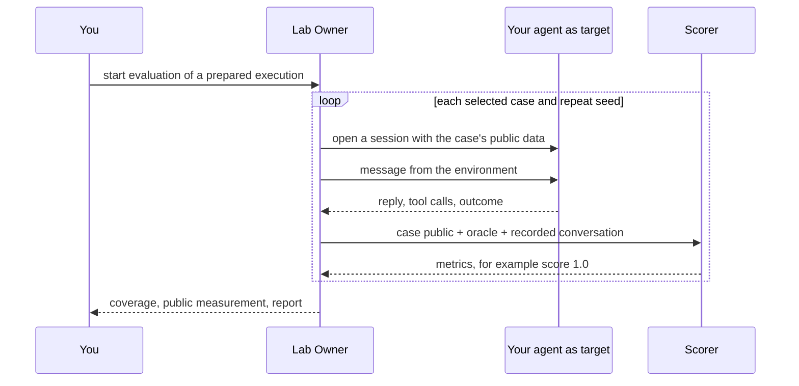
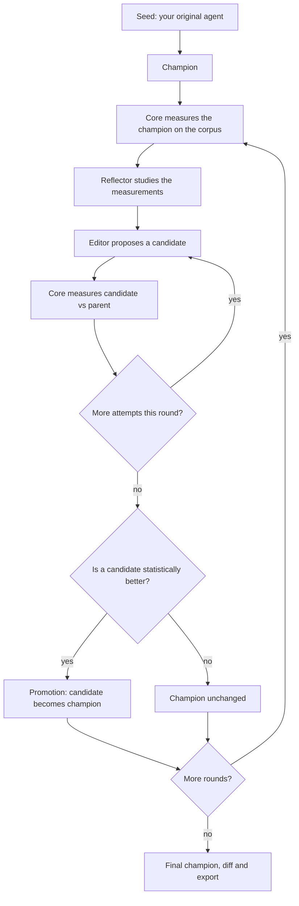

# How Lab works

[Русский](ru/concepts.md)

This page explains the ideas behind Evolution Lab before you touch any code.
Read it once end to end. Every later page assumes the words defined here, and a
[glossary](#glossary) at the bottom collects them for quick lookup.

## The problem Lab solves

You have an LLM agent — say, an **order-lookup assistant** that answers
customer questions by calling one tool, `lookup_order`. You want to make it
better: rewrite its prompts or skills, try another phrasing of an instruction,
and keep the change only if it really helps.

Doing that reliably is harder than it sounds:

- **"Better" needs a measurement.** You need a fixed set of test conversations,
  a way to score each answer, and one number you agree to compare.
- **LLMs are noisy.** The same agent can score differently on two runs, so one
  lucky run proves nothing. Comparisons need repeats and statistics.
- **Infrastructure fails.** A provider times out, a port is busy, a process
  dies. Such a failure says nothing about the agent's quality and must not be
  counted as a bad answer.
- **Experiments must be repeatable.** Someone else should be able to rerun
  your experiment on the same inputs and the same software and get a
  comparable result.

Lab exists so that every team does not have to build this scaffolding by
itself. Its guiding rule: **the evidence decides.** "No improvement" and
"the Candidate was rejected" are full, honest results, and an infrastructure
error is never reported as agent quality.

## Two pieces: the Evolution Core and Lab

Lab works together with a separate Core.

**The Evolution Core** (Python package `evo-skills`) runs the improvement loop itself. It proposes changes
through an *Editor*, measures them, applies the statistics and decides which
version wins. It alone writes the campaign journals and makes promotion
decisions.

**Lab** (Python package `evolution-lab`, command `lab`) does everything
around that loop:

| Lab does | Lab does not |
|---|---|
| Freezes your inputs into a reproducible package | Decide which version is better |
| Starts your agent as a service and checks it speaks the protocol | Write or edit Core's journals |
| Runs measurements and campaigns and tracks their processes | Contain agent-specific code, corpora or scorers |
| Cleans up processes and reports exactly what is known | Resume a run after its process died (see [Honest limits](#honest-limits)) |
| Shows results, diffs and exports of changed files | Apply changes to your project for you |

Lab is **agent-neutral**. Your agent's code, test cases and scoring logic stay
in your own project. Lab only reads them.

## Your agent as a *Target Service*

Lab never imports your agent into its own process. Instead it starts the agent
as a separate **target**: a local process that serves Core's HTTP
protocol (`/evolution/v2`) at a declared address and answers **one turn at a
time**. A *turn* is one incoming message and the agent's reply to it.

You do not implement the HTTP protocol yourself. Lab ships a small, neutral
Python contract (`evolution_lab.target.TurnAgent`) and a launcher that wraps it
in Core's server. Your code implements five methods — `describe`, `open`,
`turn`, `close_session`, `aclose` — plus a `build` function, and Lab does the
rest. [Connect your agent](connect-agent.md) walks through this.

Each turn ends with an **outcome**, and the difference matters:

| Outcome | Meaning | Effect on the score |
|---|---|---|
| `ok` | The agent answered. | Scored normally. |
| `candidate_failed` | The agent itself is broken in a repeatable way, for example it produced a malformed reply. | Counts against the agent. |
| `target_failed` | Something outside the agent's logic failed: a timeout, a flaky provider, anything uncertain. | Not scored. The sample is *indeterminate*; a campaign may retry it. |

The rule of thumb is simple: **when in doubt, report `target_failed`.** It
costs you one unscored sample, never a wrong score.

A target holds one or more **instances** (a loaded copy of the agent), and each
instance serves **sessions** (one isolated conversation each). How many of
each the target supports is something you declare.

## What a measurement is made of

Besides the target, every measurement needs four inputs. You write all of them
in your own project; [Evaluation inputs](evaluation-inputs.md) covers the
details.

**Corpus.** A file of **cases** (JSON Lines, one case per line). A case is one
scenario, for example "the customer asks where order A-100 is". Each case has
three compartments that different parties may see:

- `public` — what the agent sees (the customer's question);
- `private` — what only the environment sees (for example the scripted
  follow-up messages and a turn limit); the agent never receives it;
- `oracle` — what only the scorer sees: the expected answer and checks. The
  word *oracle* means protected reference data that is never shown to the
  agent or to the Editor as a hint.

**Environment.** The component that turns a case into messages for the agent.
A `static` environment sends one message taken from `public`; a `scripted`
environment plays a list of messages stored in the case, one per turn.

**World.** The data and behaviour of the systems the agent's tools talk to.
In a measurement these are replaced by simulations: `lookup_order` reads an
in-memory order store, not your real database. The agent only receives the
case's `public` part and the messages, so world data reaches it through
`public` or through fixture files — see
[Evaluation inputs](evaluation-inputs.md).

**Scorer.** A program you provide. For each finished conversation it receives
the case's `public` and `oracle` data plus the recorded conversation, and
prints numbers such as `{"score": 1.0}`. A crash or a timeout of the scorer is
a scoring error, never a score of zero.

**Metric.** The one number, among those the scorer prints, that you agree to
compare — for example `score`. You name this *primary metric* before running.

**Held-out cases.** Cases you keep aside to confirm an improvement at the end.
In a campaign every case's results feed back into the Editor, so a case that
was in the campaign corpus can no longer prove anything unbiased. Keep
held-out cases out of the campaign corpus and measure the winner on them
separately. Lab cannot check this for you; it is a rule for how you build your
corpus (see [Pitfalls](pitfalls.md)).

## Two kinds of work: fixed evaluation and campaign

### Fixed evaluation — measure an agent without changing it

A **fixed evaluation** runs a chosen set of cases against an unchanged agent
and reports the scores. There is no Editor and nothing is modified. Lab runs
it using Core's measurement building blocks.

You choose the cases explicitly — all of them, the first *N*, or a list of case
ids — and the **repeat seeds**, which decide how many times each case runs.
Two cases with two seeds give four scored samples, which is exactly what the
offline example in [Install](install.md) prints.

A **baseline** is a measurement of the starting version of your agent under
declared conditions. A fixed evaluation is the usual way to get one before you
start improving. [Run your first evaluation](first-evaluation.md) shows the
whole path.

### Campaign — let Core improve the agent

A **campaign** is a series of improvement attempts run and judged by the
Evolution Core. You decide up front which files may change (for example
`skills/**`) and which may not (your tool code). Then:

- The **Champion** is the current reference version. At the start it is your
  original agent, called the *seed*.
- The campaign runs in **rounds**. A round begins with Core measuring the
  current Champion on the corpus, with repeats.
- The **Reflector**, a role usually backed by an LLM, studies those
  measurements and prepares observations for the Editor.
- The **Editor**, another role usually backed by an LLM, reads a brief with the
  measurements and proposes a changed version, the **Candidate**. One Editor
  try plus its measurement is an **attempt**; a round can hold several.
- Core measures each Candidate against its **parent** — the Champion at
  the moment the attempt started.
- At the end of the round, Core's statistics decide whether a Candidate is
  clearly better. If so, Core **promotes** it: the Candidate becomes the
  new Champion. Otherwise the Champion stays.

This is the shape of the loop, not every rule: Core can, for example,
close a round early when the Champion showed no failures to work on. You
declare the number of rounds and attempts per round; the statistics and the
promotion decision belong to Core alone.

At the end you can read a diff between the seed and the final Champion and
export the changed files as a ZIP. Lab never applies that ZIP to your project;
that is your decision. See [Run a campaign](campaign.md) and
[Read the results](results.md).

## From files to a run: Bundle, prepared execution, Owner

Lab separates *freezing the inputs* from *running them*. This is what makes an
experiment repeatable.

**Bundle.** An immutable copy of everything you declared: the evaluation input
or campaign manifest, the launch file that says how to start your agent, the
corpus, the scorer and the agent files. It is identified by a *digest* (a
SHA-256 hash of its contents). Once created, a Bundle never changes; runs read
the saved copy, not your live project.

**Prepared execution.** The saved conditions for one run on top of a Bundle:
which cases, which repeat seeds, turn limits, timeouts, the primary metric.
Preparing runs nothing. It also has a digest, and changing any condition gives
a new one.

**Owner.** The Python object (`evolution_lab.owner.Owner`) that actually runs
things. It starts and stops the target, runs one evaluation, campaign or
conformance test at a time, and keeps track of processes and cleanup. One
Owner manages **one active operation and one managed target**. It lives in
your Python process; it is not a background daemon.

**State directory.** A private directory where Lab keeps Bundles, prepared
executions, run records and results. The preparation store and the Owner share
it.

**Version pair.** Lab and Core are always installed as an exact pair: the
current one is `evolution-lab 0.0.3.dev81` with exactly `evo-skills 2.0.0b22`.
The pair that produced a result is called its **producing pair**. Every state
directory belongs to one producing pair. When you upgrade to a new pair, you
start a new state directory; there is no migration of old Bundles or runs.
Dev80/b22 uses `~/lab-state/dev81-b22` and Owner schema 14, which stores action approvals. Keep old runs and state directories with the wheels that produced them.

## Check and conformance: two readiness tests

Before spending time or money you may want to know whether your target works.
Lab has two explicit tests, and you always start them yourself:

- **Check** — a quick connection test against a running target: is it healthy,
  does it report the expected identity and capabilities?
- **Conformance** — Core's full public protocol test suite, run against
  your target. It is available only if your launch file declares that this test
  runs offline, without paying for model calls. After conformance, Lab always
  stops that target; you start a fresh one for the real run.

Neither test is permission to spend money. A passing check or conformance tells
you the plumbing works, not that a paid run is safe or worthwhile.

## Three ways to use Lab

| Way | What it is | Who uses it |
|---|---|---|
| **Python API** | `PreparationStore` to freeze inputs, `Owner` to run them, in your own script. | Standalone users who script experiments; the main path in this guide. |
| **Local service + `lab` CLI** | `lab serve` exposes the same actions over a Unix socket; the `lab` command and programs call it. One user, one machine, no network. | People who prefer a command line, and programs such as the **auto-evolve** app, which builds experiment packages and drives Lab through this service. |
| **Legacy runner** | `evolution_lab.runner.run_native` / `resume_native`: an older campaign-only path. | Existing integrations. It is the only path that can continue a campaign after its process died, with limits. New work should use the Owner or the service. |

Lab treats standalone users and the auto-evolve app as **equal priorities**:
everything auto-evolve can do through the service, you can do yourself with the
Python API or the CLI. See [CLI and local service](cli.md).

There is also a single-campaign client, `evolution_lab.client`, kept for
existing callers; this guide does not cover it.

## Honest limits

- **No automatic resume.** If the Python process running the Owner (or the
  service) dies, nothing picks the operation up again on its own. A later
  Owner marks the leftovers orphaned; you inspect and clean up explicitly
  (`lab cleanup`). For a *campaign* operation, once it reaches `finished` or
  `released` with confirmed target cleanup, you can continue it explicitly on
  any ready target of the same Bundle — `Owner.resume(...)` / `lab resume`
  — even from a later Owner generation. This is not reattaching to the dead
  process: it is a new start over the same campaign journal. Evaluation and
  conformance operations have no such continuation.
- **Linux and macOS.** Linux retains its child subreaper. macOS combines a process group, a process tree polled every 0.5 s and an environment marker. On macOS, a process that leaves the group, escapes the tree between polls and hides the environment marker can survive a stop. The cleanup receipt names the mechanism; cleanup evidence uses that mechanism’s guarantee.
- **Built from source.** dev81/b22 is released as tag `lab-v0.0.3.dev81`;
  wheel checksums and source provenance are recorded in [RELEASES](../../lab/docs/RELEASES.md). Build Lab from its recorded source revision
  and use the delivered exact Core wheel ([Install](install.md)). Neither package is on PyPI.
- **No spending limit is enforced by the Owner.** An optional budget gateway can
  cap LLM spend for the processes that route through it; see
  [Budget and cost control](budget.md).

> **You may see these in older docs.** Decision records, notes and API
> references use internal work-package codes such as S1–S7, H1, W19 or
> "sudo wave". They are names of past development steps (for example, S3 is
> "conformance and fixed evaluation"). You do not need them to use Lab; the
> project glossary in `docs/product/GLOSSARY.md` decodes them.

## Glossary

| Term | Meaning |
|---|---|
| Attempt | One Editor try at producing a Candidate, plus its measurement. |
| Baseline | A measurement of the starting version under declared conditions. |
| Bundle | Immutable, digest-identified copy of all declared inputs. |
| Campaign | A series of attempts run and judged by the Evolution Core. |
| Candidate | A changed version proposed by the Editor, waiting to be measured. |
| Case | One scenario in the corpus, with `public`, `private` and `oracle` parts. |
| Champion | The current reference version in a campaign. |
| Check | A quick, explicit connection test against a running target. |
| Conformance | Core's full public protocol test, run offline against a target on request. |
| Corpus | The file of cases a measurement uses. |
| Editor | The campaign role that proposes changes. |
| Environment | The component that turns a case into messages for the agent. |
| Evolution Core | Core (`evo-skills`) that runs campaigns and decides promotion. |
| Fixed evaluation | Measuring an unchanged agent on chosen cases; no Editor. |
| Held-out cases | Cases kept out of the campaign to confirm the result independently. |
| Metric (primary) | The one scorer number you compare. |
| Oracle | Reference answers and checks seen only by the scorer. |
| Owner | The Python object that starts targets and runs one operation at a time. |
| Parent | The Champion a Candidate is compared against. |
| Prepared execution | Saved run conditions on top of a Bundle; preparing runs nothing. |
| Producing pair | The exact Lab + Core version pair that produced a result. |
| Promotion | Core's decision to make a Candidate the new Champion. |
| Reflector | The campaign role that analyses measurements for the Editor. |
| Scorer | Your program that turns a finished conversation into metrics. |
| Session | One isolated conversation inside a target instance. |
| State directory | Private directory holding Lab's saved data for one version pair. |
| Target | Your agent running as a local service of Core's protocol. |
| Turn | One message to the agent and its reply. |
| Turn outcome | `ok`, `candidate_failed` (agent's fault) or `target_failed` (uncertain or infrastructure). |
| Version pair | Lab and Core versions installed together, exactly matched. |
| World | Simulated systems and data the agent's tools use during a measurement. |

## Next

[Install](install.md) builds both wheels and runs a complete offline
example. Then pick your path in the [guide index](README.md#pick-your-path).

## Reference

For exact fields and error codes:

- [Target connector guide](../../lab/src/evolution_lab/guides/target-connector/SKILL.md) — turn contract, outcomes, launch file, capacity, conformance mode
- [Evaluation inputs guide](../../lab/src/evolution_lab/guides/evaluation-inputs/SKILL.md) — corpus, environment, scorer, metric
- [Campaign package guide](../../lab/src/evolution_lab/guides/campaign-package/SKILL.md) — manifest, editable scope, roles, scale
- [Preparation guide](../../lab/src/evolution_lab/guides/preparation/SKILL.md) and [Owner guide](../../lab/src/evolution_lab/guides/owner/README.md)
- [Diagnostics guide](../../lab/src/evolution_lab/guides/diagnostics/SKILL.md) — reading check, conformance and results
- API references: [preparation](../../lab/docs/api/preparation-s1.md), [Owner](../../lab/docs/api/owner-s4.md), [service](../../lab/docs/api/service-s5.md), [legacy runner](../../lab/docs/api/legacy-runner.md)
