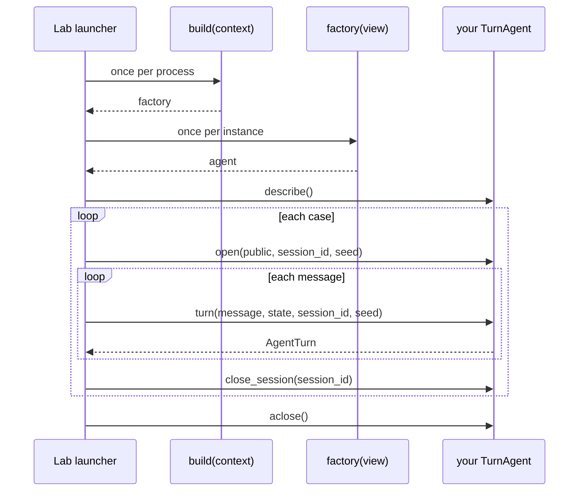
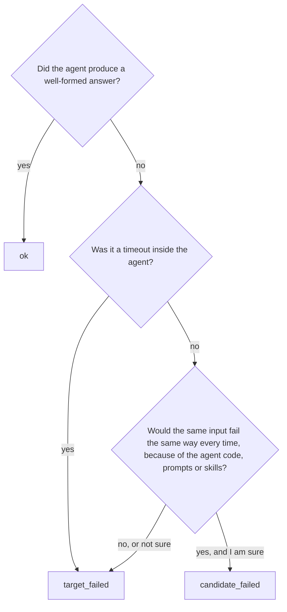

# Connect your agent

[Русский](ru/connect-agent.md)

**Goal:** measure your own agent with Lab. **You are done when**
`lab evaluate` prints `measurement accepted` for your agent and
`conversations.md` shows the answers your agent really gives. From there you
can design a real evaluation and run campaigns.

> **New in 0.0.3.dev72.** `lab new-project`, `lab evaluate` and the project
> skeleton ship from Lab 0.0.3.dev72. On 0.0.3.dev71 and earlier, read this page at tag
> `v0.0.3.dev71`; it connects an agent by editing the example script.

## Create, edit and evaluate a project

In the Lab checkout, `lab` is not on your PATH: use `just new-project DIR` and
`just evaluate DIR` (or `just lab ...`) where this page writes `lab ...`.

```sh
lab new-project ~/my-agent-lab
# edit the files marked "yours" in the map below
lab evaluate ~/my-agent-lab --wheel LAB_WHEEL --wheel CORE_WHEEL
```

From a Lab checkout, `just new-project ~/my-agent-lab` and
`just evaluate ~/my-agent-lab` do the same; `just evaluate` passes the two
wheel files in `.lab/wheels/` for you. If you installed Lab by hand,
`LAB_WHEEL` and `CORE_WHEEL` are the two wheel files you installed from (in
the [Install](install.md) layout, the files in `work/wheels/`).

`lab new-project` writes a **project skeleton**: a small working project with
a stub agent that needs no model. Run `lab evaluate` on it once before you
change anything. It measures the stub in a few seconds and shows you what a
successful run looks like. Then replace the stub, file by file.

What `lab evaluate` prints, where it keeps its files and what its exit codes
mean: [Measure your own agent](first-evaluation.md#measure-your-own-agent).

### Your files and Lab's files

```text
my-agent-lab/
  agent/my_agent.py      yours   your agent; the stub is a small lookup
  agent/adapter.py       yours   the Lab adapter: connects your agent to Lab
  seed/skills/SKILL.md   yours   the agent's prompt; a campaign may change it later
  corpus.jsonl           yours   the questions and their expected answers
  scorer/score.py        yours   decides what counts as a correct answer
  launch.json            shared  how Lab starts the adapter
  evaluation-input.json  shared  what to measure
  README.md              Lab's   a short version of this page, with a table per JSON file
  .gitignore             Lab's   keeps .lab/ out of git
  .lab/                  Lab's   written by lab evaluate: state and run files; do not edit
```

**The short path.** If your agent is a function `answer(question) -> str`, a
first measurement needs edits only in `agent/my_agent.py` and `corpus.jsonl`.
`adapter.py` needs no change: its `# TODO(you):` marks are for agents with
their own settings, state or errors (steps 1 to 4 below).

**The agent and the adapter are two files on purpose.** `my_agent.py` is your
agent. It knows nothing about Lab: `MyAgent(prompt).answer(question)` returns
the answer text. In a real project this file imports your agent instead of
containing it. `adapter.py` is the only file that imports
`evolution_lab.target`. It turns Lab's calls (open a conversation, answer one
turn, close it) into calls of your agent. Every place to edit in it is marked
`# TODO(you):`.

**Shared** files mix your fields and Lab's. Fields set to `"lab:auto"` are
Lab's bookkeeping: the Python environment digest, the local port, the
scorer's interpreter and three identity digests. Leave them as they are;
`lab evaluate` computes them for each run (see
[Identity digests](#choose-and-record-the-identity-digests)). The skeleton's
`README.md` lists every field and says whether you edit it.

### The fields of `corpus.jsonl`

One JSON object per line. A first project puts this in each row:

| Field | What goes there |
|---|---|
| `case_id` | A unique name for the case (`q1`). |
| `group_id` | Any string. One group for all cases, as in the skeleton (`codes`), is fine for a first measurement: groups matter when a campaign compares two versions of your agent, which weights every group equally ([Groups and strata](evaluation-inputs.md#groups-and-strata)). Before you compare versions, give independent scenarios their own groups and keep paraphrases of one question in one group. |
| `stratum` | Any string naming the kind of situation (`known`, `unknown`); results are reported per stratum. |
| `public.text` | The question, as the agent receives it. Never the expected answer. |
| `oracle.expected` | The expected answer; only the scorer sees it. |
| `oracle.critical` | `true` marks a hard constraint (in a campaign one failure rejects a version). The skeleton scorer always passes it; leave it as it is. |

The full rules: [Cases and the corpus](evaluation-inputs.md#cases-and-the-corpus).

## Before you start

- Lab is installed ([Install](install.md)) and you have run `just demo` or the
  offline example once.
- You can edit your agent's code.
- You know which Python environment your agent runs in (its virtualenv with
  its dependencies). If that is not the environment where Lab is installed,
  install Lab and Core there too and pass it as `--python`.
- Terms: *Target Service*, *turn*, *session*, *outcome*. See
  [How Lab works](concepts.md#your-agent-as-a-target) if they are new.

> The target process sees exactly the declared
> variables, so reading them through `os.environ` or through `context` is the
> same.
> The complete example uses `context`.

## Steps

These steps cover `agent/adapter.py` and the files that go with it. Each one
links into the [Reference material](#reference-material) below for the rules
behind it. Some steps split their advice in two: **To run** is the minimum
contract that makes your agent work under Lab, and **For correct results** is
what Lab additionally assumes so that the numbers mean what they say.

1. [Check how your agent is configured and keeps state](#step-1-check-how-your-agent-is-configured-and-keeps-state)
2. [Call your agent from the adapter](#step-2-call-your-agent-from-the-adapter)
3. [Map failures to turn outcomes](#step-3-map-failures-to-turn-outcomes)
4. [Write `describe()`](#step-4-write-describe)
5. [Run one turn offline](#step-5-run-one-turn-offline)
6. [Fill in the launch file](#step-6-fill-in-the-launch-file)
7. [Run `lab evaluate`](#step-7-run-lab-evaluate)

The running example in the reference part is an order-lookup assistant with
one tool, `lookup_order`. Its full, tested adapter is in
[Complete example](#complete-example-the-order-lookup-assistant).

### Step 1. Check how your agent is configured and keeps state

**Do:** identify how your agent handles these four things, then decide what
the adapter and `launch.json` need to supply. Background:
[What Lab assumes about your agent](#what-lab-needs-from-your-agent-and-why).

- **Settings.**
  *To run:* list the variables your agent reads in `launch.json` `env`. The
  target process sees those variables, plus the host durability and temporary
  directory settings described in step 6, so `os.environ` / `os.getenv` keep
  working. It inherits no other shell settings, including `PATH` or `HOME`.
  *For correct results:* declare every setting that changes behaviour (model,
  temperature, prompt location, endpoints, feature flags) in the launch file.
  Declared values are pinned and become part of the run's identity; a value
  read from somewhere else (a file in your home directory, a config service)
  is neither.
- **Conversation state.**
  *To run:* choose where to keep each conversation's history. It may live inside
  your agent, keyed by `session_id`, or in the JSON state returned to Lab.
  *For correct results:* two conversations must never share mutable state.
  The skeleton's adapter keeps a dict per `session_id` and drops it in
  `close_session`; keep it that way, or do the same for your agent's objects.
- **Outside systems.**
  *To run:* make the systems your tools need available to the target process.
  *For correct results:* a measurement must not touch production systems with
  side effects. Point the tools at test endpoints through the launch file's
  `env`, or pass in fakes.
- **Trace.**
  *To run:* only the final answer text is needed.
  *For better campaigns:* also return the tool calls and results as events
  (step 2), so the scorer and the campaign Editor can see what the agent did.

**Done when:** you know which settings you will declare, how conversations are
kept apart, and which systems the tools will talk to during a measurement.

### Step 2. Call your agent from the adapter

**Do:** make `agent/my_agent.py` import your agent, then wire it into
`agent/adapter.py`. The adapter already has the shape Lab needs: a
`build(context)` function and a class with five methods (the *TurnAgent*).
You change what is inside them:

| Place in `adapter.py` | What it does | What you change |
|---|---|---|
| `from my_agent import MyAgent` | imports your agent | Keep it, or import your own package directly. |
| `build(context)` | runs once per target process | Read declared settings from `context.env` and keys from `context.secrets`, and pass them to your agent. |
| `factory(view)` inside `build` | runs once per instance | Load prompts and skills from `view.root` (the measured copy of `seed/`), never from your checkout. The skeleton reads `skills/SKILL.md` there. |
| `MyTurnAgent.__init__` | creates your agent | Create your agent with the prompt and settings. |
| `open(public, *, session_id, seed)` | starts one conversation | Start a new conversation in your agent for this `session_id`. Keep the `conformance` flag (step 7). |
| `turn(message, state, *, session_id, seed)` | answers one message | Call your agent on `message.content` and return `AgentTurn("ok", answer)`. |
| `close_session(session_id)`, `aclose()` | release resources | Drop the conversation, then everything else. |

If your agent needs files besides the prompt, put the ones a campaign may
change under `seed/` and the fixed code under `agent/`. Add other code folders
to `program_paths` in `launch.json` (step 6).

*To run,* that is all. *For better campaigns,* pass the tool calls and results
as `events=[...]` in the `AgentTurn`, using these types so the campaign Editor
can see them: `tool_call` (with `name`), `tool_result` (with `name` and a short
`status`), `skill_read` (with `path`). If you prefer, Lab can also keep the
conversation state for you: return it from `open` and `turn` as JSON and it
comes back in the next `turn`. The
[complete example](#complete-example-the-order-lookup-assistant) works that way.
Details: [The turn contract](#the-turn-contract) and
[What you return from a turn](#what-you-return-from-a-turn).

**Done when:** `python -c "import adapter"` works from the `agent/` directory,
in your agent's environment.

### Report trace availability

Emit structured events for the behavior your scorer measures. For example, an agent that checks a tool result can emit a `result_check` event with a short status code. Define which events make the trace usable and report their availability on successful turns.

```python
from evolution_lab.target import AgentTurn

return AgentTurn(
    "ok",
    answer,
    events=(
        {"type": "trace_availability", "state": "complete"},
        {"type": "result_check", "status": "checked"},
    ),
)
```

Choose your own event names and define what each availability state means. Give the scorer a way to recognize absent evidence, including a missing availability event. Lab may cut events to fit the Target response limit. The scorer receives `output_truncated` when the response is marked as truncated.

If the Target knows that an infrastructure gap removed evidence required for the primary metric, return `target_failed`. If only a diagnostic is unavailable, the scorer can record it as `unknown` and still score the answer. Use `candidate_failed` for an observed defect of the loaded agent. See [how to score incomplete traces](evaluation-inputs.md#derive-feedback-from-the-trace).

### Report what the agent used

For `gate.provenance.kind: reported`, Core uses the baseline's reported inputs to select affected cases for each attempt. Return what the agent actually used on **each turn**; Lab does not infer this from `skill_read` or other events. Paths are relative to the loaded tree root (`AgentView.root`):

```python
from evolution_lab.target import AgentTurn, TurnProvenance

return AgentTurn("ok", answer, provenance=TurnProvenance(used=("skills/SKILL.md",)))
```

`provenance` is optional on any outcome. If the mandatory reply and provenance exceed `max_output_bytes`, Lab drops the whole provenance, never part of `used`; unknown inputs are treated conservatively as affected. Otherwise events are fitted into the remaining budget. Avoid secrets in `used`.

When a shared prompt includes an index of many skills, path-level reporting may mark all of them affected. Optionally provide `components()` on the agent: a map from component identifiers to rendered-content digests and source paths. Report the identifiers actually used in `TurnProvenance.used`. For example, for an index rendered from two files and one skill body:

```python
from evolution_lab.target import component

def components(self):
    return {
        "skill-index": component(self.rendered_index, ["skills/alpha.md", "skills/beta.md"]),
        "skill-alpha": component(self.alpha_body, ["skills/alpha.md"]),
    }
```

`component` hashes UTF-8 text or bytes and returns `sha256` and `sources`. Lab validates the map and scans it and `used` for launch secrets. An absent `components()` differs from an empty map. Core measures the complete instance-creation response against `max_output_bytes`: Lab does not reject, trim or drop a map for its size. Lab logs a warning when its upper bound exceeds the limit; this can be a false positive. Core can reject the actual oversized response with HTTP 500. Inspect target logs and increase the manifest limit or reduce the map if needed.

A campaign notice `baseline_provenance_unknown` means Core stored no provenance for any sample in the latest completed baseline: the target may have omitted it, including on some turns. With `reported`, every attempt then treats all cases as affected. Check that every turn reports its actual inputs and that the response limit is sufficient, then run a new campaign baseline. The notice is informational; partial baseline provenance does not produce it. With Core's evaluation provenance support, `lab evaluate` also warns when a project using `reported` has a finished sample but the Target reported no provenance. Older evaluations are identified by `provenance_not_recorded`.

### Step 3. Map failures to turn outcomes

**Do:** list every way a turn can fail in your agent and decide what each one
returns. The skeleton's `turn` already has the two `except` branches; put your
own exceptions into them:

| If this happens | Return |
|---|---|
| The agent answered — even wrongly | `AgentTurn("ok", ...)` |
| A defect of the agent version itself that would repeat on the same input: malformed output, a broken prompt template, an internal step limit hit | `AgentTurn("candidate_failed", ...)` |
| A timeout, provider or network error, or anything you cannot classify | `AgentTurn("target_failed", ...)` |
| The configuration is broken, so *every* turn would fail (missing key, unreachable model endpoint) | `raise TargetConfigurationError(...)` (from `evolution_lab.target`) |

Add a short `TurnReason(category, code)` where it helps (for example
`TurnReason("timeout", "turn_deadline")`); never put exception text in it.
Put your own deadline around the model call and return `target_failed` when
it fires. Why these rules: [Choosing a turn outcome](#choosing-a-turn-outcome).

**Done when:** no exception can escape `turn()` except
`TargetConfigurationError`, and every failure path returns an explicit
outcome.

### Step 4. Write `describe()`

**Do:** return a flat mapping that says how this instance was assembled — for
example `settings_sha256`, a digest of the non-secret settings, not the raw
model name or URL. Keep it to scalars (`str`, `int`, `float`, `bool`, `None`),
at most 32 keys and 4 KB, and
**no secret values**. Details: [`describe()`](#describe-a-statement-about-the-instance).

**Done when:** `json.dumps(agent.describe())` is under 4096 bytes, has no
nested objects and contains none of your secret values or role/scorer
environment values.

### Step 5. Run one turn offline

**Do:** drive your adapter directly, without Lab starting anything: build it
with a fake context, open a session, send one message. Save this script next
to the project (not inside it), for example as `try_turn.py`, and run it
from the project directory with the Python that has Lab installed:
`python ../try_turn.py`.

```python
import asyncio
import sys
from pathlib import Path

from evolution.tree import ArtifactPolicyV1, Message
from evolution_lab.target import AgentView, LaunchContext

sys.path.insert(0, "agent")
from adapter import build

context = LaunchContext(env={}, secrets={}, work_directory=Path("work"))
view = AgentView(root=Path("seed"), candidate_digest="0" * 64, dependency_digest="0" * 64,
                 policy=ArtifactPolicyV1((), (), ()), seed_mode="none")


async def main():
    agent = await build(context)(view)
    print(agent.describe())
    await agent.open({}, session_id="s1", seed=None)
    turn = await agent.turn(Message("What is the code word for alpha?", {}), {}, session_id="s1", seed=None)
    print(turn.outcome, "|", turn.text)
    await agent.close_session("s1")
    await agent.aclose()

asyncio.run(main())
```

With the stub it prints `{'agent': 'my-agent'}` and then
`ok | A1`. Put your settings into `env` and
`secrets`, and one of your questions into the message. A longer version
with tool events and a broken input is in [Try it offline](#try-it-offline).

**Done when:** the script prints an `ok` turn with your agent's answer (and
its tool events, if your agent emits them), and a deliberately broken input
produces the outcome you chose in step 3.

### Step 6. Fill in the launch file

**Do:** edit the fields of `launch.json` that describe your agent. Leave every
`"lab:auto"` in place.

- [ ] `env`: every non-secret variable your agent reads — through
  `os.environ` or `context.env` — including `PATH` or `HOME` if its libraries
  need them. The target process gets nothing else.
- [ ] `secret_names`: the names of the secret variables your agent reads, such
  as an API key. Set the values in your shell before `lab evaluate`; Lab reads
  them from its own environment and never writes them down.
- [ ] `identity.target_id`: a short name for your agent.
- [ ] `identity.seed_mode`: `none` for most LLM agents; keep
  `evaluation-input.json` `target.seed_mode` equal to it.
- [ ] `limits`: how many instances and sessions your agent really supports.
- [ ] `conformance`: keep `{"kind": "core-session-public/1"}` only if your
  adapter answers the self-test without paid model calls (step 7); otherwise
  set it to `null`.
- [ ] `agent` and `program_paths`: change them only if you rename
  `adapter.py` or add code folders.

Background on every key: [The launch file](#the-launch-file). The skeleton
writes the newest launch format, `lab-target-launch/3`.

**Done when:** `lab evaluate` gets past its project check. A mistake here
stops it with exit code 2, naming the file and the field.

### Step 7. Run `lab evaluate`

**Do:** decide about conformance, then run the measurement.

*Conformance* is Core's protocol self-test. `lab evaluate` runs it before
the measurement when `launch.json` declares it. The skeleton's adapter is
ready for it: in `open`, a session whose `public` has `"conformance": true`
is marked, and every turn of it gets a fixed text without calling your agent.
Keep that branch when you replace the stub, and conformance stays free. If
your adapter cannot answer without a paid call, set `conformance` to `null`.
Details: [Conformance mode](#conformance-mode).

Then measure:

```sh
lab evaluate ~/my-agent-lab --wheel LAB_WHEEL --wheel CORE_WHEEL
```

Add `--python PATH` when your agent runs in another virtualenv. That
environment must have the same Lab and Core installed from the same wheels.
If your agent calls a paid model, keep only a few cases in `corpus.jsonl` for
the first run.

**Done when:** the readout contains `measurement accepted` and the command
exits 0. Accepted means the run finished without a stop and enough samples
were scored (at least the input's `min_coverage`, default 0.95); it says
nothing about how high the scores are. A run that is not accepted prints
`Measurement not accepted` with the reason and exits 1.
When conformance fails, the reason lists the failed checks.

**If the target does not start.** Right after you edit `adapter.py` or
`my_agent.py`, the most likely failure is exit code 3 with
`target start not confirmed: target_unavailable`. It almost always means your
code failed inside the target process: the adapter did not import (a typo, a
package missing from the agent's environment), or `build` or `factory`
raised. A common cause is a setting your agent reads but `launch.json` does
not declare: apart from Lab's durability and temporary-directory settings, the
target process gets the declared `env` and secrets, not your shell's environment. The readout then shows the last lines the target
process wrote, with the traceback, under "The agent's process wrote (last
lines of …/stderr.log)", and names that file in "Open first". The full log is
`.lab/state-<pair>/scopes/<id>/stderr.log`. Paths in the traceback point at
the Bundle's copy of your files (`…/bundles/<digest>/inputs/project/agent/…`);
the line numbers are those of your `agent/` files. Background:
[How Lab starts your target](#how-lab-starts-your-target),
[Install → Troubleshooting](install.md#troubleshooting) and
[Pitfalls](pitfalls.md).

**Next:** replace the skeleton's three questions and scorer with a real
evaluation — [Evaluation inputs](evaluation-inputs.md) — and read
[Measure your own agent](first-evaluation.md#measure-your-own-agent) for
the run files.

### Without `lab evaluate`

`lab evaluate` is one way to drive Lab. The same steps are available as
explicit calls: the Python Owner
([what `lab evaluate` does inside](first-evaluation.md#what-lab-evaluate-does-inside))
and the [CLI and local service](cli.md). Those paths do not understand
`"lab:auto"`: every field needs an explicit value. A run of `lab evaluate`
shows the values it chose in `.lab/runs/<NNN>/resolved.json`, and
`.lab/runs/<NNN>/source/` holds the project copy with those values filled in
(without `.lab/`, and without what Lab leaves out of every Bundle at any
depth: `.git`, `.venv`, `__pycache__`, `.pytest_cache`, `.mypy_cache`,
`.ruff_cache`, `*.pyc` and `*.pyo`; a `venv` directory without the dot is
copied).

Starting a target yourself, with optional conformance, looks like this:

```python
from evolution_lab.owner import Owner, TargetRef

async with Owner.open(state_directory) as owner:
    connection = await owner.bind(bundle.digest)
    started = await owner.wait(await owner.start_target(
        connection, secrets={"MY_AGENT_API_KEY": api_key}))
    if started.state != "succeeded" or started.ref is None:
        raise RuntimeError(started.failure)
    target = TargetRef(started.ref.id, started.owner_generation)
    target_status = await owner.target(target)

    # Optional: only for a launch declaring core-session-public/1.
    conformance = await owner.wait(await owner.conformance(connection, target_ref=target))
    if (conformance.state != "succeeded"
            or conformance.persistence.state != "saved"
            or conformance.result is None):
        raise RuntimeError(conformance.failure)
    payload = conformance.result.payload
    print(payload["core_report"]["ok"], payload["cleanup"]["complete"],
          payload["target_cleanup"]["complete"], (await owner.target(target)).state)
```

Without conformance, stop after `owner.target(target)` and confirm
`started.state == "succeeded"` and `target_status.state == "ready"`. With
conformance, a good run prints `True True True stopped`. A task that
succeeded can still contain failed protocol checks; read
`core_report.checks` when `ok` is false. Conformance stops the target
afterwards; start a new one for the evaluation.

---

## Reference material

Current target protocol guidance uses Lab 0.0.3.dev81 with exact Core 2.0.0b22.
Core runs one turn at a time per instance: sessions on the same instance
never run their turns concurrently. A fixed evaluation can overlap samples
outside their turns and score them independently, but when agent turns take
most of the time, more sessions alone do not make baseline or holdout runs
proportionally faster. Keep older runs with the environments that produced them.

### What Lab needs from your agent, and why

Lab runs your agent as a **target**: a separate local process that answers one
turn at a time (see [concepts](concepts.md#your-agent-as-a-target)). The
contract that makes it *run* is small: the adapter from step 2 and the
outcomes from step 3. On top of that, Lab assumes four things so that results
are *correct*:

| Assumption | To run | For correct results | What goes wrong otherwise |
|---|---|---|---|
| **Declared settings** | List the variables your agent reads in the launch file. | Include every setting that changes behaviour, including defaults you rely on. | A changed hidden value changes the results but not the run's identity, so two runs that look identical are not. |
| **Separate conversations** | Choose agent-owned state or Lab's JSON state. | Conversations never share mutable state; release their resources in `close_session`. | One case leaks into the next, repeats of a case are not independent, and parallel sessions interfere. |
| **No real side effects** | Make the tool backends available. | Tools talk to test endpoints or fakes during a measurement. | A measurement changes real systems, and results depend on their current state. |
| **The turn's trace as data** | Only the final text. | Tool calls and results are returned as events. | The scorer and the campaign Editor see only the final text; wrong or skipped tool use stays invisible. |

### The turn contract

Lab ships a neutral contract in the `evolution_lab.target` package. It imports
no agent framework, so it works with whatever your agent is built on. You
never write an HTTP server: Lab's launcher wraps your code in the Evolution
Core's target server.



#### What you receive

- **`LaunchContext`** is passed to `build`. It has `env` (the non-secret
  settings declared in the launch file), `secrets` (the secret values you
  named) and `work_directory` (a private directory for this process, the
  place for caches and logs). For the built-in `/2`–`/3` launcher, `env` also
  contains Lab's effective `EVOLUTION_DURABILITY` and inherited `TMPDIR` when
  the target has no explicit value. This is not filesystem or network isolation.
- **`AgentView`** is passed to the factory. Its `root` is a read-only copy of
  the version of your agent being measured (the *Candidate*). It also carries
  the Candidate's digests, the artifact policy and the `seed_mode`. Load
  prompts and skills from `view.root`, never from your source checkout.
- **`Message`** is passed to `turn`. It has `content` (a string) and `fields`
  (a mapping). With a `static` environment, `fields` is the case's whole
  `public` mapping (see [Evaluation inputs](evaluation-inputs.md#the-environment)).

#### The five methods

| Method | When Lab calls it | What you return |
|---|---|---|
| `describe()` | Once, right after the factory builds the agent. | A small flat mapping that says how this instance was assembled. |
| `async open(public, *, session_id, seed)` | At the start of each conversation, with the case's `public` data. | The session's initial state, as JSON. |
| `async turn(message, state, *, session_id, seed)` | Once per incoming message, with the current state. | An `AgentTurn`. |
| `async close_session(session_id)` | When the conversation is over. | Nothing; release per-session resources. |
| `async aclose()` | When the instance is released. | Nothing; release everything else. |

#### What you return from a turn

`AgentTurn(outcome, text, events=(), state=KEEP, usage=None, truncated=False, reason=None, provenance=None)`:

- **`outcome`**: `"ok"`, `"candidate_failed"` or `"target_failed"` (see
  [Choosing a turn outcome](#choosing-a-turn-outcome)).
- **`text`**: the final answer. Lab turns it into the closing
  `assistant_message` event itself, so do not add that event yourself.
- **`events`**: the trace, in order. Each event is a mapping with a non-empty `type`. The scorer receives the recorded events. A `/16` campaign with the default full evidence view can also show custom events in the Editor's cited observations, within the role's evidence budget. In the allowlist view, the Editor receives projections of `tool_call`, `tool_result`, `skill_read`, `assistant_message` and `output_truncated`.
- **`state`**: the next session state, as JSON (finite numbers only). Return
  **`KEEP`** to leave the previous state unchanged, which suits a turn that
  failed.
- **`usage`**: token counts as Core's `evolution.tree.Usage(prompt, completion, cached, total)`, if you have them.
- **`reason`**: an optional `TurnReason(category, code)` with short codes matching `[A-Za-z0-9._-]{1,64}`. Use it on any outcome and keep exception text out of it. Core passes it to the scorer. The `/16` full view can also show it to the Reflector and Editor.

### Complete example: the order-lookup assistant

A complete adapter. A real assistant would call its language model where the
comment says so; this one uses a regular expression, so you can run it
offline. Save it as `agent/order_assistant_target.py`.

```python
"""Order-lookup assistant, connected to Lab through evolution_lab.target."""
from __future__ import annotations

import asyncio
import hashlib
import json
import re
from collections.abc import Mapping
from dataclasses import dataclass
from typing import Any, Protocol

from evolution_lab.target import AgentTurn, LaunchContext, TargetConfigurationError, TurnReason

ORDER_ID = re.compile(r"\b[A-Z]-\d+\b")


# --- Settings: built only from what the launcher hands over -------------------
@dataclass(frozen=True)
class Settings:
    model: str
    api_key: str
    turn_timeout_seconds: float

    @classmethod
    def from_context(cls, context: LaunchContext) -> "Settings":
        try:
            return cls(model=context.env["ORDER_ASSISTANT_MODEL"],
                       api_key=context.secrets["ORDER_ASSISTANT_API_KEY"],
                       turn_timeout_seconds=float(context.env["ORDER_ASSISTANT_TURN_TIMEOUT"]))
        except (KeyError, ValueError) as exc:
            # Every sample would fail: this is a broken configuration.
            raise TargetConfigurationError(f"missing or invalid setting: {exc}") from None

    def digest(self) -> str:
        public = {"model": self.model, "turn_timeout_seconds": self.turn_timeout_seconds}
        return hashlib.sha256(json.dumps(public, sort_keys=True).encode()).hexdigest()


# --- Injected backend: the "world" the tool talks to ----------------------------
class OrderStore(Protocol):
    async def get(self, order_id: str) -> Mapping[str, Any] | None: ...


class InMemoryOrderStore:
    def __init__(self, orders: Mapping[str, Mapping[str, Any]]) -> None:
        self._orders = {key: dict(value) for key, value in orders.items()}

    async def get(self, order_id: str) -> Mapping[str, Any] | None:
        return self._orders.get(order_id)


# --- The agent -----------------------------------------------------------------
class OrderAssistant:
    def __init__(self, settings: Settings, reply_template: str) -> None:
        self._settings = settings
        self._template = reply_template          # read from the candidate snapshot
        self._stores: dict[str, OrderStore] = {}  # one simulated world per session

    def describe(self) -> dict[str, Any]:
        # Flat scalars, no secrets: how this instance was assembled.
        return {"agent": "order-lookup-assistant",
                "settings_sha256": self._settings.digest(), "seed": "ignored"}

    async def open(self, public, *, session_id, seed):
        self._stores[session_id] = InMemoryOrderStore(public.get("orders", {}))
        # The session's initial state. Conformance opens with {"conformance": true}.
        return {"turns": 0, "offline": public.get("conformance") is True}

    async def turn(self, message, state, *, session_id, seed):
        if state["offline"]:                      # protocol self-test: never call the model
            return AgentTurn("ok", "conformance reply", state=state)
        try:
            async with asyncio.timeout(self._settings.turn_timeout_seconds):
                return await self._answer(message.content, state, self._stores[session_id])
        except TimeoutError:
            # A deadline is not a deterministic defect of the candidate.
            return AgentTurn("target_failed", "", reason=TurnReason("timeout", "turn_deadline"))

    async def _answer(self, text, state, store):
        next_state = {**state, "turns": state["turns"] + 1}
        match = ORDER_ID.search(text)             # a real agent asks its model here
        if match is None:
            return AgentTurn("ok", "Which order number should I look up?", state=next_state)
        order_id = match.group(0)
        events = [{"type": "tool_call", "name": "lookup_order", "arguments": {"order_id": order_id}}]
        order = await store.get(order_id)
        if order is None:
            events.append({"type": "tool_result", "name": "lookup_order", "status": "not_found"})
            return AgentTurn("ok", f"I could not find order {order_id}.", events=events, state=next_state)
        events.append({"type": "tool_result", "name": "lookup_order", "status": "ok", "result": dict(order)})
        try:
            reply = self._template.format(order_id=order_id, **order)
        except (KeyError, IndexError):
            # The template is part of the candidate and is broken: it fails the
            # same way on the same input every time.
            return AgentTurn("candidate_failed", "", events=events,
                             reason=TurnReason("candidate", "reply_template_invalid"))
        return AgentTurn("ok", reply, events=events, state=next_state)

    async def close_session(self, session_id):
        self._stores.pop(session_id, None)

    async def aclose(self):
        self._stores.clear()


# --- Entry point named in the launch file ---------------------------------------
def build(context: LaunchContext):
    settings = Settings.from_context(context)     # once per process, no event loop yet

    async def factory(view):                      # once per instance, on its own loop
        template = (view.root / "skills" / "reply_template.txt").read_text(encoding="utf-8")
        return OrderAssistant(settings, template.strip())

    return factory
```

`Settings.from_context` reads `context.env` and `context.secrets`; the session state is a small JSON dict
and the per-session `OrderStore` is dropped in `close_session`; each turn
returns `tool_call` and `tool_result` events; `lookup_order` goes through
`OrderStore`, filled from `public["orders"]` at `open`, because `public` is the
only case data your agent receives (see
[World data](evaluation-inputs.md#world-data-and-fixtures)). The file
`skills/reply_template.txt` belongs to the measured tree, so a campaign may
rewrite it — which is why a broken template is the Candidate's fault.

#### Try it offline

<details>
<summary>Offline script (no model, no target, runs in a second)</summary>

Put the adapter next to this script and run it with the same interpreter that
has `evolution-lab` installed:

```python
import asyncio
from pathlib import Path

from evolution.tree import ArtifactPolicyV1, Message
from evolution_lab.target import AgentView, LaunchContext

from order_assistant_target import build

Path("candidate/skills").mkdir(parents=True, exist_ok=True)
Path("candidate/skills/reply_template.txt").write_text("Order {order_id} is {status}.\n")

context = LaunchContext(
    env={"ORDER_ASSISTANT_MODEL": "example-model", "ORDER_ASSISTANT_TURN_TIMEOUT": "20"},
    secrets={"ORDER_ASSISTANT_API_KEY": "not-a-real-key"},
    work_directory=Path("work"),
)
view = AgentView(root=Path("candidate"), candidate_digest="0" * 64, dependency_digest="0" * 64,
                 policy=ArtifactPolicyV1((), (), ()), seed_mode="none")
public = {"text": "Where is order A-100?", "orders": {"A-100": {"status": "shipped"}}}


async def main():
    agent = await build(context)(view)
    print(agent.describe())
    state = await agent.open(public, session_id="s1", seed=None)
    turn = await agent.turn(Message(public["text"], public), state, session_id="s1", seed=None)
    print(turn.outcome, "|", turn.text, "|", [event["type"] for event in turn.events], "|", turn.state)
    await agent.close_session("s1")
    await agent.aclose()

asyncio.run(main())
```

It prints the description, then
`ok | Order A-100 is shipped. | ['tool_call', 'tool_result'] | {'turns': 1, 'offline': False}`.
Change the template to `Order {order_id} is {state}.` and the same turn comes
back as `candidate_failed` with reason `candidate / reply_template_invalid`.

This direct call skips Lab's own checks on `describe()`, state and output size.
Those run when the real launcher drives the agent.

</details>

### Choosing a turn outcome

| Outcome | Use it when | Effect |
|---|---|---|
| `ok` | The agent produced a well-formed answer, right or wrong. | Scored normally. |
| `candidate_failed` | The agent itself is broken in a way it would **reproduce on the same input**: a malformed reply, a broken template, an exhausted internal step limit. | Counts against this version of the agent. The sample is scored and never retried. |
| `target_failed` | The agent could not answer for any other reason: a timeout, a provider error, a network failure, or anything you cannot classify. | The sample is *indeterminate*: it is not scored. A campaign may retry it (`sample_retries`). A fixed evaluation follows its declared Core sample retries, then continues; only the documented global stops end it. |



The rules behind it:

- **A wrong answer is still `ok`.** Judging quality is the scorer's job.
- **A timeout inside the agent is always `target_failed`.** Otherwise a slow
  provider, not your change, could decide which version wins.
- **When in doubt, use `target_failed`.** It costs one unscored sample, never
  a wrong score. Nobody can check this choice from outside; it is yours.
- **Raise only for a broken configuration.** Any exception from your agent is
  a *fault* that stops the whole campaign at once. That is right only when
  every sample would fail: raise `TargetConfigurationError` then.

How many `candidate_failed` turns in a row a conversation survives is a
campaign setting, `campaign.budget.max_failed_turns`; a fixed evaluation has
its own separate `max_failed_turns` (new omission default: resolved `max_turns`),
set when it is prepared, never inherited from a campaign
manifest (see
[Evaluation budget](evaluation-inputs.md#the-fixed-evaluation-budget) and
[Pitfalls](pitfalls.md#fixed-evaluation-and-campaign-disagree-on-the-same-agent)).

### `describe()`: a statement about the instance

`describe()` records how this instance was configured: for example, a hash of
its settings (which covers the model without revealing it) and what it does
with the seed. It is called once when the instance is created and recorded with it.
It is not part of the run's
identity and no campaign role sees it, so it cannot be optimized against.

It must be a **flat** mapping of scalars (`str`, `int`, finite `float`,
`bool`, `None`), at most **32 keys** and **4096 bytes** as canonical JSON, and
must contain **no secret**: if the literal value of a launch secret appears in
it, the instance refuses to load. That check is a safety net; keeping secrets
out is your job. Avoid values that change between processes, such as a random
per-process fingerprint. Do not repeat values from role or scorer environments,
including model names, URLs and strings of 8 characters or more: a judge may
use the same model as the agent. Report `settings_sha256` instead of raw settings.

### Runtime rules worth knowing

- **One event loop per instance.** `build` runs once, synchronously, before any
  event loop exists. Create async clients and anything tied to a running loop
  in the factory, not in `build`.
- **Turns of one instance never overlap.** Campaigns can use more instances (`max_instances`). Fixed evaluation schedules
  samples on one instance with `concurrency <= max_concurrent_sessions`; that
  scheduling does not remove Core's serialization of turns.
- **State must be JSON.** A state that is not JSON (a client object, `NaN`)
  fails the call, and the session keeps its previous state. Lab stores its own
  copy, so mutating the returned object later has no effect.
- **Output is trimmed to fit.** If a reply exceeds `max_output_bytes`, Lab
  drops events from the end, invisible types first, and shortens `text` last.
  The final answer event is always kept.
- **Seeds.** Lab passes the session's seed to `open` and `turn` according to
  `seed_mode`. Declare `exact` only if the seed really makes repeats
  reproducible (for example, a fixed sampling seed on the model call).
  Language model providers are not deterministic, so most LLM agents should
  declare `unpaired` or `none`.

### The launch file

The launch file (`lab-target-launch/2`) tells Lab how to start your target.
Its set of keys is closed: every key below is required and no others are
allowed. The project skeleton writes `lab-target-launch/3`, which adds two
required keys, `reflector_probe` and `turn.empty_answer`
([what they do](campaign.md#reflector-probe-launch-lab-target-launch3)).
For the order-lookup assistant in a fixed evaluation:

```json
{
  "schema": "lab-target-launch/2",
  "agent": {"module": "order_assistant_target", "attribute": "build", "import_root": "agent"},
  "environment_ref": "<digest of the target's Python environment>",
  "program_paths": ["agent"],
  "env": {"ORDER_ASSISTANT_MODEL": "example-model", "ORDER_ASSISTANT_TURN_TIMEOUT": "20"},
  "secret_names": ["ORDER_ASSISTANT_API_KEY"],
  "endpoint": {"base_url": "http://127.0.0.1:18765"},
  "identity": {
    "target_id": "order-lookup-assistant",
    "contract_digest": "<64 lowercase hex characters>",
    "settings_hash": "<64 lowercase hex characters>",
    "runtime_ref_digest": "<64 lowercase hex characters>",
    "seed_mode": "none"
  },
  "policy": "evaluation-input.json",
  "limits": {"max_instances": 1, "max_concurrent_sessions": 4,
             "max_input_bytes": 1048576, "max_output_bytes": 65536},
  "startup_timeout_seconds": 30,
  "stop_grace_seconds": 10,
  "conformance": {"kind": "core-session-public/1"}
}
```

| Key | What to put there |
|---|---|
| `agent` | The module and the `build` function Lab imports. `import_root` is a directory, relative to the launch file, that Lab puts first on `sys.path`. Use `null` if your adapter is installed as a package in the target's environment. |
| `environment_ref` | The digest of the Python environment the target runs in. With `lab evaluate`, leave `"lab:auto"`. By hand: [Run your first evaluation](first-evaluation.md#2-describe-the-python-environment) shows how to get it. |
| `program_paths` | Files and directories of your adapter that Lab copies into the Bundle. Needed when `import_root` is set. |
| `env` | Non-secret settings. They must match the `env` you declare when creating the Bundle. |
| `secret_names` | Names only. The values are supplied when you start the target, for example `owner.start_target(connection, secrets={"ORDER_ASSISTANT_API_KEY": ...})`. |
| `endpoint.base_url` | A local address. It must equal `target.base_url` in your evaluation input or campaign manifest. With `lab evaluate`, leave `"lab:auto"` in both: Lab picks a free port for each run. |
| `identity` | Your own statement of what this target is. `seed_mode` must match the evaluation input or manifest. With `lab evaluate`, leave the three digests as `"lab:auto"`; otherwise supply them using the convention described below. |
| `policy` | The document carrying the artifact policy: the campaign manifest, or the evaluation input for a fixed evaluation. |
| `limits` | Capacity and size limits, see below. |
| `startup_timeout_seconds`, `stop_grace_seconds` | How long start-up may take, and the grace period on stop. |
| `conformance` | Whether the target can run Core's protocol self-test for free. See [Conformance mode](#conformance-mode). |

#### Choose and record the identity digests

All three must be 64 lowercase hexadecimal characters for the `/2` and `/3`
launchers. Although preparation accepts `null`, Core server refuses it at
startup. There are two ways to get them.

**With `lab evaluate`: leave `"lab:auto"`.** Lab computes each value by a fixed
rule
in a copy of the project, writes it to the run's `resolved.json` and names it
in the readout (`Lab filled: environment digest, port, scorer Python, 3 identity digests ...`):

| Field | Default under `"lab:auto"` |
|---|---|
| `contract_digest` | sha256 of the canonical JSON of `launch.json` as you wrote it, with the `"lab:auto"` markers in place. Editing `my_agent.py` or `adapter.py` does not change it; editing the launch declaration does. |
| `settings_hash` | sha256 of the canonical JSON `{"env": <launch env>, "secret_names": <sorted names>}`. Secret values never enter it. |
| `runtime_ref_digest` | The digest of the target's Python environment, the same value as `environment_ref`. |

The same rule fills the matching fields of `evaluation-input.json`
(`target.contract_digest`, `target.settings_hash`), so the two files always
agree. An explicit value always wins: write a digest into one field of a pair
and Lab copies it into the other. Two different explicit values in a pair stop
`lab evaluate` with exit code 2, naming both fields. `"lab:auto"` is
understood only by `lab evaluate`. Bundles, the Owner and the service never
see it, so for those paths you write the values yourself, as below.

**By hand: your own convention.** Lab compares these values; on these paths
it does not calculate them for your integration.

| Field | What it identifies | Where to put the same value |
|---|---|---|
| `contract_digest` | Your adapter's declared input/output contract. Hash a versioned description of that contract. | Launch `identity` and evaluation input or manifest `target.contract_digest`. |
| `settings_hash` | The non-secret settings that affect behaviour. Hash a stable JSON representation. | Launch `identity` and evaluation input or manifest `target.settings_hash`. |
| `runtime_ref_digest` | Your integration's runtime reference. Choose and retain a description of the runtime versions/files it covers, then hash it. Lab prescribes no universal inventory for this field. | Launch `identity`; the target advertises it back. |
| `environment_ref` | The Python environment verified by Lab. This is a separate value, not one of the three identity fields. | Launch `environment_ref`, from `describe_environment(...).digest`. |

For example, in the integration's own preparation code:

```python
import hashlib
import json

def json_digest(value):
    data = json.dumps(value, sort_keys=True, separators=(",", ":"),
                      ensure_ascii=False, allow_nan=False).encode("utf-8")
    return hashlib.sha256(data).hexdigest()

contract_digest = hashlib.sha256(contract_file.read_bytes()).hexdigest()
settings_hash = json_digest(launch_env)       # declared non-secret settings
runtime_ref_digest = json_digest(runtime_reference)
```

Here `contract_file` is your saved contract description, `launch_env` is the
launch file's `env` mapping, and `runtime_reference` is your saved runtime
description, for example package versions and file hashes. Preserve those
inputs with your integration so you can explain each digest. This is an
example convention, not extra validation or an attestation performed by Lab.
Dummy hashes in the synthetic lifecycle example are not a convention for a
real integration.

When you prepare a run, Lab also checks two limits against the evaluation
input or manifest: `max_input_bytes` must be at least `target.min_input_bytes`
(1 MiB by default), and `max_output_bytes` must be at most
`target.max_response_bytes`.

**Capacity.** `max_instances` is how many loaded copies of your agent the
target may hold. Campaigns can use more than one; fixed evaluation uses one
instance and can schedule several sessions within its declared capacity.
`max_concurrent_sessions` is how many conversations it serves at once; the
Core advertises this number but **does not enforce it**, so your code must stay
correct with that many sessions open. `max_input_bytes` and `max_output_bytes`
bound one request and one reply. Declare what your agent really supports:
both capacity numbers are part of a campaign's identity. How many instances a campaign needs, and which settings lower
it, is in [Campaign settings](campaign.md#target-capacity).

An older format, `lab-target-launch/1`, names a custom start command instead
of `agent`. You only need it if you write your own launcher; see the
[target connector guide](../../lab/src/evolution_lab/guides/target-connector/SKILL.md).

### How Lab starts your target

Target start and stop are always explicit. When you ask Lab to start one:

1. Lab runs `<target interpreter> -I -m evolution_lab.target.launch`. The `-I`
   flag puts Python in isolated mode, so `PYTHONPATH` and user site-packages
   are ignored. Your adapter must be installed in that environment or listed
   in `program_paths` with an `import_root`.
2. The process receives the declared `env` and secret values. For launch `/2`
   and `/3`, Lab replaces `EVOLUTION_DURABILITY` with its effective mode and
   supplies its `TMPDIR` only when the target has no explicit value. These
   launch-only settings are visible in `LaunchContext.env` and leave Bundle
   and prepared identity unchanged. No other shell variables are inherited;
   declare `PATH` or `HOME` if needed. The working directory is the private
   `work_directory`. External `/1` target environments keep their existing contract.
3. The launcher imports `agent.module`, calls `build(context)` and starts the
   Core's target server at `endpoint.base_url`.
4. Lab waits up to `startup_timeout_seconds` for a ready report, then checks
   that the target's health matches the declared identity and limits.

The target environment should have the same `evolution-lab` version as the one
that built the Bundle. If it does not, preparation shows a
`lab_version_mismatch` warning but continues; if the target then misbehaves,
check that warning first.

### Target under an execution policy

The optional [execution policy](budget.md#execution-policy-and-budget-gateway) lives outside the Bundle.
In the launch `env`, configure your adapter's model URL as
`http://127.0.0.1:8790/target/v1` and model as the policy route's
`client_model` (for example `target-client`). Those environment setting names
belong to your integration. Declare the policy's `target_token_name` in launch
`secret_names`; Lab fills it, so do not pass its value yourself. The gateway
rewrites the client alias to the policy's upstream `model` and sends no
upstream authorization for `api_key_secret: null`.

Review and confirm the policy with its expected digest, then start the target
using `start_target(..., execution_policy=digest)` or
`lab agent start CONNECTION --execution-policy DIGEST --wait`. Supply only
upstream keys and ordinary target secrets through the usual private secrets
input; upstream keys reach the gateway only. Lab runs the gateway with the
Owner interpreter and `gateway` extra, in a helper scope tied to the target,
then waits for target readiness. Stop/cleanup covers both scopes. No policy
means no Lab gateway and the existing launch behavior.

A suspended campaign can change routes only after target stop/cleanup →
review and confirm a new policy → start a target of the same Bundle → resume.
The complete gateway block and policy presence stay fixed. Stable client
URLs and aliases preserve the Bundle and Core identity; Core does not see the
route change. Lab checks neither served-model nor quantization equivalence;
the human is responsible for it. Keep `reasoning_effort` in the manifest and
put routed-role provider pins in the policy. See the
[complete policy and routing audit](budget.md#execution-policy-and-budget-gateway), including shared uses,
unavailable ledgers and the operator-run budget API that remains supported.

### Conformance mode

*Conformance* is Core's full public protocol test, run against your live
target. It opens a session with `public = {"conformance": true}` and sends
turns whose content is `"conformance"`. The `conformance` key in the launch
file says whether that is safe to run:

- `{"kind": "core-session-public/1"}`: you promise that the whole test runs
  offline, **without paid model calls**. Only this value lets Lab run
  conformance.
- `null`: no promise; Lab will not run conformance. (An older value found in
  earlier packages is still readable but also does not allow conformance.)

Lab cannot verify your promise, so keep it. Conformance never runs
automatically: you request it, and it always stops its target afterwards (see
[Read the results](results.md)).

### Framework bindings live outside Lab

If your agent is built on a shared framework or agent template, the code that
connects it to `evolution_lab.target` ships with the framework; Lab never
imports it. A good binding builds from `view.root`, translates the trace into
the event types above, maps failure codes onto the three outcomes (unknown
codes become `target_failed`) and keeps secrets out of `describe()`.

## Reference

For exact fields and error codes:

- [Target connector guide](../../lab/src/evolution_lab/guides/target-connector/SKILL.md): turn contract, outcomes, launch file, capacity, conformance mode
- [Pitfalls guide](../../lab/src/evolution_lab/guides/pitfalls/SKILL.md) and [Pitfalls](pitfalls.md)
- [Owner guide](../../lab/src/evolution_lab/guides/owner/README.md): target start, stop and cleanup
- [Preparation guide](../../lab/src/evolution_lab/guides/preparation/SKILL.md): Bundle and launch-file checks
- Source: [`src/evolution_lab/target/`](../../lab/src/evolution_lab/target/), the project skeleton in [`src/evolution_lab/quickstart/skeleton/`](../../lab/src/evolution_lab/quickstart/skeleton/), and a runnable owner-level example in [`examples/owner/evaluation.py`](../../lab/examples/owner/evaluation.py)
