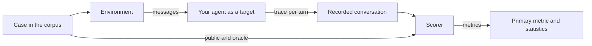

# Evaluation inputs

[Русский](ru/evaluation-inputs.md)

**Goal:** build the evaluation for your agent: the cases it is measured on and
the program that scores its answers. **You are done when** your corpus loads,
your scorer turns a hand-written sample into a result with your primary
metric, and every required item of the requirements catalogue has an answer.
Then you can freeze everything into a Bundle and measure.

The page has two parts. **[Steps](#steps)** is the checklist to follow.
**[Reference](#reference-material)** below it explains each input, what it is
for and the rules behind it. The steps link into it when you need detail.

Some steps carry two marks. **To run** is the minimum that Lab accepts. **For
correct results** is what Lab additionally assumes so that the numbers mean
what they say. Lab cannot check these assumptions for you.

The running example is the order-lookup assistant from
[Connect your agent](connect-agent.md).

Current input guidance uses Lab 0.0.3.dev81 with exact Core 2.0.0b22; session opening
continues to use the case's `public` data. Keep older inputs/runs with their
producing environments.

## Before you start

- Your agent is connected, or you at least have its adapter module
  ([Connect your agent](connect-agent.md)).
- You know whether you want a **fixed evaluation** (measure the agent as it
  is) or a **campaign** (let Core improve it). The inputs are the same;
  only the document that declares them differs (see
  [What you are building](#what-you-are-building)).
- Terms: *case*, *sample*, *Bundle*. See [How Lab works](concepts.md) if they
  are new.

## Steps

1. [Decide what you measure and name the primary metric](#step-1-decide-what-you-measure-and-name-the-primary-metric)
2. [Write the cases](#step-2-write-the-cases)
3. [Choose the environment](#step-3-choose-the-environment)
4. [Give your agent its world data](#step-4-give-your-agent-its-world-data)
5. [Write the scorer](#step-5-write-the-scorer)
6. [Set aside held-out cases](#step-6-set-aside-held-out-cases)
7. [Check against the requirements catalogue](#step-7-check-against-the-requirements-catalogue)
8. [Try it](#step-8-try-it)

### Step 1. Decide what you measure and name the primary metric

**Do:**

- [ ] Write down, in one sentence, what makes one answer better than another.
  For the order-lookup assistant: "it reports the right status of the right
  order, after looking it up".
- [ ] List the **kinds** of situation you care about (a known order, an
  unknown order, several orders in one message). They become your strata in
  step 2.
- [ ] Pick the name of **one** metric that the scorer will return for every
  sample, for example `score`. It is the *primary metric*. Other metrics may
  be recorded next to it but decide nothing.
- [ ] Decide which rules are **hard constraints**, where in a campaign one
  failure is enough to reject a version whatever its average (for example
  "never answer without a lookup"). Cases that check them are *critical* (step 2).
- [ ] Declare the metric: in a campaign manifest as `/campaign/metric`, in an
  evaluation input as `/metric_plan`, in both cases
  `{"primary": "score"}`.

*For correct results* in a fixed evaluation: Lab computes no summary from the
primary metric, so averaging and comparing is up to you. Name it anyway, so
that two evaluations with different plans cannot be mistaken for one another.
Details: [The primary metric](#the-primary-metric).

**Done when:** you have the metric name, the list of strata, and the rules
that are critical.

### Step 2. Write the cases

**Do:** create the corpus, `corpus.jsonl`: a UTF-8 file with **one case per
line**. Start from this line and write one per scenario:

```json
{"case_id": "lookup-shipped-1", "group_id": "order-A-100", "stratum": "single-order", "public": {"text": "Where is order A-100?", "orders": {"A-100": {"status": "shipped"}}}, "oracle": {"must_mention": "shipped", "critical": true}}
```

- [ ] `case_id`: unique in the file.
- [ ] `public`: what the agent may see: the message text and any world data
  (step 4). **Never** the expected answer.
- [ ] `oracle`: what only the scorer sees: the expected result and checks.
  Add `"critical": true` to the cases that check a hard constraint (step 1).
- [ ] `private` (optional): what only the environment needs (step 3).
- [ ] No case has `public.conformance: true`; that is reserved for the
  protocol self-test
  ([Conformance cases are reserved](#conformance-cases-are-reserved)).
- [ ] `reflection_metadata` only in a campaign corpus; an evaluation input's
  corpus refuses it.

*To run:* every case has `case_id`, `group_id`, `stratum` (any strings) and
`public`, and no fields beyond the table in
[Cases and the corpus](#cases-and-the-corpus).
*For correct results:* Core's statistics use them. Put cases that are
**not independent** (paraphrases of one question, the same order seen from two
angles) in **one group**, and use strata for the kinds of situation from
step 1. Why: [Groups and strata](#groups-and-strata).
Who sees which field: [Who sees what](#who-sees-what).

**Done when:** Core's own loader reads the file and prints the number of
cases, strata and groups you expect. Run it in the Python environment where
Lab is installed:

```sh
python -c "
from pathlib import Path
from evolution.tree.bindings import load_eval_corpus
cases = load_eval_corpus(Path('corpus.jsonl'))
print(len(cases), 'cases', sorted({c.stratum for c in cases}), len({c.group_id for c in cases}), 'groups')
"
```

For the three-case example corpus it prints
`3 cases ['single-order', 'unknown-order'] 2 groups`. A broken line fails
with its line number, for example `CorpusError: missing_key at line 1` or
`duplicate_case_id at line 2`. For a campaign corpus use `load_reflection_corpus`
instead, and `.cases` on its result.

### Step 3. Choose the environment

**Do:** pick how a case becomes messages for your agent:

- **One question, one answer** → `static`. The message is
  `public[input_text_key]`, and the whole `public` goes along as its fields.
- **A conversation of several fixed messages** → `scripted`. Each case lists
  its messages in `private.script`, in order. A script does not react to what
  the agent answers.

Declare it under `/environment`:

| | Campaign manifest | Evaluation input |
|---|---|---|
| static | `{"kind": "static"}` (`input_text_key` defaults to `text`) | `{"kind": "static", "input_text_key": "text"}` (required) |
| scripted | `{"kind": "scripted"}` | `{"kind": "scripted", "input_text_key": null}` |

Details and a scripted example: [The environment](#the-environment).

**Done when:** every case carries its messages. With `static`, a case without
the key gets an **empty message and no error**, so check it (replace `text`
with your key):

```sh
python -c '
import json
for line in open("corpus.jsonl", encoding="utf-8"):
    if line.strip():
        case = json.loads(line)
        if not case["public"].get("text"):
            print("no message text:", case["case_id"])
'
```

It prints nothing when all cases are fine. With `scripted`, check
`case.get("private", {}).get("script")` the same way.

### Step 4. Give your agent its world data

**Do:** decide how the data behind your agent's tools (the orders that
`lookup_order` reads) reaches it for each case, and wire your adapter
accordingly. Pick one route per kind of data:

- [ ] **In `public`**, under a key your adapter's `open` routes to the tool's
  backend (the example loads `public["orders"]` into its order store).
- [ ] **In a fixtures file inside the measured tree**, chosen by a small key
  in `public`.
- [ ] **In the `fields` of scripted messages**, when the world changes during
  the conversation.
- [ ] If answers depend on "now", a **reference time**: a setting in the
  launch file's `env` or a field in `public`.

*To run:* your agent receives `public` when the session opens, and the
messages. It **never** receives `private`, so data you put there does not
reach its tools.
*For correct results:* all world data comes from the case, through the routes
above, never from live systems or the system clock. Otherwise the same case
gives different results on different days.
Details: [World data and fixtures](#world-data-and-fixtures).

**Done when:** you paste one case's `public` into the
[offline script](connect-agent.md#try-it-offline) from Connect your agent, and
the tool reads that case's data (a known order is found, an unknown one is
not).

### Step 5. Write the scorer

**Do:** write a Python script, outside the measured tree, that reads one
sample as JSON on stdin and writes one result as JSON on stdout. Start from
the [example scorer](#example-scorer) and adapt it:

- [ ] Read `oracle` for the expected result and `view.history.turns` for what
  the agent did.
- [ ] Return `metrics` with your primary metric in **every** result.
- [ ] Return `critical_pass` (a boolean) when the case's `oracle.critical` is
  `true`.
- [ ] Use only the keys `metrics`, `critical_pass`, `verdicts`,
  `public_feedback`, `diagnostics`, `details` with the current `/15` and `/16` campaign contracts. Never copy `oracle` into `public_feedback`.
- [ ] Exit non-zero when you cannot score. That makes a scoring error, which
  is never counted as a zero.
- [ ] Declare it with `argv`, `cwd`, `dependency_paths`, `allowed_env` and
  `timeout_seconds` (plus `"kind": "subprocess"` in an evaluation input). Use
  a script path in `argv`, not `python -m`.

*For correct results* when the scorer calls a language model as a judge: pin
the model, keep its temperature low, list its prompt files in
`dependency_paths`, and exit non-zero when the call fails. See
[Judges](#judges-scoring-with-a-language-model).
Contract: [The scorer](#the-scorer).

**Done when:** a hand-written sample gives the result you expect. Save a
sample as `sample.json`, for example:

```json
{"case_id": "lookup-shipped-1", "public": {"text": "Where is order A-100?", "orders": {"A-100": {"status": "shipped"}}}, "oracle": {"must_mention": "shipped", "critical": true}, "view": {"history": {"turns": [{"message": {"content": "Where is order A-100?", "fields": {}}, "events": [{"type": "tool_call", "name": "lookup_order"}, {"type": "tool_result", "name": "lookup_order", "status": "ok"}, {"type": "assistant_message", "content": "Order A-100 has shipped."}], "outcome": "ok"}]}, "terminal": "completed", "target": {}}}
```

and run `python scorer/score.py < sample.json`. The example scorer prints
`{"metrics": {"score": 1.0, "tool_used": 1.0}, "verdicts": [...], "critical_pass": true}`
and exits 0. Change the answer text to a wrong status and check that `score`
drops to `0.0`.

### Step 6. Set aside held-out cases

This step matters for campaigns. A fixed evaluation that is not followed by
a campaign can skip it.

**Do:**

- [ ] Write a second corpus file, for example `held-out.jsonl`, with cases the
  campaign never sees. Same format as step 2.
- [ ] Do not copy their content into the campaign corpus, the Editor's
  prompt or the agent.
- [ ] Plan to measure the final Champion on them with a separate fixed
  evaluation after the campaign
  ([how](#held-out-cases)).

*To run:* nothing; a campaign runs without held-out cases.
*For correct results:* every case a campaign has seen feeds back into its
Editor and Reflector, so only held-out cases give unbiased proof that the
final version is better. Lab cannot enforce this.

**Done when:** the held-out file exists and shares no case with the campaign
corpus. This prints nothing when they are separate:

```sh
python -c '
import json
def cases(path):
    return [json.loads(line) for line in open(path, encoding="utf-8") if line.strip()]
campaign, held_out = cases("corpus.jsonl"), cases("held-out.jsonl")
ids = {c["case_id"] for c in campaign}
publics = {json.dumps(c["public"], sort_keys=True) for c in campaign}
for case in held_out:
    if case["case_id"] in ids or json.dumps(case["public"], sort_keys=True) in publics:
        print("also in the campaign corpus:", case["case_id"])
'
```

It compares case names and exact `public` data only; paraphrases of a
campaign case are for you to catch.

### Step 7. Check against the requirements catalogue

**Do:** list the requirements for your kind of work and go through them:

```sh
lab guides requirements --json | python3 -c 'import json,sys; d=json.load(sys.stdin); [print(i["id"], i["obligation"], i["guide"]) for i in d["items"] if "evaluation" in i["applies_to"]]'
```

Use `"campaign"` instead of `"evaluation"` for a campaign. The `eval.*` and
`world.*` items are this page; the `agent.*`, `launch.*` and `target.*` items
are [Connect your agent](connect-agent.md). Note the catalogue's `digest` if
you record that you went through it. Details:
[Use the requirements catalogue as a checklist](#use-the-requirements-catalogue-as-a-checklist).

**Done when:** every `required` item in the list has an answer in your
package.

### Step 8. Try it

**Do:** measure your agent once on a few cases with `lab evaluate`
([Measure your own agent](first-evaluation.md#measure-your-own-agent)): it
runs every case of `corpus.jsonl` with the input's `repeat_seeds`, so keep
only a few lines there for this try. With the Python Owner or the service,
pick the cases and repeats as described in
[Selection, repeats and coverage](#selection-repeats-and-coverage).

**Done when:** the evaluation has finished without a stop, its persistence is
saved, and its scored fraction meets the prepared `min_coverage` (default 0.95;
pre-dev60 descriptors retain 1.0). Read “N of M” and the `unmeasured` list for a
partial result, and check your primary metric in the scored samples.

**Next:** read what the numbers mean in [Read the results](results.md), or
let Core improve your agent in [Run a campaign](campaign.md).

---

## Reference material

### What you are building

A measurement is only as good as its inputs. Besides your agent, Lab needs
four of them: a **corpus** of cases, an **environment** that turns a case into
messages, a **scorer** that turns a finished conversation into numbers, and a
named **primary metric**.

The inputs are the same whether you run a fixed evaluation or a campaign. Only
the document that declares them differs: a campaign manifest
(`evolution-v2-manifest/15`, or the opt-in `/16`) or an evaluation input
(`lab-evaluation-input/1`, `/2` or `/3`).
[Run a campaign](campaign.md) and [Run your first evaluation](first-evaluation.md)
show those documents in full.

For a Bundle of kind `evaluation`, set `launch.policy` to the evaluation input
itself, for example `"policy": "evaluation-input.json"`. A campaign manifest
beside it is not the evaluation's policy source; pointing there is refused
with `unsupported_input`, naming `launch.policy`. Lab generates its internal
conformance manifest when bundling and binds the saved launch to that file.



### Cases and the corpus

The corpus is a UTF-8 JSON Lines file: **one case per line**. A case is one
scenario, for example "a customer asks where order A-100 is". Each case has
these fields:

| Field | Required | What it is for |
|---|---|---|
| `case_id` | yes | A name, unique in the corpus. |
| `group_id` | yes | Which cases belong together, for example variants of one scenario (see below). |
| `stratum` | yes | Which slice of the corpus the case belongs to, for example `single-order` or `unknown-order`. |
| `tags` | no | A list of strings for your own bookkeeping. |
| `public` | yes | What the agent may see. |
| `private` | no | What only the environment sees. |
| `oracle` | no | What only the scorer sees: expected results and checks. |
| `reflection_metadata` | no | Campaign only: diagnostic notes for the Reflector (at most 64 keys, 16384 bytes). An evaluation input's corpus refuses this field. |

Here is a case for the order-lookup assistant, spread over several lines so
you can read it. In the file it must be a single line.

```json
{
  "case_id": "lookup-shipped-1",
  "group_id": "order-A-100",
  "stratum": "single-order",
  "tags": ["happy-path"],
  "public": {"text": "Where is order A-100?", "orders": {"A-100": {"status": "shipped"}}},
  "oracle": {"must_mention": "shipped", "critical": true}
}
```

A small corpus might contain these three lines:

```json
{"case_id": "lookup-shipped-1", "group_id": "order-A-100", "stratum": "single-order", "tags": ["happy-path"], "public": {"text": "Where is order A-100?", "orders": {"A-100": {"status": "shipped"}}}, "oracle": {"must_mention": "shipped", "critical": true}}
{"case_id": "lookup-shipped-2", "group_id": "order-A-100", "stratum": "single-order", "public": {"text": "hi, can you check A-100 for me", "orders": {"A-100": {"status": "shipped"}}}, "oracle": {"must_mention": "shipped", "critical": true}}
{"case_id": "lookup-missing-1", "group_id": "order-B-7", "stratum": "unknown-order", "public": {"text": "Status of B-7?", "orders": {}}, "oracle": {"must_mention": "could not find"}}
```

#### Who sees what

The three compartments keep information away from parties that should not
have it:

| Party | Sees |
|---|---|
| Your agent | `public`, when the session opens, plus each message the environment sends. |
| Environment | `public` and `private`. |
| Scorer | `case_id`, `public`, `oracle` and the recorded conversation. Never `private`. |
| Campaign Editor and Reflector | Neither `oracle` nor `private`. They see the primary metric and selected scorer output (see [What the scorer's output reaches](#what-the-scorers-output-reaches)). |

Never put the expected answer in `public`: the agent would read it.

#### Groups and strata

Groups and strata are not labels for your convenience. Core's statistics
use them. When a campaign compares two versions of your agent, it averages
repeats within each case, then cases within each group, then **weights every
group equally**. Its confidence interval resamples whole groups, then cases,
then repeats.

What that means for you:

- Put cases that are **not independent** in one group: paraphrases of the same
  question, or the same order seen from two angles. Ten paraphrases in one
  group count as one scenario, which is honest. Ten paraphrases in ten groups
  would count as ten independent pieces of evidence, which is not.
- Use strata for the **kinds** of situation you care about (a known order, an
  unknown order, several orders in one message). A campaign Editor's brief
  reports results per group and per stratum, so good strata also make the
  feedback easier to read.

### The environment

The environment decides which messages your agent receives. There are two
kinds, declared under `/environment`:

- **`static`**: one message. Its `content` is `public[input_text_key]` and its
  `fields` are the whole `public` mapping. In a campaign manifest
  `input_text_key` is optional and defaults to `text`. In an evaluation input
  you must set it. If a case has no such key, the agent receives an empty
  message without any error, so check your corpus.
- **`scripted`**: several messages, taken in order from `private.script`, an
  array of `{"content": "...", "fields": {...}}` entries (`fields` optional).
  `input_text_key` is absent in a manifest and `null` in an evaluation input.

A script is fixed in advance. It does not react to what the agent answers.
The conversation ends when the script runs out (terminal `completed`), when it
reaches the turn limit (`turn_budget`), or when the sample's time limit
expires (`time_budget`). A case may lower the turn limit for itself with
`private.max_turns`.

A scripted case for a two-step conversation:

```json
{"case_id": "lookup-followup-1", "group_id": "order-A-100", "stratum": "multi-turn", "public": {"orders": {"A-100": {"status": "shipped"}}}, "private": {"script": [{"content": "Hi, I have a question about an order."}, {"content": "It's A-100."}]}, "oracle": {"must_mention": "shipped"}}
```

### World data and fixtures

The *world* is the simulated data behind your agent's tools, such as the
orders that `lookup_order` reads. Your agent receives exactly two things from
a case: `public` (when the session opens) and the messages. It never receives
`private`. So world data has to reach your injected backend through one of
these routes:

- **In `public`, under a key your code routes to the backend**, as in the
  example: `open` loads `public["orders"]` into the `OrderStore`, and only the
  message text goes to the model. The scorer can read this data too.
- **In files inside the measured tree** (for example a fixtures file listed
  in the manifest's `dependency_paths`), chosen by a small key in `public`.
- **In the `fields` of scripted messages**, when the world changes during the
  conversation.

`private` is still useful for what only the environment needs: the script and
`max_turns`.

If answers depend on "now" (for example "arrives in two days"), give the agent
an explicit **reference time**: a setting in the launch file's `env`, or a
field in `public`. Never let it read the system clock.

### Conformance cases are reserved

A case with `public.conformance: true` is reserved for Core's protocol
self-test. Preparation refuses a corpus that contains one, with the error
`reserved_public_input`. See [Conformance mode](connect-agent.md#conformance-mode).

### Selection, repeats and coverage

**A campaign measures its whole corpus.** A fixed evaluation measures an
explicit **selection**, chosen when you prepare it:

- `{"all": true}`: every case;
- `{"count": N}`: the first N cases, in file order;
- `{"case_ids": ["lookup-missing-1", "lookup-shipped-1"]}`: exactly these, in
  this order.

There is no random sampling. A selection makes no claim that it represents
the whole corpus.

**Repeats.** Each selected case runs once per entry in `repeat_seeds`. Three
cases with `"repeat_seeds": [null, null]` make six *samples*. Use integers
when the Target Service's `seed_mode` is `exact`, and `null` for `unpaired` or `none`
(see [seeds](connect-agent.md#runtime-rules-worth-knowing)). Each sample is
limited by `max_turns` and `timeout_seconds`. A sample that runs out of time is
indeterminate, not a low score.

**Coverage.** After a run, Lab compares the planned schedule with the samples
that were actually scored. Read it before you read any score (see
[Read the results](results.md)).

<a id="the-fixed-evaluation-budget"></a>
### The fixed-evaluation budget

Fixed evaluation has its own failure settings; it never reads a campaign's
`/campaign/budget/max_failed_turns`, `/campaign/call_retries` or other failure
keys. Choose the named [failure variant](campaign.md#run-failures)
before preparing a plan. All values below describe **new preparation**.

| Field | Fallback when absent or `null` | Limits and meaning |
|---|---|---|
| `sample_retries` | `3` | Integer 0–8; extra attempts for an unmeasured sample. `0` disables sample retries. |
| `min_coverage` | `0.95` | Finite number > 0 and ≤ 1; minimum scored fraction for accepting an evaluation without a stop. |
| `max_consecutive_unmeasured` | `3` | Positive integer N, or `"off"` to disable this stop. Count consecutive unmeasured scheduled samples after sample retries. |
| `max_failed_turns` | resolved `max_turns` | Positive integer; consecutive agent-owned failed turns that end a rollout. |
| `call_retries` | `{"max_attempts": 3, "turn_max_attempts": 2}` | Closed object with integer values 1–10, or `"off"` to disable call retries. |
| `concurrency` | `1` | Positive integer ≤ the launch's `limits.max_concurrent_sessions`; samples share one target instance. |
| `scorer_concurrency` | `1` | Positive integer; simultaneous scoring calls. |

`prepare_evaluation` accepts all these named keyword arguments. Explicit
non-`None` arguments override input defaults; `None` means not given. Missing
or `null` input defaults use the fallbacks above, including for `/1` and `/2`
inputs prepared now. This is the `retry` default, so safe resending of the
question must be established. For an agent whose turn changes the world, choose
`no_retry` explicitly. An explicit `call_retries="off"` overrides input retries.

`lab-evaluation-input/1`, `/2` and `/3` remain accepted with their closed shapes.
All accept sample retries, coverage and both concurrency defaults; `/2` adds
`defaults.max_failed_turns` and `defaults.call_retries`; `/3` adds
`defaults.max_consecutive_unmeasured`. Earlier majors reject keys introduced
later. The `/3` value is N, `"off"` or `null` (= fallback 3).

For a campaign Bundle, `selection`, `repeat_seeds`, `evaluation_set_id`,
`max_turns`, `timeout_seconds` and `metric_plan` are still explicit. Failure
settings are optional and resolve as above; they do not inherit the manifest.
The resolved plan is visible in `PreparedSummary.evaluation`; default threshold
3 is omitted from its canonical payload as described below. The applied turn
budget (`max_failed_turns`, `call_retries`) is echoed in `lab-evaluation-outcome/2`.

Call retries apply only to a rollout's own turn calls, never to `materialize`/
`release`, which the worker calls directly outside the retried call journal.
A typed retryable transient error can resend a turn only with
`turn_max_attempts > 1` and the target resending the same `request_id`. After
exhausted call retries, an `indeterminate` sample can use `sample_retries`.
Global stops still include cancellation, exhausted budget, a Core `exclude`
outcome (`cancelled` or `infrastructure_failed`) and a Core error without a
closed attempt. Reaching N consecutive unmeasured samples adds
`consecutive_unmeasured`; `"off"` disables only this stop. A scored sample resets
the consecutive count. Coverage must still reach the plan's `min_coverage`.
Keep coverage “N of M” and the `unmeasured` list beside any partial result.

### Saved plans and compatibility

Stored plans keep their original semantics and bytes: current omission defaults
are not applied to historical absent/null retry fields. Pre-dev60 plans retain
coverage threshold 1.0, no sample retries and scorer concurrency 1. The effective
`max_consecutive_unmeasured` is 3 for old plans and current default plans; the
canonical prepared payload omits that value to preserve the old digest. N other
than 3 or `"off"` is stored and changes the prepared digest. On the **same stored
Bundle**, an all-explicit old request keeps its plan bytes/digest. Newly captured
Bundles include the producing Lab environment and may have different digests.
There is no cross-pair migration: old runs stay with their producing wheels/state.

On exact Core b15 the instance lock serializes `turn` calls across sessions.
Overlapping other sample work and scoring does not guarantee a baseline speedup.

### The scorer

The scorer is **your** program, run as a separate process once per sample. It
is declared with five fields:

| Field | Meaning |
|---|---|
| `argv` | The command line. Use a script path; a `python -m module` command is refused. |
| `cwd` | The working directory of the scorer. |
| `dependency_paths` | Files and directories the scorer depends on. They are part of its identity. |
| `allowed_env` | Names of environment values passed to the scorer. Each must be a declared `env` or secret name. Nothing else is inherited. |
| `timeout_seconds` | Time limit for one call. |

In a campaign manifest these five fields form `/scorer`. In an evaluation
input `/scorer` also has `"kind": "subprocess"`. The scorer program must live
outside the measured tree.

#### Input and output

The scorer reads one JSON object on stdin:

```json
{"case_id": "...", "public": {}, "oracle": {}, "view": {"history": {"turns": []}, "terminal": "completed", "target": {}}}
```

- `view.history.turns` lists each turn: its `message` (`content`, `fields`),
  the `events` your agent returned (plus the closing `assistant_message`),
  `usage`, `latency_ms`, `outcome` and `reason`.
- `view.terminal` is how the conversation ended: `completed`, `turn_budget`
  or `candidate_failed`. Other endings are indeterminate and never reach the
  scorer.
- `view.target` is the target's identity.
- The environment variable `EVO_CANDIDATE_ROOT` holds the path of the measured
  tree.

It writes one JSON object to stdout, with only these keys:

| Key | Meaning |
|---|---|
| `metrics` | Required. A non-empty mapping of names to finite numbers. |
| `critical_pass` | A boolean if the case's `oracle.critical` is `true`. Absent or `null` otherwise. |
| `verdicts` | Optional. Up to 32 `{"criterion", "passed", "note"?}` entries. `criterion` is a short code, unique within the list, `passed` is a boolean, and `note` is at most 256 characters. |
| `public_feedback` | Optional mapping of short scalar observations for the Editor. |
| `diagnostics` | Optional object for the Reflector and Grouper in current `/15` and `/16` campaigns. |
| `details` | Optional mapping, kept private. |

If the scorer can distinguish no answer from an incorrect answer, include
`{"criterion": "answered", "passed": false}` when the agent gave no answer and
the same verdict with `passed: true` when it did. Lab counts these verdicts only
for scored samples. A scorer that does not provide them yields `not_reported`,
not zero; incomplete or unreadable evidence is reported separately. The
verdict also reaches the Reflector as an ordinary criterion.

A non-zero exit, a timeout or an unknown key is a **scoring error** for that
sample. It is never counted as a score of zero.

#### Example scorer

```python
"""Scorer for the order-lookup assistant: one sample in on stdin, one result out on stdout."""
import json
import sys


def main() -> None:
    sample = json.load(sys.stdin)
    oracle = sample["oracle"]
    turns = sample["view"]["history"]["turns"]
    events = [event for turn in turns for event in turn["events"]]

    called_tool = any(e["type"] == "tool_call" and e.get("name") == "lookup_order" for e in events)
    answers = [e["content"] for e in events if e["type"] == "assistant_message"]
    final_answer = answers[-1] if answers else ""
    status_correct = oracle["must_mention"] in final_answer.lower()

    result = {
        "metrics": {"score": 1.0 if status_correct else 0.0,
                    "tool_used": 1.0 if called_tool else 0.0},
        "verdicts": [
            {"criterion": "called_lookup_order", "passed": called_tool},
            {"criterion": "status_correct", "passed": status_correct},
        ],
    }
    if oracle.get("critical") is True:
        # A critical case fails when the answer skipped the lookup.
        result["critical_pass"] = called_tool
    json.dump(result, sys.stdout)


if __name__ == "__main__":
    main()
```

Against the three-case corpus above, with the adapter from
[Connect your agent](connect-agent.md), every case scores `1.0`. With a broken
reply template, the two shipped-order cases end as `candidate_failed` and
score `0.0`.

**Critical cases** are hard constraints. In a campaign, if any sample of a
Candidate's measurement returns `critical_pass: false`, that Candidate is
rejected, whatever its average score.

#### What the scorer's output reaches

- The **primary metric** drives every comparison.
- **`public_feedback`** goes to the campaign Editor as short scalar entries with identifier-like keys. The Reflector receives a bounded projection with support for structured values.
  Since b11, scorer `allowed_env` secrets of 8 characters or more are masked
  before the Reflector and Grouper read them, and feedback entries containing
  them are dropped before the Editor; see [masking and its limits](pitfalls.md#the-scorer-leaks-the-oracle).
- **`verdicts`** give the Reflector criterion-level evidence. The Grouper can also use failed criteria as a feature.
- **`diagnostics`** reaches the Reflector through its evidence reader and can supply the Grouper's features. The Editor receives the Reflector's admitted diagnosis and citations.
- **`details`**, stderr and the raw corpus `oracle` stay in the scoring boundary. Tool arguments belong to the recorded episode and can appear in the `/16` full role view.

Never copy `oracle` content into `public_feedback`. The Editor would learn the
expected answers and optimize towards them.

On `/14` (Core a33, #172) the Reflector may name a case by its `case_id`, `group_id`, `stratum`, tag or evidence id:
the Editor sees those anyway. Criterion ids in `verdicts` are not exempt: if one equals an oracle string, the
Reflector's note naming it is refused as `oracle_leak`. On `/11` nothing changed.

#### Derive feedback from the trace

In a `/16` campaign, read the events and their [availability signal](connect-agent.md#report-trace-availability) in `view.history.turns`. Compute short, case-specific observations from this recorded history before Core applies the role view's context limits. Your package defines the fields, their meanings and the primary metric.

When you can compute the primary metric independently of a missing diagnostic, return the finite primary score in `[0, 1]` and record the unestablished fact with a code such as `"unknown"`. For instance, `public_feedback: {"result_check": "unknown"}` tells the Editor that a correct answer did not establish whether the agent checked the tool result. Use `diagnostics` for investigation material addressed to the Reflector and Grouper. Keep expected answers out of feedback for the Editor.

For a `fields` Grouper, select each feature with a source and a JSON Pointer. The following entry in `grouper.features` selects `diagnostics.result_check`.

```json
{"name": "result_check", "source": "diagnostics", "path": "/result_check", "description": "Whether the trace establishes a result check."}
```

Use `source: feedback` to select a field from `public_feedback`. The Reflector can read the observation and cite its evidence ID. The Editor receives the cited observation, its permitted scalar feedback and the admitted diagnosis.

If the scorer determines that required evidence is unavailable and it cannot compute the primary metric, exit nonzero for a scorer-owned indeterminate sample (`scorer_failed`). The Target returns `target_failed` when it establishes that infrastructure prevented collection of that evidence. A directly observed candidate defect follows the scoreable `candidate_failed` path. Rehearse all three outcomes with local fixtures before starting a campaign.

See the [manifest reference for grouping features](../manifest-v2.md#grouping-and-selection) and [Scorer output](../manifest-v2.md#what-the-scorer-program-reads-and-writes).

### The primary metric

Name one metric that **every** scorer output contains:

- campaign: `/campaign/metric`, for example `{"primary": "score"}`;
- fixed evaluation: `/metric_plan` in the evaluation input, for example
  `{"primary": "score"}`. A fixed evaluation prepared from a campaign Bundle
  needs an explicit `metric_plan` at preparation.

How the primary metric is used differs between the two kinds of work:

- **Campaign.** Core compares versions on the primary metric, with the
  group-weighted average and resampling described in
  [Groups and strata](#groups-and-strata); you do not choose an aggregation
  function. A sample whose output lacks the primary metric is treated as an
  infrastructure failure (`scorer_metric_missing`), not as a low score. Other
  metrics, such as `tool_used` above, are recorded but decide nothing.
- **Fixed evaluation.** `metric_plan` becomes part of the run's identity, but
  Lab computes no summary from it: the report lists every sample with all of
  its metrics, and averaging or comparing them is up to you (see
  [Read the results](results.md#evaluation-reports)). Still name the metric you
  will compare, so that two evaluations with different plans cannot be
  mistaken for one another.

### Judges: scoring with a language model

Some qualities, such as politeness or whether an explanation is correct, are
hard to check with code. Your scorer may call a language model as a *judge*.
Lab has no special judge feature: a judge is part of your scorer. Declare it
properly:

- Put the judge's API key and model name in `allowed_env`, declared as Bundle
  `env` or secret names; the scorer receives nothing else.
- List the judge's prompt files in `dependency_paths`, so that changing a
  prompt changes the scorer's identity.
- Pin the judge model and keep its temperature low: judge noise costs
  statistical power.
- If the judge call fails, exit non-zero, so the sample becomes a scoring
  error instead of a made-up score.
- Judges cost money on every sample and repeat; see
  [Budget and cost control](budget.md).

### Held-out cases

In a campaign, every case's results feed back into the Editor and Reflector.
A case the campaign has seen can no longer give unbiased proof that the final
version is better. Keep a separate set of **held-out** (test) cases:

- keep them **out of the campaign corpus**, in their own corpus file;
- after the campaign, measure the final Champion on them with a separate
  fixed evaluation (see below);
- do not copy their content into the Editor's prompt or into the agent.

**Manifest `/15` can hold the split in one corpus.** Label every row `split: "train"` or `split: "test"` (all rows
or none; a group never crosses splits). Core keeps `test` rows out of the campaign: grouping, reflection, the
Editor, measurements and promotion see only `train`. A fixed evaluation prepared from that Bundle names the part it
measures in the prepare request (`split` in `lab-service-prepare-request/3`: `train`, `test` or `null` = train), and
the choice is frozen into the evaluation's case ids. The campaign report shows Core's `corpus_split` (labelling mode,
train and test case counts).

A fixed evaluation prepared from a campaign Bundle cannot do this: it
measures that Bundle's seed, not the Champion, and selects only from the
campaign's own corpus. Lab has no command that turns the Champion into a
source tree either. Export the Champion as a ZIP
([Read the results](results.md#export-the-champion-as-a-zip)), apply it to a
copy of your project yourself, and freeze that copy together with the
held-out corpus into a new evaluation Bundle.

Lab cannot enforce any of this. It is a rule for how you build your corpora.

### Use the requirements catalogue as a checklist

Lab ships a machine-readable list of everything a package needs, the
**requirements catalogue**. It works offline:

```sh
lab guides requirements --json
```

Each item has an `id` such as `eval.corpus`, an `obligation` (`required` or
`optional`), the paths it applies to (`campaign`, `evaluation` or both), a
short `title` and `why` (in Russian, for a client UI), and a `guide` link. To
list what a fixed evaluation needs:

```sh
lab guides requirements --json | python3 -c 'import json,sys; d=json.load(sys.stdin); [print(i["id"], i["obligation"], i["guide"]) for i in d["items"] if "evaluation" in i["applies_to"]]'
```

The `eval.*` and `world.*` items are covered on this page. The `agent.*`,
`launch.*` and `target.*` items are covered in
[Connect your agent](connect-agent.md). The `campaign.*` and `scope.*` items,
plus `eval.test_isolation`, apply to campaigns only (see
[Run a campaign](campaign.md)). The catalogue has a `digest`. If you record
that you went through the checklist, record the digest, not only the version
number.

## Reference

For exact fields and error codes:

- [Evaluation inputs guide](../../lab/src/evolution_lab/guides/evaluation-inputs/SKILL.md): corpus, environment, scorer protocol, metric
- [Requirements guide](../../lab/src/evolution_lab/guides/requirements/SKILL.md) and [`requirements.json`](../../lab/src/evolution_lab/guides/requirements/requirements.json)
- [Campaign package guide](../../lab/src/evolution_lab/guides/campaign-package/SKILL.md): manifest `/15`, `/16` and `lab-evaluation-input/1`/`/2`/`/3`
- [Preparation guide](../../lab/src/evolution_lab/guides/preparation/SKILL.md): selection and preparation errors
- [Pitfalls guide](../../lab/src/evolution_lab/guides/pitfalls/SKILL.md#test-outside-feedback): held-out cases
- A complete neutral example directory: Core's `evolution.tree.reference_target_cli.scaffold`

### Reporting an unanswered sample (prepared dev72)

A scorer that can distinguish no answer from an incorrect answer can emit
`{"criterion": "answered", "passed": false}` for no answer and `passed: true` for an answer,
on every sample. This is a normal Core verdict and is visible to the Reflector. Lab counts false
verdicts among admitted samples as `unanswered`: `present` means all admitted samples reported it;
`partial` means only `answered_reported` did; `not_reported` means none did; and `unavailable`
means the evidence could not be read. The last two have a null count, not zero. This count does
not change Core coverage, campaign outcome, or `measurement_basis`.
