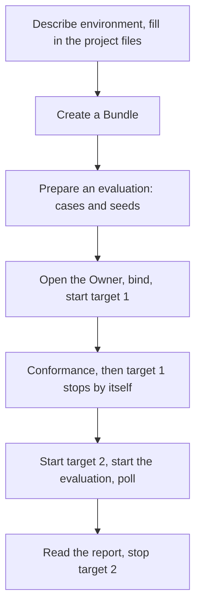

# Run your first evaluation

[Русский](ru/first-evaluation.md)

**Goal:** measure your own agent once, as it is. **You are done when**
`lab evaluate` exits 0 with `measurement accepted`, and you know which run
files to read.

A **fixed evaluation** measures an agent on cases you pick and changes
nothing. The page has two parts:

- **[Measure your own agent](#measure-your-own-agent)**: two commands,
  `lab new-project` and `lab evaluate`, what they print, where the files are
  and what the exit codes mean.
- **[What `lab evaluate` does inside](#what-lab-evaluate-does-inside)**: the
  same flow as explicit Python calls, walked through with the example
  [`examples/owner/evaluation.py`](../../lab/examples/owner/evaluation.py). Read it
  when you want to drive Lab from your own code.

Everything here runs offline with the stub agent of the project skeleton: no
model, no API key, only a loopback port. You need a working install from
[Install](install.md): a Linux or macOS venv with `evolution-lab 0.0.3.dev81` and
exactly `evo-skills 2.0.0b22`, plus the two wheel files you installed from
(Lab checks the installed packages against them, so keep them).
Use the matching checkout (tag `lab-v0.0.3.dev81`) and wheels, with a fresh state
directory for this version pair; wheel checksums and source provenance are in
[RELEASES](../../lab/docs/RELEASES.md). Keep old runs with the checkout and wheels that
produced them.

> **New in 0.0.3.dev72.** `lab new-project`, `lab evaluate` and the project
> skeleton ship from Lab 0.0.3.dev72, and the example script builds its
> project from that skeleton. On 0.0.3.dev71 and earlier, read this page at tag
> `v0.0.3.dev71`.

## Measure your own agent

In the Lab checkout `lab` is not on your PATH: use `just new-project DIR` and
`just evaluate DIR` (or `just lab ...`) where this page writes `lab ...`.

```sh
lab new-project ~/my-agent-lab
lab evaluate ~/my-agent-lab --wheel LAB_WHEEL --wheel CORE_WHEEL
```

`lab new-project DIR` writes the project skeleton into `DIR`: a stub agent, an
adapter, three questions, a scorer and two JSON files. `DIR` must not exist
or must be empty; nothing is overwritten. The command prints the next three
steps; the last one is the `lab evaluate` command with `--wheel` placeholders,
and `just evaluate DIR` for a Lab checkout.

`lab evaluate DIR` measures the project in `DIR`. You do not need to start the
Lab service. Run it once on the untouched skeleton, so you know what a
successful run looks like before you change anything. Then replace the stub agent, the questions and the scorer. Which
file is which, and what to edit in each:
[Connect your agent](connect-agent.md#your-files-and-labs-files).

From a Lab checkout, `just new-project DIR` and `just evaluate DIR` do the
same. `just evaluate` passes the two wheel files in `.lab/wheels/` and
forwards any options you put after `DIR`.

| Option | What it does |
|---|---|
| `--wheel PATH` | Required, given twice: the Lab wheel and the Core wheel the running `lab` was installed from. `just evaluate DIR` supplies both from `.lab/wheels/`; manual installs use the two files in `work/wheels/`. |
| `--python PATH` | Run the agent and the scorer in another Python environment, for example your agent's virtualenv. The same Lab and Core must be installed there from the same wheels. Default: the Python that runs `lab`. |
| `--json` | Print the result as JSON (`lab-evaluate-summary/1`) instead of the readout. |

### What it prints

On the untouched skeleton (paths shortened):

```text
What happened: Lab measured your agent as it is, without changing it.
  1. Lab copied the project into ~/my-agent-lab/.lab/runs/001/source and filled in the fields marked lab:auto.
  2. Lab froze the copy into a Bundle, an immutable copy of the inputs, in the state directory.
  3. Lab started the agent as a target and ran conformance, the core's check that it speaks the turn protocol: it passed.
  4. Lab ran the evaluation on a fresh target: 3 cases x 1 repeat, and sent the agent's answers to the scorer.
  5. Lab stopped the target and checked that nothing was left running.

Samples: case, question -> the agent's answer [score]
  c-3a6eb0b2… (evaluation)
    q1  What is the code word for alpha? -> A1   [score 1]
    q2  What is the code word for beta? -> B2   [score 1]
    q3  What is the code word for gamma? -> unknown   [score 0]

Lab filled: environment digest, port, scorer Python, 3 identity digests (listed in resolved.json); nothing to do.
run 001: measurement accepted: 3/3 samples scored; mean score 0.67 (2 of 3 scored 1)

Run files in ~/my-agent-lab/.lab/runs/001:
  report.md         Lab's report of the run
  conversations.md  every sample: question, answer, score, scorer verdicts
  resolved.json     the fields Lab filled in, the Python and the wheels
  summary.json      this result as JSON (lab-evaluate-summary/1)
  evaluate.log      the steps of the run
  source/           the project copy this run measured

Open first: ~/my-agent-lab/.lab/runs/001/conversations.md
```

**The `0` for `q3` is expected.** The stub agent knows the code words for
`alpha` and `beta`, not for `gamma`. So the first readout shows both a 1 and a
0, and you can see that the scorer really compares answers. The measurement
is still accepted: every sample was scored. Acceptance is about the run, not
about the score. That is why the last line carries both: `measurement
accepted: 3/3 samples scored` is the acceptance, and `mean score 0.67 (2 of 3
scored 1)` is the quality, the mean of the primary metric
(`metric_plan.primary`) over the scored samples. The "scored 1" count appears
when every score is 0 or 1; if the mean cannot be computed the line says
`mean score unavailable`. A run that is not accepted prints the mean of what
was scored on the line after `Measurement not accepted`. The same numbers are
in `summary.json` under `quality` (`metric`, `mean`, `scored`,
`full_score_count`; optional, so older summaries stay valid).

The steps list only what the run did. A launch without conformance shows
`launch.json declares no conformance, so Lab skipped it.`; a run that stopped
early ends its steps with the step it stopped at, and its last line is
`Run stopped: <reason>` instead of `Measurement not accepted: <reason>`.

The `Lab filled: ...` line names, in plain words, the fields that were
`"lab:auto"`: the environment digest, the port, the scorer's Python and the
identity digests (a field filled the same way in both files is named once).
Fields you wrote yourself are not named. When you wrote one field of a pair
(for example `launch.json` `endpoint.base_url`) and left `"lab:auto"` in the
other (`evaluation-input.json` `target.base_url`), Lab copies your value into
the other field, counts it on the line and adds `N copied from the paired
field you set`. Lab filled those values for this run only, and
`resolved.json` lists each field with its value under `substituted` and where
the value came from under `sources`: `computed`, or
`paired:launch.json:endpoint.base_url` for a copied one. There is nothing to
do. Your project files still say
`"lab:auto"`. To pin a value, write it into the project file yourself.

### Provenance of the evaluation

From dev77/b20 on, `summary.json` includes optional `provenance` counts for finished samples. `baseline_provenance_unknown` means the project uses `gate.provenance.kind: reported` and no finished sample reported provenance. If the campaign uses this evaluation as its baseline, every case counts as affected. `provenance_not_recorded` identifies an older evaluation. See [how to use this evaluation as a baseline](campaign.md#choose-the-first-baseline).

### Where the files are

Everything `lab evaluate` writes stays in the project, under `.lab/` (the
skeleton's `.gitignore` keeps it out of git):

```text
~/my-agent-lab/.lab/
  state-<pair>/      Lab's state for this version pair: Bundles, runs, logs; reused by later runs
  runs/001/          one lab evaluate run, numbered in order
    source/          the project copy with "lab:auto" filled in: what the Bundle was made from
    resolved.json    which fields were "lab:auto", what Lab put there and where the value came from; the Lab
                     and core versions, the pair, the Python the agent and the scorer ran in, and the wheels
                     with their sha256
    report.md        Lab's report (the same as lab report --markdown)
    conversations.md every sample: the question, the answer, the score, the scorer's verdicts
    summary.json     the facts the command checked (lab-evaluate-summary/1)
    evaluate.log     the steps of the run
  latest -> runs/001 the last run
```

`<pair>` is the version pair, for example `dev81-b22`. A new Lab or Core
version gets a new `state-<pair>/`; the old one stays and is read with its own
wheels. Do not edit anything under `.lab/`. To start over, delete it; the
Bundle files are read-only, so run `chmod -R u+w .lab` first.

The run copy `source/` leaves out `.lab/` and, at any depth, what Lab leaves
out of every Bundle: `.git`, `.venv`, `__pycache__`, `.pytest_cache`,
`.mypy_cache`, `.ruff_cache`, and `*.pyc` and `*.pyo` files. A `venv`
directory without the dot is copied, because it may be code. Keep anything else
the agent or the scorer needs inside the project. A symlinked `launch.json` or
`evaluation-input.json` works: Lab reads what the link points at and writes
the filled-in copy as a regular file in `source/`, never through the link.

### Exit codes

| Code | When | What you see |
|---|---|---|
| `0` | The measurement is accepted: the evaluation finished without a stop, the scored share is at least the input's `min_coverage` (default 0.95), the result is saved and the Target Service is stopped with nothing left over. | The full readout. |
| `1` | The run was not accepted: conformance found failed checks, the evaluation stopped for any reason, or too few samples were scored. | The results that are available, then `Measurement not accepted: <reason>`, the scored count and the stop reason. |
| `2` | A problem in your project, found before anything starts: a missing or invalid file or field, a corpus line Core would refuse (`corpus_invalid`, with the line number), a missing scorer script, a missing secret, two different explicit values in a pair of fields, a `--wheel` or `--python` path that does not exist, or missing `--wheel`. If preparation refuses the project files after the run directory exists, the readout ends with `Run stopped: preparation refused (<file>): …`; a refusal of invalid artifacts (`artifacts_invalid`) counts here only when it names a corpus line. | A JSON error on stderr naming the file and field (the corpus line, or the argument), or the secret's name and role (a usage line for missing `--wheel`). |
| `3` | A target that would not start, or Lab or the environment failed: the wheels do not match the installed packages, the result was not saved, cleanup was not confirmed, preparation refused the artifacts without naming a project file (`artifacts_invalid`), or an error Lab did not expect (`unexpected_error`, for example a project directory it cannot write). | Before the run starts, a JSON error on stderr; an `unexpected_error` also names the `state` directory and the `run_dir` when they exist. After it starts, the readout with the reason and the run files; `evaluate.log` names the state directory. When the target process wrote to stderr, the readout shows its last lines and the path of the full log. |
| `130` | You pressed Ctrl+C. | Where the state is. |

**Exit 3 with `target start not confirmed: target_unavailable`** right after
you edited `adapter.py` or `my_agent.py` usually means your code failed in
the target process: the adapter did not import, or `build` or `factory`
raised, often because the agent reads a variable `launch.json` does not
declare (the target gets only the declared `env` and secrets). The traceback
is in the readout under "The agent's process wrote (last lines of …)", and in
full in `.lab/state-<pair>/scopes/<id>/stderr.log`.

**`[scorer failed]` on every sample** (exit 1, `stopped: consecutive_unmeasured`)
means the agent answered but the scorer (`scorer/score.py` in the skeleton)
returned no score, for example after a syntax error. The readout says `The
scorer failed on N of M samples`, names the script from `scorer.cwd` and
`scorer.argv`, and names the file where Core recorded the scorer's stderr
(`.lab/state-<pair>/artifacts/…/scorer-traces/….pack`; the stderr text is in
it as plain lines after each `"kind":"output"` record); `conversations.md`
shows the scorer's exit status.
`[target failed]` marks a sample the agent could not answer.

A partial result is marked as not accepted. Its readout (exit code 1) lists
the samples that were scored and the ones that were not. What to do for each exit code: [Install → Troubleshooting](install.md#troubleshooting).

### Secrets

Lab takes secret values only from the environment of the `lab evaluate`
process, by role:

- **Target:** the names in `launch.json` `secret_names`, for example your
  agent's API key. Only the target gets them.
- **Scorer:** the names in `evaluation-input.json` `scorer.allowed_env` that
  are not in `launch.json` `env`, for example a judge model's key. Only the
  scorer gets them; the target never does.

```sh
export MY_AGENT_API_KEY=...        # a name listed in launch.json secret_names
lab evaluate ~/my-agent-lab --wheel LAB_WHEEL --wheel CORE_WHEEL
```

If a name is missing, the command stops with exit code 2 and says which name
and role. Lab itself never writes the values anywhere: not into the state, the
run files, the log or its output. In every file and line Lab writes itself
(the readout, `conversations.md`, `report.md`, `resolved.json`,
`summary.json`, `evaluate.log`), a known secret value of either role is
replaced by `<secret:NAME>`.

**What the agent or the scorer prints itself.** If your agent or scorer emits
a secret value on its own, in an answer, on stderr or in the scorer's output,
Core and the Owner record it as it is in the state of the pair: the
target's `stderr.log` (`.lab/state-<pair>/scopes/<id>/stderr.log`) and the
scorer traces (`.lab/state-<pair>/artifacts/…/scorer-traces/`) can hold it.
Lab's run files and output never do. This holds for every way of driving Lab
through the Owner, not only `lab evaluate`. Treat the state directory as
private.

### Interrupted runs

Ctrl+C stops this run's target and task through the Owner, prints where the
state is and exits 130. The unfinished evaluation is not continued: the next
`lab evaluate` is a new run with a new number. If the process was killed
rather than stopped with Ctrl+C, the next run first cleans up what it left in
the state and says `Cleaned up after run NNN`. If that cleanup
fails, the command stops with exit code 3, names the state path and the
blocker, and starts nothing.

### From Python

The same operation is `evolution_lab.quickstart.evaluate(project, wheels=[...], python=None)`,
an async function. Its result has `exit_code`, `run_dir` and `summary`, the
object `lab evaluate --json` prints. An error before the run, or one Lab did
not expect, raises `evolution_lab.quickstart.QuickstartError` with `code`,
`exit_code`, `file`, `field`, and `state` and `run_dir` when they are known.
`evolution_lab.quickstart.new_project(directory)` writes the skeleton.

## Why an evaluation looks like this

You could measure an agent with a notebook loop. Lab is more ceremonious
because every number must be traceable and every process accounted for:

- **Inputs are frozen first** into an immutable **Bundle**, so later edits to
  your project can't change what was measured.
- **The plan is saved separately** (cases, seeds, limits) as a **prepared
  execution** with its own digest.
- **Nothing starts implicitly.** You start the agent process (the *target*),
  the measurement, and you stop the target. Lab never restarts a target for
  you.
- **Facts are kept apart.** "Exited 0", "cleanup confirmed", "result saved"
  and "scored 0.8" are separate facts; one never stands in for another.

`lab evaluate` makes these calls for you, in order. If these terms are new,
skim [How Lab works](concepts.md#from-files-to-a-run-bundle-prepared-execution-owner)
first. The whole flow looks like this:



## What `lab evaluate` does inside

The example [`examples/owner/evaluation.py`](../../lab/examples/owner/evaluation.py)
makes the same calls as `lab evaluate`, one by one, on the project skeleton.
It is the Python API version of the command. It leaves out what the command
adds on top: secrets from the environment, cleanup after interrupted runs,
run numbers, the readout and the run files.

### Run the example

This is the same command as in [Install](install.md#step-5-run-the-offline-example),
run from `lab/` after `just setup`. Pick two
directories that **do not exist yet** (one for Lab's private state directory,
one for the example's source files) and a free loopback port, and run the
example with the same Python you pass as `--python`:

```sh
.lab/venv/bin/python examples/owner/evaluation.py \
  --python "$PWD/.lab/venv/bin/python" \
  --lab-wheel "$(just --evaluate lab_wheel)" \
  --core-wheel "$(just --evaluate core_wheel)" \
  --state-directory first-eval/state \
  --source-directory first-eval/source \
  --port 18765
```

It refuses to start if either directory exists, if one is inside the other,
or if the running interpreter differs from `--python`. A `--python` path with
`..` in it fails with `environment_invalid`; use the path above or an absolute
one.

[A tour of the examples](examples.md) shows the files this script writes and
which of them to read first.

### 1. Write the project skeleton

```python
new_project(source)
```

`new_project` (from `evolution_lab.quickstart`) writes the same skeleton as
`lab new-project` into the source directory: the stub agent
`agent/my_agent.py`, the adapter `agent/adapter.py`, the prompt
`seed/skills/SKILL.md`, a three-case corpus (`q1`, `q2`, `q3`), a scorer and
the two JSON files. The adapter implements `build(context)` and the turn
contract from `evolution_lab.target`; see [Connect your agent](connect-agent.md).

### 2. Describe the Python environment

```python
environment_input = EnvironmentInput(requested_python, (lab_wheel, core_wheel))
environment = describe_environment(environment_input)
```

`describe_environment` runs your interpreter in isolated mode and checks the
installed Lab and Core against the wheel files. Its `.digest` goes into the
launch file, tying the target to exactly this environment, and its
`.executable` runs the scorer. It installs nothing.

### 3. Fill in `"lab:auto"` in a run copy

```python
run = source / ".lab" / "run"
resolve_project(source, run, environment=environment, port=args.port,
                lab_version=metadata.version("evolution-lab"),
                core_version=metadata.version("evo-skills"))
```

The skeleton's JSON files leave Lab's bookkeeping fields as `"lab:auto"`.
Bundles and the Owner do not accept that marker. `resolve_project` copies the
project into `run` and writes real values there: the environment digest, the
port in both files, the scorer's interpreter and the three identity digests
([the rules](connect-agent.md#choose-and-record-the-identity-digests)).
`source` itself is never written to again. `lab evaluate` calls the same
function, with `.lab/runs/<NNN>/source/` as the copy and a free port.

### 4. The two project files

Evaluation uses a closed document, `lab-evaluation-input/3`, with everything a
measurement needs and no Editor or Reflector: `seed_root` (the tree the agent
runs from, `seed`), `policy` (the artifact policy defining that tree),
`target` (port, `seed_mode: none`, a response size limit, identity digests),
`corpus`, `environment` (`static`: each case's `public.text` is the one
message), `scorer` (`score.py` run by your interpreter), `evaluation_set_id`,
`metric_plan` (`{"primary": "score"}`) and `defaults` (one sample per case,
one turn, 60 seconds). [Evaluation inputs](evaluation-inputs.md) covers every
field.

The launch file (`lab-target-launch/3`) tells Lab how to start your agent.
You never write a server: Lab runs its own launcher,
`python -I -m evolution_lab.target.launch`, which imports your module. After
step 3, the run copy's launch file looks like this (abridged):

```json
{
  "schema": "lab-target-launch/3",
  "agent": {"module": "adapter", "attribute": "build", "import_root": "agent"},
  "environment_ref": "<environment.digest>",
  "program_paths": ["agent"],
  "endpoint": {"base_url": "http://127.0.0.1:18765"},
  "policy": "evaluation-input.json",
  "limits": {"max_instances": 1, "max_concurrent_sessions": 1,
             "max_input_bytes": 1048576, "max_output_bytes": 8192},
  "conformance": {"kind": "core-session-public/1"}
}
```

The real file also has `reflector_probe`, `turn`, `env`, `secret_names`,
`identity` and two timeouts. `endpoint.base_url` must equal the input's
`target.base_url`; `max_output_bytes` must not exceed its `max_response_bytes`
(8192 for both leaves room for conformance). `conformance` declares that the
Core's protocol self-test can run offline against this agent; without it, Lab
won't run one.

### 5. Create a Bundle

```python
store = PreparationStore(state)
bundle = store.create_bundle(
    source=EvaluationSource(run / "evaluation-input.json", run / "launch.json"),
    environments=(environment_input,), env=dict(launch["env"]), secret_names=(),
    roots=(SourceRoot("project", run),),
)
```

`PreparationStore` is Lab's private store in the state directory (the Owner
uses the same one). `create_bundle` re-checks the environment, copies the
declared `SourceRoot` into the Bundle and publishes it under a digest. `env`
holds non-secret values, the same as the launch file's `env`; `secret_names`
holds names only. Keep wheels, interpreter and state directory **outside** the
source root.

### 6. Prepare the evaluation

```python
prepared = store.prepare_evaluation(bundle.digest, selection={"all": True})
```

This saves the plan; it runs nothing. The selection is always explicit (all
cases, the first N, or a list of case ids; see
[Selection, repeats and coverage](evaluation-inputs.md#selection-repeats-and-coverage)).
What the call leaves out comes from the input's `defaults`. Each case runs once
per repeat seed; the skeleton has one seed, `null`, because its `seed_mode` is
`none`. So the example schedules 3 cases × 1 seed = **3 samples**. A bad
selection or seed list is refused with `PreparationError` code
`invalid_request`.

### 7. Open the Owner and bind

```python
async with Owner.open(state) as owner:
    connection = await owner.bind(bundle.digest)
```

The **Owner** is an in-process async object that locks the state directory and
owns one managed target and one running operation at a time. Use it from the
thread and event loop that opened it. `bind` returns a connection to the saved
Bundle; `async with` closes the Owner at the end.

### 8. Start a target and run conformance

```python
first_start = await owner.wait(await owner.start_target(connection, secrets={}))
first_target = TargetRef(first_start.ref.id, first_start.owner_generation)
conformance = await owner.wait(await owner.conformance(connection, target_ref=first_target))
```

`start_target` launches your agent and returns a task handle; `wait` returns
its final `TaskStatus` (the script requires `state == "succeeded"`).
**Conformance** runs Core's public protocol checks against the target. It
answers "does this target speak the protocol?", not "is the agent any good?",
and it is optional. Two things matter:

- A report with `ok: false` is a *completed* conformance that found problems,
  not a crash. `lab evaluate` exits 1 then, without measuring.
- Afterwards Lab **always stops the target**. The script checks that both
  cleanup facts are `complete` and the target's state is `"stopped"`. To
  measure, you need a **new** `start_target`; Lab never restarts one for you.

### 9. Start the evaluation and poll

```python
second_start = await owner.wait(await owner.start_target(connection, secrets={}))
second_target = TargetRef(second_start.ref.id, second_start.owner_generation)
accepted = await owner.start(prepared.digest, target_ref=second_target, secrets={})
operation_ref = ResourceRef("operation", accepted.id)

operation = await owner.status(operation_ref)
while operation.control_state in {"reserved", "running", "stopping"}:
    await asyncio.sleep(0.1)
    operation = await owner.status(operation_ref)
```

`owner.start` returns an `OperationStatus` as soon as the run is reserved. It
is not a wait handle, and there is no `wait` for operations, so you poll. To
end early, `await owner.stop(operation_ref)` asks for a cooperative stop; keep
polling until a terminal state. The target gets the secrets of
`start_target`; the scorer gets the ones passed to `owner.start`.

### 10. Read the report, stop the target

```python
report = await owner.report(operation_ref)
await owner.wait(await owner.stop_target(second_target))
```

`report.state` is `"available"` when Lab has a saved measurement to show.
`report.report` holds the full Core report and can contain data from your
integration, so treat it as **private**; the example prints only lifecycle
facts. After a normal evaluation the target stays `ready`, so you stop it
yourself. Then `owner.health()` should list no blockers.

An Owner can hold only one ready target. Starting a target for another Bundle
before stopping this one is refused with `target_slot_held`. Use the explicit
`owner.stop_target` call above (or `lab agent stop TARGET --wait` in the CLI)
and wait for confirmed cleanup before starting the other Bundle's target.

### Reading the example's output

A successful run prints this (keys are sorted; inner objects are folded onto
one line here to save space):

```json
{
  "blocker_count": 0,
  "conformance": {
    "cleanup": {"complete": true, "state": "confirmed"},
    "core_ok": true,
    "persistence": {"failure": null, "state": "saved"},
    "process": {"cleanup_complete": true, "exit_code": 0, "forced": false, "launched": true},
    "state": "succeeded",
    "target_cleanup": {"complete": true, "state": "confirmed"},
    "target_state": "stopped"
  },
  "evaluation": {
    "control_state": "finished",
    "coverage": {"expected": 3, "scored": 3},
    "persistence": {"failure": null, "state": "saved"},
    "process": {"cleanup_complete": true, "exit_code": 0, "forced": false, "launched": true},
    "report_state": "available",
    "results_state": "present",
    "stop_reason": null,
    "target_cleanup": {"complete": true, "state": "confirmed"}
  },
  "final_target": {"cleanup": {"complete": true, "state": "confirmed"}, "state": "stopped"},
  "prepared": {"case_count": 3, "kind": "evaluation", "repeat_count": 1},
  "schema": "lab-neutral-evaluation-example/1"
}
```

| Field | What it tells you |
|---|---|
| `prepared` | The saved plan: 3 cases, 1 repeat seed. |
| `conformance.state`, `core_ok` | The conformance task finished, and Core's self-test found no problems. |
| `…process` | The worker was launched, exited 0, its process tree was cleaned, and nothing had to be killed (`forced: false`). |
| `…cleanup`, `…target_cleanup` | Lab confirmed cleanup of the run's own scope and of the target. |
| `…persistence` | Lab saved the result. Check this before trusting a task's `result`. |
| `conformance.target_state` | `stopped`: conformance stopped the target, as promised. |
| `evaluation.control_state` | `finished`: the operation reached a terminal state. |
| `evaluation.coverage` | 3 samples scheduled (`expected`), 3 scored. Fewer scored than expected means some samples produced no score. |
| `evaluation.stop_reason` | The example summary's label for Owner's `result.stopped_reason`: `null` means nothing stopped the run early; `"unknown"` means Lab lacks the facts. |
| `evaluation.results_state`, `report_state` | Results are on disk (`deleted` after `delete_results`) and `owner.report` can show them. |
| `final_target` | The second target was stopped with confirmed cleanup. |
| `blocker_count` | `0`: nothing is left for you to clean up. |

The printed `lab-neutral-evaluation-example/1` summary keeps its
`evaluation.stop_reason` label. In Python, read the current Owner property
`operation.result.stopped_reason`; the summary label is not an Owner attribute.
For evaluations with unscored samples, read `result.unmeasured` and
`result.min_coverage` alongside coverage. After Core's `sample_retries` are
exhausted, evaluation continues unless a global stop applies. A finished run
with no stop reason and saved persistence can be accepted at the coverage
threshold (default 0.95; pre-dev60 prepared evaluations retain 1.0). This is
the rule `lab evaluate` applies for exit code 0.

The scores are deliberately **not** printed. To see them on your own machine,
read Core measurement from the finished status:

```python
for sample in operation.result.core["samples"]:
    print(sample["case_id"], sample["sample_id"], dict(sample["metrics"]))
```

```text
q1 case-1-repeat-1 {'score': 1.0}
q2 case-2-repeat-1 {'score': 1.0}
q3 case-3-repeat-1 {'score': 0.0}
```

Samples follow the corpus order, once per seed. `q3` scores `0.0` on purpose:
the stub agent does not know that code word. [Read the results](results.md)
explains the rest of the report.

## Files by hand, without `"lab:auto"`

The Owner and the [CLI service](cli.md) need every field explicit. The easiest
start is a `lab evaluate` run: `.lab/runs/<NNN>/source/` is your project with
the values filled in, and `resolved.json` lists them. The environment digest
and the scorer's interpreter there belong to the environment that run used.
If your agent runs in another virtualenv than the Owner, describe it with a
second `EnvironmentInput` after the first one in `create_bundle(environments=...)`,
and write *its* digest into `environment_ref`; Lab must be installed there
too.

### Assemble the files for your own agent

To write the files yourself, for the order-lookup assistant from
[Connect your agent](connect-agent.md#complete-example-the-order-lookup-assistant),
use this layout. The [CLI walkthrough](cli.md#walkthrough-evaluate-the-order-lookup-assistant)
uses it too:

```text
order-lookup/
  agent/order_assistant_target.py   # adapter from Connect your agent
  seed/skills/reply_template.txt    # Order {order_id} is {status}.
  corpus.jsonl                     # cases from Evaluation inputs
  scorer/score.py                  # scorer from Evaluation inputs
  evaluation-input.json
  launch.json                      # the launch file from Connect your agent
```

Keep the virtual environment, wheel archives and Lab state outside this
directory. The adapter and scorer are outside `seed/`: they stay fixed while
a campaign may change the agent's skill files.

Save the following complete document as `evaluation-input.json`. Replace
`CONTRACT_DIGEST`, `SETTINGS_HASH` and `SCORER_PYTHON` before using it:

```json
{
  "schema": "lab-evaluation-input/1",
  "seed_root": "seed",
  "policy": {"version": 1, "writable_paths": ["skills/**"],
             "dependency_paths": [], "excludes": []},
  "target": {
    "base_url": "http://127.0.0.1:18765",
    "seed_mode": "none",
    "contract_digest": "CONTRACT_DIGEST",
    "settings_hash": "SETTINGS_HASH",
    "max_response_bytes": 65536
  },
  "corpus": {"path": "corpus.jsonl"},
  "environment": {"kind": "static", "input_text_key": "text"},
  "scorer": {
    "kind": "subprocess",
    "argv": ["SCORER_PYTHON", "score.py"],
    "cwd": "scorer",
    "dependency_paths": [],
    "allowed_env": [],
    "timeout_seconds": 30
  },
  "evaluation_set_id": "order-lookup-v1",
  "metric_plan": {"primary": "score"},
  "defaults": {"repeat_seeds": [null, null], "max_turns": 4,
               "timeout_seconds": 60}
}
```

Use `describe_environment(environment_input).executable` for `SCORER_PYTHON`
and its `.digest` for the launch file's `environment_ref`. Obtain the identity
values using your integration's
[digest convention](connect-agent.md#choose-and-record-the-identity-digests),
and copy them into both this document and `launch.json`. The launch file in
Connect your agent already matches this document's port, `seed_mode` and
response limit.

With the guide's adapter, declare
`env={"ORDER_ASSISTANT_MODEL": "example-model", "ORDER_ASSISTANT_TURN_TIMEOUT": "20"}`
and `secret_names=("ORDER_ASSISTANT_API_KEY",)` in `create_bundle`, matching
the launch file. Pass `SourceRoot("project", project_directory)` and
`EvaluationSource(project_directory / "evaluation-input.json",
project_directory / "launch.json")`. Then prepare with `selection={"all": true}`
in JSON, or `selection={"all": True}` in Python, and `repeat_seeds=[None, None]`.
The three-case corpus gives six scheduled samples. Pass the secret values at
start, with exactly the names from `secret_names`, in both `start_target` calls.
The secret used by this synthetic adapter may be a dummy value; a real model
client needs its actual credential.

## Current limitations

- **Failure settings belong to the evaluation.** When an evaluation is
  prepared with its failure settings left out or null, it gets the `retry`
  defaults: `max_failed_turns = max_turns`, 3 sample retries and call retries
  3/2. An explicit value in the input or the request wins, so the skeleton
  keeps its explicit `1` and `"off"`. Settings are not inherited
  from a campaign manifest. See [Evaluation budget](evaluation-inputs.md#the-fixed-evaluation-budget).
- **No resume.** If your Python process dies mid-run, a later Owner marks the
  leftovers as orphaned. You can inspect and clean them explicitly, but
  nothing resumes. `lab evaluate` cleans them up at its next start. See
  [Pitfalls](pitfalls.md).
- **One state per version pair.** Use a fresh state directory for each
  Lab/Core version pair; there is no migration. `lab evaluate` does this by
  itself with `state-<pair>/`.
- **No case or seed flags.** `lab evaluate` measures every case in
  `corpus.jsonl` with the input's `defaults.repeat_seeds`. To measure fewer
  cases, keep fewer lines in the corpus.

## Clean up

`lab evaluate` keeps everything in the project's `.lab/`; delete it (after
`chmod -R u+w .lab`) to start over. The example script leaves two
directories. The source directory is yours to delete. The state directory
holds the Bundle, the plan and the private results; to remove one operation's
results, use `owner.delete_results(operation_ref)` (see
[Read the results](results.md)).

## Next

Run `just campaign DIR` on the same project when you are ready to try edits. Its `manifest.json` shares the initial seed, corpus and scorer; keep those settings in sync when you edit them. See [Run a campaign](campaign.md).

- [Evaluation inputs](evaluation-inputs.md) — replace the skeleton's three
  questions and scorer with a real evaluation.
- [Read the results](results.md) — what every fact in the output and report
  means.
- [Run a campaign](campaign.md) — if you want Core to improve the agent
  you just measured.

## Reference

- [Owner guide](../../lab/src/evolution_lab/guides/owner/README.md): full lifecycle, cleanup rules, privacy
- [Preparation guide](../../lab/src/evolution_lab/guides/preparation/SKILL.md): Bundle and prepared-execution rules
- [Evaluation inputs guide](../../lab/src/evolution_lab/guides/evaluation-inputs/SKILL.md): corpus, scorer protocol, metric
- [Target connector guide](../../lab/src/evolution_lab/guides/target-connector/SKILL.md): turn contract, launch file, conformance
- [Diagnostics guide](../../lab/src/evolution_lab/guides/diagnostics/SKILL.md): reading task states, cleanup and reports
- [Owner results API](../../lab/docs/api/owner-s4.md) and [Preparation API](../../lab/docs/api/preparation-s1.md)
- [`examples/owner/evaluation.py`](../../lab/examples/owner/evaluation.py) and its [README](../../lab/examples/owner/README.md)
- The project skeleton: [`src/evolution_lab/quickstart/skeleton/`](../../lab/src/evolution_lab/quickstart/skeleton/)
