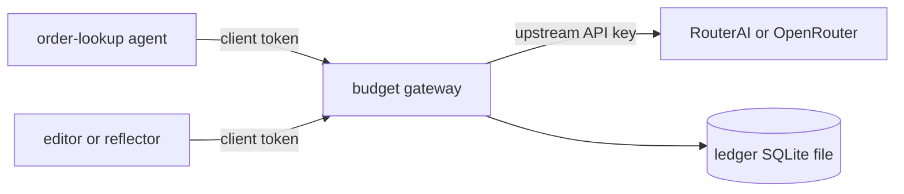

# Бюджет и контроль расходов

[English](../budget.md) · Русский

**Цель:** ограничить запросы к моделям по объявленным ценам и границам токенов.
**Готово, когда** каждый платный вызов модели вашего прогона проходит через
бюджетный шлюз, `/health` шлюза показывает лимит, а вы знаете, что делать при остановке.

Выберите описанный ниже процесс [политики исполнения под управлением Lab](#политика-исполнения-и-бюджетный-шлюз)
или сохраните [шаги шлюза под управлением оператора](#шаги). Справочные сведения
объясняют учёт для обоих путей.

Ваш агент, а в кампании также Редактор и Рефлектор, могут вызывать платные
языковые модели. Кампания может сделать сотни таких вызовов, ошибка в цикле —
тысячи. Необязательный **бюджетный шлюз** (`evolution_lab.budget`) может
работать под Lab с подтверждённой человеком политикой или под вашим скриптом.
Без политики Owner и сервис не запускают шлюз. Ограничиваются только
маршрутизированные вызовы; без шлюза используйте настройки масштаба кампании и
лимиты провайдера ([Что стоит денег](campaign.md#что-стоит-денег-и-как-ограничить-расходы)).

Некоторые шаги имеют две пометки. **Для запуска** — требования шлюза к принятию
вызова. **Для корректных результатов** — дополнительные предположения, чтобы
резервы покрывали стоимость. Граница зависит от точных цен, лимитов токенов и
отчётов использования провайдера; шлюз не может помешать провайдеру выставить
счёт вне этих предположений.

## Поместится ли запрос роли в окно модели?

Команда `lab preflight` позволяет проверить подготовленную кампанию `/16` до платного запуска. Подставьте digest из ответа `lab prepare` и каталог состояния, который указали в `lab serve --state`. Команда читает файлы с диска и работает при остановленном сервисе.

```sh
lab preflight "$STATE/prepared/$PREPARED"
lab preflight "$STATE/prepared/$PREPARED" --operation "$OPERATION" --scenario route.json --json
```

Первая команда покажет настройки Bundle и размеры сценарных запросов Editor и Reflector на первом ходу, после чтения страницы и после сжатия, если до него дойдёт сценарий. По умолчанию используется сценарий с протоколом `modern`. Для проверки сохранённых данных укажите операцию кампании, локальный экспорт трассы (`--trace FILE`) или каталог совместимой обучающей оценки (`--baseline DIR`). У каждого числа есть источник. Скрытый при экспорте текст восстановить по трассе нельзя. Для чтения операции или обучающей оценки используйте сохранённое состояние, например после штатной остановки сервиса. Для проверки только подготовленной кампании база операций не нужна.

Для сохранённой кампании в режиме `shadow` строка `repeated_read_shadow_matches` показывает, сколько раз каждая роль повторила чтение без продвижения. Источник — журнал кампании. Пока роль работает, её итог ещё неизвестен. Если вызов прервали, отменили или роль перестала отвечать, Core не сохраняет итог этого вызова. Даже после успешного повторного запуска общее число для этой роли остаётся неизвестным. Отдельный счётчик коррекций показывает, сколько раз Core попросил роль исправить повторное чтение.

Для сравнения укажите в `route.json` идентификаторы ответившей модели и провайдера и размер окна из документации этого маршрута. Для проверки Editor добавьте запись `editor` с его маршрутом.

```json
{"schema":"lab-context-scenario/1","roles":{"reflector":{
  "model":"example-model","upstream":"example-provider","styles":["modern"],
  "window_tokens":131072,"reserve_tokens":14384,"source":"operator route specification"
}}}
```

Если провайдер зафиксировал 116 678 входных токенов, то при резерве 16 384 запрос превышает окно на 1 990 токенов. С резервом из примера тот же вход оставляет 10 токенов. До запуска известен размер сценарного запроса в байтах и символах. Для оценки в токенах можно задать проверенный на этом маршруте и способе сериализации диапазон `bytes_per_token`. Когда данных недостаточно, отчёт покажет «unknown». Отрицательный остаток помогает выбрать настройки и не мешает запустить кампанию.

## Политика исполнения и бюджетный шлюз

Подтверждённая человеком политика исполнения позволяет Lab запускать шлюз с
 Target Service и выбирать upstream-маршруты вне Bundle. Она необязательна. Без неё Lab
не запускает шлюз; существующие пути target, ролей Core и управляемого оператором
`evolution_lab.budget` доступны. Лимиты покрывают только вызовы через шлюз;
цены, границы моделей и биллинг провайдера остаются ответственностью оператора.

### Напишите политику

Сохраните полный пример ниже как `policy.json` **вне Bundle**. Он объявляет
локальный target без ключа и Editor через router с закреплением `only`; пример
предполагает subprocess Reflector и не-chat Grouper. Имена, цены и границы
приведены для примера, это не текущий тариф и не инструкция к платному вызову.
Проверьте их для своей интеграции до подтверждения. Разбор или вычисление digest
не вызывает upstream.

```json
{
  "schema": "lab-execution-policy/1",
  "gateway": {
    "host": "127.0.0.1",
    "port": 8790,
    "ledger_path": "/private/lab-run/budget.sqlite3",
    "limit_units": 50000000000,
    "ledger_identity": "neutral-campaign",
    "currency": "RUB"
  },
  "routes": {
    "target": {
      "client_model": "target-client",
      "endpoint": "http://127.0.0.1:18880/v1",
      "api_key_secret": null,
      "model": "local-model",
      "price": {
        "input_per_million": 0,
        "output_per_million": 0,
        "context_tokens": 4096
      },
      "max_tokens": 512,
      "timeout_seconds": 30
    },
    "editor": {
      "client_model": "editor-client",
      "endpoint": "https://routerai.ru/api/v1",
      "api_key_secret": "UPSTREAM_ROUTER_KEY",
      "model": "vendor/example-model",
      "price": {
        "input_per_million": 1,
        "output_per_million": 2,
        "context_tokens": 4096
      },
      "max_tokens": 512,
      "timeout_seconds": 60,
      "provider": {
        "only": [
          "provider-a"
        ]
      }
    }
  },
  "target_token_name": "TARGET_GATEWAY_TOKEN"
}
```

Форма закрыта: обязательные верхнеуровневые ключи `schema`, `gateway`, `routes`;
необязательные — `target_token_name`, `scorer_token_names`, `role_groups`.
Каждый ключ `gateway` и маршрута выше обязателен, кроме `provider`.
`gateway.host` должен быть loopback, `ledger_path` — абсолютным, валюта —
`RUB` или `USD`; `limit_units` использует 1 000 000 000 единиц на единицу
валюты. Каждый маршрут требует `price` ровно с `input_per_million`,
`output_per_million`, `context_tokens`. Цены неотрицательны; границы токенов и
тайм-аут положительны. Endpoints принимают HTTP(S), без встроенных учётных
данных, query или fragment. Значения секретов в политике недопустимы.
`api_key_secret: null` не отправляет заголовок авторизации upstream.

`provider` необязателен и имеет ровно вид `{"only": ["provider-a"]}` или
`{"order": ["provider-a", "provider-b"], "allow_fallbacks": false}` (boolean
может быть `true`, если человек выбрал резервный переход router). Имена должны
быть уникальны. Закрепление поддерживается только для распознанных endpoints
RouterAI/OpenRouter, не произвольного OpenAI-совместимого сервера; локальные
фиктивные URL протокола используют `/routerai/api/v1` или `/openrouter/api/v1`.
Закреплённая upstream-модель не может иметь суффикс `@provider`. Для нескольких
провайдеров используйте цену самого дорогого. Необязательный `balance_floor`
положителен и требует ключа и распознанного протокола, валюта которого совпадает
со шлюзом (RouterAI RUB, OpenRouter USD). У локального маршрута без ключа выше
нет ни закрепления, ни минимального остатка.

`reasoning_effort` остаётся в манифесте кампании: он влияет на поведение модели
и идентичность Core. В политике он отклоняется. Шлюз передаёт поле `reasoning`
клиента upstream; существующая опция библиотеки `Route.reasoning_effort`
остаётся доступной операторам.

### Привяжите клиентов и разделите секреты

Bundle сохраняет стабильные alias клиентских моделей и URL шлюза. В примере
`env` запуска target настраивает адаптер на `http://127.0.0.1:8790/target/v1` с
моделью `target-client`; `secret_names` запуска объявляет `TARGET_GATEWAY_TOKEN`.
Имена настроек URL/модели адаптера определяются интеграцией. Chat Editor
объявляет в манифесте `base_url: "http://127.0.0.1:8790/editor/v1"`,
`model: "editor-client"` и `api_key_env: "EDITOR_GATEWAY_TOKEN"`. Имя должно
быть в объявленных секретах Bundle. Выходную границу задайте не выше `max_tokens`
маршрута. Привяжите каждый chat Editor, Reflector и chat Grouper кампании с
политикой к соответствующему маршруту или группе; несопоставленная роль
отклоняется до вызовов с `policy_route_mismatch`.

Lab генерирует новый токен каждого маршрута при каждом запуске шлюза. Он
заполняет `target_token_name` для target; chat-роли Core используют объявленный
`api_key_env`, выбираемый по URL шлюза и `client_model`. Необязательный
`scorer_token_names` сопоставляет имена окружения оценщика именам маршрутов,
например `{"SCORER_GATEWAY_TOKEN": "editor"}`; эти имена должны быть в
`allowed_env` оценщика и объявлении секретов Bundle. Необязательные `role_groups`,
например `{"roles": ["editor", "reflector"]}`, предоставляют
`http://127.0.0.1:8790/roles/v1`; значения `client_model` участников должны
различаться. Completion группы использует токен выбранного участника.

Одно имя окружения можно разделять только потребителям одного маршрута. Имена
upstream-ключей не должны совпадать с заполняемыми Lab именами токенов. Не
передавайте заполняемые Lab токены в секретах target/start/resume: Lab их
отклоняет. Значения upstream-ключей передавайте только при запуске target по
именам секретов политики; получает их только шлюз. Остальные секреты target/
ролей/оценщика оставляйте в объявленных областях. Lab записывает имена и
метаданные подтверждения, никогда значения ключей или токенов.

Для ролей, маршрутизированных политикой, `provider_only`, `provider_order` и
даже явный `allow_fallbacks: false` в манифесте отклоняются до вызовов с
`manifest_provider_pin`. Перенесите закрепления в политику до запечатывания
Bundle. Без политики настройки провайдера манифеста сохраняют существующую
передачу в Core. Старый Bundle с закреплениями нельзя отредактировать для этого
продолжения; этот процесс не мигрирует старые кампании.

### Проверьте, подтвердите и запустите

Проверьте фактический файл политики, включая endpoints, цены, лимит, имена
ключей и выбор fallback. Вычислите канонический SHA-256 офлайн:

```bash
lab exec-policy digest policy.json
```

Команда печатает чистый digest и не требует сервиса или сокета. Сохраните
проверенный digest как `POLICY_DIGEST`. При работающем локальном сервисе пары
подтвердите ровно проверенные байты и явно запустите target:

```bash
lab exec-policy confirm policy.json --expect "$POLICY_DIGEST" --author operator --channel terminal --note "Reviewed routes and bounds"
lab exec-policy show "$POLICY_DIGEST"
lab agent start CONNECTION --execution-policy "$POLICY_DIGEST" --secrets-file /private/target-secrets.json --wait
```

`CONNECTION` — соединение запечатанного Bundle. Приватный файл секретов содержит
upstream-ключ `UPSTREAM_ROUTER_KEY` и обычные секреты target без сгенерированных
клиентских токенов. Замените все ID и пути своими. Подтверждение сохраняет
политику и исходные author, channel, note и время в **состоянии пары**, не в
Lab home. `--expect` должен совпадать с каноническим digest файла
(`digest_mismatch` не записывает политику); неподтверждённый digest не запускает
 target (`policy_unconfirmed`). `lab exec-policy list` и `show` читают сохранённые
подтверждения. Подтверждение — запись одобрения человеком, а не проверка, что
upstream обслуживает заявленную модель.

Lab использует интерпретатор Owner с extra `gateway` для запуска шлюза во
вспомогательной области target, ждёт health, затем запускает target. Остановка/
очистка target также останавливает шлюз и ждёт квитанцию очистки. Автоматического
перезапуска шлюза нет. Ошибка шлюза останавливает target; работающая кампания
идёт по пути инфраструктурной приостановки. Проба Рефлектора target наследует
секреты target, включая сгенерированный токен, без изменения собственного
жизненного цикла или правил `on_unavailable` пробы.

Запустите подготовленную кампанию/оценку на полученном готовом target и его
поколении обычной командой `lab start`. Сгенерированные токены ролей/оценщика
передаёт Lab; передавайте только обычные секреты исполнения. Интерактивные
сессии пробы тоже используют политику target.

Эквивалентный Python API внутри уже открытого Owner при существующем соединении:

```python
from evolution_lab.execution_policy import parse_policy, policy_digest

# document is loaded from the reviewed policy.json; neither call contacts upstream.
parse_policy(document)
assert policy_digest(document) == reviewed_digest
record = await owner.confirm_execution_policy(
    document, expected_digest=reviewed_digest,
    author="operator", channel="python", note="Reviewed routes and bounds",
)
task = await owner.start_target(
    connection, secrets=upstream_and_target_secrets, execution_policy=record.digest,
)
```

До использования target примените существующий API ожидания/статуса задачи;
`start_target` возвращает задачу, а не обещание готового target.
`owner.execution_policy(digest)` и `owner.execution_policies()` читают
неизменяемые подтверждения.

### Смените провайдера приостановленной кампании

1. Убедитесь, что операция приостановлена, worker завершил settlement, очистка
   подтверждена. Явно остановите target и дождитесь очистки target/шлюза:
   `lab agent stop OLD_TARGET --generation OLD_GENERATION --wait`.
2. Напишите политику B вне Bundle, меняя только маршруты, имена ключей или
   привязки токенов/групп, совместимые с существующими клиентами. Весь блок
   `gateway`, включая host, port, путь и идентичность журнала, лимит и валюту,
   оставьте неизменным. Проверьте B, выполните `lab exec-policy digest policy-b.json`,
   затем `lab exec-policy confirm policy-b.json --expect "$POLICY_B_DIGEST" --author operator --channel terminal`.
3. Запустите новый target **того же Bundle**:
   `lab agent start CONNECTION --execution-policy "$POLICY_B_DIGEST" --secrets-file /private/target-b-secrets.json --wait`.
4. Явно продолжите с новым готовым target:
   `lab resume OPERATION --target NEW_TARGET --generation NEW_GENERATION --secrets-file /private/execution-secrets.json`.

Digest Bundle, prepared execution, идентичность Core и измерение сохраняются.
Core **не** видит смену маршрута. Lab не проверяет, что endpoints/провайдеры
обслуживают одну модель или квантизацию; человек должен установить эту
эквивалентность до сохранения эксперимента. Это принятая цена размещения
операционных маршрутов вне идентичности Core.

Изменённый блок `gateway` отклоняется как `policy_gateway_changed`. Добавление
или удаление политики при продолжении — `policy_continuation_mismatch`: кампанию
без политики нельзя перенести под политику или обратно. Работающая операция не
перемаршрутизируется на месте. Существующие требования продолжения Core,
проверки Bundle и разделение инфраструктуры и качества сохраняются.

### Проверьте маршрутизацию и недоступные доказательства

`await owner.operation_routing(ResourceRef("operation", operation_id))`,
`GET /v1/operations/OPERATION/routing` и `lab routing OPERATION --json`
предоставляют `lab-operation-routing/1`. JSON-отчёт Owner `/13` условно включает
`routing` для операций с политикой; панель только для чтения тоже его показывает.
Отчёты без политики опускают поле. Прямое чтение без политики возвращает
`available: false`, `reason: "no_policy"`. В `report.md` нет аудита маршрутизации,
политик, запусков или usage.

Чтение сохраняет все запуски и метаданные подтверждения (`start`, `policy_digest`,
`author`, `channel`, `confirmed_at`, `lab_version`). Доступные строки ролей
содержат `endpoint`, `upstream_model`, `client_model`, `requested`,
`reported_provider`, `calls`, `mismatched`. `upstream_model` — настроенная
модель, отправленная upstream, а не независимое наблюдение обслуживаемых весов.
`reported_provider` — провайдер из ответа; его отсутствие означает неизвестность,
а не доказательство совпадения закрепления. Известные сообщённые провайдеры вне
запрошенного набора увеличивают `mismatched` и остаются видимыми.

Запросы, приписанные ровно одному запуску операции, входят в строки его ролей.
Перекрывающиеся использования с этой операцией считаются `shared` без назначения
вызова роли; корректные запросы с пустым использованием считаются глобальными
для журнала `outside`. Это аудит числа запросов без денег или подробностей
попыток. Старый, отсутствующий, повреждённый или непривязанный журнал делает
чтение недоступным (`ledger_unsupported`, `ledger_unreadable` или
`ledger_invalid`), сохраняя историю и возвращая null для `roles`, `shared`,
`outside`. Неизвестные доказательства никогда не считаются нулём. Читатель не
создаёт и не мигрирует журнал; только открытие шлюза выполняет его обычные миграции.

### Шлюз под управлением оператора и учёт

Существующие пользователи `Route`, `Gateway`, `BudgetLedger` и `create_app`
сохраняют поведение и управляемый оператором жизненный цикл. Политика не
заменяет правила журнала: резервировать по объявленному тарифу для ограниченных
входа/выхода; списывать подходящую стоимость провайдера при корректном usage
токенов и совпадении валюты протокола, иначе по тарифу; отсутствие пригодного
usage удерживает резерв. Токены сверх границы учитываются полностью; списание
свыше `max(reserved, tariff_actual)` останавливает дальнейшую отправку как перерасход.

HTTP 400–499 (включая 429) освобождает резерв до нуля при предположении о
неоплачиваемом отказе, с аудитом ошибки и освобождения. 5xx, ошибка транспорта,
тайм-аут и некорректные успешные ответы удерживают резервы. Python-процесс
оператора `ledger.release_refused_reservations(authorization=...)` идемпотентно
освобождает только старые удержанные записанные 4xx, не снимая остановку;
`ledger.authorize_resume(authorization=...)` отдельно разрешает продолжение
остановленного журнала. Ни один не перезапускает target или кампанию; новых
команд Lab для этого нет. См. [подробности учёта](pitfalls.md#gateway-accounting)
и [настройку ролей модели](campaign.md#бюджетный-шлюз-для-ролей-на-модели).

## Перед началом

- Вы знаете, какие части прогона вызывают платную модель: агент, а в кампании,
  возможно, Редактор, Рефлектор и оценщик-судья ([Кампания](campaign.md)).
- Для каждой известны URL провайдера, модель, цена миллиона входных и выходных
  токенов и окно контекста.
- API-ключ upstream находится в вашем хранилище секретов, не в настройках агента.
- Для HTTP-шлюза wheel Lab установлен с extra `gateway` (`...whl[gateway]`,
  добавляет FastAPI и uvicorn; см. [Установка](install.md#extras-что-добавлять-и-зачем)).
  Классы журнала и ценообразования работают без него.

## Шаги

1. [Определите лимит, цены и границы](#шаг-1-определите-лимит-цены-и-границы)
2. [Создайте журнал и маршруты](#шаг-2-создайте-журнал-и-маршруты)
3. [Запустите шлюз](#шаг-3-запустите-шлюз)
4. [Направьте агента и роли в шлюз](#шаг-4-направьте-агента-и-роли-в-шлюз)
5. [Выполняйте прогон и следите за журналом](#шаг-5-выполняйте-прогон-и-следите-за-журналом)
6. [При остановке найдите причину и продолжите](#шаг-6-при-остановке-найдите-причину-и-продолжите)

### Шаг 1. Определите лимит, цены и границы

**Сделайте:** заполните список для каждой модели прогона (по одному *маршруту*
на роль, например `target` и `editor`):

- [ ] Цена миллиона входных и миллиона выходных токенов в RUB или USD.
- [ ] `context_tokens`: реальный максимум размера входа модели и ваших запросов.
- [ ] `max_tokens`: реальный максимум выхода, запрашиваемого клиентами.
- [ ] Резерв на вызов = `min(context_tokens, request JSON bytes)` × цена входа
  + `max_tokens` запроса × цена выхода (на миллион).
- [ ] Лимит: планируйте списанные затраты **плюс** резервы всех одновременно возможных вызовов.

*Для корректных результатов:* берите границы из модели и клиентов, а не из
вписывающегося в бюджет. Уменьшение ради большего числа вызовов превращает
«верхнюю границу» в догадку ([Объявленные границы должны быть реальными](#объявленные-границы-должны-быть-реальными)).
При закреплении нескольких провайдеров задавайте маршруту цену **самого дорогого**.

[Пример расчёта](#сначала-резервирование-затем-списание) резервирует 3 RUB на
вызов для запроса 2000 байт при 300/1200 RUB за миллион и 2000 выходных токенов.
Лимит 50 RUB сначала допускает шестнадцать таких одновременных вызовов.

**Готово, когда:** для каждого маршрута есть цена, `context_tokens`,
`max_tokens` и общий лимит, покрывающий параллельность.

### Шаг 2. Создайте журнал и маршруты

Эти шаги описывают библиотечный путь оператора. При политике исполнения Lab
сам создаёт клиентские токены и владеет жизненным циклом шлюза.

**Сделайте:** напишите небольшой Python-скрипт, создающий журнал (SQLite-файл
учёта денег) и по одному `Route` на роль. Сгенерируйте клиентский токен каждого
маршрута (например `python -c "import secrets; print(secrets.token_urlsafe(32))"`)
и храните его в хранилище секретов рядом с upstream-ключом.

```python
import os
from pathlib import Path

import uvicorn

from evolution_lab.budget import BudgetLedger, Gateway, Price, Route, create_app

RUB = 1_000_000_000  # accounting units per rouble

ledger = BudgetLedger(
    Path("/home/you/lab-run/budget/order-lookup.sqlite3"),
    limit_units=50 * RUB,
    identity="order-lookup-eval-2026-09",
)
routes = {
    "target": Route(
        base_url="https://routerai.ru/api/v1",
        api_key=os.environ["ROUTERAI_API_KEY"],             # upstream key: only the gateway has it
        model="vendor/some-model",
        price=Price(input_per_million=300, output_per_million=1200, context_tokens=32_000),
        max_tokens=2_000,
        client_token=os.environ["TARGET_GATEWAY_TOKEN"],    # what your agent sends
    ),
}
gateway = Gateway(ledger, routes, currency="RUB")
uvicorn.run(create_app(gateway), host="127.0.0.1", port=8790, access_log=False)
```

- [ ] Один файл журнала на эксперимент. Повторное открытие с другим `identity`
  или `limit_units` вызывает `ValueError`, поэтому лимит не может измениться молча.
- [ ] При желании закрепите провайдеров через `provider=` или `providers=`
  (только RouterAI и OpenRouter), сгруппируйте маршруты через `role_groups`
  ([Маршруты, провайдеры и роли](#маршруты-провайдеры-и-роли)).
- [ ] Клиентский токен отличается от upstream-ключа; иначе `Route` выдаёт
  `ValueError`. Без `client_token=` каждый объект `Route` получает новый
  случайный токен, что полезно только когда всё выполняется в одном процессе.

**Готово, когда:** скрипт создаёт журнал и маршруты без ошибки. До расходов
можно попробовать весь путь с фиктивным провайдером ([Небольшой офлайн-пример](#небольшой-офлайн-пример)).

### Шаг 3. Запустите шлюз

**Сделайте:** запустите скрипт шага 2 с upstream-ключом и клиентским токеном в
его окружении. Он обслуживает loopback-интерфейс с выключенным access log.
Держите его работающим весь прогон.

*Для корректных результатов:* в кампании `base_url` Редактора или Рефлектора
на модели входит в идентичность прогона, поэтому закрепите хост и порт шлюза на всю кампанию.

**Готово, когда:** `curl -s http://127.0.0.1:8790/health` отвечает вашим
лимитом и `"budget_exhausted": false`, например:

```json
{"limit_units":50000000000,"reserved_upper_units":0,"available_units":50000000000,
 "requests":0,"unknown_requests":0,"overrun_requests":0,"bound_observations":0,
 "settled_upstream_units":0,"settled_tariff_units":0,"usage_cost_missing":0,
 "released_refusals":0,
 "refusals":0,"failed_requests":0,"failed_by_status":{"transport":0},
 "budget_exhausted":false,"currency":"RUB","balance_floor":null}
```

### Шаг 4. Направьте агента и роли в шлюз

Каждая роль вызывает `http://127.0.0.1:8790/<role>/v1/chat/completions` с
`Authorization: Bearer <client token>`. Upstream-ключ не покидает шлюз
([почему](#держите-настоящий-api-ключ-вдали-от-агента)).

**Сделайте:**

- [ ] **Агент.** В файле запуска задайте базовый URL модели, читаемый агентом,
  как `http://127.0.0.1:8790/target/v1` (в `env`) и добавьте имя переменной
  клиентского токена в `secret_names`. Передайте токен в `start_target(..., secrets=...)`.
  Его `model` должен совпадать с моделью маршрута.
- [ ] **Редактор или Рефлектор `chat`.** Задайте `base_url`
  `http://127.0.0.1:8790/<role>/v1`, `model` модели маршрута, `api_key_env` —
  имени секрета с клиентским токеном маршрута; передайте значение в `start(..., secrets=...)`.
- [ ] **Оценщик-судья на модели.** Аналогично направьте его на свой маршрут через имена в `allowed_env`.
- [ ] *Для запуска:* каждый запрос задаёт `max_tokens` (или `max_completion_tokens`)
  от 1 до `max_tokens` маршрута, отправляет только простой текст и обычные поля
  chat; остальное отклоняется ([Что принимает шлюз](#что-принимает-шлюз)). Для
  Редактора Core `chat` это значит: его `max_output_tokens` (по умолчанию 8192)
  не должен превышать `max_tokens` маршрута, а закрепление провайдера и
  `reasoning_effort` задаются в `Route`, не Редакторе — иначе Редактор отправит
  их как дополнительные поля запроса.
- [ ] *Для длинных запросов:* соблюдайте порядок трёх лимитов. `timeout_seconds`
  маршрута (по умолчанию 300) не меньше ожидаемого самого длинного запроса;
  `retry.total_budget_seconds` роли (также ограничивает один запрос роли) не
  меньше тайм-аута маршрута; `reflection_timeout_seconds` и
  `editor_timeout_seconds` выше бюджета повторов. Каждый повторный запрос
  получает собственный резерв; upstream 4xx, включая 429, освобождает его.
- [ ] Адаптер агента возвращает `target_failed` при `429`, как при любой ошибке
  провайдера ([почему](#использование-журнала-с-прогонами)).

**Готово, когда:** первый реальный вызов каждой роли принят, а `/health`
показывает рост `requests` при `refusals`, равном `0`.

### Шаг 5. Выполняйте прогон и следите за журналом

**Сделайте:** запустите оценку или кампанию как обычно. Во время работы читайте
`GET /health` (или `ledger.summary()`):

- `reserved_upper_units` / `available_units`: использованное или удержанное и
  оставшееся в единицах 10⁻⁹ валюты;
- `unknown_requests`: вызовы с неизвестной реальной стоимостью, удерживающие полный резерв;
- `settled_upstream_units` / `settled_tariff_units`: суммы, списанные по стоимости провайдера и объявленному тарифу соответственно;
- `usage_cost_missing`: ответы известного протокола с пригодными токенами, чью стоимость нельзя использовать, включая несовпадение валюты;
- `released_refusals`: резервы upstream 4xx, освобождённые автоматически или оператором;
- `failed_requests`, `failed_by_status`: вызовы с записанной причиной отказа по
  полученному HTTP-статусу (`transport`: нет HTTP-ответа), включая освобождённые
  4xx. `402` обычно означает отсутствие денег на счёте провайдера; `404` часто — отказ маршрута;
- `bound_observations`: вызовы, превысившие объявленные границы токенов или
  списанные выше резерва в пределах тарифа сообщённых токенов — проверьте их;
- `refusals`, `overrun_requests`: значение выше `0` означает остановку шлюза (следующий шаг).

**Готово, когда:** прогон завершён. Отчёт Owner не содержит стоимость
(`cost: null`); чтобы включить числа журнала в отчёт кампании, соберите его
самостоятельно, как описано в разделе [Использование журнала с прогонами](#использование-журнала-с-прогонами).

### Шаг 6. При остановке найдите причину и продолжите

После отказа или перерасхода каждый вызов получает HTTP `429` с кодом
`budget_exhausted`, даже небольшой ([Когда шлюз останавливается](#когда-шлюз-останавливается)).
Ничто не повторяется автоматически.

**Сделайте:**

- [ ] Прочитайте `/health`. `refusals` > 0: вызов не поместился в остаток бюджета —
  лимит мал для параллельности. `overrun_requests` > 0: списание вызова выше и
  резерва, и тарифа сообщённых токенов — проверьте объявленные цены.
- [ ] Устраните причину: снизьте параллельность либо начните новый эксперимент
  с новым файлом журнала и большим лимитом.
- [ ] Снимите остановку с письменной причиной из сессии Python, открывшей тот же
  файл журнала с теми же `identity` и `limit_units`:

```python
ledger.authorize_resume(authorization="Checked: concurrency lowered to 2")
```

- [ ] Явно начните новый прогон. Продолжение журнала никогда не перезапускает
  остановленную оценку или кампанию.

**Готово, когда:** `/health` показывает `"budget_exhausted": false`. Если
причина остаётся, следующий вызов снова остановит шлюз.

**Далее:** [Результаты](results.md) объясняют отчёт кампании, включая `cost`,
и получение финальной версии как diff или ZIP.

---

## Справочные сведения

### Идея на одной схеме

Шлюз — небольшой HTTP-прокси с обычным API chat-completions. Агент отправляет
вызовы модели шлюзу вместо провайдера. Шлюз проверяет бюджет, пересылает вызов
с настоящим API-ключом и учитывает стоимость в локальном журнале.



Он может пересылать на любой HTTP(S) endpoint chat-completions. Два router имеют
дополнительную поддержку (закрепление провайдера и минимальный остаток ниже):
**RouterAI** (`https://routerai.ru/api/v1`, RUB) и **OpenRouter**
(`https://openrouter.ai/api/v1`, USD). Журнал считает в RUB или USD.

Вы владеете шлюзом: создаёте его в собственном Python-коде и запускаете сами.
HTTP-часть (`create_app`) требует extra `gateway`, добавляющий FastAPI и uvicorn:
установите wheel Lab как `...whl[gateway]` (см. [Установка](install.md#extras-что-добавлять-и-зачем)).
Классы журнала и цен работают без него.

### Сначала резервирование, затем списание

Главный вопрос: *как обещать лимит, не зная стоимости вызова?* Шлюз отвечает
**резервированием**.

1. **До** пересылки вызова он резервирует
   `price.units(min(context_tokens, len(encoded)), max_tokens)`. `encoded` —
   сериализация JSON в UTF-8 шлюза после добавления provider/reasoning и
   нормализации ограничения вывода; она также используется для `request_hash`.
2. Если уже использованные деньги плюс резерв превысят лимит, вызов отклоняется
   и провайдеру ничего не отправляется.
3. **После** пригодного ответа списывается подходящая стоимость провайдера,
   иначе тариф для сообщённых токенов.

Оценка входа предполагает не более одного токена на байт текста, а
форматирование chat покрывается синтаксисом JSON. Шлюз принимает только
текстовое содержимое сообщений. Резервы зависят от этих предположений и
объявленных цен; уже работающие вызовы могут списать больше резерва и превысить
лимит. Следующие вызовы проверяются по обновлённой списанной сумме.

Деньги считаются целыми *units*: единица равна 10⁻⁹ валюты, поэтому
`1_000_000_000` единиц — 1 RUB (или 1 USD).

**Условия списания.** `usage.prompt_tokens` и `usage.completion_tokens` должны
быть неотрицательными целыми, исключая boolean. При корректных токенах конечный
неотрицательный числовой `usage.cost` (тоже без boolean) принимается только если
валюта распознанного протокола маршрута совпадает с `Gateway.currency`:
OpenRouter → USD, RouterAI → RUB. Распознаются URL
`https://openrouter.ai/api/v1` и `https://routerai.ru/api/v1`, а также loopback
URL с окончанием `/openrouter/api/v1` или `/routerai/api/v1`. Сумма —
`ceil(Decimal(str(cost)) * 10**9)` и уже включает скидку провайдера за кэш.
Другие протоколы, отсутствующая/неверная стоимость или несовпадение валюты
используют объявленный тариф для сообщённых токенов. Переходы на тариф для
известных протоколов увеличивают `usage_cost_missing`. Стоимость без корректных
токенов оставляет резерв удержанным и записывает `usage_missing`.

`requests.settled_source` записывает `upstream_cost`, `tariff` или `refused`.
Открытие старого журнала добавляет столбец без переписывания строк; списанные
строки с NULL source входят в `settled_tariff_units`. Несписанные сохраняют
NULL source. `reserved_upper_units` остаётся суммой списаний и удержанных
резервов; `available_units` — лимит минус эта сумма.

**Пример расчёта.** При 300 RUB за миллион входных токенов и 1200 RUB за
миллион выходных, `context_tokens=32_000`, JSON-запрос на 2000 байт с 2000
выходными токенами резервирует:

- 2000 × 300/10⁶ + 2000 × 1200/10⁶ = **3 RUB**;
- ответ с 1200 входными и 300 выходными токенами имеет тариф **0,72 RUB**;
  подходящий `usage.cost=0.3` вместо этого списывает **0,30 RUB**.

В лимит 50 RUB сначала помещаются шестнадцать таких одновременных резервов.
Планируйте списанные суммы плюс все одновременные резервы.

**Отказы upstream освобождают резерв.** HTTP 400–499, включая 429, списывается
в ноль с источником `refused`, даже если тело некорректно. Исходная ошибка
сохраняется. `released_reservations` аудирует каждое освобождение с ID запроса,
статусом upstream, исходным резервом, временем и авторизацией (NULL для
автоматического). Предполагается, что upstream не тарифицирует 4xx; если
провайдер начислит плату, она не появится в журнале. Отказы шлюза до отправки
upstream резерв не создают.

5xx, ошибки соединения, тайм-ауты, неверные успешные тела и ответы без
корректного usage токенов сохраняют полный резерв. Они считаются в
`unknown_requests`. Приоритет записываемых причин ошибки:

1. нет HTTP-ответа: `upstream_unavailable` (без статуса);
2. HTTP 400 или выше: короткий токен `error.code` или `error.type`, либо `http_error` с полученным статусом;
3. успешное тело не JSON или не объект: `upstream_invalid`;
4. успешный объект без пригодного числа токенов: `usage_missing`.

Сохраняется только токен, никогда текст сообщения. `failed_requests` считает
записанные ошибки, включая освобождённые 4xx; это больше не подмножество
`unknown_requests`. У отменённых вызовов и строк до появления записи ошибок
причины может не быть.

**Старые удержанные отказы.** В Python откройте тот же журнал с теми же
`identity` и `limit_units`, затем явно разрешите освобождение:

```python
released = ledger.release_refused_reservations(
    authorization="Reviewed historical upstream 4xx refusals"
)
```

Это освобождает только несписанные запросы с записанным upstream-статусом
400–499. Уже списанные строки и другие удержанные резервы сохраняются;
возвращается число освобождённых, аудируются каждое освобождение и авторизация/
количество, в том числе нулевой результат. Повтор освобождает ноль. Пустая
авторизация отклоняется. Это только Python API; CLI освобождения нет. Остановку
учёта это не снимает: после устранения причины используйте `authorize_resume` отдельно.

### Объявленные границы должны быть реальными

Резерв честен настолько, насколько честны исходные числа:

- `Price.context_tokens` должен быть реальным максимумом входа модели и ваших запросов.
- `Route.max_tokens` должен быть реальным максимумом выхода, который могут
  запрашивать клиенты. Каждый запрос должен задавать `max_tokens` (или
  `max_completion_tokens`) от 1 до этой границы; иначе он отклоняется с `invalid_request_bounds`.

Не уменьшайте числа лишь для того, чтобы одновременно помещалось больше
вызовов. Это превращает «верхнюю границу» в догадку.

Если сообщённые токены превышают объявленные границы, шлюз записывает
`bound_observations`. Пусть `tariff_actual` — тариф маршрута для всех
сообщённых токенов. Списание выше резерва, но не выше `tariff_actual`, тоже
является наблюдением без остановки: дополнительные токены объясняют
дополнительные деньги. Только списание **выше `max(reserved, tariff_actual)`**
создаёт запись `overrun_requests` и останавливает шлюз. Тарифное списание равно
`tariff_actual`, поэтому само по себе никогда не вызывает перерасход. Шлюз всё
равно учитывает полное списание, включая перерасход; отменить начисление он не может.

### Когда шлюз останавливается

Шлюз переходит в остановленное состояние после:

- **отказа** — вызов не поместился в остаток бюджета; или
- **перерасхода** — списание выше и резерва, и тарифа сообщённых токенов.

С этого момента каждый вызов получает HTTP `429` с кодом `budget_exhausted`,
даже небольшой, который ещё поместился бы. В Python `BudgetLedger.reserve`
выбрасывает `BudgetExhausted`. Остановка намеренна: случилось неожиданное, и
человек должен разобраться до дальнейших расходов.

Для снятия оператор вызывает `ledger.authorize_resume(authorization="…")` с
краткой письменной причиной. Журнал архивирует отказы и перерасходы, записывает
причину и снова принимает вызовы. Если причина остаётся (бюджет всё ещё мал),
следующий вызов снова остановит шлюз. Продолжение *журнала* никогда не
перезапускает остановленный прогон: новый прогон — новая явно запущенная операция.

### Держите настоящий API-ключ вдали от агента

У каждого маршрута два разных секрета:

| Секрет | Кто хранит | Для чего |
|---|---|---|
| `Route.api_key` | только шлюз | вызов провайдера |
| `Route.client_token` | ваш агент, Редактор или оценщик | вызов шлюза |

Шлюз принимает только `Authorization: Bearer <client_token>` и отвечает
`401 invalid_gateway_credentials` на всё остальное, включая upstream-ключ. По
умолчанию `client_token` — новый случайный токен каждого объекта `Route`;
сохраняйте объект (или передайте свой токен), пока маршрут используется. Токен
должен отличаться от каждого upstream-ключа.

Это разделение секретов, не песочница. Оно не останавливает вредоносный процесс
на той же машине.

### Маршруты, провайдеры и роли

`Route` описывает модель одной роли: endpoint, ключ, имя модели, цены и границы.
Шлюз сопоставляет имя роли в URL маршруту: `POST /<role>/v1/chat/completions`.
Для агента поиска заказов можно использовать роль `target`, тогда базовый URL
агента — `http://127.0.0.1:<port>/target/v1`.

Router может направлять одну модель нескольким upstream-провайдерам. Это можно закрепить:

- `provider="name"` — только этот провайдер;
- `providers=("a", "b")` — только эти, в указанном порядке.

Используйте одно из двух, никогда оба. Шлюз отправляет их router как
`only`/`order` с `allow_fallbacks: false` и записывает запрошенный набор и
провайдера из ответа. Закрепление работает только с URL RouterAI и OpenRouter,
имя модели не должно содержать `@`. Резерв использует единственный `Price`
маршрута, поэтому для набора провайдеров используйте цену **самого дорогого**.

`Gateway(..., role_groups={"editor": ("editor-a", "editor-b")})` позволяет
одному имени роли выбирать маршрут по полю `model` запроса. Completion-запросы
всё равно требуют клиентский токен выбранного маршрута.

`GET /<role>/v1/models` использует `Authorization: Bearer <client_token>` и
перечисляет настроенную модель локально, без upstream-вызова или резерва:

```json
{"object": "list", "data": [{"id": "vendor/some-model", "object": "model", "owned_by": "lab-gateway"}]}
```

Для группы ролей клиентский токен любого участника авторизует каталог, и все
модели участников перечисляются в объявленном порядке. Неизвестные роли
получают `404 invalid_role_or_model`; отсутствующие или неверные токены —
`401 invalid_gateway_credentials`.

### Небольшой офлайн-пример

Он создаёт журнал и маршрут, оценивает один запрос, затем вручную учитывает
один вызов со списанием по тарифу. Сетевых вызовов нет. Имена модели и
провайдеров — заглушки.

```python
import hashlib
import json
from pathlib import Path

from evolution_lab.budget import BudgetLedger, Gateway, Price, Route

RUB = 1_000_000_000  # accounting units per rouble

ledger = BudgetLedger(
    Path("/home/you/lab-run/budget/order-lookup.sqlite3"),
    limit_units=50 * RUB,
    identity="order-lookup-eval-2026-09",
)
route = Route(
    base_url="https://routerai.ru/api/v1",
    api_key="UPSTREAM-KEY-FROM-YOUR-SECRET-STORE",
    model="vendor/some-model",
    price=Price(input_per_million=300, output_per_million=1200, context_tokens=32_000),
    max_tokens=2_000,
    providers=("provider-a", "provider-b"),
)
gateway = Gateway(ledger, {"target": route}, currency="RUB")

# Match the gateway's request serialization, including injected provider data.
request = {
    "model": route.model,
    "messages": [{"role": "user", "content": "Hello"}],
    "max_tokens": 2_000,
    "provider": {"only": list(route.providers), "order": list(route.providers), "allow_fallbacks": False},
}
encoded = json.dumps(request, sort_keys=True, ensure_ascii=False, allow_nan=False).encode()
reserved = route.price.units(min(route.price.context_tokens, len(encoded)), request["max_tokens"])
print(reserved / RUB)

request_id = ledger.reserve(
    reserved, role="target", model=route.model,
    request_hash=hashlib.sha256(encoded).hexdigest(),
)
actual = route.price.tariff_units({"prompt_tokens": 1200, "completion_tokens": 300})
ledger.settle(request_id, actual, source="tariff", tariff_actual=actual)
summary = ledger.summary()
print(summary["reserved_upper_units"] / RUB)  # 0.72
print(summary["settled_tariff_units"] / RUB)  # 0.72
print(summary["settled_upstream_units"])      # 0
```

Обычно вы не вызываете `reserve` и `settle` сами; шлюз делает это вокруг
каждого вызова. Открытие того же файла журнала с другими `identity` или
`limit_units` выдаёт `ValueError`, поэтому лимит не меняется молча. Для нового
эксперимента используйте новый файл журнала.

Для проверки всего пути без провайдера передайте
`transport=httpx.MockTransport(handler)` в `Gateway` и вызовите
`await gateway.complete("target", body, "Bearer " + route.client_token)`.

Для реального обслуживания запустите приложение сами на loopback с выключенным
access log, например
`uvicorn.run(create_app(gateway), host="127.0.0.1", port=8790, access_log=False)`.
`GET /health` возвращает сводку журнала (включая `failed_requests` и
`failed_by_status`), а также `budget_exhausted`, `currency` и `balance_floor`.

### Что принимает шлюз

Чтобы стоимость каждого вызова можно было оценить, шлюз отклоняет то, что не
может ограничить:

- потоковую передачу (`"stream": true`), отсутствующий или слишком большой `max_tokens` (`invalid_request_bounds`);
- поля запроса вне обычного набора chat, например дополнительные опции провайдера (`unpriced_request_features`);
- содержимое сообщения, отличное от простого текста (`unpriced_message_content`);
- модель, отличную от модели маршрута (`invalid_role_or_model`).

### Использование журнала с прогонами

- Направьте каждую платную роль в шлюз: агента через его настройки
  ([Подключение агента](connect-agent.md)), Редактора, Рефлектора или оценщика —
  через их базовые URL. Каждому передайте только его клиентский токен как объявленный секрет.
- В кампании `base_url` Редактора или Рефлектора на модели входит в идентичность
  прогона, поэтому сохраняйте хост и порт шлюза на всю кампанию.
- Owner не читает журнал (сессия пробы читает только для чтения; см.
  [Сессии пробы](#сессии-пробы)). При остановке шлюза вызовы модели агента
  получают `429`, а адаптер решает исход хода. Верните `target_failed`, как при
  любой ошибке провайдера (см. [Выбор исхода хода](connect-agent.md#выбор-исхода-хода)):
  образец будет indeterminate, а не низкой оценкой. Фиксированная оценка следует
  правилу повторов Core и объявленным `sample_retries`, затем продолжает после
  неоценённого образца, если не действует глобальная остановка. Глобальные
  остановки включают настроенный порог последовательных неоценённых образцов
  (по умолчанию 3, `"off"` отключает); см. [Отчёты оценки](results.md#отчёты-оценки).
  Исключение вместо этого — fault, немедленно останавливающий кампанию.
- Старый клиент одной кампании и прежний runner принимают callback
  `dispatch_guard`; guard, выбрасывающий `BudgetExhausted` (например при
  `gateway.exhausted()`), останавливает прогон с `budget_exhausted`.
- Отчёты Lab сами по себе не содержат стоимость. Чтобы добавить числа журнала в
  отчёт кампании, постройте его самостоятельно через
  `read_campaign_report(run_directory, cost=CostSummary.from_budget(ledger.summary(), currency="RUB"))`
  из `evolution_lab.report`. Тогда отчёт помечает сумму как верхнюю оценку или
  как учтённую стоимость, если был перерасход. Используйте суммы источников
  списания журнала, чтобы различить стоимость провайдера и переход на тариф.

Необязательный **минимальный остаток**
(`ledger.activate_balance_floor(floor_rub, authorization=...)`) также проверяет
баланс счёта перед каждым вызовом и отказывает при достижении границы. Остаток —
защитная мера, никогда не разрешение тратить: явный лимит по-прежнему действует.

### Сессии пробы

Сессия пробы (`lab probe`, см. [API проектов](../../../lab/docs/api/projects.md#probe-sessions))
отправляет настоящие пользовательские ходы запущенному target, поэтому ход может
расходовать платную модель. Токены всегда берутся из `usage` хода. Стоимость
**в деньгах** появляется только если вы объявили шлюз для сессии:

```sh
lab probe start <project> <implementation> --max-turns 10 --max-cost 1.00 \
  --budget-ledger /abs/path/ledger.sqlite3 --budget-role agent --budget-currency RUB
```

- `--budget-ledger` — абсолютный путь к журналу шлюза; `--budget-role`
  (повторяемый, хотя бы один) называет роли шлюза, используемые агентом target;
  `--budget-currency` — `RUB` или `USD`. Журнал не хранит валюту, поэтому вы
  объявляете её. `--max-cost` требует все три. Lab только читает журнал с
  тайм-аутом; он не запускает шлюз и не меняет URL провайдера агента.
- Стоимость хода — сумма `COALESCE(settled, reserved)` строк журнала с
  объявленной ролью, чей `rowid` попал в окно между наибольшим `rowid` журнала
  до и после хода. Ход показывает `cost: {amount, currency, attribution: "ledger_window", upper_bound}`.
  `upper_bound` равно `true`, когда окно содержит несписанный резерв: реальная
  стоимость не выше этой суммы.
- `ledger_window` честен **только пока объявленные роли принадлежат этому target**.
  Если другой процесс использует те же роли одновременно, его вызовы тоже
  попадут в окно. Дайте target собственные роли.
- Ходы всех сессий одного target выполняются последовательно (ход ждёт предыдущий,
  независимо от объявления шлюза сессиями), поэтому окна не перекрываются.
- Если журнал не читается, ход всё равно выполняется с `cost: null`, а сессия
  получает `cost_unavailable: true`; предел `--max-cost` затем отклоняет
  следующий ход с `probe_ceiling_unverifiable`. Токены работают так же: ход без
  `usage` устанавливает `tokens_incomplete` и блокирует следующий ход при `--max-tokens`.
- Предел проверяется перед каждым ходом и охватывает всю цепочку `reset`. Один
  ход может превысить предел токенов или стоимости; поле `ceiling` хода это
  показывает. Собственный лимит шлюза продолжает действовать независимо.

### Чего шлюз не делает

- **Нет предварительного плана вызовов.** Нет preflight, перечисляющего все
  запланированные вызовы и получающего подтверждённый лимит до прогона. Лимит
  проверяется для каждого вызова.
- **Нет контроля провайдеров.** Провайдер может начислить больше объявленных
  границ. Журнал записывает это, но не может предотвратить.
- **Это не сверка счёта.** Подходящей стоимости провайдера доверяют как
  сообщённой. Переходы на тариф могут превышать начисление, поскольку скидки за
  кэш отдельно не моделируются. Освобождённые 4xx считаются нулём, даже если провайдер взял плату.
- **Ошибки внутри успешного ответа удерживают полный резерв.** Некоторые router
  сообщают о перегрузке через HTTP 200 с телом ошибки и без usage; такие вызовы
  считаются неизвестными, удерживают худший случай и записываются как
  `usage_missing` в `failed_requests`.
- **Нет автоматического повтора.** После остановки ничего не повторяется за вас.

## Справочные материалы

- [Заметка API бюджетного шлюза](../../../lab/docs/api/budget-gateway.md) — краткие правила, которые объясняет эта страница.
- Код: `src/evolution_lab/budget.py` (`BudgetLedger`, `Price`, `Route`, `Gateway`, `create_app`), `src/evolution_lab/report.py` (`CostSummary`).
- [Гайд Owner](../../../lab/src/evolution_lab/guides/owner/README.md) — секреты и то, что запускает Owner.

### Ошибка вышестоящего сервиса при успешном HTTP-ответе (dev72)

Если ответ 2xx — объект JSON с ключом `error` и без `choices`, шлюз считает
его явным отказом вышестоящего сервиса для учёта расходов и освобождает резерв
с нулевой стоимостью. Он записывает статус и безопасный код ошибки, но не её
сообщение. Тело ответа передаётся без изменений: Core `/16` (с b17) обрабатывает
его как отказ провайдера; у `/15` своя классификация.
