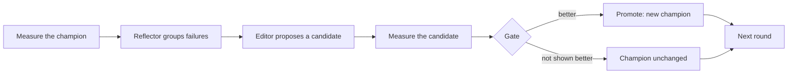

# Запуск кампании

[English](../campaign.md) · Русский

Используйте тот же проект, который измерили через `lab evaluate`. Lab подготавливает кампанию, запускает Target Service и объявленную проверку conformance, ждёт Core и останавливает target. Core решает, какие Кандидаты становятся Чемпионами.

## Шаги

Из `lab/` после `just setup`:

```sh
just new-project ~/my-agent-lab
just evaluate ~/my-agent-lab
just campaign ~/my-agent-lab
```

Если проект уже существует, начните с последней команды. Нетронутый шаблон работает офлайн, без модели и ключа. Его пример Редактора может завершиться без продвижения. Перед оценкой своего агента замените заглушку в `agent/my_agent.py`, корпус и оценщик.

Команда установленного Lab:

```sh
lab campaign ~/my-agent-lab --wheel LAB_WHEEL --wheel CORE_WHEEL
```

Передайте точные wheel, установленные в текущем Python. `--python /absolute/path/to/python` выбирает другое подготовленное окружение для target и subprocess-ролей. `--json` печатает проверенный readout `lab-campaign-summary/1`.

## Настройте проект

`evaluation-input.json` задаёт фиксированное измерение, `manifest.json` — кампанию. Начальные seed, корпус, target и оценщик у них одинаковы. При изменении этих входов поддерживайте оба файла согласованными. `launch.json` запускает target измерения, а `campaign-launch.json` — target кампании с политикой `manifest.json`.

В `manifest.json` задайте изменяемые файлы (`artifacts.writable_paths`), Редактор, Рефлектор, Группировщик и бюджет кампании. Шаблон использует статистический gate Core `/15`. Сохраните его для эксперимента о качестве; только офлайн-демо использует `observe` для проверки связей. README проекта перечисляет все параметры допуска сбоев и варианты `retry`, `no_retry`, `fail_fast`. Для модельных ролей нужны endpoint, объявленные переменные с ключами и [лимит расходов](budget.md).

## Выберите первый baseline

Начиная с dev77/b20 команда `lab campaign DIR` на `/16` выбирает последнюю фиксированную оценку проекта с сохранёнными результатами и журналом замера. Lab учитывает и состояния предыдущих пар версий. По умолчанию импорт происходит, если трассы скорера доступны для чтения. Кампания измеряет запланированные пары, которых нет в источнике.

- `just campaign DIR --baseline fresh` измеряет весь baseline по запросу.
- `just campaign DIR --baseline-from RUN` принимает номер оценки, например `001`, или ID операции оценки. На `/15` сбои импортированных строк, видимые только по вердиктам, можно диагностировать после первого обновления baseline (#208). Когда трассы не читаются, у импортированных строк нет вердиктов источника. Lab предупреждает перед таким импортом.
- Шаблон `/15` по умолчанию измеряет baseline целиком. На `/16` Lab объясняет полный замер, если подходящей оценки нет или её трассы недоступны.

Для Target с `seed_mode: exact` задайте в оценке `repeat_seeds` как `[random_seed + 1, …, random_seed + R]`, где `R` — `repeats_per_question` кампании. Например, при seed 7 и трёх повторах укажите `[8, 9, 10]`. Пары с несовпавшими seeds Core измерит заново.

Допуск импорта определяет Core. Held-out кейсы в источнике или отличия скорера, плана метрики или seed-дерева могут потребовать явного решения. Прочитайте каждый отказ перед `--continue --accept CODE:DIGEST --reason TEXT`. При жёстком отказе по источнику Lab предложит новый запуск с `--baseline fresh` или `--baseline-from RUN`. При `baseline_import_inputs_changed` повторите запуск после стабилизации входов.

`--from OPERATION` выбирает связанное продолжение. Используйте `--baseline-from` при новом запуске без `--from`. `--continue` использует сохранённый выбор. Оставляйте `baseline_import` за пределами манифеста Bundle.

## Прочитайте исход

Команда печатает исход, финального Чемпиона, путь к diff, файлы для чтения и следующую команду. Размещение совпадает с измерением:

```text
my-agent-lab/.lab/
  state-<pair>/          состояние породившей пары
  runs/001/source/      разрешённая копия проекта
  runs/001/resolved.json
  runs/001/summary.json
  runs/001/report.md
  runs/001/changes.diff
  runs/001/campaign.log
  latest                последний запуск
```

Измерения и кампании используют общую нумерацию. В `report.md` — раунды и решения Core, в `changes.diff` — изменение файлов, в `summary.json` — машинный readout. Это приватные данные эксперимента. Исходный проект не изменяется; Lab не применяет diff к репозиторию агента.

| Код | Значение |
|---|---|
| `0` | Завершено с продвижением |
| `1` | Завершено без продвижения |
| `2` | Ошибка входов проекта или подготовки |
| `3` | Сбой target, выполнения, сохранения или очистки |
| `4` | Приостановлено |
| `5` | Отказ Core |

При `4` или `5` сначала прочитайте сохранённую причину. Сохраните состояние и породившие wheel. Ctrl+C останавливает работу этого запуска и печатает путь состояния.

Для детерминированного изменения оценки выполните `just demo-campaign`; [Демо](demo.md) объясняет синтетического агента и профиль observe. Интеграция через Python описана ниже.

## Продолжение и связанные кампании

Исправьте причину приостановки и продолжите последнюю кампанию проекта с сохранёнными подготовленными входами:

```sh
lab campaign ~/my-agent-lab --continue --wheel LAB_WHEEL --wheel CORE_WHEEL
```

При авторизуемом отказе readout показывает все findings, их digest, предложенные Core эффекты и команду Lab. Причину принятия оператор указывает явно:

```sh
lab campaign ~/my-agent-lab --continue --accept CODE:DIGEST --reason "почему это изменение приемлемо" --wheel LAB_WHEEL --wheel CORE_WHEEL
```

Без `--effect` записывается Core `default`; перед записью Lab показывает выбранный по умолчанию эффект. `--effect rebaseline` или другой предложенный эффект задаёт явный выбор. Принимаются только названные findings последнего запуска, дошедшего до admission/execution Core. Более поздний сбой до Core сохраняет отказ и уже записанные решения; после cleanup можно повторить продолжение. Запуск, дошедший до Core без отказа, снимает это исключение. Автопродолжение никогда не авторизует.

По умолчанию продолжение использует сохранённые входы. `--prepared ID` явно выбирает другой PreparedExecution кампании из того же состояния. После правок проекта выполните `lab campaign DIR --continue --reprepare --wheel LAB_WHEEL --wheel CORE_WHEEL`: Lab подготовит текущие файлы и продолжит ту же операцию. Если Core откажет из-за изменённых входов, примите предложенные findings следующим вызовом `--continue`: он повторно использует уже сохранённые новые входы. `--reprepare` и `--prepared` взаимоисключающие. Допуск решает Core. Требования очистки и target сохраняются. `inputs.json` хранит подготовленные входы и Bundle по запускам, `refusal.json` — все findings отказа.

Чтобы развить результат завершённой кампании:

```sh
lab campaign ~/my-agent-lab --from OPERATION --wheel LAB_WHEEL --wheel CORE_WHEEL
```

По умолчанию новая кампания начинается с финального Чемпиона предшественника и просит Core унаследовать совместимые измерения baseline. `--baseline fresh` выбирает свежий baseline. `--seed project` явно выбирает seed проекта; прочитайте caveat Core об изменении условия в readout и отчёте. Предшественник должен быть кампанией этого состояния с сохранёнными результатами. В Bundle поле `linked_from` по-прежнему запрещено: связь задаётся при запуске Owner. Для сервиса доступны `lab resume OPERATION --accept ... --reason ... [--prepared ID]` и `lab start PREPARED --linked-from OPERATION` с обычными параметрами target, generation и секретов.

## Advanced: Owner API и справочник Core

Ниже сохранены явные шаги подготовки и сервиса, справочник заготовки Core и исторические примечания о парах версий. Основной путь выше сохраняет статистический gate; преобразование observe ниже относится к офлайн-демо.

**Цель:** позволить Lab и Evolution Core попытаться улучшить агента: предложить
изменения файлов, измерить каждое относительно текущей версии и сохранить
изменение только тогда, когда измерения показывают улучшение. **Готово, когда**
кампания завершилась с подтверждённой очисткой, вы прочитали её исход и получили
изменения как diff или ZIP (либо знаете, что ничто не превзошло вашего агента).

Страница состоит из двух частей. **[Шаги](#шаги)** — список действий.
**[Справочные сведения](#справочные-сведения)** ниже объясняют кампанию,
манифест, расходы и исходы. При необходимости шаги ссылаются на подробности.

Некоторые шаги имеют две пометки. **Для запуска** — то, что Lab требует для
начала кампании. **Для корректных результатов** — дополнительные предположения
Lab, благодаря которым исход означает заявленное.

Руководство описывает текущую пару Lab `0.0.3.dev81` и строго
`evo-skills==2.0.0b22` (тег `lab-v0.0.3.dev81`); оно не является записью приёмки
пары. Схема Owner 14 хранит подтверждения действий.
Используйте новый приватный каталог состояния, например `~/lab-state/dev81-b22`.
Старые прогоны сохраняйте с породившими wheel и состоянием. Следующие заметки о
ранних парах — историческое происхождение, а не приёмка этой пары.

Перед dev61 была выпущена dev60/b12, тег `v0.0.3.dev60` (2026-10-26). Более
ранние свидетельства dev58/b10 и отдельная приёмка остаточного ограничения
pack-index/RSS сохранены в заметке пары b10.
Для точной dev58/b10 пользователь отдельно принял ограничение 2026-10-22;
приёмка dev57/b9 не переносилась. Для точной dev59/b11 оно принято отдельно
2026-10-23; приёмка dev58/b10 не переносилась. Модули чтения Core не изменились:
сохраняются nofollow и 32 МиБ на выбранную секцию без общего ограничения
pack-index/RSS и обещания неизменяемости файлов владельца. Для точной dev60/b12
пользователь отдельно принял это ограничение 2026-10-25; приёмка b11 не
переносилась. Каждая следующая пара требует собственной оценки.

Для точной dev61/b13 пользователь условно принял это ограничение 2026-10-27 по
ADR-0019. Аудит точного тега подтвердил неизменность модулей чтения/хранения,
поэтому условие выполнено: nofollow и 32 МиБ на выбранную секцию остаются без
общего ограничения pack-index/RSS и неизменяемости файлов владельца. Это
отдельная приёмка; приёмка dev60/b12 не переносилась. Она не разрешает выпуск,
миграцию или создание состояния.

### Перед началом

- Вы выполнили [первую оценку](first-evaluation.md) и знаете Bundle, prepared
  execution и Target Service ([Как работает Lab](concepts.md)).
- Агент подключён: адаптер и файл запуска существуют, Lab может его запустить.
  Если выбрана conformance, прочитайте результаты проверки протокола
  ([Подключение агента](connect-agent.md)).
- У вас есть корпус и оценщик ([Входы оценки](evaluation-inputs.md)).
- Для Редактора или Рефлектора на модели: endpoint и API-ключ каждого, а также
  план расходов ([Бюджет и контроль расходов](budget.md)).

### Шаги

1. [Запустите офлайн-пример кампании](#шаг-1-запустите-офлайн-пример-кампании)
2. [Создайте манифест из заготовки Core](#шаг-2-создайте-манифест-из-заготовки-ядра)
3. [Задайте изменяемую область](#шаг-3-задайте-изменяемую-область)
4. [Выберите Редактора и Рефлектора](#шаг-4-выберите-редактора-и-рефлектора)
5. [Задайте масштаб и лимиты диалога](#шаг-5-задайте-масштаб-и-лимиты-диалога)
6. [Оцените и ограничьте стоимость](#шаг-6-оцените-и-ограничьте-стоимость)
7. [Создайте Bundle и подготовьте кампанию](#шаг-7-создайте-bundle-и-подготовьте-кампанию)
8. [Запустите target и кампанию и дождитесь её](#шаг-8-запустите-target-и-кампанию-и-дождитесь-её)
9. [Прочитайте исход](#шаг-9-прочитайте-исход)
10. [Получите изменение: diff и экспорт](#шаг-10-получите-изменение-diff-и-экспорт)

#### Шаг 1. Запустите офлайн-пример кампании

**Сделайте:** один раз запустите [`examples/owner/campaign.py`](../../../lab/examples/owner/campaign.py)
с новыми каталогами и свободным портом. Ему не нужны модель, сеть или ключ; он
завершается за несколько секунд. Его подготовка описана в разделе
[Как выглядит завершённая кампания](#как-выглядит-завершённая-кампания).
Запустите из каталога `lab/` после `just setup`. Путь `--python` не должен
содержать `..`, иначе подготовка завершится с `environment_invalid`:

```sh
.lab/venv/bin/python examples/owner/campaign.py \
  --python "$PWD/.lab/venv/bin/python" \
  --lab-wheel "$(just --evaluate lab_wheel)" \
  --core-wheel "$(just --evaluate core_wheel)" \
  --state-directory campaign-state \
  --source-directory campaign-source \
  --port 18766
```

[Обзор примеров](examples.md) показывает файлы, записанные скриптом (манифест,
агент, Редактор, Рефлектор, оценщик), и порядок их чтения.

**Готово, когда:** процесс кампании завершён, очистка подтверждена. Прочитайте
фактический исход Core, раунды, финального Чемпиона и состояния diff/export в
выводе; продвижение и изменение Чемпиона зависят от решений Core. Держите
скрипт открытым: шаги 7–10 выполняют те же вызовы с вашими входами.

<a id="шаг-2-создайте-манифест-из-заготовки-ядра"></a>

#### Шаг 2. Создайте манифест из заготовки Core

Для обычного проекта выполните `lab new-project DIR`: он содержит `manifest.json`, `campaign-launch.json`, примеры Редактора и Рефлектора. Для измерений качества сохраните статистический gate. Публичная заготовка Core в справочнике ниже полезна для прямой интеграции Core; это не дополнительный обязательный шаг. Профиль observe применяется только в офлайн-демо.

Далее настройте изменяемую область того же проекта. Связь двух входных и двух launch-файлов описана в разделе [Настройте проект](#настройте-проект).

#### Шаг 3. Задайте изменяемую область

**Сделайте:** заполните `artifacts` в манифесте. Шаблоны заданы относительно
корня seed и работают как `.gitignore`. Подробнее: [Изменяемая область](#изменяемая-область).

```json
"artifacts": {
  "writable_paths": ["skills/**"],
  "dependency_paths": ["uv.lock"],
  "excludes": ["build/**"]
}
```

- [ ] `writable_paths`: только файлы, которые кампания может менять (для
  ассистента поиска заказов — файлы навыков; код инструмента остаётся фиксированным).
- [ ] `dependency_paths`: обычные пути зависимостей Кандидата, которые никогда
  не меняются, например lock-файл. Без шаблонов.
- [ ] `excludes`: всё, что нужно исключить из Кандидата.

**Готово, когда:** ни один шаблон записи не пересекается с зависимостью или
исключением, а всё, что нельзя менять, находится вне `writable_paths`.

<a id="шаг-4-выберите-редактора-и-рефлектора"></a>

#### Шаг 4. Выберите Редактора и Рефлектора

**Сделайте:** выберите вид каждой роли ([Редактор и Рефлектор](#редактор-и-рефлектор)):
`subprocess` (ваша программа), `chat` (модель за OpenAI-совместимым endpoint)
или `agent_cli` (инструмент командной строки coding-агента). Для роли `chat`:

- [ ] Задайте `model`, `base_url` и `api_key_env` — *имя* секрета с ключом, никогда не сам ключ.
- [ ] Добавьте имя в `secret_names` при создании Bundle (шаг 7) и передайте
  значение при запуске кампании (шаг 8).
- [ ] Для Рефлектора также сохраните пять обязательных ключей
  (`environment_docs`, `probe`, `grouping`, `selection`, `families`); скопируйте их формы из заготовки.
- [ ] Для долгой роли `chat` задайте лимиты контекста и соблюдайте порядок трёх
  тайм-аутов; см. [Редактор и Рефлектор](../../../lab/src/evolution_lab/guides/campaign-package/SKILL.md#editor-and-reflector).

*Для корректных результатов:* `base_url` роли входит в идентичность кампании,
поэтому закрепите хост и порт ([Подводные камни](pitfalls.md)).

**Готово, когда:** каждая роль имеет вид и обязательные ключи, а все названные
секреты внесены в ваш список имён секретов.

#### Шаг 5. Задайте масштаб и лимиты диалога

**Сделайте:** заполните раздел `campaign`. Начните с малого; смысл каждой
настройки — в разделе [Масштаб кампании](#масштаб-кампании).

- [ ] `rounds`, `attempts_per_round`, `parallel_attempts` (не больше `attempts_per_round`).
- [ ] `max_concurrency`, `max_scorer_concurrency` — также ограничены `limits.max_instances` файла запуска.
- [ ] `budget.max_turns`, `budget.timeout_seconds` и обязательный
  `budget.max_failed_turns`. Этот `budget` ограничивает один диалог, а не деньги.
- [ ] Выберите [вариант отказов](#run-failures); нейтральная заготовка использует `sample_retries: 3`.
- [ ] Повторы на вопрос: `campaign.evaluation.repeats_per_question` и режим
  gate — `observe` (один повтор, без gate, проверка соединений) или
  `statistical` (R ≥ 2 повторов и уровни доверия); см.
  [confidence gate](../../../lab/src/evolution_lab/guides/campaign-package/SKILL.md#confidence-gate).

Для сопоставимости настроек фиксированной оценки и кампании явно выберите в
каждой один [вариант отказов](#run-failures); оценка не наследует манифест.
Ниже явный небольшой бюджет, а не стандартный retry заготовки.

```jsonc
"campaign": {
  "rounds": 1, "attempts_per_round": 1, "parallel_attempts": 1,
  "budget": {"max_turns": 2, "timeout_seconds": 30, "max_failed_turns": 1},
  "sample_retries": 1
  // ...the other keys as in the scaffold
}
```

**Готово, когда:** вы можете назвать факторы числа измерений кампании (шаг 6)
и число образцов в каждом (train-кейсы × повторы).

#### Шаг 6. Оцените и ограничьте стоимость

**Сделайте:** перечислите, кто вызывает платную модель, — target, Редактор,
Рефлектор, оценщик-судья на модели и повторы ([Что стоит денег](#что-стоит-денег-и-как-ограничить-расходы)) —
и перемножьте: размер корпуса × повторы × число измерений. Затем выберите лимиты:

- [ ] настройки масштаба из шага 5;
- [ ] лимит расходов у провайдера модели;
- [ ] при желании [бюджетный шлюз](budget.md) между ролями и провайдером
  для резервирования затрат по объявленному лимиту. Граница зависит от
  соответствия ваших цен и лимитов токенов биллингу провайдера.

*Для запуска:* ничего из этого не требуется. На этом пути Lab не отслеживает и
не ограничивает денежные расходы, поэтому без ваших лимитов траты ничто не остановит.

**Готово, когда:** у вас есть число для худшего случая и лимит, останавливающий
прогон ниже суммы, которую вы готовы потратить.

#### Шаг 7. Создайте Bundle и подготовьте кампанию

**Сделайте:** зафиксируйте входы и сохраните план кампании. Это то же, что для
оценки, с `CampaignSource` и `prepare_campaign`:

```python
store = PreparationStore(state)
bundle = store.create_bundle(
    source=CampaignSource(manifest_path, launch_path),   # launch "policy": "manifest.json"
    environments=(environment_input,), env={}, secret_names=("EDITOR_API_KEY",),
    roots=(SourceRoot("project", source),),
)
prepared = store.prepare_campaign(bundle.digest)          # saves the plan, runs nothing
```

`secret_names` перечисляет все секреты, читаемые любой частью кампании: имена из
`secret_names` файла запуска и имена, используемые ролями (шаг 4).

**Готово, когда:** `create_bundle` и `prepare_campaign` завершаются без ошибки,
а у вас есть `bundle.digest` и `prepared.digest`.

#### Шаг 8. Запустите target и кампанию и дождитесь её

**Сделайте:** откройте Owner, запустите target, при желании проверьте его,
запустите кампанию и опрашивайте состояние до выхода из активных:

```python
async with Owner.open(state) as owner:
    connection = await owner.bind(bundle.digest)
    started = await owner.wait(await owner.start_target(connection, secrets=target_secrets))
    target_ref = TargetRef(started.ref.id, started.owner_generation)

    check = await owner.wait(await owner.check(connection, target_ref=target_ref))  # optional

    operation = await owner.start(prepared.digest, target_ref=target_ref,
                                  secrets=execution_secrets)
    operation_ref = ResourceRef("operation", operation.id)
    while operation.control_state in {"reserved", "running", "stopping"}:
        await asyncio.sleep(0.5)
        operation = await owner.status(operation_ref)

    report = await owner.report(operation_ref)
    if (await owner.target(target_ref)).state == "ready":
        await owner.wait(await owner.stop_target(target_ref))
```

- [ ] `target_secrets`: ровно секреты, названные в файле запуска.
- [ ] `execution_secrets`: ровно секреты, используемые ролями
  ([Два набора секретов](#что-нужно-знать-при-запуске)). Имя в обоих наборах
  должно иметь одно значение. Lab никогда не читает окружение вашей оболочки.
- [ ] Для досрочной остановки вызовите `await owner.stop(operation_ref)` и продолжайте опрос.

**Готово, когда:** `operation.control_state` равно `finished`, а target —
`stopped`. Если вместо этого `cleanup_required` или `orphaned`, сначала
выполните очистку ([Результаты](results.md#шаг-5-разрешите-оставшуюся-неопределённость)).

В оболочке то же ожидание выполняется одной командой: `lab watch OPERATION`
выводит строку на изменение и завершается с `0`, когда кампания закончилась,
`3` при приостановке Core и `4` при нештатном завершении. Это работает для
family 14 (`/15`) и family 15 (`/16`); см. [Наблюдение за кампанией](watch-campaign.md).

#### Шаг 9. Прочитайте исход

**Сделайте:** прочитайте решение Core и лежащие за ним измерения из отчёта
(внутри того же блока `async with` или позднее из нового `Owner.open(state)`,
где `await owner.list_operations()` находит операцию):

```python
report = await owner.report(operation_ref)
core = report.report["core"]
print(report.state, core["campaign_outcome"]["outcome"], core["campaign_outcome"]["reason"])
print([r["outcome"] for r in core["rounds"]], core["final_champion"]["version"])
for m in report.report["measurements"]:
    print(m["coverage"]["state"], m["coverage"]["scored"], "/", m["coverage"]["expected"],
          m["metrics"]["score"]["mean"])   # "score": your metric.primary
```

В офлайн-примере это вывело `available completed rounds_exhausted`,
`['promoted', 'clean'] v1`, затем два измерения `complete 6 / 6 0.0` (seed) и
`complete 6 / 6 1.0` (продвинутый Кандидат).

- [ ] `campaign_outcome` равен `null`? Исход *неизвестен*, а не ошибка.
- [ ] У каждого измерения покрытие `complete`? Иначе оценено меньше образцов,
  чем планировалось; прочитайте подробности отчёта, прежде чем доверять метрике.
- [ ] Финальный Чемпион всё ещё `v0`? Ничто не продвинуто; см.
  [Если ничего не продвинуто](#если-ничего-не-продвинуто).

Значения исходов — в разделах [Термины отчёта](#термины-отчёта) и
[Отчёты кампании](results.md#отчёты-кампании).

**Готово, когда:** вы знаете исход кампании, финального Чемпиона и полноту каждого измерения.

#### Шаг 10. Получите изменение: diff и экспорт

**Сделайте:** прочитайте изменение от seed до финального Чемпиона и
экспортируйте его в ZIP, если изменение есть:

```python
diff = await owner.diff(operation_ref)
print(diff.state)                 # "changed" or "no_change"
print(diff.text)                  # unified diff of text files

export = await owner.wait(await owner.export(operation_ref))
if (export.state != "succeeded" or export.persistence.state != "saved"
        or export.result is None):
    raise RuntimeError("Export unavailable; inspect task failure and persistence")
payload = export.result.payload
if payload["state"] == "ready":
    data = await owner.read_export(operation_ref, payload["export_id"])
    with open("champion.zip", "xb") as stream:  # new file in your current directory
        stream.write(data)
```

Затем сами решите, применять ли его: Lab не применяет изменения к вашему
проекту. ZIP означает различие файлов, а не улучшение агента — об этом говорит
исход шага 9. Чтобы продолжить работу на основе результата, примените изменение
и начните из него новую кампанию.

**Готово, когда:** у вас есть diff (или `no_change`) и, для изменённого Чемпиона,
ZIP-файл. Подробнее: [Результаты](results.md#шаг-4-получите-изменения-кампании).

**Далее:** [Результаты](results.md) — содержимое статуса и отчёта;
[Бюджет и контроль расходов](budget.md) — перед кампанией на реальной модели.

---

### Справочные сведения

#### Что происходит в кампании

Фиксированная оценка ([Первая оценка](first-evaluation.md)) показывает качество
агента. **Кампания** пытается его улучшить. Предлагаемые изменения измеряются
относительно текущей версии и сохраняются, только когда измерения показывают улучшение.

Кампания работает с копией файлов агента — **деревом seed**. Менять можно
только файлы, помеченные вами как изменяемые. Участвуют четыре роли:

- **Editor**: предлагает изменение файлов, обычно с помощью модели. Одна
  попытка — **attempt**; изменённое дерево — **Candidate**.
- **Target**: агент, запускаемый из каждого Кандидата на вашем корпусе.
- **Scorer**: превращает каждый завершённый диалог в метрики.
- **Reflector**: читает измерения, группирует ошибки и даёт Редактору диагноз для работы.

Цикл выполняет **Evolution Core**. Каждый раунд начинается с измерения
текущего **Чемпиона** (в раунде 1 — seed), который является **родителем**
каждого предложенного в раунде Кандидата. Рефлектор анализирует ошибки,
Редактор делает попытки, Core измеряет каждого Кандидата на тех же кейсах.
Статистический **gate** (проверка Core, явно ли Кандидат лучше) сравнивает
Кандидата и родителя по образцам. Если gate находит Кандидата лучше, Core
**продвигает** его: он становится новым Чемпионом и родителем следующего
раунда. Более полная схема — в разделе [Как работает Lab](concepts.md#кампания--улучшение-агента-ядром).



**Кто за что отвечает.** Core владеет журналом кампании, статистикой, решением
о продвижении и выбором финального Чемпиона. Lab никогда их не переопределяет.
Lab фиксирует входы в Bundle, запускает и останавливает процессы, подтверждает
очистку и показывает результаты Core. Когда руководство говорит «продвинут»,
оно сообщает решение Core.

<a id="manifest-16"></a>
#### Манифест `/16`: независимая приёмка (family 15)

`/16` включается явно, а `/15` сохраняет свой смысл. Выберите его, когда число
повторов R не должно зависеть от правила оценки Кандидата. Ключи gate:
`gate.mode` (`point`, `confidence` или `unfiltered`), `gate.execution_noise`
(`{kind: negligible | bounded | observed}`), `gate.verification` (`reuse` или
`fresh`), `gate.fresh_parent` и, при `confidence`, `gate.statistics`; R остаётся
`evaluation.repeats_per_question`. Поэлементное описание — в поставляемом гайде
campaign-package (`lab guides`, `campaign-package`), нормативном для этих ключей.

- При R = 1 и `confidence` даже идеальное улучшение с 0 до 1 требует не менее
  4 единиц focus для прохождения при доверии 0.9 (5 при 0.95, по `passes_bound`
  Core). Поэтому многие попытки могут завершиться с `comparison_preflight_failed` без чисел.
- Продвижение автоматическое. В Core b13 ручного продвижения нет: ключ
  `campaign.promotion` отклоняется как `unknown_key`, а Lab не предлагает решение
  о продвижении. `linked_from` в манифесте Bundle отклоняется как `linked_run_unsupported`. Связь задаётся при запуске, см. [Продолжение и связанные кампании](#продолжение-и-связанные-кампании).
- Lab показывает записанное Core: для каждой области прирост с «с доверием c
  не ниже L» и порог (`bound`), точку и порог (`point`), прирост без порога
  либо статус Core. Двусторонний интервал не показывается. Сравнения идут с
  Чемпионом раунда с пометкой stored, fresh или not recorded ([Результаты](results.md)).
- Оба записанных уровня сравнения видимы отдельно: допускающие null
  `gate_comparison` и `global_comparison`, каждый со своими областями и
  допускающим null `reference_measurement_id`. `comparison` Core — global,
  если он есть, иначе gate; Lab копирует каждое поле независимо. CLI, markdown
  и панель опускают только отсутствующие уровни.
- Lab показывает одностороннюю нижнюю границу. Продвижение автоматическое, L3 недоступен.

Core b13 добавляет настройки `/16`; Core проверяет их и владеет правилами:

- `evidence` управляет объёмом доказательств ролей; см. [Core evidence](../../manifest-v2.md#evidence-manifest-16).
- `checks` выбирает режимы проверок политики; см. [Core check modes](../../manifest-v2.md#checks-manifest-16).
- Лимиты цикла ролей ограничивают исправления, ошибки инструментов, резервные
  варианты группировки и пропущенные раунды; см. [Core role-loop limits](../../manifest-v2.md#role-loop-limits-manifest-16).
- `campaign.indeterminate.<owner>.*` управляет политикой indeterminate каждого
  владельца; см. [Core campaign settings](../../manifest-v2.md#campaign).
- `target.preflight_sample_retries` управляет повторами образцов предварительной
  проверки соединения; см. [Core target settings](../../manifest-v2.md#schema-seed_root-target-and-artifacts).
- `reflector.probe.string_body` управляет телами пробы в виде JSON-строки; см.
  [Core live probes](../../manifest-v2.md#optional-live-probes).

Поставка Core b13 сообщает, что `qwen/qwen3.8-flash` отправляет тело пробы как
JSON-строку даже с типизированной схемой; для этой модели используйте
`string_body: "parse"` в `reflector.probe`.

Lab показывает режимы проверок, отличные от `enforce`, и счётчики shadow hits
Core в представлении кампании, CLI, markdown-отчёте и панели, даже когда данные
независимой приёмки недоступны. Журналы запуска и продолжения объясняют
последствия каждого режима не `enforce`. Счётчики разных проверок несопоставимы;
не складывайте их.

Завершайте кампании `/16`, начатые на dev60/b12, с породившими парой и
состоянием. Не продолжайте их на dev61/b13: Core не может откатить прогон `/16`,
который затронула b13.

#### Манифест кампании

Кампания описывается одним JSON-файлом — манифестом Core. Lab пишет
`evolution-v2-manifest/15` и принимает его и `/16` на путях Owner (Bundle и
подготовка, Owner, сервис, CLI, форма проекта; H1 и прежний runner принимают
только `/15`); другие версии, включая `/11` и `/14`, отклоняются до побочных
эффектов (`unsupported_schema` при подготовке Bundle/сервиса, `manifest_invalid`
через H1 `connect()`). Манифест `/15` с `grouper.kind` вида `agent_cli`
отклоняется с `grouper_kind_unsupported` (HTTP 422, этап `bundle`; сообщение
«Lab supports grouper kinds fields, command, chat (grouper.kind).»); все пути
подготовки (Bundle, форма проекта, прежний `recipe.prepare_inputs`, H1
`connect()`) проверяют его до побочных эффектов. Быстрее всего увидеть полный
манифест, создав нейтральное демо Core:

```sh
.lab/venv/bin/evo-target init ../campaign-demo   # from the Lab checkout; fresh path
```

Оно записывает `manifest.json`, дерево seed, корпус из двух кейсов и примеры
оценщика, Редактора и Рефлектора. (`--help` может всё ещё говорить «/5»;
Core 2.0.0b13 пишет `/15`.) Аннотированный `/15` ниже показывает профиль observe офлайн-демо, включая все признаки Grouper и контракт метрики. Обычная кампания `lab new-project` сохраняет статистический gate. В JSON комментариев нет; удалите их в настоящем файле.

```jsonc
{
  "schema": "evolution-v2-manifest/15",
  "seed_root": "seed",                       // the tree the campaign evolves
  "target": {"base_url": "http://127.0.0.1:8765", "seed_mode": "exact"},
  "artifacts": {                             // the editable scope, see below
    "writable_paths": ["skills/**"],
    "dependency_paths": ["uv.lock"],
    "excludes": ["build/**"]
  },
  "role_visibility": {"version": "role_visibility/1", "readable_paths": []}, // role-visible tree paths
  "campaign": {
    "rounds": 2,                             // how many rounds
    "attempts_per_round": 1,                 // editor attempts per round
    "parallel_attempts": 1,                  // attempts run at once (≤ attempts_per_round)
    "evaluation": {"repeats_per_question": 1},   // repeats of each question; R >= 2 with the statistical gate
    "round_stop": "first_accepted",            // stop attempts at the first accepted final decision, or use "all_attempts"
    "baseline_refresh_after_rounds": 3,        // re-measure baseline after this many rounds
    "indeterminate": {                       // how many unclear samples are tolerated
      "target":      {"max_count": 20, "max_rate": "1"},
      "environment": {"max_count": 20, "max_rate": "1"},
      "scorer":      {"max_count": 20, "max_rate": "1"},
      "rollout":     {"max_count": 20, "max_rate": "1"}
    },
    "budget": {"max_turns": 2, "timeout_seconds": 30, "max_failed_turns": 2},  // per sample, not money
    "call_retries": {"max_attempts": 3, "turn_max_attempts": 2},
    "sample_retries": 3,  // extra attempts for an unmeasured sample
    "max_concurrency": 2,                    // conversations running at once
    "max_scorer_concurrency": 2,             // scorer calls at once
    "metric": {"primary": "score"},          // the metric the gate compares
    "random_seed": 7,
    "editor_timeout_seconds": 60,
    "editor_context": null,                 // shared by Editor and Reflector; no role-only instructions
    "reflection_timeout_seconds": 60,
    "gate": {"mode": "observe",              // wiring check; set "statistical" explicitly for the confidence gate
             "stability": "stable",          // "unstable" re-measures the Champion in every final
             "focus": {"margin": 0},         // required effect threshold; observe omits confidence
             "causal": {"tolerance": "measured_noise"},
             "provenance": {"kind": "reported"}, "fresh_parent": true, "global": "off"},
    "attempt_feedback": "sequential"         // later attempts see earlier ones' feedback
  },
  "environment": {"kind": "static", "input_text_key": "text"},
  "scorer":  {"argv": ["python3", "score.py"], "cwd": "scorer", "timeout_seconds": 30,
              "dependency_paths": [], "allowed_env": [],
              "metric_contract": {"version": "metric_contract/1", "kind": "pointwise",
                                  "target_fields": [{"event": "assistant_message", "pointer": "/content",
                                                     "value": "nonempty_string"}]}}, // what the scorer needs
  "editor":  {"kind": "subprocess", "argv": ["python3", "edit.py"], "cwd": "editor",
              "dependency_paths": [], "allowed_env": []},
  "grouper": {"kind": "fields",             // top-level grouping; free, no model calls
              "features": [{"name": "failed_criteria", "source": "observation",
                            "path": "/failed_criteria", "description": "Failed criteria."},
                           {"name": "terminal", "source": "observation",
                            "path": "/terminal", "description": "Terminal observation status."}]},
  "reflector": {"kind": "subprocess", "argv": ["python3", "reflect.py"], "cwd": "reflector",
                "dependency_paths": [], "allowed_env": [],
                "environment_docs": null, "probe": null,
                "max_consecutive_failures": 5,   // required, integer 1–20
                "selection": {"focus_cases": 16, "representatives_per_case": 2, "context_page_size": 32},
                "families": {"kind": "none"}},
  "corpus": {"path": "corpus.jsonl"}
}
```

Разделы `target`, `environment`, `scorer` и `corpus` означают то же, что во
входе оценки; см. [Входы оценки](evaluation-inputs.md). Два практических замечания:

- Замените `python3` в каждом `argv` путём интерпретатора из
  `describe_environment(...).executable`, как пример оценки делает для
  оценщика. С простым `python3` `create_bundle` отклоняет манифест
  (`unsupported_input`): Lab требует прямого вызова закреплённого интерпретатора.
- `target.base_url` должен совпадать с `endpoint.base_url` файла запуска, а
  `policy` файла запуска указывает на этот манифест.

**Корпус можно разделить.** Каждая строка корпуса `/15` может содержать
`split: "train"` или `"test"` (все строки или ни одна; группа не пересекает
разделения). Кампания видит только train; фиксированная оценка измеряет часть,
названную в запросе подготовки (по умолчанию train).

#### Изменяемая область

`artifacts` определяет, что может менять Редактор. Шаблоны заданы относительно
корня seed и работают как `.gitignore` (`**` соответствует любой глубине):

- `writable_paths`: файлы, которые Редактор может менять. Остальное фиксировано.
- `dependency_paths`: обычные пути файлов, от которых зависит Кандидат, но
  которые он никогда не меняет, например lock-файл. Без шаблонов.
- `excludes`: файлы, исключаемые из Кандидата. Core добавляет свои умолчания
  (каталоги контроля версий, виртуальные окружения, кэши, файлы `.env`, журналы).

Шаблон записи не может пересекаться с зависимостью или исключением. Для
ассистента поиска заказов `writable_paths: ["skills/**"]` позволяет кампании
переписывать файлы навыков агента, а код инструмента `lookup_order` остаётся
вне изменяемого набора.

<a id="редактор-и-рефлектор"></a>

#### Редактор и Рефлектор

Пользовательские subprocess Reflector должны принимать `reflect_brief/5` для
`/15` и `reflect_brief/6` для `/16`. Editor получает `edit_brief/4` для `/15`
(или `edit_brief/5` при последовательной обратной связи попыток) и `edit_brief/6`
для `/16` (или `edit_brief/7` при такой обратной связи). Старые программы ролей
и прогоны сохраняйте в породивших окружениях; не обновляйте старый прогон на месте.

На точной dev61/b13 Lab делегирует размещение корпуса
`evolution.tree.evolve.check_corpus_placement(manifest)` без `run_root` или
`environ`. Он проверяет объявленные Core пути ролей/группировки; не ищет agent
CLI в `PATH`. Разрешение CLI и runtime-проверки остаются за Core. Отказ
размещения сохраняет `corpus_inside_role_workspace`. Другие ошибки helper не
являются успешной проверкой: H1 использует `manifest_invalid`/`io_error`;
прежний recipe — `PreparationArtifactsInvalid`; Bundle — `manifest_invalid`/
`io_error` с существующим приоритетом дрейфа источника; проверки пакета проекта —
`manifest_invalid`/`unsupported_input` с безопасными подробностями.
Отсутствующий корпус остаётся на существующем этапе проверки корпуса. Этот
импорт для точного pin не обещает стабильный beta facade.

`campaign.editor_context` — общий контекст: Core показывает его и Editor, и
Reflector, поэтому он не должен содержать инструкции только для одной роли.
Специфические инструкции помещайте в промпт или программу соответствующей роли.

Обе роли бывают трёх видов:

- `subprocess`: ваша программа (`argv`, `cwd`, `dependency_paths`, `allowed_env`). Примеры заготовки относятся к этому виду.
- `chat`: модель за OpenAI-совместимым endpoint. Требует `model`, `base_url` и
  `retry`; `api_key_env` необязателен (*имя* секрета, обязательное для ролей
  через шлюз политики). Другие необязательные ключи включают `system_prompt` и `reasoning_effort`.
- `agent_cli`: инструмент командной строки coding-агента (как Редактор — один
  запуск на попытку). Требует `model`; необязательные ключи включают
  `system_prompt`, `allowed_env` и `reasoning_effort`.

Для ассистента поиска заказов Редактор на модели мог бы выглядеть так (модель и URL — заглушки):

```json
"editor": {
  "kind": "chat",
  "model": "your-model-name",
  "base_url": "https://llm.example.com/v1",
  "api_key_env": "EDITOR_API_KEY",
  "system_prompt": "You improve the skills of an order-lookup assistant.",
  "retry": {"version": "role_call_retry/1", "max_attempts": 3, "total_budget_seconds": 600,
            "backoff": {"initial_seconds": 5, "multiplier": 2, "max_seconds": 60, "jitter": "full"}}
}
```

На `/15` роль `chat` без `retry` отклоняется как `missing_key`.

При chat-Редакторе `editor_timeout_seconds` (а для chat-Рефлектора
`reflection_timeout_seconds`) должен превышать `retry.total_budget_seconds`
роли — для 600 выше требуется больше 60 из аннотированного манифеста.

Рефлектор принимает те же виды плюс `environment_docs` и `probe` (каждый может
быть `null`), `selection`, `families` и `max_consecutive_failures` (целое 1–20,
без умолчания). Группировка принадлежит верхнеуровневому `grouper` (`fields`,
`command` или `chat`). Скопируйте их формы из заготовки. `base_url` роли входит
в идентичность кампании, поэтому закрепите его (см. [Подводные камни](pitfalls.md)).

#### Бюджетный шлюз для ролей на модели

Необязательная [политика исполнения](budget.md#политика-исполнения-и-бюджетный-шлюз)
позволяет Lab запускать шлюз вместе с target. Bundle сохраняет стабильные URL
шлюза и alias `client_model`; политика хранит upstream endpoints, модели, имена
секретов и закрепления провайдеров. Lab передаёт новые токены маршрутов в target,
объявленные `api_key_env` ролей Core и сопоставленные имена оценщика. Передавайте
upstream-ключи только при запуске target; не передавайте сгенерированные токены
сами. `reasoning_effort` остаётся в манифесте. Поля провайдера `provider_only`,
`provider_order` и явный `allow_fallbacks` маршрутизированных chat-ролей
отклоняются как `manifest_provider_pin`; поместите их в политику до запечатывания
Bundle. Без политики сохраняется существующая передача закреплений провайдера в Core.

Для смены провайдера приостановленной кампании: остановите target и дождитесь
очистки, подтвердите политику B с проверенным ожидаемым digest, запустите новый
 target того же Bundle под B, затем явно продолжите кампанию. Весь блок `gateway`
оставьте неизменным. Наличие политики нельзя изменить при продолжении. Bundle,
идентичность Core и измерение сохраняются; Core не видит смены маршрута. Lab не
проверяет эквивалентность модели или квантизации: это должен установить человек.
Существующие кампании с закреплениями в Bundle не мигрируются этим способом.

JSON-отчёт Owner `/13`, `lab routing OPERATION` и панель только для
чтения показывают историю политик и число запросов, включая несовпадения
провайдера, совместные и внешние использования. Отсутствие доказательства
провайдера означает неизвестность; нечитаемый или непривязанный журнал сохраняет
историю подтверждений, но делает маршрутизацию недоступной. Аудита денег/отдельных
попыток и маршрутизации в `report.md` нет. [Процесс политики](budget.md#политика-исполнения-и-бюджетный-шлюз)
содержит полный JSON, команды подтверждения и запуска и ограничения учёта.

<a id="run-failures"></a>
#### Отказы во время выполнения

Выберите до запуска кампании или фиксированной оценки. Вариант описывает
следующие явные значения; `max_turns` — выбранный бюджет на диалог. Для
`campaign.indeterminate.<каждый>` примените значения к каждому владельцу.

| | `retry` «С повтором» (умолчание) | `no_retry` «Без повтора» | `fail_fast` «Остановка на первом сбое» |
|---|---|---|---|
| `campaign.sample_retries` | 3 | 0 | 0 |
| `campaign.indeterminate.<каждый>.max_count` | 20 | 20 | 0 |
| `campaign.indeterminate.<каждый>.max_rate` | `"1"` | `"1"` | `"0"` |
| `reflector.max_consecutive_failures` | 5 | 5 | 1 |
| `campaign.call_retries.max_attempts` | 3 | 3 | 1 |
| `campaign.call_retries.turn_max_attempts` | 2 | 1 | 1 |
| `campaign.budget.max_failed_turns` | = `max_turns` | = `max_turns` | 1 |
| оценка: `sample_retries` | 3 | 0 | 0 |
| оценка: `min_coverage` | 0.95 | 0.95 | 1 |
| оценка: `max_consecutive_unmeasured` | 3 | 3 | 1 |
| оценка: `call_retries` | 3 / 2 | 3 / 1 | 1 / 1 |
| оценка: `max_failed_turns` | = `max_turns` | = `max_turns` | 1 |

**`retry` «С повтором» (умолчание).** Неоценённые образцы можно повторить,
временные ошибки вызовов target — повторить, а неудачные ходы могут продолжаться
в рамках бюджета диалога. Оценённое покрытие всё равно должно достичь 0.95.
`sample_retries > 0` или `turn_max_attempts > 1` утверждает безопасность
повторной отправки вопроса агенту; подтвердите её до выбора этих значений.
Повторы могут повторять побочные эффекты и добавлять работу. Для повторов хода
 target должен повторно отправлять тот же `request_id`; см.
[Исходы хода](../../../lab/src/evolution_lab/guides/target-connector/SKILL.md#turn-outcomes).

**`no_retry` «Без повтора».** Используйте для агентов, повторный ход которых
меняет мир. Повторная отправка образцов и ходов отключена; число попыток
временного вызова остаётся 3 при `turn_max_attempts: 1`. Неудачный образец может
остаться неоценённым, пока другие продолжаются, с учётом лимитов покрытия и
последовательных неоценённых образцов. Это не гарантия exactly-once для внешних побочных эффектов.

**`fail_fast` «Остановка на первом сбое».** Повторы образцов и ходов отключены;
один неудачный ход завершает rollout, один последовательный неоценённый образец
останавливает фиксированную оценку. Допуск indeterminate кампании равен нулю,
оценка требует полного покрытия. Ошибка исполнения не даёт балл образцу и не
является доказательством плохого качества.

На точном Core b15 `max_rate < 1` может сделать ошибку на первых вопросах
фатальной: Core считает долю с первого знаменателя, поэтому первая неудачная
попытка даёт долю 1, даже если `max_count` ещё ниже лимита. Необязательный
`campaign.indeterminate.<owner>.min_tries` манифеста `/16` задаёт прогрев перед
проверкой доли; Lab не записывает его или другие настройки `/16` за вас.

Builder записывает ключи кампании в неизменяемый манифест; Lab не подставляет
их и не сверяет манифест с выбранным вариантом. Нейтральная заготовка кампании
Lab записывает `retry`. У фиксированной оценки собственные настройки запроса/
входа; она не наследует настройки отказов кампании. Новые подготовки используют
`retry` для пропущенных/default-null значений оценки; явные значения имеют
приоритет. См. [Бюджет оценки](evaluation-inputs.md#the-fixed-evaluation-budget).

Изменение варианта до запуска создаёт новый Bundle, но само по себе не требует
нового первого измерения, когда основа измерения остаётся равной. Для оценки
сохранённых доказательств используйте [измерения Bundle](../../../lab/docs/api/service-s5.md#bundle-measurements)
и общие факты проекта. Работающие или приостановленные кампании не меняют
вариант на месте. Запустите новую кампанию и [выберите её baseline](campaign.md#выберите-первый-baseline) из сохранённых оценок проекта.

#### Масштаб кампании

| Настройка | Что определяет |
|---|---|
| `rounds` | Число раундов. |
| `attempts_per_round` | Попытки Редактора в раунде. |
| `parallel_attempts` | Одновременные попытки. |
| `max_concurrency` | Одновременно выполняемые диалоги во всей кампании. |
| `max_scorer_concurrency` | Одновременно выполняемые вызовы оценщика. |
| `budget.max_turns`, `budget.timeout_seconds` | Лимиты одного диалога. |
| `evaluation.repeats_per_question` | Повторы каждого вопроса (R). `observe` использует 1; `statistical` требует R ≥ 2. |
| `gate.mode` | `observe` (gate не применяется, проверка соединений, не доказательство качества) или `statistical` (confidence gate). |

<a id="target-capacity"></a>
Параллельность также ограничена объявленной ёмкостью target
(`limits.max_instances` в файле запуска). Подготовка проверяет `/15` до любых
расходов через собственный `admit_capabilities` Core. Lab запрашивает
минимальный `max_instances`, допускаемый Core, и не хранит собственной
формулы. Если файл запуска объявляет меньше экземпляров, `lab prepare`
отклоняется с `artifacts_invalid` и `target capacity: the campaign needs N instances, the target declares M`.

Рычаги включают `max_concurrency`, `parallel_attempts`, `gate.fresh_parent`,
`attempts_per_round` и фактический `limits.max_concurrent_sessions` target.
Smoke-профилю observe выше (`max_concurrency: 2`, `parallel_attempts: 1`,
`fresh_parent: true`) нужны 4 экземпляра, когда каждый обслуживает одну сессию.
Пересматривайте допуск при изменении этих значений; режим gate и финальные
измерения тоже влияют на политику Core.

`budget` ограничивает диалог, а не деньги. Выберите повторы образцов, лимиты
неудачных ходов и допуски indeterminate в разделе [Отказы во время выполнения](#run-failures).
Фиксированная оценка разрешает собственные настройки отдельно от манифеста кампании.

<a id="связанные-прогоны-отклоняются"></a>
#### Связанные кампании

Используйте `lab campaign DIR --from OPERATION` или `Owner.start(..., linked_from=OPERATION)`, как описано [выше](#продолжение-и-связанные-кампании). Поле `linked_from` внутри Bundle по-прежнему отклоняется как `linked_run_unsupported`. Допуск связи и baseline принадлежит Core.

#### Приостановка

**Цель:** понять, что такое приостановленная кампания и что с ней делать.

Инфраструктурная ошибка внутри rollout больше не закрывает кампанию как
`infrastructure_failed`. Вместо этого Core приостанавливает её нетерминальной
записью `campaign_suspended {reason, owner, evidence}` и сохраняет каталог
прогона: кампания не завершена, а `campaign_outcome` остаётся `null`
(неизвестно, не ошибка).

1. **Сделайте:** прочитайте `status.result.core.suspended`, прежде чем считать
   `status.process.exit_code == 1` ошибкой; `status.result.core.suspensions`
   называет причину, владельца и вид доказательств каждой приостановки.
   `lab suspensions OPERATION [--json]` (также `Owner.suspensions(ref)` и
   `GET /v1/operations/OPERATION/suspensions`) читает закрытую историю
   `lab-suspension-evidence/1` с возвращёнными строками fault/final/Champion
   или доказательствами порога/этапа. Строки объясняют причину паузы, а не все
   ещё подлежащие исполнению образцы; count/truncated сохраняют ограниченный
   префикс Core. Пустой, недоступный и удалённый результаты различны
   ([контракт](../../../lab/docs/api/owner-s4.md#suspension-evidence)). После продолжения
   это остаётся историей; текущий статус отдельный. Панель читает текущие
   доказательства при открытии, исторические — при раскрытии, отмечает
   устаревшее чтение и очищает удалённые данные. Раскрытия приватных данных не
   добавлено. `lab status` выводит две дополнительные строки (`suspended:`,
   `continuation:`); отчёт содержит таблицу `suspensions`. Подробности полей:
   [Результаты](results.md#suspended-campaigns).
2. **Сделайте:** решите, как продолжать. Прогоны Owner, сервиса и CLI явно
   продолжаются на любом `ready` target того же Bundle, даже из следующего
   поколения Owner: исправьте target (или запустите другой), затем выполните
   `Owner.resume(ResourceRef('operation', id), target_ref=..., secrets=...)` /
   `lab resume <id> --target … --generation …`. Операция должна быть `finished`
   или `released` с подтверждённой очисткой target; `cleanup_required`/
   `orphaned` сначала требует `lab cleanup operation <id>`, а операция `released`
   после ручного `lab release-operation` не имеет продолжения. Прогон прежнего runner
   (существует `<run>-lab-logs/supervisor.lock`) вместо этого продолжается через
   `runner.resume_native` в той же папке, без этой проверки допуска — см.
   [справочник прежнего runner](../../../lab/docs/api/legacy-runner.md). Прогоны H1 не имеют
   продолжения. В любом случае удалите результаты, когда каталог прогона больше не нужен.
3. **Готово, когда:** прежний прогон достигает `campaign_finished`, прогон
   Owner/сервиса/CLI достигает `complete` при следующем запуске либо вы
   приняли решение остановиться здесь.

В кампании `/15` (Core family 14) есть дополнительные паузы, каждая со строкой
`hint:` в `lab status` и `lab campaign`: `final_incomplete` (финальное измерение
раунда не завершено: продолжите, Core измерит недостающие пары),
`connection_incompatible`, `connection_preflight_unavailable` и
`connection_preflight_inconclusive` (проверка соединения target и оценщика
Core), а также `grouper_provider_failed` и `grouper_failing` (исправьте
провайдера или хост Grouper, затем продолжите). Ни одной из них новый target не
нужен. У `connection_incompatible` и `connection_preflight_inconclusive` **два
выхода**: если причина вне Bundle (провайдер агента, окружение target),
исправьте её и продолжите; если ошибка в агенте, оценщике или `metric_contract`
(все внутри Bundle), исправьте проект и выполните `--continue --reprepare` с параметрами wheel либо выберите подготовленные входы через `--prepared ID`. Тот же Bundle повторит ошибку; Core решит, можно ли принять изменение или нужен связанный запуск. Для `connection_preflight_unavailable` один выход:
исправьте target или оценщик и продолжите.

На dev61/b13 `input_too_large` рефлексии остаётся точным `error_class` и
`reason` журнала; внутренняя классификация `unknown` Core не заменяет эти коды.
Существующая приостановка — `reflector_failing`. Повтор того же слишком большого
Bundle не исправляет проблему. Авторизация или редактирование запечатанных
входов не помогает; используйте исправленный пакет и новую кампанию по
существующим правилам продолжения.

#### Что нужно знать при запуске

Процесс запуска (шаги 7 и 8) повторяет оценку. Отличаются вид источника,
`prepare_campaign` и передаваемые секреты.

- **Два набора секретов**, передаваемые словарями `{name: value}`.
  `start_target` нужны ровно секреты из файла запуска. `start` нужны ровно
  секреты ролей кампании: имена в `allowed_env` оценщика, `api_key_env`/
  `proxy_env` Редактора и Рефлектора (для `chat`) или `allowed_env` (другие
  виды), `allowed_env` командной группировки и некоторые имена, передаваемые
  Core инструментам `agent_cli`; все ограничены именами секретов, объявленными
  в `create_bundle`. Имя в обоих наборах должно иметь одно значение. Lab не
  читает окружение вашей оболочки.
- **Check необязательна.** `check` запрашивает у работающего target health,
  возможности и идентичность. Это не conformance и не разрешение тратить деньги.
- **Stop — запрос.** `await owner.stop(operation_ref)` просит кампанию
  кооперативно остановиться; продолжайте опрос до завершения. Если что-то
  осталось неопределённым, операции нужна явная `owner.cleanup(operation_ref)`.
  См. [Подводные камни](pitfalls.md) и [гайд диагностики](../../../lab/src/evolution_lab/guides/diagnostics/SKILL.md#cleanup_required-and-release).
- **Наблюдение за долгой кампанией.** Оставьте `lab watch OPERATION` работающим
  (`nohup … >> watch.log &`); смысл строк и действия после остановки — в
  разделе [Наблюдение за кампанией](watch-campaign.md).
- **Отчёт приватен.** `report.report` содержит полный отчёт Core и может включать ваши данные.

Все вызовы по порядку — в [`examples/owner/campaign.py`](../../../lab/examples/owner/campaign.py):
подготовить Bundle кампании из заготовки Core, запустить target, `check`,
`start`, опрос, отчёт, `diff`, `export`, остановить target.

#### Как выглядит завершённая кампания

[Демо кампании](demo.md) строится на том же шаблоне проекта. Пример Редактора записывает `IMPROVED: reference skill`, после чего синтетический агент правильно отвечает на три вопроса корпуса о кодовых словах. Обычный оценщик полного совпадения выставляет `1.0`. Gate observe показывает работоспособность связей, а не улучшение качества. Команда приведена в [шаге 1](#шаг-1-запустите-офлайн-пример-кампании).

Ранняя породившая пара записала следующий вывод примера; это историческое
происхождение, а не capture dev52/b6 или обещание продвижения. Текущие попытки
family14 становятся финалистами до решения финального контраста Core о приёмке.
Ранний прогон вывел `campaign.outcome: "completed"`, `reason: "rounds_exhausted"`,
`rounds: ["promoted", "clean"]`, `final_champion: "v1"`, `diff.state: "changed"`,
`export.state: "succeeded"` и `blocker_count: 0`. Подробно `operation.result.core` показывает:

- раунд 1: попытка `r01-a01` — `accepted` (`lower_bound_positive`), исход раунда `promoted`;
- раунд 2: попыток нет, исход `clean` (у родителя не было ошибок для исправления);
- `campaign_outcome`: `completed`, причина `rounds_exhausted`;
- `final_champion`: версия `v1`, происхождение `promoted_attempt`.

`owner.diff(operation_ref)` затем показал изменение одной строки `skills/SKILL.md`.

С агентом, игнорирующим файл навыка, каждая попытка была `rejected`, каждый
раунд завершался `stalled`, финальный Чемпион оставался `v0` (seed), а `diff`
возвращал `no_change`.

#### Термины отчёта

| Уровень | Исходы |
|---|---|
| Attempt | `finalist` (финальный контраст решает приёмку), `accepted`, `rejected`, `insufficient_evidence`, `abandoned` (например Редактор отказался, завершился ошибкой или ничего не изменил) |
| Round | `promoted`, `stalled`, `clean`, `unscored`, `unmeasurable` |
| Campaign | `completed`, `stopped`, `budget_exhausted`, `infrastructure_failed` |

#### Если ничего не продвинуто

«Нет продвижения» означает, что Core не нашло достаточно доказательств
превосходства любого Кандидата над родителем. Это **не** означает сбой кампании
и не доказывает, что Кандидаты были хуже. Частые причины:

- изменения Редактора не повлияли на измеряемое оценщиком;
- корпус или число повторов слишком малы, чтобы gate увидел реальное небольшое улучшение;
- изменения улучшили целевые кейсы, но ухудшили другие сильнее причинного допуска;
- слишком много образцов были неопределёнными (инфраструктурные ошибки), поэтому
  попытка завершилась с `insufficient_evidence`;
- финалист не прошёл финальный контраст Core либо финальное измерение было
  недоступно. Одно прохождение gate не принимает попытку family14. Прочитайте
  финальное решение и причину Core в `lab campaign`; Lab не вычисляет вердикт.

В этом случае финальный Чемпион — seed, `diff` сообщает `no_change`, а `export`
не создаёт архив.

#### Что стоит денег и как ограничить расходы

Для реального агента деньги расходуются на вызовы модели:

- **target**: собственные вызовы модели агентом для каждого образца каждого
  измерения (родителя и каждого Кандидата);
- **Редактор**: один запуск на попытку;
- **Рефлектор**: анализ измерений;
- **оценщик**, если вызывает модель-судью;
- **повторы**: дополнительные образцы, когда `sample_retries` > 0 и образцы неудачны.

Главный множитель — размер train-корпуса × повторы (`evaluation.repeats_per_question`)
× число измерений. В family14 измерения включают свежих родителей (когда
`fresh_parent` включён), финал каждого раунда и обновления baseline. Простой
верхней границы здесь нет; влияют раунды, попытки на раунд, свежие родители,
финалисты, настройки стабильности и обновления.

При `gate.mode: "statistical"` каждое измерение запускает каждый вопрос R раз
(`evaluation.repeats_per_question`), поэтому расходы в R раз больше, чем при
`observe`. **На этом пути Lab не отслеживает и не ограничивает денежные расходы.**
Ограничивайте стоимость настройками масштаба выше и лимитами провайдера. Начните
с крошечной кампании (один раунд, одна попытка, несколько кейсов) и посмотрите
счёт до увеличения масштаба. Подробнее: [Бюджет и контроль расходов](budget.md).

#### После кампании: diff и экспорт

После завершения операции `owner.diff(operation_ref)` показывает изменения
между seed и финальным Чемпионом, а `owner.export(operation_ref)` упаковывает
изменённые файлы в ZIP (`lab-change-set/1`). Lab не применяет изменения к
проекту; решение за вами. ZIP не означает улучшения агента: проверьте
записанный исход и полноту. Подробности и значения полей — в [Результатах](results.md).

### Справочные материалы

- [Гайд пакета кампании](../../../lab/src/evolution_lab/guides/campaign-package/SKILL.md): манифест `/15`, изменяемая область, роли, масштаб, приостановка
- [Гайд подготовки](../../../lab/src/evolution_lab/guides/preparation/SKILL.md): создание Bundle кампании
- [Гайд Owner](../../../lab/src/evolution_lab/guides/owner/README.md): жизненный цикл, секреты, Stop, очистка
- [Гайд диагностики](../../../lab/src/evolution_lab/guides/diagnostics/SKILL.md): чтение отчётов, состояния очистки, diff и экспорт
- [API результатов Owner](../../../lab/docs/api/owner-s4.md): продолжение, diff, экспорт, удаление
- [`_manifest_schema.py`](../../../lab/src/evolution_lab/_manifest_schema.py): принимаемая схема в коде

<a id="reflector-probe"></a>

<a id="запуск-пробы-рефлектора-lab-target-launch3"></a>

### Запуск пробы Рефлектора (`lab-target-launch/3`)

Это HTTP-копия окружения, используемая Reflector кампании и отдельная от
интерактивных сессий пробы target. `reflector.probe` манифеста объявляет URL API
и путь health; запуск `/3` объявляет способ её запуска. Lab не проверяет, что
проба и target обслуживают один снимок данных, и не передаёт пробе текущего
Чемпиона. Обеспечьте совпадение данных в своей интеграции.

Например, объект `reflector.probe` манифеста:

```json
{"base_url": "http://127.0.0.1:8781", "health_path": "/health", "request_timeout_seconds": 10}
```

Core проверяет объявление; Lab читает загруженный манифест, а не разбирает новые
ключи `/16` сам. При создании Bundle кампании объявления должны согласовываться:

| `reflector.probe` манифеста | `reflector_probe` запуска | Результат |
|---|---|---|
| Отсутствует или `null` | `null` | Допустимо; нет запуска пробы и проверки health |
| Объявлен | Объект | Lab запускает и очищает пробу |
| Объявлен | `null` | Оператор запускает вручную; Lab один раз проверяет health при запуске |
| Отсутствует или `null` | Объект | Отклоняется с `manifest_invalid` |

`/1` и `/2` по-прежнему принимаются; отсутствующее поле запуска означает, что
управляемой пробы нет. Bundle видов evaluation и интерактивной пробы отклоняют
ненулевой `reflector_probe` с `invalid_request`. Target командной формы `/1` не
получает управляемую пробу Рефлектора.

Заготовка кампании записывает `/3` с `"reflector_probe": null` и
`"turn": {"empty_answer": "target_failed"}`. Для запуска нейтрального сервиса
в форме HTTP-эмулятора из собственного пакета замените null на:

```json
{
  "environment_ref": "<Bundle environment digest>",
  "executable": "<that environment's interpreter>",
  "args": [
    {"bundle_path": "local/probe_server.py"},
    {"literal": "--port"}, {"probe_port": null},
    {"literal": "--data"}, {"bundle_path": "data/reference"}
  ],
  "startup_timeout_seconds": 60,
  "stop_grace_seconds": 5,
  "max_restarts": 3
}
```

Все шесть полей обязательны; 60 секунд, 5 секунд и 3 перезапуска — значения
руководства, а не умолчания runtime. Тайм-ауты должны быть положительными
конечными числами, `max_restarts` — целым ≥ 0. `environment_ref` называет
объявленное окружение Bundle, а `executable` должен совпадать с его
интерпретатором. `args` принимает только объекты с тегами `literal`,
`bundle_path` и `probe_port`. `bundle_path` переносит скрипты/данные в Bundle;
литералы передаются без изменений. Рабочий каталог — приватное состояние Owner,
поэтому буквальный относительный путь скрипта/данных не разрешается от Bundle.
Процесс получает объявленный `env` запуска target и переданные секреты.

`{"probe_port": null}` берёт порт из `reflector.probe.base_url` — единственного
источника истины и части идентичности кампании Core. Он может встретиться ноль
или более раз; не дублируйте порт литералом. Активный слушатель отклоняет запуск
с `reflector_probe_port_busy`; TCP `TIME_WAIT` после очистки можно использовать
повторно. Проверка bind/listen не является атомарным резервированием:
окончательным остаётся фактический bind сервера, а повторно используемый
привязанный, но не слушающий сокет может пройти проверку.

При запуске и явном продолжении, после совпадения health target и до отправки
worker, Owner запускает пробу и ждёт ответ 2xx от `GET <base_url><health_path>`
в течение `startup_timeout_seconds`. **На точной b13 все объявленные пробы
используют допуск `suspend`:** недоступная health отклоняет запуск с
`reflector_probe_unavailable` до worker кампании или расходов на модель, а Lab
очищает свою пробу. Для пробы оператора Lab делает ровно один GET с
`reflector.probe.request_timeout_seconds` манифеста; он не следит за внешним
процессом постоянно и не останавливает его. Манифест без пробы не требует сервера пробы.

**Условно после repin b14:** стандартный или явный `on_unavailable: suspend`
для `/15` и `/16` сохраняет отказ; `/16` с `on_unavailable: continue` может
начаться с уведомлением о недоступной пробе, и Core может продолжать рефлексии
без неё. Это поведение не поставляется на b13. Последствия недоступности пробы
во время кампании принадлежат Core.

Каждый запуск/перезапуск Lab получает собственную вспомогательную область Owner
и квитанцию очистки. Если дочерний процесс завершится во время worker, Owner
полностью собирает его перед попыткой замены на том же порту, не более
`max_restarts` раз за прогон worker. Исчерпание останавливает попытки замены;
оно не заставляет Lab продолжать кампанию. Явное продолжение запускает новую
пробу с новым счётчиком перезапусков. Когда worker завершается, приостанавливается
или падает, Owner отправляет STOP и ждёт очистки вспомогательной области;
очистка после смерти Owner использует существующий механизм областей.

Уведомления запуска, выхода, перезапуска и исчерпания идут в приватный worker
`stderr.log`; они не транслируются как события CLI. CLI campaign/watch/report
показывают агрегированные факты пробы, а панель — все четыре поля рядом с
проверками. Текущие `lab-campaign-view/15` и `lab-owner-report/15` имеют
верхнеуровневую тройку: `reflector_probe`, `reflector_probe_state` (`present`
или `unavailable`) и `reflector_probe_reason` (null или `unreadable`).
Присутствующая запись — ровно `{launched_by, state, restarts, last_exit}`:
атрибуция `lab` или `operator`, состояние `running`, `stopped` или `exhausted`,
restarts считает попытки замены, last_exit — знаковый целочисленный код выхода
или null. Это факты Owner, независимые от доступности Core/отчёта. Только явный
`{launched_by: null, state: not_declared, restarts: 0, last_exit: null}` означает
отсутствие объявления; отсутствующее или некорректное доказательство недоступно,
а не подразумевает отсутствие. Для сервера оператора `running`/`stopped`
записывает участие этого запуска; `stopped` не означает, что Lab его завершил,
а `last_exit` остаётся null. Markdown сохраняет существующий недоступный
результат, если нет отчёта Core для отображения.

Для `/2` и `/3` слой ходов Lab преобразует пустой или состоящий только из
пробелов ответ `ok` в `target_failed` с причиной `lab/empty_answer` до подгонки
под бюджет ответа, сохраняя события и usage. Это меняет смысл измерений, ранее
считавших пустые ответы успешными. `/3` может явно отключить правило через
`turn.empty_answer: "ok"`; `/1` находится вне этой автоматической политики.

### Автоматическое продолжение в dev72

Dev72 поддерживает необязательное автоматическое продолжение для выбранных
причин приостановки Core. До запуска подтвердите на target политику
`lab-execution-policy/2` с `auto_resume`: непустой список `reasons`,
`max_resumes` не менее 1, `delay_seconds` от 0 до 31 536 000 и необязательный
`busy_recheck_seconds` от 1 до 31 536 000 (по умолчанию 60). Границы
включаются. В `/1` и `/2` без блока функция выключена. Правила берутся из
target последнего запуска; ручное продолжение на совместимом target может их
изменить. Предыдущие автоматические запуски учитываются в новом лимите.
Подробнее — [политика исполнения](../../../lab/docs/api/execution-policy.md).

Owner ждёт, выполняет очистку и выбирает совместимый target, затем применяет
обычные правила допуска resume. Занятые ресурсы откладывают повторную проверку
без расходования попытки. `lab status` показывает состояние, число и лимит
попыток, следующую проверку и причину блокировки; `starts` различает ручные и
автоматические запуски. Stop отменяет ожидание; ручной resume доступен по
обычным правилам. Функция не меняет исходы Core, допуск и продвижение и не
работает как демон после выхода Owner. Секреты хранятся в памяти Owner и после
выхода их нужно передать при ручном resume. Core b18 маскирует секреты запуска
в stderr ролей-подпроцессов, но scorer traces по-прежнему хранятся без
маскирования (Core #200), поэтому компоненты не должны печатать секреты туда. Панель пока не
показывает новый блок. Для dev72 нужен новый Owner state v11; v10 отклоняется
без миграции, старые прогоны остаются со своей парой.

#### Уведомление о provenance baseline

Уведомление кампании `baseline_provenance_unknown` означает, что Core не сохранил provenance ни для одного сэмпла последнего завершённого baseline: цель могла её не передать, в том числе на части ходов. При `reported` каждая попытка тогда считает все кейсы затронутыми. Проверьте, что каждый ход сообщает действительно использованные входы и что лимит ответа достаточен, затем запустите новый baseline кампании. Уведомление информационное; частичная provenance baseline его не вызывает. С поддержкой provenance оценки в Core команда `lab evaluate` предупреждает, когда проект использует `reported`, есть завершённые сэмплы, а Target не передал provenance. Старые оценки помечаются `provenance_not_recorded`.
