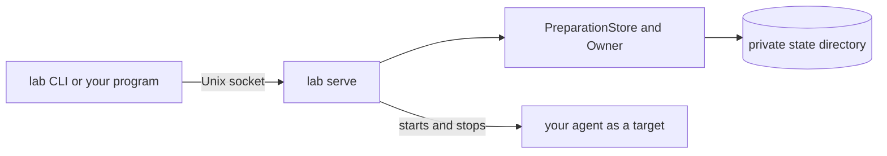

# CLI и локальный сервис

[English](../cli.md) · Русский

Всеми возможностями Lab можно управлять из Python (`PreparationStore` и
`Owner`). Команда `lab` — второй способ: небольшой клиент командной строки для
**локального сервиса Lab**, предоставляющего те же действия. Используйте его,
если предпочитаете оболочку или другой программе (например auto-evolve) нужно
управлять Lab без импорта.

Эта страница объясняет сервис, его запуск и остановку и проводит через полную
оценку ассистента поиска заказов из других страниц. Выводы с пометкой «реальный»
получены на `evolution-lab 0.0.3.dev32` с `evo-skills 0.3.0a21` и остаются
историческими примерами породившей пары. Текущая рабочая пара —
`evolution-lab 0.0.3.dev81` / строго `evo-skills 2.0.0b22`. Используйте новое
состояние `~/lab-state/dev81-b22`; старые прогоны/состояние сохраняйте с
породившими wheel. Схема Owner 14 хранит подтверждения действий.
[История релизов Lab](../../../lab/docs/RELEASES.md) перечисляет версии обеих поставок.
Понятия за командами объясняет [Как работает Lab](concepts.md).

Для этой страницы активируйте окружение из раздела установки, чтобы `lab` был в
PATH. Из checkout Lab в описанной там структуре:

```bash
source .lab/venv/bin/activate
```

Замените `/home/you` в путях ниже своим домашним каталогом. Это примеры
абсолютных путей; Lab не создаёт за вас проект агента или файлы секретов.

Чтобы узнать, сколько места останется для ответа модели, запустите `lab preflight` на подготовленной кампании. Сервис можно оставить остановленным. [Проверка окна модели](budget.md#поместится-ли-запрос-роли-в-окно-модели)

## Найти команду

`lab --help` группирует команды по задаче: Start here; Run step by step;
Follow and inspect; Results; Agent processes and policies; Projects;
Service and maintenance. Начните с `lab evaluate DIR`, `lab campaign DIR`
или `lab trace DIR --out FILE --disclose-private`. Для просмотра сохранённой
кампании используйте `lab view OPERATION`.

### Старые имена

Существующие скрипты продолжают работать: `lab target` → `lab agent`,
`lab policy` → `lab exec-policy`, `lab operation routing` → `lab routing`,
`lab task` → `lab job`, `lab release operation ID` → `lab release-operation ID`,
`lab target probe` → `lab probe`, `lab campaign OPERATION` →
`lab view OPERATION`. Прежняя форма `lab release KIND ID` также принимает
ссылки на target и task для ручного подтверждения очистки.

## Что такое сервис

`lab serve` запускает один процесс, объединяющий хранилище подготовки и Owner
вокруг одного каталога состояния, и слушает **Unix-сокет** (файл на диске, а
не сетевой порт). Команды клиента `lab` отправляют HTTP-запросы через сокет.



Сервис намеренно небольшой:

- **Необязателен.** Python API работает без него.
- **Один пользователь, одна машина.** Нет TCP-слушателя, удалённого доступа и пользователей.
- **На переднем плане, не демон.** Работает в терминале до остановки.
- **Ничего не делает неявно.** Не запускает Target Service, check, conformance или
  прогон самостоятельно и не повторяет запрос за вас.

Только `lab serve` требует extra `service` (FastAPI и uvicorn; см. [Установку](install.md)).
Клиентские команды, справка и `lab guides` работают с базовым пакетом.

## Запуск и остановка сервиса

Каталог состояния и родительский каталог сокета должны принадлежать вам и иметь
права `0700`. Пути должны быть абсолютными. Для каждой пары версий используйте
новый каталог состояния ([почему](results.md#результаты-принадлежат-своей-паре-версий)).

```bash
mkdir -m 700 -p /home/you/lab-run
lab serve --socket /home/you/lab-run/lab.sock --state /home/you/lab-run/state
```

`--socket` необязателен. Без него сервис слушает `<home>/service.sock` — тот же
Lab home, где хранится реестр проектов ([Проекты и сценарии](projects.md#сокет-находится-в-lab-home)).
Клиентские команды находят сокет так же, поэтому `lab serve --state … --execution-wheel …`
и обычные команды `lab …` находят друг друга без указания пути к сокету.

Сервис создаёт отсутствующий каталог состояния и сокет с правами `0600`.
При готовности он печатает одну строку в stdout, `lab serve: listening on <socket>`;
его stderr остаётся JSON, поэтому скрипты могут дождаться строки. Полезные параметры `lab serve`:

| Параметр | Значение |
|---|---|
| `--socket PATH` | Создаваемый сокет. Необязателен; по умолчанию `<home>/service.sock`. При уже существующем объекте отклоняется с `socket_path_exists`. |
| `--state DIR` | Каталог состояния. |
| `--home DIR` | Lab home: переживающий пары версий реестр проектов и его блокировка. По умолчанию `$LAB_HOME`, иначе `$XDG_DATA_HOME/evolution-lab`, иначе `~/.local/share/evolution-lab`. Один сервис на home; второй завершается с `home_busy` ([подробнее](../../../lab/docs/api/service-s5.md#lab-home)). |
| `--durability VALUE` | `relaxed` или `strict`; переопределяет `EVOLUTION_DURABILITY` для всего сервиса. По умолчанию — переменная, иначе `relaxed`. |
| `--shutdown-wait-seconds N` | Время ожидания корректного завершения (по умолчанию 30). Завершение может занять около двойного значения: сначала завершается остановленная операция, затем закрывается Owner, каждый этап — в пределах N. |
| `--execution-wheel PATH` | Повторяемый. Точные архивы wheel Lab и Core интерпретатора сервиса; см. ниже. |
| `--execution-runtime-file PATH` | Повторяемый. Дополнительные runtime-файлы; нужен хотя бы один `--execution-wheel`. |

> **Совет: путь сокета должен быть коротким.** Предельная длина пути Unix-сокета — 107 байт на Linux и 103 на macOS. Более длинный путь отклоняется, а не переписывается молча: `lab serve` выдаёт
> `socket_path_too_long` (этап `transport`; сообщение называет `--socket`),
> клиент CLI — ошибку использования. Обычно причина — глубокий `--home` (или
> `$XDG_DATA_HOME`), когда `--socket` не задан; передайте более короткий путь.
> `lab guides`, `lab scenarios`, `lab new-project` и `lab evaluate` никогда не открывают сокет и отклоняют оба
> параметра `--socket` и `--home`.

**Окружение сервиса.** С `--execution-wheel` сервис при запуске до создания
чего-либо записывает свой интерпретатор и заданные wheel как «окружение
сервиса». Тогда запросы Bundle могут указать `{"kind": "service"}` вместо путей
интерпретатора и wheel, а `lab health` показывает окружение (реальный вывод, сокращён):

```json
"service_environment": {"schema": "lab-service-environment/2",
  "digest": "be29fd17…", "executable": "/home/you/lab-venv/bin/python",
  "python_version": "3.14.7",
  "distributions": [{"name": "evo-skills", "version": "0.3.0a21", "wheel_sha256": "60cc05bc…"},
                    {"name": "evolution-lab", "version": "0.0.3.dev28", "wheel_sha256": "cbda1a3d…"}],
  "runtime_files": [], "proof_profile": "wheel-members/1"}
```

Поместите `digest` в `environment_ref` файла запуска ([Подключение агента](connect-agent.md#файл-запуска));
тогда target работает под этим интерпретатором. Если wheel изменится после
запуска, создание Bundle завершится с `environment_invalid`; перезапустите
сервис с нужными архивами.

Строка `evo-skills` выше реальна и получена на этой паре. `wheel_sha256` для
`evolution-lab` приведён для примера: правки поставляемых гайдов (включая эту
страницу) меняют байты wheel Lab, поэтому это не фиксированное проверяемое значение.

**Остановка.** Отправьте `SIGTERM` (или `SIGINT`) только PID сервиса, например
`kill -TERM <pid>`. Сервис прекращает принимать запросы, просит текущую работу
остановиться, закрывает Owner, удаляет сокет и выводит результат завершения в stderr (реальный):

```json
{"schema":"lab-owner-shutdown/1","owner_generation":"3e2e5cde…","cleanup":{"state":"confirmed","complete":true},"blockers":[]}
```

Ctrl-C в терминале посылает сигнал всей группе процессов переднего плана,
поэтому target и worker могут остановиться одновременно; очистка менее упорядочена.
Если умерший сервис оставил сокет, удаляйте файл вручную только убедившись, что
старого сервиса больше нет.

Каждый запуск сервиса открывает новое **поколение Owner**. Соединения исчезают
при перезапуске и должны создаваться заново; ссылки задач и target сохраняют
породившее их поколение.

### Сохранность при сбое хоста

Lab и Core по умолчанию используют `EVOLUTION_DURABILITY=relaxed`: сбой отдельного процесса покрывается, но сбой ОС или потеря питания могут потерять последние записи. Задайте `EVOLUTION_DURABILITY=strict` до запуска, чтобы вернуть прежние fsync и настройки баз. `lab serve --durability strict` переопределяет переменную для всего сервиса, включая файловые квитанции и дочерние процессы. Без флага используется переменная, иначе `relaxed`. Неизвестное значение переменной отклоняется при старте CLI с кодом 2.

В relaxed базы SQLite используют WAL и `synchronous=NORMAL`; файлы `-wal` и `-shm` рядом с базой ожидаемы. Соединения остаются открытыми, чтобы закрытие после каждой операции не вызывало checkpoint. SQLite синхронизирует при создании базы и checkpoint. В strict Owner, probes и бюджетный журнал используют DELETE+FULL, реестр проектов — WAL+FULL. Для перехода WAL → DELETE нужно единственное соединение; при занятой базе открытие отказывает.

При запуске процессов с кодом Core или Lab родитель передаёт действующее значение, заменяя значение из Bundle или подготовленного окружения. Если в окружении запуска нет `TMPDIR`, он получает `TMPDIR` родителя. Байты и digest Bundle и подготовленного выполнения не меняются. Gateway получает режим через свою приватную конфигурацию. Во время работы процесса режим менять нельзя. Подробнее: [сбои хоста](../../running-campaigns.md#host-crashes-and-durability).

## Глобальные флаги

Глобальные флаги ставятся **перед** командой:

```bash
lab --socket /home/you/lab-run/lab.sock --json --timeout 60 status OPERATION
```

| Флаг | Значение |
|---|---|
| `--socket PATH` | Сокет сервиса. Без него Lab определяет то же умолчание, что `lab serve`: `--home`, иначе `$LAB_HOME`, иначе `$XDG_DATA_HOME/evolution-lab`, иначе `~/.local/share/evolution-lab`, плюс `service.sock` ([Lab home](../../../lab/docs/api/service-s5.md#lab-home)). Для `guides` и `scenarios` ни один параметр не нужен: они отклоняют оба. |
| `--home DIR` | Lab home, когда вы не полагаетесь на `$LAB_HOME` или умолчание и не передаёте `--socket`. Порядок определения одинаков у `lab serve` и каждой клиентской команды. |
| `--json` | Печатать полный публичный ответ как JSON. С `--wait` выводятся две JSON-строки (NDJSON): ссылка задачи `lab-task-ref/1`, затем итоговый `lab-task-status/1` — читайте последнюю строку (при выходе 124, локальном тайм-ауте ожидания, печатается только ссылка задачи). Без флага выводится однострочная сводка. |
| `--timeout SECONDS` | Лимит запроса и всего ожидания у команды с `--wait`. |
| `--request-id ID --generation G` | Собственный ключ повтора для изменяющей команды (см. [Безопасный повтор](#безопасный-повтор-после-потери-ответа)). |
| `--no-request-id` | Отправить изменяющую команду без ключа повтора. |

В этом примере используйте `--json`: он включает ID и поля результата,
используемые далее. Однострочная сводка полезна для быстрого просмотра, но не
содержит все поля.

**Коды выхода:**

| Код | Значение |
|---|---|
| `0` | Успех. С `--wait`: задача успешна, сохранение результата не отказало. |
| `1` | Сервис отказал (ошибка JSON в stderr), ожидаемая задача завершилась ошибкой или `unknown` либо не сохранила результат; для `lab watch` также десять минут без переподключения или неизвестный класс после ошибки финального чтения статуса. |
| `2` | Ошибка использования (неверные флаги, относительный путь, отсутствующий `--socket`). |
| `3` | Только `lab watch`: кампания приостановлена Core; исправьте по `hint:`, выполните `lab resume`, затем снова наблюдайте. |
| `4` | Только `lab watch`: операция завершилась нештатно (очистка не подтверждена, ошибка включая `core_refused` или результат не сохранён); причина названа в `abnormal:`. |
| `124` | Истёк локальный тайм-аут ожидания или запроса. Принятая работа продолжается. |
| `125` | `acceptance_unknown`: изменение могло быть принято или нет. |
| `130` | Вы прервали локальное ожидание. Принятая работа продолжается. |

## Пример: оценка ассистента поиска заказов

Используйте [собранный проект поиска заказов](first-evaluation.md#соберите-файлы-своего-агента)
с `evaluation-input.json` и `launch.json` в корне. Здесь для него используется
`/home/you/order-lookup`. На всём протяжении сохраняйте одни настройки запуска
и `seed_mode: "none"`.

В одном терминале из checkout Lab запустите сервис с двумя архивами wheel
(остановите предыдущий сервис перед повторным использованием сокета):

```bash
mkdir -m 700 -p /home/you/lab-run
lab serve --socket /home/you/lab-run/lab.sock --state /home/you/lab-run/state \
  --execution-wheel "$(realpath ../wheels)/evolution_lab-0.0.3.dev81-py3-none-any.whl" \
  --execution-wheel "$(realpath ../wheels)/evo_skills-2.0.0b22-py3-none-any.whl"
```

Во втором терминале активируйте то же окружение, затем:

```bash
S=/home/you/lab-run/lab.sock
lab --socket "$S" --json health
```

Скопируйте `service_environment.digest` в `launch.json.environment_ref` и
используйте `service_environment.executable` как `argv[0]` оценщика. В примере
сервис и target разделяют окружение. Каждая команда ниже выполняет одно действие.

**1. Зафиксируйте входы в Bundle.** Сохраните запрос как
`/home/you/lab-run/bundle.json` (без поля `schema`; CLI добавляет его сам).
Пути находятся на машине сервиса:

```json
{
  "source": {"kind": "evaluation",
             "input_path": "/home/you/order-lookup/evaluation-input.json",
             "launch_path": "/home/you/order-lookup/launch.json"},
  "environments": [{"kind": "service"}],
  "env": {"ORDER_ASSISTANT_MODEL": "example-model",
          "ORDER_ASSISTANT_TURN_TIMEOUT": "20"},
  "secret_names": ["ORDER_ASSISTANT_API_KEY"],
  "roots": [{"alias": "project", "source_path": "/home/you/order-lookup"}],
  "path_bindings": []
}
```

Для кампании используйте источник `{"kind": "campaign", "manifest_path": ..., "launch_path": ...}`.
Каждый ключ обязателен. Затем:

```bash
lab --socket $S --json bundle create --request /home/you/lab-run/bundle.json
lab --socket $S bundle show BUNDLE_DIGEST
```

Реальный человеческий вывод: `lab-bundle-summary/2 36a0ff81…`. Сводка JSON
перечисляет `source_kind`, `launch_digest`, `environment_digests`, `secret_names`,
`entry_count`, `limitations` и `warnings`. Повторное создание того же Bundle
возвращает тот же digest.

Используйте `digest` ответа как `BUNDLE_DIGEST` далее. Файлы запросов и секретов
храните вне копируемого корня проекта.

**2. Подготовьте условия прогона.** Файл подготовки оценки называет Bundle и
полное расписание (`--request -` читает stdin). Сохраните его как
`/home/you/lab-run/prepare.json`, заменив `BUNDLE_DIGEST`:

```json
{"kind": "evaluation", "bundle_digest": "BUNDLE_DIGEST",
 "selection": {"all": true}, "repeat_seeds": [null, null],
 "evaluation_set_id": "order-lookup-v1", "max_turns": 4,
 "timeout_seconds": 60, "metric_plan": {"primary": "score"},
 "runtime_policy": null, "max_failed_turns": null, "call_retries": null}
```

`max_failed_turns` и `call_retries` — обязательные ключи
`lab-service-prepare-request/3` (`null` означает «не задано»: используются
сначала собственные `defaults` входа оценки, затем текущие умолчания Lab
`retry`). На Bundle кампании эти настройки отказов также необязательны и не
наследуются из манифеста. `max_consecutive_unmeasured` выбирает запрос `/5`;
настройки `/4` выбирают `/4`. См. [HTTP-подготовку](../../../lab/docs/api/service-s5.md).

Файл запроса без `split` идёт в сервис как `lab-service-prepare-request/2`, с
`split` — как `/3` (`lab prepare` сам выбирает версию, файл никогда не содержит
`schema`). `split` равен `"train"`, `"test"` или `null` (= train) и выбирает
часть корпуса Bundle кампании `/15` для фиксированной оценки:

```json
{"kind": "evaluation", "bundle_digest": "BUNDLE_DIGEST", "split": "test",
 "selection": {"all": true}, "repeat_seeds": [null, null],
 "evaluation_set_id": "order-lookup-v1", "max_turns": 4,
 "timeout_seconds": 60, "metric_plan": {"primary": "score"},
 "runtime_policy": null, "max_failed_turns": 1, "call_retries": "off"}
```

Для кампании достаточно
`{"kind": "campaign", "bundle_digest": "…", "stop_grace_seconds": null, "cleanup_wait_seconds": null}`.

```bash
lab --socket $S --json prepare --request /home/you/lab-run/prepare.json
lab --socket $S --json prepared show PREPARED_DIGEST
```

`digest` ответа — это `PREPARED_DIGEST`.

**3. Подключите** Bundle к текущему поколению Owner. Соединение живёт только в
памяти; повторяйте подключение после каждого перезапуска сервиса.

```bash
lab --socket $S --json connect BUNDLE_DIGEST
# real: {"schema":"lab-owner-connection/1","id":"f88fc12a…","source_kind":"evaluation",...,"owner_generation":"3e2e5cde…"}
```

Используйте `id` ответа как `CONNECTION`.

**4. Запустите target** (агента). Итоговый статус задачи содержит ID target;
сохраните его вместе с `owner_generation`.

Создайте приватный `/home/you/secrets/target.json` с объявленным значением
`ORDER_ASSISTANT_API_KEY` (фиктивным для синтетического адаптера). Создайте
`/home/you/secrets/run.json` с `{}`: этот оценщик не использует секреты. Задайте
обоим файлам права `0600`. [Раздел о секретах](#секреты-не-передаются-в-командной-строке)
объясняет формат.

```bash
lab --socket $S --json target start CONNECTION --secrets-file /home/you/secrets/target.json --wait
lab --socket $S --json target status TARGET --generation GENERATION
```

Итоговый статус задачи от `--wait` содержит `ref.id` (используйте как `TARGET`)
и `owner_generation` (как `GENERATION`). Первый напечатанный ID задачи — не ID target.

**5. Необязательные проверки готовности.** Обе явные и никогда не обязательны:

```bash
lab --socket $S --json check CONNECTION --target TARGET --generation GENERATION --wait
lab --socket $S --json conformance CONNECTION --target TARGET --generation GENERATION --wait
```

Conformance всегда останавливает target после проверки; запустите новый (шаг 4)
до настоящего прогона. `conformance` также принимает `--runtime-policy FILE`.

**6. Запустите оценку и наблюдайте за ней.**

```bash
lab --socket $S --json start PREPARED_DIGEST --target TARGET --generation GENERATION \
  --secrets-file /home/you/secrets/run.json
lab --socket $S --json status OPERATION
lab --socket $S --json events OPERATION
lab --socket $S watch OPERATION
lab --socket $S --json list
```

`start` сразу возвращает статус операции, не ожидая завершения. Используйте его
`id` как `OPERATION` далее. `events` печатает текущее состояние и каждое
изменение до завершения операции. Истории нет: при переподключении видно только
настоящее. Например, это событие получено из эхо-оценки на четырёх образцах
(payload сокращён); пример поиска заказов с тремя кейсами планирует шесть:

```json
{"schema":"lab-operation-event/3","operation_id":"d0b514d5…","sequence":1,"kind":"status",
 "payload":{"control_state":"finished","results_state":"present","result_available":true,
            "progress":{"kind":"evaluation","coverage":{"expected":4,"scored":4},"observed_at":"2026-09-29T14:53:32.074010Z"},
            "progress_state":"present",
            "times":{"first_event_at":"2026-09-29T14:53:32.013118Z","last_event_at":"2026-09-29T14:53:32.074010Z"},
            "times_state":"present","start":1}}
```

`payload.start` — номер последнего запуска; при `resume` кампании он увеличивается
на единицу каждый раз. `progress` и `times` равны `null`, когда их нельзя
предоставить, а `progress_state`/`times_state` объясняют почему: `not_started`
(журнал ещё не существует, поэтому `result` кампании тоже пуст) или `unavailable`
(ошибка чтения). Для кампании `progress` также называет `phase` (`baseline`,
`reflection`, `generation`, `evaluation`, `selection`, `finishing`, `suspended`,
`finished`, `waiting`, `unknown`) и число раундов и попыток; см. [справочник](../../../lab/docs/api/service-s5.md#progress-times-and-summaries).

**Наблюдение из терминала: `lab watch`.** Для человека `lab watch OPERATION`
заменяет повторные вызовы `status` и `campaign`: он выводит снимок (строки
`lab campaign` и `progress:`), затем строку на изменение с местным временем и
завершается, когда нужно ваше участие или операция закончилась. Печатаются
только изменившиеся строки; новый день начинается с `--- YYYY-MM-DD`.
`--interval SECONDS` (по умолчанию `10`) ограничивает частоту перечитывания
представления кампании; изменения статуса выводятся сразу. Watch читает
`lab-operation-status/7` и `lab-campaign-view/11`, включая family 14 (манифесты
`/15`) и family 15 (`/16`). Family 15 печатает отдельные строки сравнения gate
и global с их областями и коротким `reference_measurement_id`, плюс строки
preflight, как `lab campaign`. Допускающее null поле `comparison` в JSON
выбирает global, если он есть, иначе gate; Lab копирует три записанных поля
независимо. См. [ключи watch](watch-campaign.md#как-читать-ленту).

```bash
lab --socket $S watch OPERATION
nohup lab --socket $S watch OPERATION >> watch.log 2>&1 &   # leave it running; every line is flushed
```

Если сводка выведена, последняя строка —
`watch ended: <finished|suspended|abnormal|unknown> start <N> exit <code>` с
кодом выхода `0`, `3` (кампания приостановлена: строки `suspended:`, `hint:` и
`continuation:` объясняют исправление и продолжение) или `4` (строка
`abnormal:` с причиной и `hint:` со следующей командой). Ошибка финального
чтения статуса с неизвестным классом даёт `unknown` и выход `1`. Постоянный
отказ, исчерпание переподключений, тайм-аут или Ctrl-C могут завершить команду
без сводки. После перезапуска сервиса команда переподключается сама
(`reconnecting: <code>` … `reconnected`; изменения за промежуток показываются
одной разницей) и прекращает попытки через десять минут (выход 1,
`interrupted_observation`). Вывод только текстовый: `--json` — ошибка
использования; для JSON-кадров используйте `lab events`. Значение строк и
действия описаны в разделе [Наблюдение за кампанией](watch-campaign.md).

Чтобы посмотреть много прогонов без полных результатов, `lab list --summary`
выводит лёгкую строку на операцию (`lab-operation-summary-list/1`: состояние,
прогресс, время и краткий исход); `lab list` сохраняет полные статусы.

Для досрочной остановки `lab --socket $S stop OPERATION` запрашивает
кооперативную остановку. Это запрос, а не доказательство: продолжайте читать `status`.

**7. Прочитайте результаты, остановите target, затем удалите данные при необходимости.**

```bash
lab --socket $S --json report OPERATION
lab --socket $S --json target stop TARGET --generation GENERATION --wait
```

`lab report OPERATION --markdown` печатает тот же отчёт в Markdown (`report.md`,
текст `Report.markdown()`); добавьте `--output /home/you/out/report-OPERATION.md`
для записи в новый файл (права `0600`; существующий путь отклоняется без изменений).
С `--output` команда печатает путь и число байт либо JSON-объект `{"path", "bytes"}`
при `--json`. `--output` требует `--markdown`, а `--markdown` с `--json` требует
`--output` (Markdown не JSON): оба нарушения — ошибка использования (выход 2).
Операция без отчёта отвечает `results_deleted` или `report_unavailable` (выход 1).

После кампании target остаётся `ready`, пока вы его не остановите: у Owner один
 target, и запуск target другого Bundle отклоняется с `target_slot_held`.
В текстовом режиме `lab agent start` выводит `held by: <id> (generation <g>) — lab agent stop <id> --generation <g> --wait`.

После сохранения нужных результатов удаление — отдельное необязательное
действие: `lab --socket $S --json delete-results OPERATION --wait`.

Для завершённой **кампании** есть ещё три команды:

```bash
lab --socket $S --json diff OPERATION
lab --socket $S --json export OPERATION --wait
lab --socket $S --json export-content OPERATION EXPORT_ID --output /home/you/out/champion.zip
```

`export-content` проверяет SHA-256 ZIP и записывает новый файл; существующий не
перезаписывает. `diff` также принимает `--from REF --to REF` для сравнения двух
сохранённых деревьев (`initial`, `champion:vN`, `attempt:<attempt id>`);
попытка без сохранённого дерева отвечает `tree_unavailable`. Представления той
же кампании только для чтения:

```bash
lab --socket $S --json campaign OPERATION                # rounds, attempts grouped by outcome, champions
lab --socket $S --json suspensions OPERATION             # closed historical pause evidence
lab --socket $S --json measurements OPERATION            # every measurement of the campaign or evaluation
lab --socket $S --json measurements OPERATION MEASUREMENT  # one measurement with per-sample rows
lab --socket $S --json target list [--bundle DIGEST] [--ready]
```

Для кампании `/15` (Core family 14) текстовый `lab campaign` добавляет эти
строки (ответ JSON — `lab-campaign-view/11`; кампания `/16` печатает строки
`independent`, по утверждению на область, как в [Результатах](results.md)):

```text
settings: stability=<stable|unstable> round_stop=<first_accepted|all_attempts> refresh=<off | every N, performed K>
connection: <state> <outcome> attempts=<n>[ detail=<code>[ at <manifest path>]]
round 1 promoted baseline=… final=selected:<attempt id>/<reason>
  a01 accepted … exact=<true|false|-> margin=<number> decision=<accepted|rejected|pending|unavailable>/<reason>
suspended: <reason>
hint: <what to repair>
```

`settings:` и `connection:` идут под заголовком; раунд показывает `final=`
(`selected:…`, `incomplete listed=N` или `none/<reason>`) из финального
измерения Core; финалист — `decision=`, вердикт финального измерения, принятый
Core (`accepted`, `rejected` с причиной Core, `pending`, `unavailable`).
`connection:` содержит коды и пути, но не значения. Приостановленная кампания
печатает `suspended:` и `hint:`; подсказка паузы соединения называет оба выхода
([Приостановка](campaign.md#приостановка)). Те же факты содержатся в существующем
`Report.markdown()` как строки «Настройки», «Роли», «Проверка подключения» и
финальная строка каждого раунда (участники, точки, точные контрасты, выбор).

`lab suspensions OPERATION [--json]` — команда истории только для чтения,
также доступная как `GET /v1/operations/OPERATION/suspensions` и
`Owner.suspensions(ref)`. JSON имеет вид `lab-suspension-evidence/1`; текст
печатает каждую возвращённую паузу и строку, включая seq, reason, owner, вид
доказательств, count/truncated, причину/код fault или владельца строки и поля
порога/этапа вне строк. Успешный пустой результат печатает `no suspensions`.
Недоступная история печатает причину вместо пустоты; отсутствующие или
удалённые результаты дают ошибку команды. См. [точную схему и таблицу отказов](../../../lab/docs/api/owner-s4.md#suspension-evidence).

Это идентификаторы/коды без текста кейса, эталона, диагностики или раскрытия
приватных данных. Усечённые строки — возвращённый префикс (*shown N of count*),
а не полный оставшийся список работ. Историческая пауза остаётся после
продолжения; текущий статус операции читайте отдельно. Ни эти доказательства,
ни финалист, ни финальный выбор не доказывают переход Чемпиона: читайте
записанную Core родословную.

Значение результатов объясняется в разделе [Результаты](results.md).

<a id="content-reads"></a>
**Прочитайте образец, попытку или рефлексию.** Эти команды исследуют завершённое
содержимое без запуска работы:

```bash
lab --socket $S --json sample OPERATION MEASUREMENT CASE SAMPLE
lab --socket $S --json attempt OPERATION ATTEMPT
lab --socket $S --json reflection OPERATION REFLECTION
```

Они возвращают `lab-sample/1`, `lab-attempt/1`, `lab-reflection/1`. Например id
попытки — `r01-a01`, рефлексии — `r01-x01`; id измерений могут содержать `@e1`.
Передавайте исходные id кейса/образца (экранируйте значимые для оболочки символы);
CLI кодирует каждый сегмент пути один раз. HTTP-клиенты процентно кодируют
Unicode id Core один раз; неверные id и значения раскрытия возвращают
`invalid_request` с именем поля.

Добавьте `--disclose-private` к отдельной команде для раскрытия эталона/oracle,
диагностики оценщика, примечаний вердикта или приватного текста Reflector.
Эквивалентный HTTP-запрос — `?disclose=private`; по умолчанию данные публичны с
явными маркерами сокрытия. **Не передавайте эти приватные флаги или раскрытые
эталон и диагностику в контекст редактирующей модели: Core скрывает эталон от
этой модели**.

Читайте состояние/причину вместе с данными: частичная ошибка сохраняет
читаемые секции доступными; неполное содержимое недоступно. Неудачное
оценивание сохраняет читаемый диалог, но не раскрывает значения результата;
исходный stdout оценщика появляется только как приватная диагностика. `attempt`
даёт полную историю оценённых look и события/ошибку Editor; `reflection` —
события роли, а не ещё одну копию гипотез. История попыток оценивания и
`usage` ролей не возвращаются. `agent_cli` даёт сводку без записанных вызовов
инструментов и имеет только unit-покрытие, без контрактного теста реального прогона.

`masking: "keys"` и `[REDACTED]` описывают маскирование ключей/рассуждений, а
не сравнение с реальными значениями секретов. Все три ответа всегда содержат
`truncation: [{path, size}]` (возможно пустой): пути JSON Pointer экранируют
`~` как `~0`, `/` как `~1`; size считает символы после маскирования, до обрезки.
Скрытых полей и отброшенных записей в списке нет. `truncated` также охватывает
пропущенные списки и заменённые секции. Жёсткий лимит — 1 МиБ с метаданными:
уровни текста/списков 16,384/200 → 4,096/100 → 1,024/40, затем крупнейшие
разрешённые секции заменяются ровно на `{"state":"unavailable","reason":"too_large"}`.
Их записи truncation удаляются; публичное поле `private` образца остаётся ровно
`{"withheld":"private"}`. См. [точные объединения секций и поля форм](../../../lab/docs/api/owner-s4.md#sample-attempt-and-reflection-content).
Лимиты предварительные до пилота track E; токенов Editor/оценщика и денег здесь нет.

**8. Продолжите приостановленную кампанию.** Инфраструктурная ошибка внутри
rollout оставляет операцию **кампании** приостановленной, а не неудачной;
`status`/`list` показывают её и, когда продолжение возможно, печатают строку
`continuation:` с точной командой (см. [строку продолжения `lab status`](#suspended-campaigns)
ниже). Исправьте target (или запустите другой `ready` target того же Bundle), затем:

```bash
lab --socket $S --json resume OPERATION --target TARGET --generation GENERATION \
  --secrets-file /home/you/secrets/run.json
```

Форма та же, что у `start`: те же секреты и пара `--target`/`--generation`,
ответ `lab-operation-status/8`. Target не обязан совпадать с использованным
ранее, а `--generation` — с поколением предыдущего запуска: подходит любой
`ready` target того же Bundle, в том числе после перезапуска сервиса — кроме
приостановки `target_unstable`, после которой нужен ещё не использованный
кампанией target (см. строки продолжения ниже); после приостановки Reflector
или Editor (`reflector_provider_failed`, `reflector_failing`,
`editor_provider_failed`, `editor_failing`) такого требования нет, а `lab status`
печатает `hint:` о том, что сначала исправить. Если `status` показывает
`cleanup_required`/`orphaned`, сначала выполните `lab cleanup operation OPERATION --wait`.
Теперь события и статус сообщают всю историю кампании: `starts` статуса
перечисляет все запуски по порядку (`scope_id`, `target_ref`, `process`,
`target_cleanup`, `settlement`), а `events OPERATION` начинает новый поток,
который снова завершается при следующем терминальном `control_state`.

<a id="suspended-campaigns"></a>
**Строка `continuation:` в `lab status`.** Для приостановленной операции
кампании `status` печатает дополнительную строку `suspended:` и, когда
применимо, `continuation:` с точной следующей командой:

```text
suspended: <reason> (owner=<owner>, evidence=<evidence_kind>)
continuation: lab resume OPERATION --target <ready target of the same bundle> --generation <owner generation>
```

Строка следует полю `resume` статуса ([подробнее](../../../lab/docs/api/service-s5.md#resume-readiness)):

- `ready` (`finished` или `released` с подтверждённой очисткой) → строка `lab resume …` выше.
- `cleanup_first` (`cleanup_required`/`orphaned` или `released` с потерянным
  фактом очистки) → `continuation: lab cleanup operation OPERATION, then lab resume …`.
- `ready` или `cleanup_first` с заданным `resume.target` (после приостановки
  `target_unstable`) → те же строки, но часть resume говорит `on a fresh target: stop target ID if it is still running (lab agent stop ID --generation GENERATION --wait), start a new target of the same bundle (lab agent start <connection>), then lab resume OPERATION --target <new target> --generation <owner generation>`,
  где `ID` — текущий target операции (`target_ref`, target последнего запуска).
  `lab resume` на любом уже использованном кампанией target завершается с
  `target_unstable_fresh_required` (409). Когда подходящий `ready` target того
  же Bundle, ещё не использованный кампанией, уже существует (см. `lab agent list --ready`),
  текстовая строка называет его: `lab resume OPERATION --target <id> --generation <g> (a ready target of the same bundle the campaign has not used)`.
  JSON не меняется.
- `refused` после ручного `lab release-operation` → `continuation: not available after manual release; the run directory is kept until results are deleted`.
- `busy` или любой другой отказ → строки `continuation:` нет.

`refused: <code>[ at <path>] (<class>)` печатается, когда последний запуск
отклонён Core (`failure.code: core_refused`); `<class>` — `hard` или
`authorizable`. Он не говорит, можно ли продолжить кампанию: это делает строка
`continuation:`, следующая за `resume`.

`ready` означает, что сама операция может продолжиться; `lab resume` при вызове
всё равно проверяет target, секреты и свободные слоты.

## Задачи, очистка и release

Команды с `--wait` (запуск и остановка target, check, conformance, export,
delete-results, cleanup) сначала печатают ссылку задачи, затем опрашивают её до
завершения. Без `--wait` возвращается только ссылка. С `--json` это две
JSON-строки; разбирайте построчно и берите последнюю (при выходе 124, локальном
тайм-ауте ожидания, печатается только ссылка). Прочитать задачу позже:

```bash
lab --socket $S --json task status TASK --generation GENERATION
lab --socket $S --json task stop TASK
```

Когда что-то застряло в `cleanup_required` ([подробнее](results.md#очистка-сироты-и-ручной-release)):

```bash
lab --socket $S --json cleanup operation OPERATION --wait     # KIND is operation, target or task
lab --socket $S --json release operation OPERATION --reason "Checked: no leftover processes, port 18765 free"
```

`cleanup` также принимает `--wait-seconds N`. `release` — ваше письменное
заявление о самостоятельной проверке остатков, а не доказательство.

## Секреты не передаются в командной строке

Аргументы видны другим процессам и попадают в историю оболочки, поэтому у CLI
нет флага для значения секрета. `target start` и `start` читают JSON-объект
имя → значение из файла или открытого файлового дескриптора:

```bash
# secrets.json: {"ORDER_ASSISTANT_API_KEY": "…"}   (chmod 600)
lab --socket $S --json target start CONNECTION --secrets-file /home/you/secrets/target.json --wait
lab --socket $S --json target start CONNECTION --secrets-fd 3 --wait 3< /home/you/secrets/target.json
```

Имена должны совпадать с объявленными Bundle: target получает ровно секреты
запуска, прогон — ровно имена, нужные ролям (см. [гайд Owner](../../../lab/src/evolution_lab/guides/owner/README.md#inputs-and-privacy)).

## Безопасный повтор после потери ответа

Ответ может потеряться после того, как сервис уже принял изменение (например,
при тайм-ауте). Тогда нельзя определить, произошло ли оно, а слепой повтор
может запустить второй target или прогон. CLI решает это **ключами повтора**:

- Каждая изменяющая команда несёт ключ. По умолчанию CLI читает текущее поколение
  из `health` и генерирует случайный ключ.
- При выходе `125` ошибка называет использованный ключ:

```json
{"error":{"code":"acceptance_unknown","stage":"transport","message":"The mutation acceptance is unknown."},
 "acceptance":"unknown","action":"bundle create","cause":"timeout",
 "request_id":"REQUEST_ID","owner_generation":"GENERATION"}
```

- Повторите **ту же** команду с этим ключом. Вы получите исходный ответ;
  действие не выполнится дважды:

```bash
lab --socket $S --json --request-id REQUEST_ID --generation GENERATION \
  bundle create --request /home/you/lab-run/bundle.json
```

Возможные проблемы (все проверены):

- Тот же ключ с другой командой или параметрами: `request_conflict`.
- Ключ старого поколения (сервис перезапустился): `request_unknown_generation`.
  Ничего не сделано; изучите состояние и решите, как поступить.
- Параметры ключа у читающей команды: ошибка использования, выход `2`.

Ключи живут в памяти сервиса только одно поколение (до 10 000 на класс). Если
таблица заполнена (`request_table_full`), повторите с `--no-request-id`.
CLI никогда не повторяет действия сам.

## Офлайн-команды: `lab new-project` и `lab evaluate`

Новые в 0.0.3.dev72 команды выполняют первое измерение без сервиса и
отклоняют `--socket`, `--home` и `--timeout`:

```bash
lab new-project DIR                                        # write the project skeleton into DIR
lab evaluate DIR --wheel LAB_WHEEL --wheel CORE_WHEEL      # measure it; add --python PATH, --json
```

`lab evaluate` открывает собственный Owner в `DIR/.lab/state-<pair>/` и
проходит весь процесс одним вызовом. Его коды: 0 — принято, 1 — не принято,
2 — ошибка проекта, 3 — ошибка запуска target, Lab или окружения, 130 —
прерывание. См. [коды завершения](first-evaluation.md#коды-завершения).
Команда понимает `"lab:auto"`; сервис и `lab bundle create` — нет, поэтому
для них нужны явные значения.

## Офлайн-справка: `lab guides`

Пакет содержит справочные гайды для построения пакетов Lab. Эти команды читают
их из установленного пакета и никогда не обращаются к сервису (они отклоняют
`--socket`, `--home` и `--timeout`):

```bash
lab guides path            # where the guides are installed
lab guides list            # name, file and one-line description (add --json)
lab guides requirements    # the requirements catalogue as JSON
```

[Установка](install.md#шаг-4-проверьте-установку) показывает ожидаемый вывод,
а [Входы оценки](evaluation-inputs.md#используйте-каталог-требований-как-список-проверки)
— использование каталога как списка проверки.

## Панель: `lab panel`

`lab panel` предоставляет страницу поверх сервиса только для чтения на
`127.0.0.1` ([Панель Lab](panel.md)). Нужен extra `panel`
(`pip install 'evolution-lab[panel]'`); сервис находится через те же
`--home` / `--socket`, что и для остальных команд.

```bash
lab panel [--home H] [--socket S] [--port N] [--open]          # foreground; prints the link
lab panel [--home H] --background [--port N] [--open]          # detached; prints the link and returns
lab panel status [--home H]                                    # running or not
lab panel stop [--home H] [--wait-seconds N]                   # stop the panel of this home
```

`--json` выдаёт `lab-panel-runtime/1`, `lab-panel-status/1` и `lab-panel-stop/1`
([API](../../../lab/docs/api/panel.md)). На один home работает одна панель.

## Что дальше

- [Проекты и сценарии](projects.md) — те же действия, но записанные для
  зарегистрированного проекта агента вместо одного Bundle: `lab project demo`/
  `create`, `lab project open` для рабочего пространства ассистента,
  `lab project status` как список проверки и `lab project sync` для обновления
  клонированного проекта из репозитория команды.
- [Результаты](results.md) — смысл полученных отчётов, diff и экспорта.
- [Подводные камни](pitfalls.md) — ошибки, портящие измерение при любом способе управления Lab.

## Справочные материалы

- [Гайд сервиса](../../../lab/src/evolution_lab/guides/service/README.md) — правила оператора сервиса.
- [API панели](../../../lab/docs/api/panel.md) — формы `lab panel`, ошибки и список пересылаемых маршрутов.
- [API сервиса и CLI](../../../lab/docs/api/service-s5.md) — все HTTP-маршруты, файлы запросов, правила ключей повтора и коды ошибок.
- [Проекты](../../../lab/docs/api/projects.md) — `lab project …`: регистрация проекта
  агента в Lab home, создание его Bundle, target и прогонов, чтение фактов
  (`check.passed`, `baseline.measured`, `connected`) и приёмка изменений,
  создание рабочего пространства ассистента через `project open`, обновление
  клона через `project sync` или бесплатный проход всего цикла с `project demo`.
- [Гайд диагностики](../../../lab/src/evolution_lab/guides/diagnostics/SKILL.md) — чтение кодов выхода, `unknown` и очистки.
- Код: `src/evolution_lab/cli/parser.py` (команды и флаги), `src/evolution_lab/service/` (сервер).

## Авторизованное и связанное продолжение

Для проекта используйте `lab campaign DIR --continue`, после завершения — `lab campaign DIR --from OPERATION`; передайте установленные wheel. Отказ показывает все findings Core и команды Lab. `--accept CODE:DIGEST --reason TEXT` принимает названные findings последнего запуска; `--effect` выбирает предложенный Core эффект. После правок проекта `--continue --reprepare` явно готовит новые входы и продолжает ту же операцию; `--prepared ID` выбирает уже подготовленные входы. Эти параметры взаимоисключающие. Статус показывает текущий digest и изменения истории входов по запускам, Markdown-отчёт сохраняет эту историю. Сервисные формы — `lab resume OPERATION --accept ... --reason ...` и `lab start PREPARED --linked-from OPERATION` с обычными target/generation/secrets. JSON-статус остаётся `/8`. Подробнее: [Продолжение и связанные кампании](campaign.md#продолжение-и-связанные-кампании).
