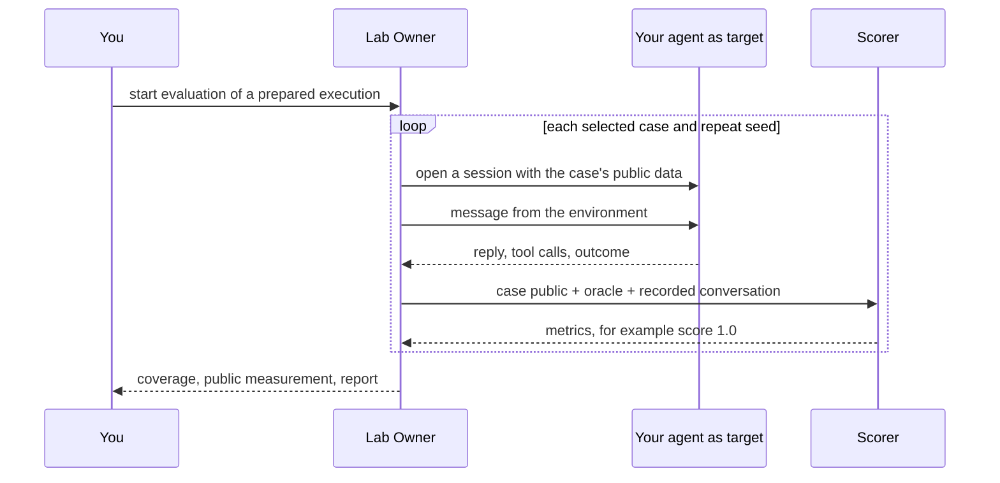
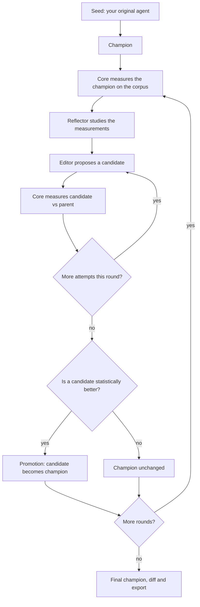

# Как работает Lab

[English](../concepts.md) · Русский

Эта страница объясняет идеи Evolution Lab до работы с кодом. Прочитайте её
целиком: остальные страницы используют определённые здесь термины. Внизу есть
[словарь](#словарь) для быстрого поиска.

## Какую задачу решает Lab

У вас есть LLM-агент, например **ассистент поиска заказов**, который отвечает
клиентам с помощью одного инструмента `lookup_order`. Вы хотите улучшить его:
переписать промпты или навыки, попробовать другую формулировку инструкции и
сохранить изменение только тогда, когда оно действительно помогает.

Сделать это надёжно сложнее, чем кажется:

- **«Лучше» нужно измерить.** Нужны фиксированный набор тестовых диалогов,
  способ оценить каждый ответ и один согласованный показатель для сравнения.
- **LLM дают нестабильный результат.** Один и тот же агент может получить
  разные оценки в разных прогонах, поэтому один удачный запуск ничего не
  доказывает. Для сравнения нужны повторы и статистика.
- **Инфраструктура отказывает.** У провайдера истекает тайм-аут, порт занят,
  процесс завершается. Такая ошибка ничего не говорит о качестве агента и не
  должна считаться плохим ответом.
- **Эксперименты должны быть воспроизводимыми.** Другой человек должен иметь
  возможность повторить эксперимент на тех же входах и программах и получить
  сопоставимый результат.

Lab избавляет каждую команду от самостоятельного создания этой инфраструктуры.
Главное правило: **решают доказательства**. «Улучшения нет» и «Кандидат
отклонён» — полноценные честные результаты, а ошибка инфраструктуры никогда не
выдаётся за качество агента.

## Две части: Evolution Core и Lab

Lab работает вместе с отдельным Core.

**Evolution Core** (Python-пакет `evo-skills`)
само выполняет цикл улучшения. Оно предлагает изменения через *Редактора*,
измеряет их, применяет статистику и выбирает победившую версию. Только Core
пишет журналы кампании и принимает решения о продвижении.

**Lab** (Python-пакет `evolution-lab`, команда `lab`) выполняет работу вокруг
этого цикла:

| Lab делает | Lab не делает |
|---|---|
| Фиксирует входы в воспроизводимом пакете | Решает, какая версия лучше |
| Запускает агента как сервис и проверяет соблюдение протокола | Записывает или редактирует журналы Core |
| Запускает измерения и кампании, отслеживает их процессы | Содержит код, корпуса или оценщики конкретного агента |
| Очищает процессы и точно сообщает известные факты | Продолжает прогон после смерти процесса (см. [Ограничения](#честные-ограничения)) |
| Показывает результаты, diff и экспорт изменённых файлов | Применяет изменения к вашему проекту за вас |

Lab **не привязан к конкретному агенту**. Код агента, тестовые кейсы и логика
оценивания остаются в вашем проекте. Lab только читает их.

## Агент как Target Service

Lab не импортирует агента в собственный процесс. Он запускает агента как
отдельный **target**: локальный процесс, обслуживающий HTTP-протокол Core
(`/evolution/v2`) по объявленному адресу и отвечающий **на один ход за раз**.
*Ход* — одно входящее сообщение и ответ агента на него.

Самостоятельно реализовывать HTTP-протокол не нужно. Lab поставляет небольшой
нейтральный Python-контракт (`evolution_lab.target.TurnAgent`) и запускатель,
который оборачивает его в сервер Core. Ваш код реализует пять методов —
`describe`, `open`, `turn`, `close_session`, `aclose` — и функцию `build`,
остальное делает Lab. Подробнее — [Подключение агента](connect-agent.md).

Каждый ход завершается **исходом**; различия существенны:

| Исход | Значение | Влияние на оценку |
|---|---|---|
| `ok` | Агент ответил. | Оценивается обычным образом. |
| `candidate_failed` | Сам агент повторяемо неисправен, например сформировал некорректный ответ. | Учитывается против агента. |
| `target_failed` | Ошибка вне логики агента: тайм-аут, нестабильный провайдер или другая неопределённость. | Не оценивается. Образец считается *indeterminate*; кампания может повторить его. |

Практическое правило: **если сомневаетесь, сообщайте `target_failed`**. Это
стоит одного неоценённого образца, но не создаёт неверную оценку.

Target содержит один или несколько **экземпляров** (загруженных копий агента),
каждый из которых обслуживает **сессии** (отдельные изолированные диалоги).
Поддерживаемое количество тех и других вы объявляете сами.

## Из чего состоит измерение

Помимо target, каждому измерению нужны четыре входа. Все они создаются в вашем
проекте; подробности — в разделе [Входы оценки](evaluation-inputs.md).

**Корпус.** Файл **кейсов** (JSON Lines, по одному кейсу на строку). Кейс —
один сценарий, например «клиент спрашивает, где заказ A-100». В каждом кейсе
три части, доступные разным участникам:

- `public` — то, что видит агент (вопрос клиента);
- `private` — то, что видит только окружение (например последующие сообщения
  сценария и лимит ходов); агент этого не получает;
- `oracle` — то, что видит только оценщик: ожидаемый ответ и проверки. *Oracle*
  означает защищённые эталонные данные, которые никогда не показывают агенту
  или Редактору в качестве подсказки.

**Окружение.** Компонент, который превращает кейс в сообщения агенту.
Окружение `static` отправляет одно сообщение из `public`; `scripted`
воспроизводит список сообщений из кейса, по одному на ход.

**Мир.** Данные и поведение систем, с которыми общаются инструменты агента.
При измерении их заменяют симуляциями: `lookup_order` читает хранилище заказов
в памяти, а не реальную базу. Агент получает только `public` кейса и сообщения,
поэтому данные мира доходят до него через `public` или файлы фикстур — см.
[Входы оценки](evaluation-inputs.md).

**Оценщик.** Программа, которую предоставляете вы. Для каждого завершённого
диалога она получает `public` и `oracle` кейса и запись разговора, а выводит
числа, например `{"score": 1.0}`. Сбой или тайм-аут оценщика — ошибка оценки,
а не нулевой балл.

**Метрика.** Одно число из выведенных оценщиком, которое вы договорились
сравнивать, например `score`. Эту *основную метрику* выбирают до запуска.

**Отложенные кейсы.** Кейсы, отложенные для подтверждения улучшения в конце.
В кампании результаты каждого кейса возвращаются Редактору, поэтому кейс из
корпуса кампании уже не может служить беспристрастным доказательством. Не
включайте отложенные кейсы в корпус кампании и измеряйте победителя на них
отдельно. Lab не может проверить это за вас; это правило построения корпуса
(см. [Подводные камни](pitfalls.md)).

## Два вида работы: фиксированная оценка и кампания

### Фиксированная оценка — измерение без изменения агента

**Фиксированная оценка** запускает выбранные кейсы на неизменённом агенте и
сообщает результаты. Редактора нет, ничего не изменяется. Lab запускает её с
помощью строительных блоков измерения Core.

Вы явно выбираете кейсы — все, первые *N* или список id — и **seed повторов**,
которые определяют число запусков каждого кейса. Два кейса с двумя seed дают
четыре оценённых образца — именно это выводит офлайн-пример в разделе
[Установка](install.md).

**Baseline** — измерение исходной версии агента в объявленных условиях.
Фиксированная оценка обычно позволяет получить baseline до начала улучшений.
В разделе [Первая оценка](first-evaluation.md) показан весь путь.

### Кампания — улучшение агента Core

**Кампания** — серия попыток улучшения, которые запускает и оценивает Core
Evolution. Заранее вы решаете, какие файлы можно менять (например `skills/**`),
а какие нельзя (код инструментов). Затем:

- **Чемпион** — текущая опорная версия. В начале это исходный агент, *seed*.
- Кампания идёт **раундами**. Раунд начинается с измерения текущего Чемпиона на
  корпусе с повторами.
- **Рефлектор**, роль обычно на базе LLM, изучает эти измерения и готовит
  наблюдения для Редактора.
- **Редактор**, другая роль обычно на базе LLM, читает задание с измерениями и
  предлагает изменённую версию — **Кандидата**. Одна попытка Редактора вместе
  с измерением — **attempt**; раунд может содержать несколько таких попыток.
- Core измеряет каждого Кандидата относительно его **родителя** — Чемпиона на
  момент начала попытки.
- В конце раунда статистика Core определяет, является ли Кандидат явно лучше.
  Если да, Core **продвигает** его: Кандидат становится новым Чемпионом.
  Иначе Чемпион остаётся прежним.

Это общая форма цикла, а не полный набор правил: например, Core может досрочно
закрыть раунд, если у Чемпиона нет ошибок для исправления. Вы задаёте число
раундов и попыток в каждом; статистика и решение о продвижении принадлежат
только Core.

В конце можно прочитать diff между seed и финальным Чемпионом и экспортировать
изменённые файлы в ZIP. Lab никогда не применяет этот ZIP к вашему проекту;
решение остаётся за вами. См. [Запуск кампании](campaign.md) и
[Результаты](results.md).

## От файлов к прогону: Bundle, prepared execution, Owner

Lab отделяет *фиксацию входов* от *их запуска*. Это делает эксперимент
воспроизводимым.

**Bundle.** Неизменяемая копия всего, что вы объявили: входа оценки или
манифеста кампании, файла запуска агента, корпуса, оценщика и файлов агента.
Она определяется *digest* (хешем SHA-256 содержимого). Созданный Bundle не
меняется; прогоны читают сохранённую копию, а не текущий проект.

**Prepared execution.** Сохранённые условия одного прогона поверх Bundle:
кейсы, seed повторов, лимиты ходов, тайм-ауты, основная метрика. Подготовка
ничего не запускает. У неё также есть digest, который меняется при изменении
любого условия.

**Owner.** Python-объект (`evolution_lab.owner.Owner`), который выполняет
работу. Он запускает и останавливает target, выполняет одну оценку, кампанию
или conformance за раз и отслеживает процессы и очистку. Один Owner управляет
**одной активной операцией и одним управляемым target**. Он живёт в вашем
процессе Python и не является фоновым демоном.

**Каталог состояния.** Приватный каталог, в котором Lab хранит Bundle,
подготовленные исполнения, записи прогонов и результаты. Хранилище подготовки
и Owner используют его совместно.

**Пара версий.** Lab и Core всегда устанавливаются как точная пара: текущая —
`evolution-lab 0.0.3.dev81` и строго `evo-skills 2.0.0b22`. Пара, создавшая
результат, называется его **producing pair**. Каждый каталог состояния
принадлежит одной такой паре. При обновлении на новую пару создаётся новый
каталог состояния; миграции старых Bundle и прогонов нет. Dev80/b22 использует `~/lab-state/dev81-b22` и схему Owner 14, в которой хранятся подтверждения действий. Старые прогоны и каталоги состояния храните вместе с породившими их wheel.

## Check и conformance: две проверки готовности

Прежде чем тратить время или деньги, можно проверить работу target. Lab
предоставляет две явные проверки, которые вы всегда запускаете сами:

- **Check** — быстрая проверка соединения с работающим target: исправен ли он,
  сообщает ли ожидаемую идентичность и возможности?
- **Conformance** — полный набор публичных тестов протокола Core, выполняемый
  на вашем target. Он доступен только если файл запуска объявляет, что тест
  работает офлайн, без оплаты вызовов модели. После conformance Lab всегда
  останавливает target; для настоящего прогона запустите новый.

Ни одна проверка не разрешает расходовать деньги. Успешная check или
conformance показывает работоспособность соединений, а не безопасность или
целесообразность платного запуска.

## Три способа использовать Lab

| Способ | Что это | Кто использует |
|---|---|---|
| **Python API** | `PreparationStore` для фиксации входов, `Owner` для запуска в своём скрипте. | Самостоятельные пользователи, автоматизирующие эксперименты; основной путь этого руководства. |
| **Локальный сервис + CLI `lab`** | `lab serve` предоставляет те же действия через Unix-сокет; команда `lab` и программы обращаются к нему. Один пользователь, одна машина, без сети. | Любители командной строки и программы вроде **auto-evolve**, которая собирает пакеты экспериментов и управляет Lab через сервис. |
| **Прежний runner** | `evolution_lab.runner.run_native` / `resume_native`: старый путь только для кампаний. | Существующие интеграции. Это единственный путь, который с ограничениями может продолжить кампанию после смерти её процесса. Для новой работы используйте Owner или сервис. |

Lab считает самостоятельных пользователей и приложение auto-evolve
**равноправными**: всё, что auto-evolve делает через сервис, вы можете сделать
сами через Python API или CLI. См. [CLI и локальный сервис](cli.md).

Для существующих клиентов сохранён также клиент одной кампании
`evolution_lab.client`; это руководство его не рассматривает.

## Честные ограничения

- **Нет автоматического продолжения.** Если процесс Python с Owner (или сервис)
  завершается, никто автоматически не подхватывает операцию. Следующий Owner
  помечает остатки как orphaned; вы явно проверяете и очищаете их (`lab cleanup`).
  Операцию *кампании* после достижения `finished` или `released` с подтверждённой
  очисткой target можно явно продолжить на любом готовом target того же Bundle —
  `Owner.resume(...)` / `lab resume` — даже из следующего поколения Owner. Это
  не переподключение к умершему процессу, а новый запуск поверх того же журнала
  кампании. Операции оценки и conformance так продолжать нельзя.
- **Linux и macOS.** В Linux сохраняется child subreaper. На macOS используются группа процессов, опрос дерева каждые 0,5 с и метка окружения. На macOS процесс может пережить остановку, если выйдет из группы, исчезнет из дерева между опросами и скроет метку окружения. В cleanup receipt указан механизм; свидетельство очистки соответствует его гарантии.
- **Сборка из исходников.** dev81/b22 выпущен с тегом `lab-v0.0.3.dev81`;
  контрольные суммы wheel и происхождение исходников указаны в
  [RELEASES](../../../lab/docs/RELEASES.md). Соберите Lab из указанной ревизии и используйте
  поставленный точный wheel Core ([Установка](install.md)). Ни один пакет не
  опубликован на PyPI.
- **Owner не обеспечивает лимит расходов.** Необязательный бюджетный шлюз
  может ограничить расходы на LLM для процессов, направляющих запросы через
  него; см. [Бюджет и контроль расходов](budget.md).

> **Это можно встретить в старых документах.** Записи решений, заметки и
> справочник API используют внутренние коды рабочих пакетов, например S1–S7,
> H1, W19 или «sudo wave». Это названия прошлых этапов разработки (например,
> S3 — «conformance и фиксированная оценка»). Для работы с Lab они не нужны;
> словарь проекта `docs/product/GLOSSARY.md` их расшифровывает.

## Словарь

| Термин | Значение |
|---|---|
| Attempt | Одна попытка Редактора создать Кандидата вместе с его измерением. |
| Baseline | Измерение начальной версии в объявленных условиях. |
| Bundle | Неизменяемая копия всех объявленных входов с идентификатором digest. |
| Campaign | Серия попыток, которые запускает и оценивает Evolution Core. |
| Candidate | Изменённая версия, предложенная Редактором и ожидающая измерения. |
| Case | Один сценарий в корпусе с частями `public`, `private` и `oracle`. |
| Champion | Текущая опорная версия в кампании. |
| Check | Быстрая явная проверка соединения с работающим target. |
| Conformance | Полная публичная проверка протокола Core, выполняемая по запросу офлайн на target. |
| Corpus | Файл кейсов, используемый измерением. |
| Editor | Роль кампании, предлагающая изменения. |
| Environment | Компонент, превращающий кейс в сообщения агенту. |
| Evolution Core | Core (`evo-skills`), запускающий кампании и решающий вопросы продвижения. |
| Fixed evaluation | Измерение неизменённого агента на выбранных кейсах; без Редактора. |
| Held-out cases | Кейсы вне кампании для независимого подтверждения результата. |
| Metric (primary) | Одно число оценщика, которое вы сравниваете. |
| Oracle | Эталонные ответы и проверки, видимые только оценщику. |
| Owner | Python-объект, запускающий target и выполняющий одну операцию за раз. |
| Parent | Чемпион, с которым сравнивают Кандидата. |
| Prepared execution | Сохранённые условия прогона поверх Bundle; подготовка ничего не запускает. |
| Producing pair | Точная пара версий Lab и Core, создавшая результат. |
| Promotion | Решение Core сделать Кандидата новым Чемпионом. |
| Reflector | Роль кампании, анализирующая измерения для Редактора. |
| Scorer | Ваша программа, превращающая завершённый диалог в метрики. |
| Session | Один изолированный диалог внутри экземпляра target. |
| State directory | Приватный каталог сохранённых данных Lab для одной пары версий. |
| Target | Ваш агент, работающий как локальный сервис протокола Core. |
| Turn | Одно сообщение агенту и его ответ. |
| Turn outcome | `ok`, `candidate_failed` (вина агента) или `target_failed` (неопределённость либо инфраструктура). |
| Version pair | Точно соответствующие друг другу версии Lab и Core, установленные вместе. |
| World | Симулированные системы и данные, используемые инструментами агента при измерении. |

## Что дальше

[Установка](install.md) собирает оба wheel и запускает полный офлайн-пример.
Затем выберите путь в [оглавлении руководства](README.md#выберите-свой-путь).

## Справочные материалы

Точные поля и коды ошибок:

- [Гайд по подключению target](../../../lab/src/evolution_lab/guides/target-connector/SKILL.md) — контракт хода, исходы, файл запуска, ёмкость, режим conformance
- [Гайд по входам оценки](../../../lab/src/evolution_lab/guides/evaluation-inputs/SKILL.md) — корпус, окружение, оценщик, метрика
- [Гайд по пакету кампании](../../../lab/src/evolution_lab/guides/campaign-package/SKILL.md) — манифест, изменяемая область, роли, масштаб
- [Гайд по подготовке](../../../lab/src/evolution_lab/guides/preparation/SKILL.md) и [гайд по Owner](../../../lab/src/evolution_lab/guides/owner/README.md)
- [Гайд по диагностике](../../../lab/src/evolution_lab/guides/diagnostics/SKILL.md) — чтение результатов check, conformance и оценки
- Справочник API: [подготовка](../../../lab/docs/api/preparation-s1.md), [Owner](../../../lab/docs/api/owner-s4.md), [сервис](../../../lab/docs/api/service-s5.md), [прежний runner](../../../lab/docs/api/legacy-runner.md)
