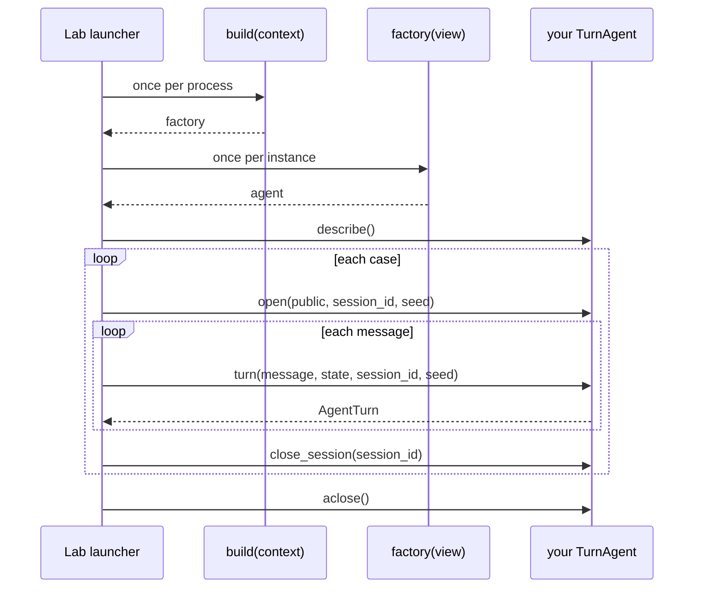
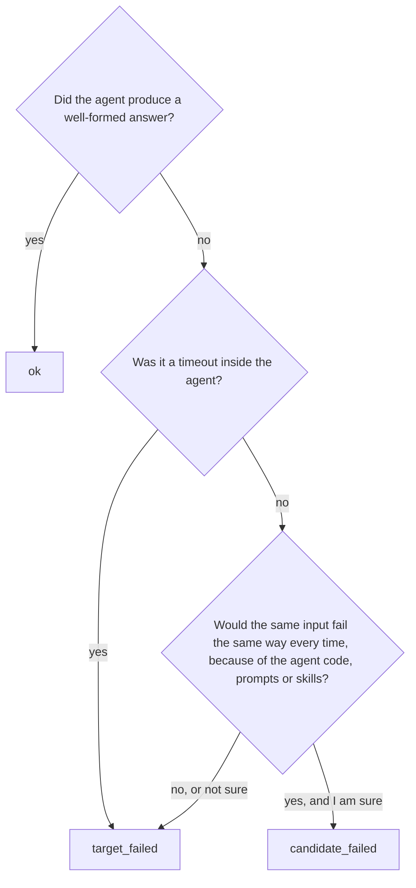

# Подключение агента

[English](../connect-agent.md) · Русский

**Цель:** измерить своего агента с Lab. Работа завершена, когда `lab evaluate`
выводит `measurement accepted`, а `conversations.md` показывает реальные ответы
агента. Затем можно подготовить полноценную оценку и запускать кампании.

> **Новое в 0.0.3.dev72.** `lab new-project`, `lab evaluate` и шаблон проекта
> появились в 0.0.3.dev72. Для 0.0.3.dev71 и более ранних версий используйте
> страницу под тегом `v0.0.3.dev71`.

## Создайте, измените и измерьте проект

В checkout Lab команда `lab` не находится в PATH: используйте
`just new-project DIR` и `just evaluate DIR` (или `just lab ...`) вместо
указанных ниже `lab ...`.

```sh
lab new-project ~/my-agent-lab
# edit the files marked "yours" in the map below
lab evaluate ~/my-agent-lab --wheel LAB_WHEEL --wheel CORE_WHEEL
```

В checkout команды `just new-project ~/my-agent-lab` и
`just evaluate ~/my-agent-lab` делают то же; `just evaluate` сам передаёт два
wheel из `.lab/wheels/`. При ручной установке `LAB_WHEEL` и `CORE_WHEEL` —
wheel, из которых вы устанавливали Lab и Core (в структуре из [Установки](install.md)
они находятся в `work/wheels/`).

`lab new-project` создаёт рабочий **шаблон проекта** с агентом-заглушкой без
модели. Запустите `lab evaluate` один раз до изменений: он измерит заглушку за
несколько секунд и покажет успешный запуск. Затем заменяйте заглушку по файлам.
Вывод, файлы и коды описаны в [первом измерении](../first-evaluation.md#measure-your-own-agent).

### Ваши файлы и файлы Lab

```text
my-agent-lab/
  agent/my_agent.py      yours   your agent; the stub is a small lookup
  agent/adapter.py       yours   the Lab adapter: connects your agent to Lab
  seed/skills/SKILL.md   yours   the agent's prompt; a campaign may change it later
  corpus.jsonl           yours   the questions and their expected answers
  scorer/score.py        yours   decides what counts as a correct answer
  launch.json            shared  how Lab starts the adapter
  evaluation-input.json  shared  what to measure
  README.md              Lab's   a short version of this page, with a table per JSON file
  .gitignore             Lab's   keeps .lab/ out of git
  .lab/                  Lab's   written by lab evaluate: state and run files; do not edit
```

**Короткий путь.** Если агент — функция `answer(question) -> str`, для первого
измерения достаточно изменить `agent/my_agent.py` и `corpus.jsonl`. Метки
`# TODO(you):` в `adapter.py` нужны для собственных настроек, состояния и ошибок.

**Агент и адаптер разделены.** `my_agent.py` ничего не знает о Lab:
`MyAgent(prompt).answer(question)` возвращает текст ответа. В реальном проекте
файл импортирует вашего агента. `adapter.py` импортирует `evolution_lab.target`
и превращает вызовы Lab в вызовы агента; места для правок отмечены `# TODO(you):`.

В общих файлах поля `"lab:auto"` относятся к Lab: digest окружения Python,
порт, интерпретатор оценщика и три digest идентичности. Оставьте их: `lab evaluate`
вычислит значения при запуске. `README.md` шаблона описывает каждое поле.

### Поля `corpus.jsonl`

Один объект JSON на строку:

| Поле | Что указать |
|---|---|
| `case_id` | Уникальное имя кейса, например `q1`. |
| `group_id` | Строка группы. Для первого измерения можно использовать одну группу, как в шаблоне. При сравнении версий группы весят одинаково: независимым сценариям дайте разные группы, перефразировкам одного вопроса — одну. |
| `stratum` | Строка с видом ситуации (`known`, `unknown`); результаты выводятся по стратам. |
| `public.text` | Вопрос, который получает агент; не ожидаемый ответ. |
| `oracle.expected` | Ожидаемый ответ, видимый только оценщику. |
| `oracle.critical` | `true` отмечает жёсткое ограничение: в кампании одна ошибка отклоняет версию. Оценщик шаблона всегда его пропускает; оставьте как есть. |

Полные правила — [кейсы и корпус](../evaluation-inputs.md#cases-and-the-corpus).

## Перед началом

- Установите Lab ([Установка](install.md)) и запустите `just demo` или офлайн-пример.
- Убедитесь, что можете менять код агента и знаете его Python-окружение. Если
  оно отличается от окружения Lab, установите в него те же Lab и Core и
  передайте его через `--python`.
- Термины *Target Service*, *turn*, *session*, *outcome* объяснены в [Как работает Lab](concepts.md).

## Шаги

Шаги относятся к `agent/adapter.py` и связанным файлам. *Для запуска* означает
минимальный контракт, *для корректных результатов* — дополнительные условия,
чтобы измерения были осмысленными. Ниже есть [справочные сведения](#справочные-сведения).

### Шаг 1. Проверьте настройки и состояние агента

Определите настройки, состояние диалогов, внешние системы и случайность.
Объявите в `launch.json` все используемые переменные: target не наследует
окружение оболочки, даже `PATH` и `HOME`. Встроенный launcher `/2`–`/3`
дополнительно получает действующий `EVOLUTION_DURABILITY` Lab и наследует
`TMPDIR`, если цель не задала свой. Закрепите настройки, влияющие на
поведение, включая модель и температуру. Не разделяйте изменяемое состояние
между диалогами: сохраняйте его по `session_id` и очищайте в `close_session`.
Используйте тестовые внешние системы и объявите режим seed; подробности —
[требования к агенту](#что-lab-требует-от-агента-и-почему).

### Шаг 2. Подключите агента через адаптер

Импортируйте своего агента в `agent/my_agent.py` и подключите в
`agent/adapter.py`. Структура с `build(context)` и пятью методами TurnAgent уже
создана; измените внутреннюю логику:

| Место в `adapter.py` | Действие |
|---|---|
| `from my_agent import MyAgent` | Сохраните импорт или импортируйте собственный пакет. |
| `build(context)` | Читайте настройки из `context.env`, ключи — из `context.secrets`. |
| `factory(view)` | Загружайте промпты из `view.root`, измеряемой копии `seed/`, а не из checkout. |
| `MyTurnAgent.__init__` | Создайте агента с промптом и настройками. |
| `open(public, *, session_id, seed)` | Создайте диалог для `session_id`; сохраните флаг conformance. |
| `turn(message, state, *, session_id, seed)` | Вызовите агента с `message.content` и верните `AgentTurn("ok", answer)`. |
| `close_session`, `aclose` | Освободите диалог и остальные ресурсы. |

Изменяемые кампанией файлы поместите в `seed/`, постоянный код — в `agent/`;
другие папки кода добавьте в `program_paths`. Для кампании передавайте вызовы
инструментов и результаты через `events` с типами `tool_call`, `tool_result`,
`skill_read`. Можно возвращать состояние JSON из `open` и `turn`, чтобы Lab
передал его в следующий ход. Проверка: `python -c "import adapter"` из `agent/`
в окружении агента должна работать.

### Сообщите, что использовал агент

При `gate.provenance.kind: reported` Core выбирает затронутые кейсы попытки по входам, сообщённым на baseline. На **каждом ходе** указывайте то, что агент действительно использовал: Lab не выводит это из `skill_read` и других событий. Пути задаются относительно корня загруженного дерева (`AgentView.root`):

```python
from evolution_lab.target import AgentTurn, TurnProvenance

return AgentTurn("ok", answer, provenance=TurnProvenance(used=("skills/SKILL.md",)))
```

`provenance` необязательна при любом исходе. Если обязательный ответ вместе с provenance превышает `max_output_bytes`, Lab отбрасывает provenance целиком, никогда не обрезая `used`; неизвестные входы считаются затронутыми. Иначе события ужимаются в оставшийся бюджет. Не включайте секреты в `used`.

Когда общий промпт содержит индекс многих навыков, выбор по путям может считать их все затронутыми. Можно добавить агенту метод `components()`: карту идентификаторов компонентов с дайджестами отрендеренного содержимого и путями источников. Передавайте реально использованные идентификаторы в `TurnProvenance.used`. Например, индекс из двух файлов и тело одного навыка:

```python
from evolution_lab.target import component

def components(self):
    return {
        "skill-index": component(self.rendered_index, ["skills/alpha.md", "skills/beta.md"]),
        "skill-alpha": component(self.alpha_body, ["skills/alpha.md"]),
    }
```

`component` хеширует текст в UTF-8 или байты и возвращает `sha256` и `sources`. Lab проверяет карту и сканирует её и `used` на секреты запуска. Отсутствие `components()` отличается от пустой карты. Core измеряет полный ответ создания экземпляра относительно `max_output_bytes`: Lab не отклоняет, не обрезает и не отбрасывает карту из-за размера. Lab пишет предупреждение, когда верхняя оценка превышает лимит; оно может быть ложным. Core может отклонить реально превышающий лимит ответ с HTTP 500. Проверьте логи цели и при необходимости увеличьте лимит манифеста или уменьшите карту.

Уведомление кампании `baseline_provenance_unknown` означает, что Core не сохранил provenance ни для одного сэмпла последнего завершённого baseline: цель могла её не передать, в том числе на части ходов. При `reported` каждая попытка тогда считает все кейсы затронутыми. Проверьте, что каждый ход сообщает действительно использованные входы и что лимит ответа достаточен, затем запустите новый baseline кампании. Уведомление информационное; частичная provenance baseline его не вызывает. С поддержкой provenance оценки в Core команда `lab evaluate` предупреждает, когда проект использует `reported`, есть завершённые сэмплы, а Target не передал provenance. Старые оценки помечаются `provenance_not_recorded`.

### Шаг 3. Сопоставьте ошибки с исходами

Используйте ветви `except` шаблона: ошибка Кандидата — `candidate_failed`,
тайм-аут, провайдер, сеть и неклассифицируемая ошибка — `target_failed`,
сломанную для всех ходов конфигурацию обозначайте `TargetConfigurationError`.
При необходимости добавьте `TurnReason(category, code)` без текста исключения.
Ограничьте время вызова модели и при тайм-ауте возвращайте `target_failed`.
Из `turn()` не должны выходить исключения, кроме `TargetConfigurationError`.
Подробности — [выбор исхода](#выбор-исхода-хода).

### Шаг 4. Напишите `describe()`

Верните компактные сведения об экземпляре без секретов, промптов и значений
окружения; например, хеш настроек. См. [`describe()`](#describe-сведения-об-экземпляре).

### Шаг 5. Выполните один ход офлайн

Сохраните скрипт рядом с проектом, например `try_turn.py`, и запустите из
каталога проекта через Python с установленным Lab: `python ../try_turn.py`.

```python
import asyncio
import sys
from pathlib import Path

from evolution.tree import ArtifactPolicyV1, Message
from evolution_lab.target import AgentView, LaunchContext

sys.path.insert(0, "agent")
from adapter import build

context = LaunchContext(env={}, secrets={}, work_directory=Path("work"))
view = AgentView(root=Path("seed"), candidate_digest="0" * 64, dependency_digest="0" * 64,
                 policy=ArtifactPolicyV1((), (), ()), seed_mode="none")


async def main():
    agent = await build(context)(view)
    print(agent.describe())
    await agent.open({}, session_id="s1", seed=None)
    turn = await agent.turn(Message("What is the code word for alpha?", {}), {}, session_id="s1", seed=None)
    print(turn.outcome, "|", turn.text)
    await agent.close_session("s1")
    await agent.aclose()

asyncio.run(main())
```

С заглушкой выводятся `{'agent': 'my-agent'}` и `ok | A1`. Передайте свои
настройки в `env` и `secrets`, а свой вопрос — в сообщение. Убедитесь, что
корректный вход возвращает `ok` и ответ, а намеренно неверный — выбранный исход.
Более длинная проверка с событиями — [Попробуйте офлайн](#попробуйте-офлайн).

### Шаг 6. Заполните файл запуска

Измените описывающие агента поля `launch.json`, оставив `"lab:auto"`:

- `env` — все несекретные переменные, включая нужные библиотекам `PATH` и `HOME`;
- `secret_names` — имена секретов; значения задайте в оболочке перед запуском;
- `identity.target_id` — короткое имя агента;
- `identity.seed_mode` — для большинства LLM-агентов `none`, как и в `evaluation-input.json`;
- `limits` — реальные поддерживаемые числа экземпляров и сессий;
- `conformance` — оставьте `{"kind": "core-session-public/1"}` только если
  адаптер отвечает на проверку без платных вызовов, иначе задайте `null`;
- `agent` и `program_paths` меняйте только при переименовании адаптера или добавлении кода.

Шаблон создаёт `lab-target-launch/3`. Ошибки проверки проекта приводят к коду 2
с указанием файла и поля. Подробнее — [файл запуска](#файл-запуска).

### Шаг 7. Запустите `lab evaluate`

Conformance — самопроверка протокола Core. Если она объявлена в `launch.json`,
`lab evaluate` выполняет её перед измерением. Адаптер шаблона отмечает сессию с
`public.conformance: true` и отвечает фиксированным текстом без вызова агента.
Сохраните эту ветвь или задайте `conformance: null`, если бесплатный ответ невозможен.

```sh
lab evaluate ~/my-agent-lab --wheel LAB_WHEEL --wheel CORE_WHEEL
```

Если агент работает в другом venv, добавьте `--python PATH`; в нём должны быть
установлены те же Lab и Core из тех же wheel. Для платной модели сначала
оставьте в корпусе несколько кейсов.

`measurement accepted` и код 0 означают завершение без остановки и достаточное
покрытие (не менее `min_coverage`, по умолчанию 0.95), а не высокое качество.
Непринятое измерение выводит `Measurement not accepted` с причиной и код 1;
при провале conformance указываются неудачные проверки.

Если target не стартует и выводит `target start not confirmed: target_unavailable`
с кодом 3, проверьте импорт адаптера, зависимости, `build` и `factory`, а также
переменные, объявленные в `launch.json`. Последние строки traceback показаны в
выводе; полный журнал — `.lab/state-<pair>/scopes/<id>/stderr.log`. Пути в
traceback относятся к копии Bundle, номера строк — к вашим файлам `agent/`.
См. [устранение неполадок](install.md#устранение-неполадок).

### Без `lab evaluate`

Те же действия доступны через Python Owner и [CLI/сервис](cli.md). Они не
понимают `"lab:auto"`: каждому полю нужно явное значение. Выбранные значения
содержатся в `.lab/runs/<NNN>/resolved.json`, копия проекта — в
`.lab/runs/<NNN>/source/`. Из неё исключены `.lab/`, `.git`, `.venv`, кэши
Python и тестов и `*.pyc`/`*.pyo`; каталог `venv` без точки копируется.

Запуск target вручную с необязательным conformance:

```python
from evolution_lab.owner import Owner, TargetRef

async with Owner.open(state_directory) as owner:
    connection = await owner.bind(bundle.digest)
    started = await owner.wait(await owner.start_target(
        connection, secrets={"MY_AGENT_API_KEY": api_key}))
    if started.state != "succeeded" or started.ref is None:
        raise RuntimeError(started.failure)
    target = TargetRef(started.ref.id, started.owner_generation)
    target_status = await owner.target(target)

    # Optional: only for a launch declaring core-session-public/1.
    conformance = await owner.wait(await owner.conformance(connection, target_ref=target))
    if (conformance.state != "succeeded"
            or conformance.persistence.state != "saved"
            or conformance.result is None):
        raise RuntimeError(conformance.failure)
    payload = conformance.result.payload
    print(payload["core_report"]["ok"], payload["cleanup"]["complete"],
          payload["target_cleanup"]["complete"], (await owner.target(target)).state)
```

Без conformance остановитесь после `owner.target(target)` и проверьте
`started.state == "succeeded"` и `target_status.state == "ready"`. При
conformance успешный вывод — `True True True stopped`; проверяйте также
`core_report.checks`, если `ok` ложно. Conformance останавливает target,
поэтому для оценки запустите новый.

## Справочные сведения

Рекомендации соответствуют Lab 0.0.3.dev81 и строго Core 2.0.0b22. Core
выполняет по одному ходу на экземпляр; одни лишь дополнительные сессии не
гарантируют пропорционального ускорения. Старые прогоны сохраняйте в породивших
их окружениях.

### Что Lab требует от агента и почему

Lab запускает агента как **target**: отдельный локальный процесс, отвечающий
на один ход за раз (см. [понятия](concepts.md#агент-как-target)). Контракт для
*запуска* невелик: адаптер из шага 2 и исходы из шага 3. Дополнительно Lab
исходит из четырёх условий, чтобы результаты были *корректными*:

| Предположение | Для запуска | Для корректных результатов | Что иначе идёт не так |
|---|---|---|---|
| **Объявленные настройки** | Перечислите переменные агента в файле запуска. | Включите все настройки, меняющие поведение, включая используемые умолчания. | Изменившееся скрытое значение меняет результат, но не идентичность прогона; внешне одинаковые прогоны различаются. |
| **Раздельные диалоги** | Выберите состояние внутри агента или JSON-состояние Lab. | Диалоги не разделяют изменяемое состояние; освобождайте ресурсы в `close_session`. | Один кейс протекает в следующий, повторы не независимы, параллельные сессии мешают друг другу. |
| **Нет реальных побочных эффектов** | Обеспечьте доступность backend инструментов. | При измерении инструменты общаются с тестовыми endpoints или заглушками. | Измерение меняет реальные системы, а результаты зависят от их состояния. |
| **Трасса хода как данные** | Только итоговый текст. | Вызовы инструментов и результаты возвращаются событиями. | Оценщик и Редактор кампании видят лишь итоговый текст; неверное или пропущенное использование инструментов незаметно. |

### Контракт хода

Lab поставляет нейтральный контракт в пакете `evolution_lab.target`. Он не
импортирует фреймворки агентов, поэтому работает с любой основой вашего агента.
HTTP-сервер писать не нужно: запускатель Lab оборачивает код в сервер target Evolution Core.



#### Что вы получаете

- **`LaunchContext`** передаётся в `build`. Содержит `env` (объявленные в файле
  запуска несекретные настройки), `secrets` (значения названных секретов) и
  `work_directory` (приватный каталог процесса для кэшей и журналов). Lab
  добавляет действующий `EVOLUTION_DURABILITY` и `TMPDIR`, когда у цели нет своего
  временного каталога; эти настройки видны в `env`. Это не изоляция файловой системы или сети.
- **`AgentView`** передаётся фабрике. Его `root` — копия измеряемой версии
  агента (*Кандидата*) только для чтения. Также он содержит digest Кандидата,
  политику артефактов и `seed_mode`. Загружайте промпты и навыки из `view.root`,
  никогда из исходного checkout.
- **`Message`** передаётся в `turn`. Содержит `content` (строку) и `fields`
  (отображение). При окружении `static` `fields` — всё отображение `public`
  кейса (см. [Входы оценки](evaluation-inputs.md#окружение)).

#### Пять методов

| Метод | Когда Lab вызывает | Что вернуть |
|---|---|---|
| `describe()` | Один раз сразу после создания агента фабрикой. | Небольшое плоское отображение, описывающее сборку экземпляра. |
| `async open(public, *, session_id, seed)` | В начале каждого диалога с данными `public` кейса. | Начальное состояние сессии как JSON. |
| `async turn(message, state, *, session_id, seed)` | На каждое входящее сообщение с текущим состоянием. | `AgentTurn`. |
| `async close_session(session_id)` | После окончания диалога. | Ничего; освободите ресурсы сессии. |
| `async aclose()` | При освобождении экземпляра. | Ничего; освободите остальные ресурсы. |

#### Что возвращает ход

`AgentTurn(outcome, text, events=(), state=KEEP, usage=None, truncated=False, reason=None, provenance=None)`:

- **`outcome`**: `"ok"`, `"candidate_failed"` или `"target_failed"` (см. [Выбор исхода хода](#выбор-исхода-хода)).
- **`text`**: итоговый ответ. Lab сам превращает его в заключительное событие
  `assistant_message`, поэтому не добавляйте событие самостоятельно.
- **`events`**: трасса по порядку. Каждое событие — отображение с непустым
  `type`. Редактор кампании видит пять типов: `tool_call` (с `name`),
  `tool_result` (с `name` и коротким кодом `status`, например `ok`),
  `skill_read` (с `path`), `assistant_message` и `output_truncated`. Вы можете
  выдавать другие типы, и оценщик их получит, но Редактор не увидит.
- **`state`**: следующее состояние сессии как JSON (только конечные числа).
  Верните **`KEEP`**, чтобы оставить прежнее состояние, что подходит при неудачном ходе.
- **`usage`**: число токенов как `evolution.tree.Usage(prompt, completion, cached, total)` Core, если известно.
- **`reason`**: необязательный `TurnReason(category, code)`: короткие коды по
  `[A-Za-z0-9._-]{1,64}`, никогда текст исключения. Допустим при любом исходе.
  Core передаёт его оценщику и Редактору кампании, но не Рефлектору.

### Полный пример: ассистент поиска заказов

Полный адаптер. Настоящий ассистент вызывал бы языковую модель в указанном
комментарием месте; здесь используется регулярное выражение для работы офлайн.
Сохраните как `agent/order_assistant_target.py`.

```python
"""Order-lookup assistant, connected to Lab through evolution_lab.target."""
from __future__ import annotations

import asyncio
import hashlib
import json
import re
from collections.abc import Mapping
from dataclasses import dataclass
from typing import Any, Protocol

from evolution_lab.target import AgentTurn, LaunchContext, TargetConfigurationError, TurnReason

ORDER_ID = re.compile(r"\b[A-Z]-\d+\b")


# --- Settings: built only from what the launcher hands over -------------------
@dataclass(frozen=True)
class Settings:
    model: str
    api_key: str
    turn_timeout_seconds: float

    @classmethod
    def from_context(cls, context: LaunchContext) -> "Settings":
        try:
            return cls(model=context.env["ORDER_ASSISTANT_MODEL"],
                       api_key=context.secrets["ORDER_ASSISTANT_API_KEY"],
                       turn_timeout_seconds=float(context.env["ORDER_ASSISTANT_TURN_TIMEOUT"]))
        except (KeyError, ValueError) as exc:
            # Every sample would fail: this is a broken configuration.
            raise TargetConfigurationError(f"missing or invalid setting: {exc}") from None

    def digest(self) -> str:
        public = {"model": self.model, "turn_timeout_seconds": self.turn_timeout_seconds}
        return hashlib.sha256(json.dumps(public, sort_keys=True).encode()).hexdigest()


# --- Injected backend: the "world" the tool talks to ----------------------------
class OrderStore(Protocol):
    async def get(self, order_id: str) -> Mapping[str, Any] | None: ...


class InMemoryOrderStore:
    def __init__(self, orders: Mapping[str, Mapping[str, Any]]) -> None:
        self._orders = {key: dict(value) for key, value in orders.items()}

    async def get(self, order_id: str) -> Mapping[str, Any] | None:
        return self._orders.get(order_id)


# --- The agent -----------------------------------------------------------------
class OrderAssistant:
    def __init__(self, settings: Settings, reply_template: str) -> None:
        self._settings = settings
        self._template = reply_template          # read from the candidate snapshot
        self._stores: dict[str, OrderStore] = {}  # one simulated world per session

    def describe(self) -> dict[str, Any]:
        # Flat scalars, no secrets: how this instance was assembled.
        return {"agent": "order-lookup-assistant",
                "settings_sha256": self._settings.digest(), "seed": "ignored"}

    async def open(self, public, *, session_id, seed):
        self._stores[session_id] = InMemoryOrderStore(public.get("orders", {}))
        # The session's initial state. Conformance opens with {"conformance": true}.
        return {"turns": 0, "offline": public.get("conformance") is True}

    async def turn(self, message, state, *, session_id, seed):
        if state["offline"]:                      # protocol self-test: never call the model
            return AgentTurn("ok", "conformance reply", state=state)
        try:
            async with asyncio.timeout(self._settings.turn_timeout_seconds):
                return await self._answer(message.content, state, self._stores[session_id])
        except TimeoutError:
            # A deadline is not a deterministic defect of the candidate.
            return AgentTurn("target_failed", "", reason=TurnReason("timeout", "turn_deadline"))

    async def _answer(self, text, state, store):
        next_state = {**state, "turns": state["turns"] + 1}
        match = ORDER_ID.search(text)             # a real agent asks its model here
        if match is None:
            return AgentTurn("ok", "Which order number should I look up?", state=next_state)
        order_id = match.group(0)
        events = [{"type": "tool_call", "name": "lookup_order", "arguments": {"order_id": order_id}}]
        order = await store.get(order_id)
        if order is None:
            events.append({"type": "tool_result", "name": "lookup_order", "status": "not_found"})
            return AgentTurn("ok", f"I could not find order {order_id}.", events=events, state=next_state)
        events.append({"type": "tool_result", "name": "lookup_order", "status": "ok", "result": dict(order)})
        try:
            reply = self._template.format(order_id=order_id, **order)
        except (KeyError, IndexError):
            # The template is part of the candidate and is broken: it fails the
            # same way on the same input every time.
            return AgentTurn("candidate_failed", "", events=events,
                             reason=TurnReason("candidate", "reply_template_invalid"))
        return AgentTurn("ok", reply, events=events, state=next_state)

    async def close_session(self, session_id):
        self._stores.pop(session_id, None)

    async def aclose(self):
        self._stores.clear()


# --- Entry point named in the launch file ---------------------------------------
def build(context: LaunchContext):
    settings = Settings.from_context(context)     # once per process, no event loop yet

    async def factory(view):                      # once per instance, on its own loop
        template = (view.root / "skills" / "reply_template.txt").read_text(encoding="utf-8")
        return OrderAssistant(settings, template.strip())

    return factory
```

`Settings.from_context` читает `context.env` и `context.secrets`; состояние
сессии — небольшой JSON-словарь, а `OrderStore` каждой сессии удаляется в
`close_session`; каждый ход возвращает события `tool_call` и `tool_result`;
`lookup_order` работает через `OrderStore`, заполняемый из `public["orders"]`
при `open`, поскольку `public` — единственные данные кейса, получаемые агентом
(см. [Данные мира](evaluation-inputs.md#данные-мира-и-фикстуры)). Файл
`skills/reply_template.txt` принадлежит измеряемому дереву, поэтому кампания
может его переписать — вот почему сломанный шаблон считается виной Кандидата.

#### Попробуйте офлайн

<details>
<summary>Офлайн-скрипт (без модели и target, выполняется за секунду)</summary>

Поместите адаптер рядом со скриптом и запустите тем же интерпретатором, в
котором установлен `evolution-lab`:

```python
import asyncio
from pathlib import Path

from evolution.tree import ArtifactPolicyV1, Message
from evolution_lab.target import AgentView, LaunchContext

from order_assistant_target import build

Path("candidate/skills").mkdir(parents=True, exist_ok=True)
Path("candidate/skills/reply_template.txt").write_text("Order {order_id} is {status}.\n")

context = LaunchContext(
    env={"ORDER_ASSISTANT_MODEL": "example-model", "ORDER_ASSISTANT_TURN_TIMEOUT": "20"},
    secrets={"ORDER_ASSISTANT_API_KEY": "not-a-real-key"},
    work_directory=Path("work"),
)
view = AgentView(root=Path("candidate"), candidate_digest="0" * 64, dependency_digest="0" * 64,
                 policy=ArtifactPolicyV1((), (), ()), seed_mode="none")
public = {"text": "Where is order A-100?", "orders": {"A-100": {"status": "shipped"}}}


async def main():
    agent = await build(context)(view)
    print(agent.describe())
    state = await agent.open(public, session_id="s1", seed=None)
    turn = await agent.turn(Message(public["text"], public), state, session_id="s1", seed=None)
    print(turn.outcome, "|", turn.text, "|", [event["type"] for event in turn.events], "|", turn.state)
    await agent.close_session("s1")
    await agent.aclose()

asyncio.run(main())
```

Скрипт печатает описание, затем
`ok | Order A-100 is shipped. | ['tool_call', 'tool_result'] | {'turns': 1, 'offline': False}`.
Измените шаблон на `Order {order_id} is {state}.`, и тот же ход вернётся как
`candidate_failed` с причиной `candidate / reply_template_invalid`.

Этот прямой вызов пропускает собственные проверки Lab для `describe()`,
состояния и размера вывода. Они выполняются, когда агентом управляет настоящий запускатель.

</details>

### Выбор исхода хода

| Исход | Когда использовать | Эффект |
|---|---|---|
| `ok` | Агент сформировал корректно оформленный ответ, верный или нет. | Оценивается обычно. |
| `candidate_failed` | Сам агент сломан так, что ошибка **повторится на том же входе**: некорректный ответ, сломанный шаблон, исчерпан внутренний лимит шагов. | Учитывается против этой версии агента. Образец оценивается и никогда не повторяется. |
| `target_failed` | Агент не ответил по другой причине: тайм-аут, ошибка провайдера, сети или не поддающаяся классификации ошибка. | Образец *indeterminate*: не оценивается. Кампания может повторить его (`sample_retries`). Фиксированная оценка выполняет объявленные повторы Core для образца, затем продолжается; её завершают только документированные глобальные остановки. |



Правила:

- **Неверный ответ всё равно `ok`.** Качество оценивает оценщик.
- **Тайм-аут внутри агента всегда `target_failed`.** Иначе победителя может
  определить медленный провайдер, а не ваше изменение.
- **При сомнении используйте `target_failed`.** Это стоит одного неоценённого
  образца, но не создаёт неверную оценку. Никто не может проверить выбор извне; он ваш.
- **Выбрасывайте исключение только при сломанной конфигурации.** Любое исключение
  агента — *fault*, немедленно останавливающий всю кампанию. Это верно только
  если каждый образец завершится ошибкой: тогда выбросьте `TargetConfigurationError`.

Сколько ходов `candidate_failed` подряд допускается в диалоге, задаётся
настройкой кампании `campaign.budget.max_failed_turns`; у фиксированной оценки
свой отдельный `max_failed_turns` (новое умолчание при пропуске — разрешённый
`max_turns`), задаваемый при подготовке и никогда не наследуемый из манифеста
(см. [Бюджет оценки](evaluation-inputs.md#the-fixed-evaluation-budget) и
[Подводные камни](pitfalls.md#фиксированная-оценка-и-кампания-расходятся-на-одном-агенте)).

### `describe()`: сведения об экземпляре

`describe()` отвечает на вопрос «как собран этот экземпляр?» — хеш настроек
(охватывающий модель без вывода её значения), поведение с seed. Метод вызывается
один раз при создании экземпляра и записывается вместе с ним. Он не входит в
идентичность прогона и не виден ролям кампании, поэтому его нельзя оптимизировать.

Результат должен быть **плоским** отображением скаляров (`str`, `int`, конечный
`float`, `bool`, `None`), не более **32 ключей** и **4096 байт** как канонический
JSON и **без секретов**: если буквальное значение секрета запуска присутствует,
экземпляр откажется загружаться. Это дополнительная проверка; исключение
секретов — ваша ответственность. Избегайте значений, меняющихся между
процессами, например случайного отпечатка процесса. Не повторяйте значения
окружений роли или оценщика, включая имена моделей, URL и строки от 8 символов:
судья может использовать ту же модель, что и агент. Вместо исходных настроек
сообщайте `settings_sha256`.

### Полезные правила выполнения

- **Один event loop на экземпляр.** `build` выполняется один раз синхронно, до
  появления event loop. Создавайте асинхронные клиенты и всё привязанное к циклу
  в фабрике, а не в `build`.
- **Ходы одного экземпляра никогда не перекрываются.** Кампании могут
  использовать больше экземпляров (`max_instances`). Фиксированная оценка
  планирует образцы на одном экземпляре с `concurrency <= max_concurrent_sessions`;
  это планирование не отменяет последовательное выполнение ходов в Core.
- **Состояние должно быть JSON.** Иное состояние (объект клиента, `NaN`)
  приводит к ошибке вызова, сессия сохраняет прежнее состояние. Lab хранит
  собственную копию, поэтому последующее изменение возвращённого объекта не влияет на неё.
- **Вывод сокращается по размеру.** Если ответ превышает `max_output_bytes`,
  Lab удаляет события с конца, сначала невидимые типы, а `text` сокращает в
  последнюю очередь. Событие итогового ответа всегда сохраняется.
- **Seed.** Lab передаёт seed сессии в `open` и `turn` согласно `seed_mode`.
  Объявляйте `exact`, только если seed действительно делает повторы
  воспроизводимыми (например фиксированный seed выборки при вызове модели).
  Провайдеры языковых моделей не детерминированы, поэтому большинство LLM-агентов
  должны объявлять `unpaired` или `none`.

### Файл запуска

Файл запуска (`lab-target-launch/2`) сообщает Lab, как запускать target. Набор
ключей закрыт: все ключи ниже обязательны, другие не разрешены. Шаблон использует
`lab-target-launch/3` с дополнительными полями `reflector_probe` и
`turn.empty_answer` ([описание](../campaign.md#reflector-probe-launch-lab-target-launch3)). Для ассистента
поиска заказов при фиксированной оценке:

```json
{
  "schema": "lab-target-launch/2",
  "agent": {"module": "order_assistant_target", "attribute": "build", "import_root": "agent"},
  "environment_ref": "<digest of the target's Python environment>",
  "program_paths": ["agent"],
  "env": {"ORDER_ASSISTANT_MODEL": "example-model", "ORDER_ASSISTANT_TURN_TIMEOUT": "20"},
  "secret_names": ["ORDER_ASSISTANT_API_KEY"],
  "endpoint": {"base_url": "http://127.0.0.1:18765"},
  "identity": {
    "target_id": "order-lookup-assistant",
    "contract_digest": "<64 lowercase hex characters>",
    "settings_hash": "<64 lowercase hex characters>",
    "runtime_ref_digest": "<64 lowercase hex characters>",
    "seed_mode": "none"
  },
  "policy": "evaluation-input.json",
  "limits": {"max_instances": 1, "max_concurrent_sessions": 4,
             "max_input_bytes": 1048576, "max_output_bytes": 65536},
  "startup_timeout_seconds": 30,
  "stop_grace_seconds": 10,
  "conformance": {"kind": "core-session-public/1"}
}
```

| Ключ | Что указать |
|---|---|
| `agent` | Модуль и функцию `build`, импортируемые Lab. `import_root` — каталог относительно файла запуска, который Lab помещает первым в `sys.path`. Используйте `null`, если адаптер установлен как пакет в окружении target. |
| `environment_ref` | Digest окружения Python, в котором работает target. С `lab evaluate` оставьте `"lab:auto"`. Вручную: [Первая оценка](first-evaluation.md#2-описание-окружения-python) показывает, как его получить. |
| `program_paths` | Файлы и каталоги адаптера, копируемые Lab в Bundle. Нужны при заданном `import_root`. |
| `env` | Несекретные настройки. Должны совпадать с `env`, объявленным при создании Bundle. |
| `secret_names` | Только имена. Значения передаются при запуске target, например `owner.start_target(connection, secrets={"ORDER_ASSISTANT_API_KEY": ...})`. |
| `endpoint.base_url` | Локальный адрес. Должен совпадать с `target.base_url` входа оценки или манифеста кампании. С `lab evaluate` оставьте `"lab:auto"` в обоих полях. |
| `identity` | Ваше описание target. `seed_mode` должен совпадать со входом оценки или манифестом. С `lab evaluate` оставьте три digest как `"lab:auto"`; иначе заполните по соглашению ниже. |
| `policy` | Документ с политикой артефактов: манифест кампании или вход фиксированной оценки. |
| `limits` | Ограничения ёмкости и размера, см. ниже. |
| `startup_timeout_seconds`, `stop_grace_seconds` | Допустимое время запуска и льготный период остановки. |
| `conformance` | Может ли target выполнить самопроверку протокола Core бесплатно. См. [Режим conformance](#режим-conformance). |

#### Выберите и запишите digest идентичности

Все три digest для запускателей `/2` и `/3` должны содержать 64 строчных
шестнадцатеричных символа; `null` сервер Core отклоняет.

**С `lab evaluate` оставьте `"lab:auto"`.** Lab вычисляет значения по
и записывает их в `resolved.json`: `contract_digest` — SHA-256 канонического
JSON файла запуска с маркерами; `settings_hash` — SHA-256 канонического JSON
с `env` и отсортированными `secret_names`, без значений секретов;
`runtime_ref_digest` равен digest окружения Python. Соответствующие поля входа
оценки заполняются так же. Явное значение имеет приоритет и копируется в парное
поле; два разных явных значения дают ошибку с кодом 2. Только `lab evaluate`
понимает маркер: Owner, Bundle и сервис получают уже разрешённые значения.

**Вручную:** Lab сравнивает значения, но не вычисляет их для интеграции.

| Поле | Что определяет | Где указать то же значение |
|---|---|---|
| `contract_digest` | Объявленный контракт входа/выхода адаптера. Хешируйте версионированное описание контракта. | `identity` запуска и `target.contract_digest` входа оценки или манифеста. |
| `settings_hash` | Несекретные настройки, влияющие на поведение. Хешируйте стабильное представление JSON. | `identity` запуска и `target.settings_hash` входа оценки или манифеста. |
| `runtime_ref_digest` | Ссылка на runtime вашей интеграции. Выберите и сохраните описание охватываемых версий/файлов runtime, затем хешируйте его. Lab не предписывает универсальный состав этого поля. | `identity` запуска; target сообщает его обратно. |
| `environment_ref` | Окружение Python, проверенное Lab. Это отдельное значение, не одно из трёх полей идентичности. | `environment_ref` запуска из `describe_environment(...).digest`. |

Например, в коде подготовки интеграции:

```python
import hashlib
import json

def json_digest(value):
    data = json.dumps(value, sort_keys=True, separators=(",", ":"),
                      ensure_ascii=False, allow_nan=False).encode("utf-8")
    return hashlib.sha256(data).hexdigest()

contract_digest = hashlib.sha256(contract_file.read_bytes()).hexdigest()
settings_hash = json_digest(launch_env)       # declared non-secret settings
runtime_ref_digest = json_digest(runtime_reference)
```

Здесь `contract_file` — сохранённое описание контракта, `launch_env` —
отображение `env` файла запуска, `runtime_reference` — сохранённое описание
runtime, например версии пакетов и хеши файлов. Сохраните эти входы с интеграцией,
чтобы объяснить каждый digest. Это пример соглашения, а не дополнительная
проверка или аттестация Lab. Фиктивные хеши синтетического примера жизненного
цикла не являются соглашением для реальной интеграции.

При подготовке прогона Lab также проверяет два лимита по входу оценки или
манифесту: `max_input_bytes` должен быть не менее `target.min_input_bytes`
(по умолчанию 1 МиБ), а `max_output_bytes` — не более `target.max_response_bytes`.

**Ёмкость.** `max_instances` — число загруженных копий агента, которые может
содержать target. Кампании могут использовать больше одной; фиксированная
оценка использует один экземпляр и может планировать несколько сессий в рамках
объявленной ёмкости. `max_concurrent_sessions` — число одновременно
обслуживаемых диалогов; Core объявляет это число, но **не обеспечивает его
соблюдение**, поэтому код должен корректно работать при таком числе открытых
сессий. `max_input_bytes` и `max_output_bytes` ограничивают один запрос и ответ.
Объявляйте реальные возможности агента: оба числа ёмкости входят в идентичность
кампании. Сколько экземпляров нужно кампании и какие настройки сокращают это
число, описано в [Настройках кампании](campaign.md#target-capacity).

Старый формат `lab-target-launch/1` задаёт собственную команду запуска вместо
`agent`. Он нужен только при собственном запускателе; см.
[гайд подключения target](../../../lab/src/evolution_lab/guides/target-connector/SKILL.md).

### Как Lab запускает target

Запуск и остановка target всегда явные. Когда вы запрашиваете запуск:

1. Lab запускает `<target interpreter> -I -m evolution_lab.target.launch`.
   Флаг `-I` включает изолированный режим Python, поэтому `PYTHONPATH` и
   пользовательские site-packages игнорируются. Адаптер должен быть установлен
   в этом окружении или указан в `program_paths` с `import_root`.
2. Окружение содержит объявленный `env` и значения секретов. Для launch `/2`
   и `/3` Lab заменяет `EVOLUTION_DURABILITY` своим действующим значением и
   передаёт свой `TMPDIR`, только если у цели нет явного значения. Настройки
   видны в `LaunchContext.env`, но не меняют Bundle и prepared identity.
   Другие переменные оболочки не наследуются: объявите `PATH` и `HOME`, если
   они нужны. Рабочий каталог — приватный `work_directory`. Окружение внешней
   цели `/1` сохраняет прежний контракт.
3. Запускатель импортирует `agent.module`, вызывает `build(context)` и
   запускает сервер target Core на `endpoint.base_url`.
4. Lab ждёт отчёт о готовности до `startup_timeout_seconds`, затем проверяет
   соответствие health target объявленным идентичности и лимитам.

Окружение target должно содержать ту же версию `evolution-lab`, что собрала
Bundle. Иначе подготовка показывает предупреждение `lab_version_mismatch`, но
продолжается; если target работает неверно, сначала проверьте это предупреждение.

### Target с политикой исполнения

Необязательная [политика исполнения](budget.md#политика-исполнения-и-бюджетный-шлюз)
находится вне Bundle. В `env` запуска настройте URL модели адаптера как
`http://127.0.0.1:8790/target/v1`, а модель — как `client_model` маршрута
политики (например `target-client`). Имена этих настроек окружения принадлежат
вашей интеграции. Объявите `target_token_name` политики в `secret_names` запуска;
Lab заполнит его, поэтому не передавайте значение сами. Шлюз переписывает
клиентский alias в upstream `model` политики и не отправляет авторизацию
upstream при `api_key_secret: null`.

Проверьте и подтвердите политику с ожидаемым digest, затем запустите target
через `start_target(..., execution_policy=digest)` или
`lab agent start CONNECTION --execution-policy DIGEST --wait`. Через обычный
приватный ввод секретов передавайте только upstream-ключи и обычные секреты target;
upstream-ключи доходят только до шлюза. Lab запускает шлюз интерпретатором Owner
с extra `gateway` во вспомогательной области, привязанной к target, затем ждёт
готовности target. Остановка/очистка охватывает обе области. Без политики шлюза
Lab нет, и действует прежнее поведение запуска.

Приостановленная кампания может менять маршруты только после остановки/очистки
 target → проверки и подтверждения новой политики → запуска target того же
Bundle → продолжения. Полный блок шлюза и наличие политики остаются неизменными.
Стабильные URL и alias клиента сохраняют Bundle и идентичность Core; Core не
видит смену маршрута. Lab не проверяет эквивалентность обслуживаемой модели или
квантизации; за это отвечает человек. Оставляйте `reasoning_effort` в манифесте,
а закрепление провайдеров маршрутизированных ролей помещайте в политику. См.
[полную политику и аудит маршрутизации](budget.md#политика-исполнения-и-бюджетный-шлюз),
включая совместные использования, недоступные журналы и поддерживаемый API бюджета оператора.

### Режим conformance

*Conformance* — полный публичный тест протокола Core на работающем target. Он
открывает сессию с `public = {"conformance": true}` и отправляет ходы с
содержимым `"conformance"`. Ключ `conformance` файла запуска указывает,
безопасно ли выполнять тест:

- `{"kind": "core-session-public/1"}`: вы обещаете, что весь тест проходит
  офлайн, **без платных вызовов модели**. Только это значение позволяет Lab
  выполнить conformance.
- `null`: обещания нет; Lab не выполнит conformance. (Старое значение из
  предыдущих пакетов всё ещё читается, но тоже не разрешает conformance.)

Lab не может проверить ваше обещание, поэтому соблюдайте его. Conformance
никогда не запускается автоматически: вы запрашиваете её, и после неё target
всегда останавливается (см. [Результаты](results.md)).

### Привязки фреймворков живут вне Lab

Если агент построен на общем фреймворке или шаблоне, код подключения к
`evolution_lab.target` поставляется с фреймворком; Lab никогда не импортирует
его. Хорошая привязка строится из `view.root`, переводит трассу в указанные
типы событий, сопоставляет коды ошибок трём исходам (неизвестные коды становятся
`target_failed`) и исключает секреты из `describe()`.

## Справочные материалы

Точные поля и коды ошибок:

- [Гайд подключения target](../../../lab/src/evolution_lab/guides/target-connector/SKILL.md): контракт хода, исходы, файл запуска, ёмкость, режим conformance
- [Гайд по подводным камням](../../../lab/src/evolution_lab/guides/pitfalls/SKILL.md) и [Подводные камни](pitfalls.md)
- [Гайд Owner](../../../lab/src/evolution_lab/guides/owner/README.md): запуск, остановка и очистка target
- [Гайд подготовки](../../../lab/src/evolution_lab/guides/preparation/SKILL.md): проверки Bundle и файла запуска
- Исходники: [`src/evolution_lab/target/`](../../../lab/src/evolution_lab/target/) и исполняемый пример уровня Owner в [`examples/owner/evaluation.py`](../../../lab/examples/owner/evaluation.py)
