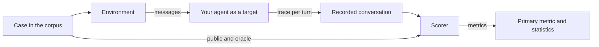

# Входы оценки

[English](../evaluation-inputs.md) · Русский

**Цель:** подготовить оценку агента: кейсы, на которых он измеряется, и
программу, оценивающую его ответы. **Готово, когда** корпус загружается,
оценщик превращает написанный вручную образец в результат с основной метрикой,
а на каждый обязательный пункт каталога требований есть ответ. Тогда можно
зафиксировать всё в Bundle и измерить агента.

Страница состоит из двух частей. **[Шаги](#шаги)** — список действий.
**[Справочные сведения](#справочные-сведения)** ниже объясняют каждый вход,
его назначение и правила. Шаги ссылаются на подробности при необходимости.

Некоторые шаги имеют две пометки. **Для запуска** — минимум, принимаемый Lab.
**Для корректных результатов** — дополнительные предположения Lab, благодаря
которым числа означают заявленное. Lab не может проверить эти условия за вас.

Пример — ассистент поиска заказов из раздела [Подключение агента](connect-agent.md).
Текущие рекомендации используют Lab 0.0.3.dev81 со строго Core 2.0.0b22;
открытие сессии по-прежнему использует данные `public` кейса. Старые входы и
прогоны сохраняйте с породившими их окружениями.

## Перед началом

- Агент подключён или у вас хотя бы есть модуль его адаптера ([Подключение агента](connect-agent.md)).
- Вы знаете, нужна ли **фиксированная оценка** (измерить агента как есть) или
  **кампания** (дать Core его улучшить). Входы одинаковы; различается только
  объявляющий их документ (см. [Что вы создаёте](#что-вы-создаёте)).
- Термины: *кейс*, *образец*, *Bundle*. Если они незнакомы, см. [Как работает Lab](concepts.md).

## Шаги

1. [Решите, что измерять, и назовите основную метрику](#шаг-1-решите-что-измерять-и-назовите-основную-метрику)
2. [Напишите кейсы](#шаг-2-напишите-кейсы)
3. [Выберите окружение](#шаг-3-выберите-окружение)
4. [Передайте агенту данные мира](#шаг-4-передайте-агенту-данные-мира)
5. [Напишите оценщик](#шаг-5-напишите-оценщик)
6. [Отложите тестовые кейсы](#шаг-6-отложите-тестовые-кейсы)
7. [Проверьте каталог требований](#шаг-7-проверьте-каталог-требований)
8. [Попробуйте](#шаг-8-попробуйте)

### Шаг 1. Решите, что измерять, и назовите основную метрику

**Сделайте:**

- [ ] Одним предложением запишите, что делает ответ лучше другого. Для
  ассистента поиска заказов: «сообщает правильный статус правильного заказа
  после поиска».
- [ ] Перечислите важные **виды** ситуаций (известный заказ, неизвестный заказ,
  несколько заказов в одном сообщении). На шаге 2 они станут стратами.
- [ ] Выберите имя **одной** метрики, которую оценщик вернёт для каждого
  образца, например `score`. Это *основная метрика*. Другие метрики можно
  записывать рядом, но они ничего не решают.
- [ ] Решите, какие правила являются **жёсткими ограничениями**, когда в
  кампании одной ошибки достаточно для отклонения версии независимо от
  среднего (например «никогда не отвечать без поиска»). Проверяющие их кейсы
  являются *critical* (шаг 2).
- [ ] Объявите метрику: в манифесте кампании как `/campaign/metric`, во входе
  оценки как `/metric_plan`, в обоих случаях `{"primary": "score"}`.

*Для корректных результатов* фиксированной оценки: Lab не вычисляет сводку по
основной метрике, поэтому усреднение и сравнение — ваша задача. Всё равно
назовите её, чтобы две оценки с разными планами нельзя было спутать. Подробнее:
[Основная метрика](#основная-метрика).

**Готово, когда:** у вас есть имя метрики, список страт и критические правила.

### Шаг 2. Напишите кейсы

**Сделайте:** создайте корпус `corpus.jsonl`: файл UTF-8 с **одним кейсом на
строку**. Возьмите эту строку за основу и напишите по одной на сценарий:

```json
{"case_id": "lookup-shipped-1", "group_id": "order-A-100", "stratum": "single-order", "public": {"text": "Where is order A-100?", "orders": {"A-100": {"status": "shipped"}}}, "oracle": {"must_mention": "shipped", "critical": true}}
```

- [ ] `case_id`: уникален в файле.
- [ ] `public`: то, что может видеть агент: текст сообщения и данные мира
  (шаг 4). **Никогда** не ожидаемый ответ.
- [ ] `oracle`: то, что видит только оценщик: ожидаемый результат и проверки.
  Добавьте `"critical": true` к кейсам, проверяющим жёсткое ограничение (шаг 1).
- [ ] `private` (необязательно): то, что нужно только окружению (шаг 3).
- [ ] Ни один кейс не содержит `public.conformance: true`: это зарезервировано
  для самопроверки протокола ([кейсы conformance зарезервированы](#кейсы-conformance-зарезервированы)).
- [ ] `reflection_metadata` только в корпусе кампании; корпус входа оценки отклоняет это поле.

*Для запуска:* каждый кейс имеет `case_id`, `group_id`, `stratum` (любые
строки) и `public`, без полей сверх таблицы в разделе [Кейсы и корпус](#кейсы-и-корпус).
*Для корректных результатов:* статистика Core использует эти поля. Поместите
**зависимые** кейсы (перефразировки одного вопроса, один заказ с двух сторон) в
**одну группу**, а для видов ситуаций из шага 1 используйте страты. Почему:
[Группы и страты](#группы-и-страты). Кто видит поля: [Кто что видит](#кто-что-видит).

**Готово, когда:** собственный загрузчик Core читает файл и выводит ожидаемое
число кейсов, страт и групп. Запустите его в окружении Python с установленным Lab:

```sh
python -c "
from pathlib import Path
from evolution.tree.bindings import load_eval_corpus
cases = load_eval_corpus(Path('corpus.jsonl'))
print(len(cases), 'cases', sorted({c.stratum for c in cases}), len({c.group_id for c in cases}), 'groups')
"
```

Для примера из трёх кейсов он выводит
`3 cases ['single-order', 'unknown-order'] 2 groups`. Ошибочная строка выдаёт
номер, например `CorpusError: missing_key at line 1` или `duplicate_case_id at line 2`.
Для корпуса кампании используйте `load_reflection_corpus` и `.cases` его результата.

### Шаг 3. Выберите окружение

**Сделайте:** выберите, как кейс превращается в сообщения агенту:

- **Один вопрос, один ответ** → `static`. Сообщение — `public[input_text_key]`,
  а весь `public` передаётся как его поля.
- **Диалог из нескольких фиксированных сообщений** → `scripted`. Каждый кейс
  перечисляет сообщения в `private.script` по порядку. Скрипт не реагирует на ответы агента.

Объявите его в `/environment`:

| | Манифест кампании | Вход оценки |
|---|---|---|
| static | `{"kind": "static"}` (`input_text_key` по умолчанию `text`) | `{"kind": "static", "input_text_key": "text"}` (обязательно) |
| scripted | `{"kind": "scripted"}` | `{"kind": "scripted", "input_text_key": null}` |

Подробности и пример scripted: [Окружение](#окружение).

**Готово, когда:** каждый кейс содержит свои сообщения. При `static` кейс без
ключа получает **пустое сообщение без ошибки**, поэтому проверьте его (замените
`text` своим ключом):

```sh
python -c '
import json
for line in open("corpus.jsonl", encoding="utf-8"):
    if line.strip():
        case = json.loads(line)
        if not case["public"].get("text"):
            print("no message text:", case["case_id"])
'
```

Если все кейсы исправны, команда ничего не выводит. При `scripted` аналогично
проверьте `case.get("private", {}).get("script")`.

### Шаг 4. Передайте агенту данные мира

**Сделайте:** решите, как данные инструментов агента (заказы, читаемые
`lookup_order`) доходят до него для каждого кейса, и соответствующим образом
подключите адаптер. Выберите по одному пути для каждого вида данных:

- [ ] **В `public`**, под ключом, который `open` адаптера передаёт backend
  инструмента (пример загружает `public["orders"]` в хранилище заказов).
- [ ] **В файле фикстур внутри измеряемого дерева**, выбираемом небольшим ключом в `public`.
- [ ] **В `fields` сообщений scripted**, когда мир меняется во время диалога.
- [ ] Если ответы зависят от «сейчас» — **эталонное время**: настройка в `env`
  файла запуска или поле в `public`.

*Для запуска:* агент получает `public` при открытии сессии и сообщения. Он
**никогда** не получает `private`, поэтому данные оттуда не доходят до его инструментов.
*Для корректных результатов:* все данные мира поступают из кейса указанными
путями, никогда из реальных систем или системных часов. Иначе один кейс в
разные дни даёт разные результаты. Подробнее: [Данные мира и фикстуры](#данные-мира-и-фикстуры).

**Готово, когда:** вы вставляете `public` одного кейса в [офлайн-скрипт](connect-agent.md#попробуйте-офлайн)
из раздела подключения агента, и инструмент читает данные этого кейса (известный
заказ находится, неизвестный — нет).

### Шаг 5. Напишите оценщик

**Сделайте:** напишите вне измеряемого дерева Python-скрипт, читающий один
образец как JSON из stdin и записывающий один результат как JSON в stdout.
Начните с [примера оценщика](#пример-оценщика) и адаптируйте его:

- [ ] Читайте ожидаемый результат из `oracle`, а действия агента — из `view.history.turns`.
- [ ] Возвращайте `metrics` с основной метрикой в **каждом** результате.
- [ ] Возвращайте `critical_pass` (boolean), когда `oracle.critical` кейса равно `true`.
- [ ] Используйте только ключи `metrics`, `critical_pass`, `verdicts`, `public_feedback`, `details`. Никогда не копируйте `oracle` в `public_feedback`.
- [ ] Завершайтесь с ненулевым кодом, если оценить невозможно. Это ошибка оценки, никогда не нулевой балл.
- [ ] Объявите оценщик через `argv`, `cwd`, `dependency_paths`, `allowed_env` и
  `timeout_seconds` (плюс `"kind": "subprocess"` во входе оценки). Используйте
  путь к скрипту в `argv`, а не `python -m`.

*Для корректных результатов* при использовании языковой модели как судьи:
закрепите модель, держите температуру низкой, перечислите файлы промпта в
`dependency_paths` и завершайтесь с ненулевым кодом при сбое вызова. См.
[Судьи](#судьи-оценивание-языковой-моделью). Контракт: [Оценщик](#оценщик).

**Готово, когда:** написанный вручную образец даёт ожидаемый результат.
Сохраните образец как `sample.json`, например:

```json
{"case_id": "lookup-shipped-1", "public": {"text": "Where is order A-100?", "orders": {"A-100": {"status": "shipped"}}}, "oracle": {"must_mention": "shipped", "critical": true}, "view": {"history": {"turns": [{"message": {"content": "Where is order A-100?", "fields": {}}, "events": [{"type": "tool_call", "name": "lookup_order"}, {"type": "tool_result", "name": "lookup_order", "status": "ok"}, {"type": "assistant_message", "content": "Order A-100 has shipped."}], "outcome": "ok"}]}, "terminal": "completed", "target": {}}}
```

Запустите `python scorer/score.py < sample.json`. Пример оценщика выводит
`{"metrics": {"score": 1.0, "tool_used": 1.0}, "verdicts": [...], "critical_pass": true}`
и завершается с кодом 0. Измените текст ответа на неверный статус и убедитесь,
что `score` падает до `0.0`.

### Шаг 6. Отложите тестовые кейсы

Этот шаг важен для кампаний. При фиксированной оценке без последующей кампании
его можно пропустить.

**Сделайте:**

- [ ] Напишите второй файл корпуса, например `held-out.jsonl`, с кейсами,
  которые кампания никогда не видит. Формат как в шаге 2.
- [ ] Не копируйте их содержимое в корпус кампании, промпт Редактора или агента.
- [ ] Запланируйте после кампании измерение финального Чемпиона на них отдельной
  фиксированной оценкой ([как](#отложенные-кейсы)).

*Для запуска:* ничего; кампания работает без отложенных кейсов.
*Для корректных результатов:* каждый увиденный кампанией кейс попадает в
обратную связь Редактору и Рефлектору, поэтому только отложенные кейсы дают
беспристрастное доказательство улучшения финальной версии. Lab не может это обеспечить.

**Готово, когда:** отложенный файл существует и не разделяет кейсы с корпусом
кампании. Если они отдельны, команда ничего не выводит:

```sh
python -c '
import json
def cases(path):
    return [json.loads(line) for line in open(path, encoding="utf-8") if line.strip()]
campaign, held_out = cases("corpus.jsonl"), cases("held-out.jsonl")
ids = {c["case_id"] for c in campaign}
publics = {json.dumps(c["public"], sort_keys=True) for c in campaign}
for case in held_out:
    if case["case_id"] in ids or json.dumps(case["public"], sort_keys=True) in publics:
        print("also in the campaign corpus:", case["case_id"])
'
```

Она сравнивает только имена кейсов и точные данные `public`; перефразировки
кейса кампании нужно обнаружить самостоятельно.

### Шаг 7. Проверьте каталог требований

**Сделайте:** перечислите требования для своего вида работы и пройдите их:

```sh
lab guides requirements --json | python3 -c 'import json,sys; d=json.load(sys.stdin); [print(i["id"], i["obligation"], i["guide"]) for i in d["items"] if "evaluation" in i["applies_to"]]'
```

Для кампании используйте `"campaign"` вместо `"evaluation"`. Пункты `eval.*`
и `world.*` относятся к этой странице; `agent.*`, `launch.*` и `target.*` — к
[подключению агента](connect-agent.md). Если записываете прохождение, отметьте
`digest` каталога. Подробнее: [Каталог требований как список проверки](#используйте-каталог-требований-как-список-проверки).

**Готово, когда:** на каждый пункт `required` есть ответ в пакете.

### Шаг 8. Попробуйте

**Сделайте:** измерьте агента на нескольких кейсах через `lab evaluate`
([первое измерение](../first-evaluation.md#measure-your-own-agent)). Команда
запускает все кейсы `corpus.jsonl` с `repeat_seeds` из входа, поэтому для
пробы оставьте в корпусе несколько строк. При использовании Python Owner или
сервиса выбирайте кейсы и повторы, как описано в [Выбор, повторы и покрытие](#выбор-повторы-и-покрытие).

**Готово, когда:** оценка завершилась без остановки, её persistence сохранён,
а доля оценённых образцов достигает подготовленного `min_coverage` (по
умолчанию 0.95; дескрипторы до dev60 сохраняют 1.0). Для частичного результата
читайте «N из M» и список `unmeasured`, а для оценённых образцов проверяйте основную метрику.

**Далее:** прочитайте смысл чисел в разделе [Результаты](results.md) или
позвольте Core улучшить агента через [кампанию](campaign.md).

---

## Справочные сведения

### Что вы создаёте

Измерение настолько хорошо, насколько хороши его входы. Помимо агента Lab
нужны четыре: **корпус** кейсов, **окружение**, превращающее кейс в сообщения,
**оценщик**, превращающий завершённый диалог в числа, и названная **основная метрика**.

Для фиксированной оценки и кампании входы одинаковы. Различается только документ,
который их объявляет: манифест кампании (`evolution-v2-manifest/15` или
добровольный `/16`) либо вход оценки (`lab-evaluation-input/1`, `/2` или `/3`).
Полные документы показаны в разделах [Кампания](campaign.md) и [Первая оценка](first-evaluation.md).

Для Bundle вида `evaluation` задайте `launch.policy` самим входом оценки,
например `"policy": "evaluation-input.json"`. Манифест кампании рядом не
является источником политики оценки; ссылка на него отклоняется с
`unsupported_input` и указанием `launch.policy`. Lab генерирует внутренний
манифест conformance при сборке Bundle и привязывает сохранённый запуск к нему.



### Кейсы и корпус

Корпус — файл UTF-8 JSON Lines: **один кейс на строку**. Кейс — один сценарий,
например «клиент спрашивает, где заказ A-100». Поля кейса:

| Поле | Обязательно | Назначение |
|---|---|---|
| `case_id` | да | Имя, уникальное в корпусе. |
| `group_id` | да | Какие кейсы относятся друг к другу, например варианты одного сценария (см. ниже). |
| `stratum` | да | Срез корпуса, к которому относится кейс, например `single-order` или `unknown-order`. |
| `tags` | нет | Список строк для собственного учёта. |
| `public` | да | То, что может видеть агент. |
| `private` | нет | То, что видит только окружение. |
| `oracle` | нет | То, что видит только оценщик: ожидаемые результаты и проверки. |
| `reflection_metadata` | нет | Только кампания: диагностические заметки Рефлектору (до 64 ключей, 16384 байт). Корпус входа оценки отклоняет поле. |

Вот кейс ассистента поиска заказов, разбитый на строки для чтения. В файле он
должен занимать одну строку.

```json
{
  "case_id": "lookup-shipped-1",
  "group_id": "order-A-100",
  "stratum": "single-order",
  "tags": ["happy-path"],
  "public": {"text": "Where is order A-100?", "orders": {"A-100": {"status": "shipped"}}},
  "oracle": {"must_mention": "shipped", "critical": true}
}
```

Небольшой корпус может содержать три строки:

```json
{"case_id": "lookup-shipped-1", "group_id": "order-A-100", "stratum": "single-order", "tags": ["happy-path"], "public": {"text": "Where is order A-100?", "orders": {"A-100": {"status": "shipped"}}}, "oracle": {"must_mention": "shipped", "critical": true}}
{"case_id": "lookup-shipped-2", "group_id": "order-A-100", "stratum": "single-order", "public": {"text": "hi, can you check A-100 for me", "orders": {"A-100": {"status": "shipped"}}}, "oracle": {"must_mention": "shipped", "critical": true}}
{"case_id": "lookup-missing-1", "group_id": "order-B-7", "stratum": "unknown-order", "public": {"text": "Status of B-7?", "orders": {}}, "oracle": {"must_mention": "could not find"}}
```

#### Кто что видит

Три раздела отделяют информацию от участников, которым она не нужна:

| Участник | Видит |
|---|---|
| Ваш агент | `public` при открытии сессии и каждое сообщение окружения. |
| Окружение | `public` и `private`. |
| Оценщик | `case_id`, `public`, `oracle` и записанный диалог. Никогда `private`. |
| Редактор и Рефлектор кампании | Ни `oracle`, ни `private`. Они видят основную метрику и выбранный вывод оценщика (см. [Куда попадает вывод оценщика](#куда-попадает-вывод-оценщика)). |

Никогда не помещайте ожидаемый ответ в `public`: агент прочитает его.

#### Группы и страты

Группы и страты — не просто удобные метки. Их использует статистика Core. При
сравнении двух версий агента кампания усредняет повторы внутри кейса, затем
кейсы внутри группы, затем **взвешивает все группы одинаково**. Доверительный
интервал повторно выбирает целые группы, затем кейсы, затем повторы.

Что это значит:

- Помещайте **зависимые** кейсы в одну группу: перефразировки вопроса или один
  заказ с двух сторон. Десять перефразировок в одной группе считаются одним
  сценарием — это честно. Десять перефразировок в десяти группах считались бы
  десятью независимыми доказательствами — это неверно.
- Используйте страты для важных **видов** ситуаций (известный заказ,
  неизвестный заказ, несколько заказов в сообщении). Задание Редактора кампании
  сообщает результаты по группам и стратам, поэтому хорошие страты также делают
  обратную связь понятнее.

### Окружение

Окружение определяет сообщения агента. Два вида объявляются в `/environment`:

- **`static`**: одно сообщение. Его `content` — `public[input_text_key]`,
  `fields` — всё отображение `public`. В манифесте кампании `input_text_key`
  необязателен и по умолчанию равен `text`. Во входе оценки его нужно задать.
  Если ключа нет, агент получает пустое сообщение без ошибки, поэтому проверьте корпус.
- **`scripted`**: несколько сообщений по порядку из `private.script`, массива
  записей `{"content": "...", "fields": {...}}` (`fields` необязательно).
  `input_text_key` отсутствует в манифесте и равен `null` во входе оценки.

Скрипт фиксирован заранее. Он не реагирует на ответы агента. Диалог заканчивается,
когда скрипт исчерпан (терминальное состояние `completed`), достигнут лимит
ходов (`turn_budget`) или истёк лимит времени образца (`time_budget`). Кейс
может понизить свой лимит ходов через `private.max_turns`.

Кейс scripted для двухходового диалога:

```json
{"case_id": "lookup-followup-1", "group_id": "order-A-100", "stratum": "multi-turn", "public": {"orders": {"A-100": {"status": "shipped"}}}, "private": {"script": [{"content": "Hi, I have a question about an order."}, {"content": "It's A-100."}]}, "oracle": {"must_mention": "shipped"}}
```

### Данные мира и фикстуры

*Мир* — симулированные данные инструментов агента, например заказы, читаемые
`lookup_order`. Агент получает из кейса ровно две вещи: `public` (при открытии
сессии) и сообщения. Он никогда не получает `private`. Поэтому данные мира
должны доходить до внедрённого backend одним из путей:

- **В `public` под ключом, который код передаёт backend**, как в примере:
  `open` загружает `public["orders"]` в `OrderStore`, а в модель идёт только
  текст сообщения. Оценщик тоже может читать эти данные.
- **В файлах внутри измеряемого дерева** (например файл фикстур в
  `dependency_paths` манифеста), выбираемых небольшим ключом в `public`.
- **В `fields` сообщений scripted**, когда мир меняется во время диалога.

`private` остаётся полезным для того, что нужно только окружению: скрипта и `max_turns`.

Если ответы зависят от «сейчас» (например «доставят через два дня»), передайте
агенту явное **эталонное время**: настройку в `env` файла запуска или поле в
`public`. Никогда не позволяйте ему читать системные часы.

### Кейсы conformance зарезервированы

Кейс с `public.conformance: true` зарезервирован для самопроверки протокола
Core. Подготовка отклоняет такой корпус с ошибкой `reserved_public_input`. См.
[Режим conformance](connect-agent.md#режим-conformance).

### Выбор, повторы и покрытие

**Кампания измеряет весь корпус.** Фиксированная оценка измеряет явную **выборку**,
заданную при подготовке:

- `{"all": true}`: все кейсы;
- `{"count": N}`: первые N кейсов в порядке файла;
- `{"case_ids": ["lookup-missing-1", "lookup-shipped-1"]}`: ровно эти, в указанном порядке.

Случайной выборки нет. Выборка не претендует на представительность всего корпуса.

**Повторы.** Каждый выбранный кейс выполняется один раз на запись в
`repeat_seeds`. Три кейса с `"repeat_seeds": [null, null]` дают шесть
*образцов*. Используйте целые числа при `seed_mode` Target Service `exact` и `null` при
`unpaired` или `none` (см. [seed](connect-agent.md#полезные-правила-выполнения)).
Каждый образец ограничен `max_turns` и `timeout_seconds`. Образец с истекшим
временем считается indeterminate, а не низкой оценкой.

**Покрытие.** После прогона Lab сравнивает плановое расписание с фактически
оценёнными образцами. Читайте покрытие до оценок (см. [Результаты](results.md)).

<a id="the-fixed-evaluation-budget"></a>
### Бюджет фиксированной оценки

У фиксированной оценки собственные настройки отказов; она никогда не читает
`/campaign/budget/max_failed_turns`, `/campaign/call_retries` или другие ключи
отказов кампании. До подготовки плана выберите именованный
[вариант отказов](campaign.md#run-failures). Все значения ниже относятся к
**новой подготовке**.

| Поле | Значение при отсутствии или `null` | Ограничения и значение |
|---|---|---|
| `sample_retries` | `3` | Целое 0–8; дополнительные попытки неоценённого образца. `0` отключает повторы образцов. |
| `min_coverage` | `0.95` | Конечное число > 0 и ≤ 1; минимальная оценённая доля для принятия оценки без остановки. |
| `max_consecutive_unmeasured` | `3` | Положительное целое N или `"off"` для отключения остановки. Считаются последовательные неоценённые запланированные образцы после повторов. |
| `max_failed_turns` | разрешённый `max_turns` | Положительное целое; последовательные неудачные по вине агента ходы, завершающие rollout. |
| `call_retries` | `{"max_attempts": 3, "turn_max_attempts": 2}` | Закрытый объект с целыми значениями 1–10 или `"off"` для отключения повторов вызовов. |
| `concurrency` | `1` | Положительное целое ≤ `limits.max_concurrent_sessions` запуска; образцы разделяют один экземпляр target. |
| `scorer_concurrency` | `1` | Положительное целое; одновременные вызовы оценщика. |

`prepare_evaluation` принимает все эти именованные аргументы. Явные аргументы
не `None` переопределяют умолчания входа; `None` означает отсутствие значения.
Пропущенные или `null` умолчания входа используют таблицу выше, включая входы
`/1` и `/2`, подготовленные сейчас. Это умолчание `retry`, поэтому нужно
установить безопасность повторной отправки вопроса. Для агента, чей ход меняет
мир, явно выберите `no_retry`. Явный `call_retries="off"` переопределяет повторы входа.

`lab-evaluation-input/1`, `/2` и `/3` по-прежнему принимаются в закрытых
формах. Все принимают умолчания повторов образца, покрытия и обеих параллельностей;
`/2` добавляет `defaults.max_failed_turns` и `defaults.call_retries`; `/3` —
`defaults.max_consecutive_unmeasured`. Более ранние основные версии отклоняют
добавленные позже ключи. Значение `/3` — N, `"off"` или `null` (= умолчание 3).

Для Bundle кампании `selection`, `repeat_seeds`, `evaluation_set_id`,
`max_turns`, `timeout_seconds` и `metric_plan` по-прежнему задаются явно.
Настройки отказов необязательны и разрешаются как выше; они не наследуются из
манифеста. Разрешённый план виден в `PreparedSummary.evaluation`; стандартный
порог 3 опущен в его канонической нагрузке, как описано ниже. Применённый
бюджет ходов (`max_failed_turns`, `call_retries`) повторяется в `lab-evaluation-outcome/2`.

Повторы вызовов применяются только к собственным вызовам ходов rollout, не к
`materialize`/`release`, которые worker вызывает напрямую вне журнала
повторяемых вызовов. Типизированная повторяемая временная ошибка может повторно
отправить ход только при `turn_max_attempts > 1` и повторной отправке target
того же `request_id`. После исчерпания повторов вызовов образец `indeterminate`
может использовать `sample_retries`. Глобальные остановки по-прежнему включают
отмену, исчерпание бюджета, исход Core `exclude` (`cancelled` или
`infrastructure_failed`) и ошибку Core без закрытой попытки. Достижение N
последовательных неоценённых образцов добавляет `consecutive_unmeasured`;
`"off"` отключает только эту остановку. Оценённый образец сбрасывает счётчик.
Покрытие всё равно должно достигать `min_coverage` плана. Сохраняйте покрытие
«N из M» и список `unmeasured` рядом с частичным результатом.

### Сохранённые планы и совместимость

Сохранённые планы сохраняют исходный смысл и байты: текущие умолчания при
пропуске не применяются к историческим отсутствующим/null полям повторов.
Планы до dev60 сохраняют порог покрытия 1.0, отсутствие повторов образцов и
параллельность оценщика 1. Эффективный `max_consecutive_unmeasured` равен 3
для старых и текущих стандартных планов; каноническая нагрузка подготовки
опускает значение ради старого digest. N, отличное от 3, или `"off"` сохраняется
и меняет digest подготовки. На **том же сохранённом Bundle** старый запрос со
всеми явными значениями сохраняет байты/digest плана. Новые Bundle включают
окружение породившего Lab и могут иметь другие digest. Миграции между парами нет:
старые прогоны остаются со своими wheel/состоянием.

На точном Core b15 блокировка экземпляра сериализует вызовы `turn` между
сессиями. Перекрытие другой работы образцов и оценивания не гарантирует
ускорения baseline.

### Оценщик

Оценщик — **ваша** программа, запускаемая отдельным процессом один раз на
образец. Он объявляется пятью полями:

| Поле | Значение |
|---|---|
| `argv` | Командная строка. Используйте путь к скрипту; команда `python -m module` отклоняется. |
| `cwd` | Рабочий каталог оценщика. |
| `dependency_paths` | Файлы и каталоги, от которых зависит оценщик. Они входят в его идентичность. |
| `allowed_env` | Имена значений окружения для оценщика. Каждое должно быть объявленным `env` или именем секрета. Ничто другое не наследуется. |
| `timeout_seconds` | Лимит времени одного вызова. |

В манифесте кампании эти пять полей образуют `/scorer`. Во входе оценки
`/scorer` также содержит `"kind": "subprocess"`. Программа оценщика должна
находиться вне измеряемого дерева.

#### Вход и выход

Оценщик читает один JSON-объект из stdin:

```json
{"case_id": "...", "public": {}, "oracle": {}, "view": {"history": {"turns": []}, "terminal": "completed", "target": {}}}
```

- `view.history.turns` перечисляет ходы: их `message` (`content`, `fields`),
  возвращённые агентом `events` (плюс заключительный `assistant_message`),
  `usage`, `latency_ms`, `outcome` и `reason`.
- `view.terminal` — способ завершения диалога: `completed`, `turn_budget` или
  `candidate_failed`. Другие завершения indeterminate и не попадают оценщику.
- `view.target` — идентичность target.
- Переменная окружения `EVO_CANDIDATE_ROOT` содержит путь измеряемого дерева.

Оценщик записывает в stdout один JSON-объект только с этими ключами:

| Ключ | Значение |
|---|---|
| `metrics` | Обязательно. Непустое отображение имён в конечные числа. |
| `critical_pass` | Boolean, если `oracle.critical` кейса равно `true`. Иначе отсутствует или `null`. |
| `verdicts` | Необязательно. До 32 записей `{"criterion", "passed", "note"?}`. `criterion` — короткий уникальный в списке код, `passed` — boolean, `note` — не более 256 символов. |
| `public_feedback` | Необязательное отображение (см. ниже). |
| `details` | Необязательное отображение, остаётся приватным. |

Ненулевой код выхода, тайм-аут или неизвестный ключ — **ошибка оценивания**
образца. Она никогда не считается нулевой оценкой.

#### Пример оценщика

```python
"""Scorer for the order-lookup assistant: one sample in on stdin, one result out on stdout."""
import json
import sys


def main() -> None:
    sample = json.load(sys.stdin)
    oracle = sample["oracle"]
    turns = sample["view"]["history"]["turns"]
    events = [event for turn in turns for event in turn["events"]]

    called_tool = any(e["type"] == "tool_call" and e.get("name") == "lookup_order" for e in events)
    answers = [e["content"] for e in events if e["type"] == "assistant_message"]
    final_answer = answers[-1] if answers else ""
    status_correct = oracle["must_mention"] in final_answer.lower()

    result = {
        "metrics": {"score": 1.0 if status_correct else 0.0,
                    "tool_used": 1.0 if called_tool else 0.0},
        "verdicts": [
            {"criterion": "called_lookup_order", "passed": called_tool},
            {"criterion": "status_correct", "passed": status_correct},
        ],
    }
    if oracle.get("critical") is True:
        # A critical case fails when the answer skipped the lookup.
        result["critical_pass"] = called_tool
    json.dump(result, sys.stdout)


if __name__ == "__main__":
    main()
```

На корпусе из трёх кейсов выше с адаптером из [подключения агента](connect-agent.md)
каждый кейс получает `1.0`. При сломанном шаблоне ответа два кейса отправленного
заказа завершаются как `candidate_failed` и получают `0.0`.

**Критические кейсы** — жёсткие ограничения. В кампании, если любой образец
измерения Кандидата возвращает `critical_pass: false`, Кандидат отклоняется
независимо от среднего балла.

#### Куда попадает вывод оценщика

- **Основная метрика** управляет каждым сравнением.
- **`public_feedback`** идёт Редактору кампании, но только короткие скалярные
  записи с ключами, похожими на идентификаторы. Рефлектор получает всё
  отображение. С b11 секреты `allowed_env` оценщика от 8 символов маскируются
  перед чтением Reflector и Grouper, а записи обратной связи с ними отбрасываются
  перед Editor; см. [маскирование и ограничения](pitfalls.md#оценщик-раскрывает-oracle).
- **`verdicts`** получает Рефлектор, группирующий ошибки по неуспешному
  критерию. Редактор их не видит.
- **`details`**, stderr, `oracle` и исходные аргументы инструментов не доходят до обеих ролей.

Никогда не копируйте содержимое `oracle` в `public_feedback`: Редактор узнает
ожидаемые ответы и будет оптимизироваться под них.

На `/14` (Core a33, #172) Reflector может называть кейс по его `case_id`,
`group_id`, `stratum`, тегу или id доказательства: Редактор и так их видит.
Id критериев в `verdicts` не исключены: если один равен строке oracle,
заметка Reflector с ним отклоняется как `oracle_leak`. В `/11` ничего не изменилось.

### Основная метрика

Назовите одну метрику, присутствующую в **каждом** выводе оценщика:

- кампания: `/campaign/metric`, например `{"primary": "score"}`;
- фиксированная оценка: `/metric_plan` во входе оценки, например `{"primary": "score"}`.
  При подготовке фиксированной оценки из Bundle кампании нужен явный `metric_plan`.

Использование основной метрики различается:

- **Кампания.** Core сравнивает версии по основной метрике с усреднением по
  группам и повторной выборкой из раздела [Группы и страты](#группы-и-страты);
  функцию агрегации вы не выбираете. Образец без основной метрики считается
  инфраструктурной ошибкой (`scorer_metric_missing`), а не низким баллом.
  Другие метрики, например `tool_used` выше, записываются, но ничего не решают.
- **Фиксированная оценка.** `metric_plan` входит в идентичность прогона, но
  Lab не вычисляет по нему сводку: отчёт перечисляет каждый образец со всеми
  метриками, а усреднение и сравнение — ваша задача (см. [Результаты](results.md#отчёты-оценки)).
  Всё равно называйте сравниваемую метрику, чтобы оценки с разными планами нельзя было спутать.

### Судьи: оценивание языковой моделью

Некоторые качества, например вежливость или правильность объяснения, трудно
проверять кодом. Оценщик может вызывать языковую модель как *судью*. У Lab
нет специальной функции судьи: судья — часть оценщика. Объявите его правильно:

- Поместите API-ключ и имя модели судьи в `allowed_env`, объявив их как `env`
  Bundle или имена секретов; оценщик больше ничего не получает.
- Перечислите файлы промпта судьи в `dependency_paths`, чтобы изменение промпта
  меняло идентичность оценщика.
- Закрепите модель судьи и держите температуру низкой: шум судьи снижает статистическую мощность.
- Если вызов судьи не удался, завершайтесь с ненулевым кодом, чтобы образец
  стал ошибкой оценивания, а не выдуманным баллом.
- Судьи стоят денег на каждом образце и повторе; см. [Бюджет и контроль расходов](budget.md).

### Отложенные кейсы

В кампании результаты каждого кейса поступают Редактору и Рефлектору. Кейс,
увиденный кампанией, уже не может беспристрастно доказать улучшение финальной
версии. Держите отдельный набор **отложенных** (тестовых) кейсов:

- держите их **вне корпуса кампании**, в отдельном файле корпуса;
- после кампании измерьте на них финального Чемпиона отдельной фиксированной оценкой (см. ниже);
- не копируйте их содержимое в промпт Редактора или агента.

**Манифест `/15` может хранить разделение в одном корпусе.** Пометьте каждую
строку `split: "train"` или `split: "test"` (все строки или ни одну; группа не
пересекает разделения). Core исключает строки `test` из кампании: группировка,
рефлексия, Editor, измерения и продвижение видят только `train`. Фиксированная
оценка, подготовленная из этого Bundle, называет измеряемую часть в запросе
подготовки (`split` в `lab-service-prepare-request/3`: `train`, `test` или
`null` = train), а выбор фиксируется в id кейсов оценки. Отчёт кампании
показывает `corpus_split` Core (режим разметки, число кейсов train и test).

Фиксированная оценка из Bundle кампании не может сделать это: она измеряет
seed Bundle, а не Чемпиона, и выбирает только из корпуса кампании. У Lab также
нет команды превращения Чемпиона в дерево исходников. Экспортируйте Чемпиона в
ZIP ([Результаты](results.md#экспорт-чемпион-в-zip)), примените его
к копии своего проекта самостоятельно и зафиксируйте копию вместе с отложенным
корпусом в новом Bundle оценки.

Lab не может обеспечить эти правила. Это правила построения ваших корпусов.

### Используйте каталог требований как список проверки

Lab поставляет машиночитаемый список всего необходимого пакету — **каталог
требований**. Он работает офлайн:

```sh
lab guides requirements --json
```

Каждый пункт имеет `id`, например `eval.corpus`, `obligation` (`required` или
`optional`), применимые пути (`campaign`, `evaluation` или оба), короткие
`title` и `why` (на русском, для интерфейса клиента) и ссылку `guide`. Чтобы
перечислить нужное фиксированной оценке:

```sh
lab guides requirements --json | python3 -c 'import json,sys; d=json.load(sys.stdin); [print(i["id"], i["obligation"], i["guide"]) for i in d["items"] if "evaluation" in i["applies_to"]]'
```

Пункты `eval.*` и `world.*` рассматриваются на этой странице. `agent.*`,
`launch.*` и `target.*` — в разделе [Подключение агента](connect-agent.md).
`campaign.*`, `scope.*` и `eval.test_isolation` применимы только к кампаниям
(см. [Кампания](campaign.md)). У каталога есть `digest`. Если вы записываете
прохождение списка, запишите digest, а не только номер версии.

## Справочные материалы

Точные поля и коды ошибок:

- [Гайд входов оценки](../../../lab/src/evolution_lab/guides/evaluation-inputs/SKILL.md): корпус, окружение, протокол оценщика, метрика
- [Гайд требований](../../../lab/src/evolution_lab/guides/requirements/SKILL.md) и [`requirements.json`](../../../lab/src/evolution_lab/guides/requirements/requirements.json)
- [Гайд пакета кампании](../../../lab/src/evolution_lab/guides/campaign-package/SKILL.md): манифест `/15`, `/16` и `lab-evaluation-input/1`/`/2`/`/3`
- [Гайд подготовки](../../../lab/src/evolution_lab/guides/preparation/SKILL.md): выбор и ошибки подготовки
- [Гайд подводных камней](../../../lab/src/evolution_lab/guides/pitfalls/SKILL.md#test-outside-feedback): отложенные кейсы
- Полный нейтральный пример каталога: `evolution.tree.reference_target_cli.scaffold` Core

### Сообщение об образце без ответа (dev72)

Если оценщик отличает отсутствие ответа от неправильного ответа, он может
вернуть `{"criterion": "answered", "passed": false}` при отсутствии ответа и
`passed: true`, когда ответ есть, для каждого образца. Это обычный verdict
Core, доступный Рефлектору. Lab подсчитывает ложные verdict среди принятых
образцов как `unanswered`: `present` означает, что verdict есть у всех,
`partial` — только у `answered_reported`, `not_reported` — ни у одного,
`unavailable` — доказательства не удалось прочитать. В последних двух случаях
счёт равен null, а не нулю. Счёт не меняет покрытие Core, исход кампании или
`measurement_basis`.
