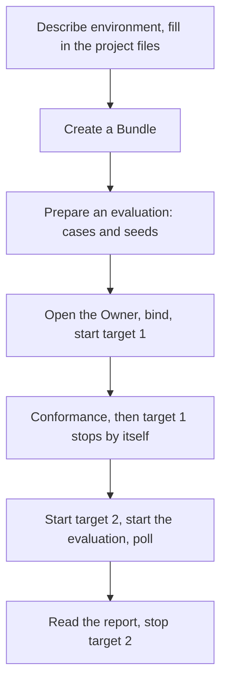

# Первая оценка

[English](../first-evaluation.md) · Русский

**Цель:** один раз измерить своего агента как есть. Работа завершена, когда
`lab evaluate` выводит `measurement accepted`, завершается с кодом 0 и вы знаете,
какие файлы открыть. Фиксированная оценка измеряет агента на выбранных кейсах,
не меняя его.

Нужна установка на Linux или macOS ([Установка](install.md)): `evolution-lab 0.0.3.dev81`,
строго `evo-skills 2.0.0b22` и оба wheel, из которых они установлены. Используйте
соответствующий checkout `lab-v0.0.3.dev81` и новый каталог состояния; старые прогоны
сохраняйте с породившими их checkout и wheel. Заглушка работает офлайн без модели
и ключей, используя только loopback-порт.

> **Новое в 0.0.3.dev72.** Команды и шаблон ниже появились в dev72; пример
> Python также строит проект из шаблона. Для dev71 и ранее читайте эту страницу
> под тегом `v0.0.3.dev71`.

## Измерьте своего агента

В checkout `lab` нет в PATH: вместо него используйте `just new-project DIR`,
`just evaluate DIR` или `just lab ...`.

```sh
lab new-project ~/my-agent-lab
lab evaluate ~/my-agent-lab --wheel LAB_WHEEL --wheel CORE_WHEEL
```

`lab new-project DIR` создаёт шаблон: заглушку, адаптер, три вопроса, оценщик
и два файла JSON. Каталог должен быть новым или пустым; ничего не перезаписывается.
Команда выводит дальнейшие шаги, в том числе `lab evaluate` с подстановками
wheel и `just evaluate DIR` для checkout.

`lab evaluate DIR` измеряет проект без запуска сервиса. Сначала выполните его
на неизменённом шаблоне, затем замените заглушку, вопросы и оценщик; описание
файлов — в [подключении агента](connect-agent.md#ваши-файлы-и-файлы-lab).
`just evaluate` сам передаёт wheel из `.lab/wheels/` и дополнительные опции.

| Опция | Назначение |
|---|---|
| `--wheel PATH` | Обязательна дважды: wheel Lab и Core, из которых установлен `lab`; при ручной установке это файлы в `work/wheels/`. |
| `--python PATH` | Запуск агента и оценщика в другом Python-окружении с теми же Lab и Core из тех же wheel. По умолчанию используется Python команды `lab`. |
| `--json` | Вывести результат JSON `lab-evaluate-summary/1` вместо текстового отчёта. |

### Что выводится

На неизменённом шаблоне (пути сокращены):

```text
What happened: Lab measured your agent as it is, without changing it.
  1. Lab copied the project into ~/my-agent-lab/.lab/runs/001/source and filled in the fields marked lab:auto.
  2. Lab froze the copy into a Bundle, an immutable copy of the inputs, in the state directory.
  3. Lab started the agent as a target and ran conformance, the core's check that it speaks the turn protocol: it passed.
  4. Lab ran the evaluation on a fresh target: 3 cases x 1 repeat, and sent the agent's answers to the scorer.
  5. Lab stopped the target and checked that nothing was left running.

Samples: case, question -> the agent's answer [score]
  c-3a6eb0b2… (evaluation)
    q1  What is the code word for alpha? -> A1   [score 1]
    q2  What is the code word for beta? -> B2   [score 1]
    q3  What is the code word for gamma? -> unknown   [score 0]

Lab filled: environment digest, port, scorer Python, 3 identity digests (listed in resolved.json); nothing to do.
run 001: measurement accepted: 3/3 samples scored; mean score 0.67 (2 of 3 scored 1)

Run files in ~/my-agent-lab/.lab/runs/001:
  report.md         Lab's report of the run
  conversations.md  every sample: question, answer, score, scorer verdicts
  resolved.json     the fields Lab filled in, the Python and the wheels
  summary.json      this result as JSON (lab-evaluate-summary/1)
  evaluate.log      the steps of the run
  source/           the project copy this run measured

Open first: ~/my-agent-lab/.lab/runs/001/conversations.md
```

Ноль за `q3` ожидается: заглушка знает слова для `alpha` и `beta`, но не для
`gamma`. Все образцы оценены, поэтому измерение принято. `accepted` относится к
пригодности запуска; `mean score 0.67` — среднее основной метрики по оценённым
образцам. Число `scored 1` выводится, когда все оценки равны 0 или 1; если
среднее невозможно вычислить, выводится `mean score unavailable`. Те же данные
находятся в `summary.json` в необязательном поле `quality`.

Строка `Lab filled` перечисляет автоматически заполненные поля. Если одно поле
пары задано явно, а другое содержит `"lab:auto"`, значение копируется в него.
`resolved.json` записывает значения в `substituted` и их источник в `sources`.
Исходные файлы проекта не изменяются; чтобы закрепить значение, задайте его в них.
Запуск без conformance сообщает о пропуске; при ранней остановке выводится
`Run stopped: <reason>`.

### Provenance оценки

Начиная с dev77/b20 файл `summary.json` может содержать счётчики `provenance` по завершённым сэмплам. `baseline_provenance_unknown` означает, что проект использует `gate.provenance.kind: reported`, а provenance не передана ни у одного завершённого сэмпла. Если кампания использует эту оценку как baseline, все кейсы считаются затронутыми. `provenance_not_recorded` отмечает старую оценку. См. [как выбрать эту оценку для baseline](campaign.md#выберите-первый-baseline).

### Где находятся файлы

Все файлы `lab evaluate` остаются в проекте под `.lab/`; шаблон исключает их из git:

```text
~/my-agent-lab/.lab/
  state-<pair>/      Lab's state for this version pair: Bundles, runs, logs; reused by later runs
  runs/001/          one lab evaluate run, numbered in order
    source/          the project copy with "lab:auto" filled in: what the Bundle was made from
    resolved.json    which fields were "lab:auto", what Lab put there and where the value came from; the Lab
                     and core versions, the pair, the Python the agent and the scorer ran in, and the wheels
                     with their sha256
    report.md        Lab's report (the same as lab report --markdown)
    conversations.md every sample: the question, the answer, the score, the scorer's verdicts
    summary.json     the facts the command checked (lab-evaluate-summary/1)
    evaluate.log     the steps of the run
  latest -> runs/001 the last run
```

Для новой пары версий создаётся новый `state-<pair>/`, старый читается своими
wheel. Не редактируйте `.lab/`. Для удаления сначала выполните `chmod -R u+w .lab`:
файлы Bundle доступны только для чтения. Копия `source/` исключает `.lab/`,
`.git`, `.venv`, `__pycache__`, `.pytest_cache`, `.mypy_cache`, `.ruff_cache`,
`*.pyc` и `*.pyo`; каталог `venv` без точки копируется. Символические ссылки
`launch.json` и `evaluation-input.json` читаются, а заполненные копии записываются
как обычные файлы, не через ссылки.

### Коды завершения

| Код | Значение |
|---|---|
| `0` | Измерение принято: оценка не остановилась, покрытие не ниже `min_coverage` (по умолчанию 0.95), результат сохранён, Target Service остановлен и очистка подтверждена. |
| `1` | Запуск не принят: не прошли проверки conformance, оценка остановилась или оценено слишком мало образцов. Выводятся доступные результаты и причина. |
| `2` | Проблема проекта до запуска: отсутствующий или некорректный файл, поле, строка корпуса (`corpus_invalid`), оценщик или секрет; несовпадающие явные значения; неверные пути `--wheel`/`--python` или отсутствующий `--wheel`. Ошибка JSON в stderr указывает место. Отказ подготовки после создания каталога также может относиться сюда; `artifacts_invalid` — только если указана строка корпуса. |
| `3` | Target не стартовал либо возникла ошибка Lab/окружения: несовпадающие wheel, несохранённый результат, неподтверждённая очистка, отказ `artifacts_invalid` без указания файла или `unexpected_error`. До запуска ошибка выводится как JSON, после — вместе с доступными файлами; `evaluate.log` указывает состояние. |
| `130` | Нажат Ctrl+C; выводится путь состояния. |

`target start not confirmed: target_unavailable` после правок агента обычно
указывает на ошибку импорта, `build` или `factory`, в том числе на переменную,
не объявленную в `launch.json`. Traceback есть в выводе и полностью в
`.lab/state-<pair>/scopes/<id>/stderr.log`.

`[scorer failed]` у каждого образца (код 1, `stopped: consecutive_unmeasured`)
означает, что агент ответил, но оценщик не вернул оценку, например из-за
синтаксической ошибки. Вывод указывает скрипт и scorer trace в состоянии;
`conversations.md` содержит код выхода оценщика. `[target failed]` обозначает
образец, на который агент не ответил. Частичные результаты не принимаются.
Подробнее — [устранение неполадок](install.md#устранение-неполадок).

### Секреты

Lab читает значения только из окружения процесса `lab evaluate` по ролям:
`launch.json` `secret_names` получает только target; имена из
`evaluation-input.json` `scorer.allowed_env`, отсутствующие в `launch.json` `env`,
получает только оценщик.

```sh
export MY_AGENT_API_KEY=...        # a name listed in launch.json secret_names
lab evaluate ~/my-agent-lab --wheel LAB_WHEEL --wheel CORE_WHEEL
```

Если имя отсутствует, команда завершится с кодом 2 и укажет имя и роль. Lab сам
не записывает значения и заменяет известные секреты на `<secret:NAME>` в своём
выводе и файлах запуска. **Но если агент или оценщик сам выводит секрет** в
ответе, stderr или выводе оценщика, Core и Owner могут сохранить его без
маскирования в состоянии, включая target `stderr.log` и scorer traces. Это
касается всех способов использования Owner; храните каталог состояния приватно.

### Прерванный запуск

Ctrl+C останавливает target и задачу через Owner и завершает команду с кодом 130.
Незавершённая оценка не продолжается: следующая получает новый номер. Если процесс
был убит, следующий запуск сначала очистит оставленное состояние и сообщит
`Cleaned up after run NNN`. При неудачной очистке он завершится с кодом 3,
укажет состояние и блокер и ничего нового не запустит.

### Из Python

Асинхронная `evolution_lab.quickstart.evaluate(project, wheels=[...], python=None)`
возвращает `exit_code`, `run_dir` и `summary`, тот же объект, что `--json`.
Ошибка до запуска или неожиданная ошибка вызывает `QuickstartError` с `code`,
`exit_code`, `file`, `field` и известными `state`, `run_dir`.
`evolution_lab.quickstart.new_project(directory)` создаёт шаблон.

## Почему оценка устроена именно так

Агента можно измерить циклом в notebook. Lab требует больше шагов, потому что
каждое число должно иметь прослеживаемое происхождение, а каждый процесс — учёт:

- **Сначала входы фиксируются** в неизменяемом **Bundle**, чтобы последующие
  правки проекта не меняли то, что измерялось.
- **План сохраняется отдельно** (кейсы, seed, лимиты) как **prepared execution**
  с собственным digest.
- **Ничто не запускается неявно.** Вы запускаете процесс агента (*target*),
  измерение и останавливаете target. Lab не перезапускает target за вас.
- **Факты разделены.** «Завершился с кодом 0», «очистка подтверждена»,
  «результат сохранён» и «оценка 0.8» — отдельные факты; одно не заменяет другое.

Если термины незнакомы, сначала просмотрите [Как работает Lab](concepts.md#от-файлов-к-прогону-bundle-prepared-execution-owner).
Общая схема:



## Что `lab evaluate` делает внутри

[`examples/owner/evaluation.py`](../../../lab/examples/owner/evaluation.py) выполняет
те же вызовы над шаблоном проекта по одному через Python API. В отличие от
команды, пример не добавляет секреты из окружения, очистку после прерываний,
нумерацию запусков, текстовый вывод и файлы запуска.

### Запуск примера

Выполните из `lab/` после `just setup`, как в [установке](install.md#шаг-5-запустите-офлайн-пример).
Выберите два ещё **не существующих** каталога состояния и исходников, свободный
loopback-порт и тот же Python, который передаётся в `--python`:

```sh
.lab/venv/bin/python examples/owner/evaluation.py \
  --python "$PWD/.lab/venv/bin/python" \
  --lab-wheel "$(just --evaluate lab_wheel)" \
  --core-wheel "$(just --evaluate core_wheel)" \
  --state-directory first-eval/state \
  --source-directory first-eval/source \
  --port 18765
```

Пример отказывается работать, если каталог существует, один вложен в другой
или интерпретатор отличается от `--python`. Путь `--python` с `..` даёт
`environment_invalid`; используйте показанный или абсолютный путь.

### 1. Создание шаблона проекта

```python
new_project(source)
```

`new_project` из `evolution_lab.quickstart` записывает шаблон с заглушкой,
адаптером, промптом, тремя кейсами, оценщиком и двумя JSON-файлами. Адаптер
реализует `build(context)` и контракт хода.

### 2. Описание окружения Python

```python
environment_input = EnvironmentInput(requested_python, (lab_wheel, core_wheel))
environment = describe_environment(environment_input)
```

`describe_environment` запускает интерпретатор в изоляции и сверяет установленные
Lab и Core с wheel. `.digest` связывает target с окружением, `.executable`
используется оценщиком; функция ничего не устанавливает.

### 3. Заполнение `"lab:auto"` в копии запуска

```python
run = source / ".lab" / "run"
resolve_project(source, run, environment=environment, port=args.port,
                lab_version=metadata.version("evolution-lab"),
                core_version=metadata.version("evo-skills"))
```

Bundle и Owner не принимают маркеры. `resolve_project` копирует проект в `run`
и записывает digest окружения, порт в обоих файлах, интерпретатор оценщика и
три digest идентичности ([правила](connect-agent.md#выберите-и-запишите-digest-идентичности)).
Исходный проект не меняется. `lab evaluate` делает то же в
`.lab/runs/<NNN>/source/`, выбирая свободный порт.

### 4. Два файла проекта

Закрытый документ `lab-evaluation-input/3` содержит `seed_root`, политику
артефактов, target и его идентичность, корпус, статическое окружение, оценщик,
`evaluation_set_id`, `metric_plan` и значения по умолчанию. Они задают один
образец и один ход на кейс с тайм-аутом 60 секунд. Файл запуска
`lab-target-launch/3` сообщает, как запустить агента через собственный launcher
Lab `python -I -m evolution_lab.target.launch`. После разрешения маркеров:

```json
{
  "schema": "lab-target-launch/3",
  "agent": {"module": "adapter", "attribute": "build", "import_root": "agent"},
  "environment_ref": "<environment.digest>",
  "program_paths": ["agent"],
  "endpoint": {"base_url": "http://127.0.0.1:18765"},
  "policy": "evaluation-input.json",
  "limits": {"max_instances": 1, "max_concurrent_sessions": 1,
             "max_input_bytes": 1048576, "max_output_bytes": 8192},
  "conformance": {"kind": "core-session-public/1"}
}
```

Настоящий файл также содержит `reflector_probe`, `turn`, `env`, `secret_names`,
`identity` и два тайм-аута. `endpoint.base_url` должен совпадать с `target.base_url`
входа; `max_output_bytes` не должен превышать `max_response_bytes`. `conformance`
объявляет возможность бесплатной офлайн-проверки протокола.

### 5. Создание Bundle

```python
store = PreparationStore(state)
bundle = store.create_bundle(
    source=EvaluationSource(run / "evaluation-input.json", run / "launch.json"),
    environments=(environment_input,), env=dict(launch["env"]), secret_names=(),
    roots=(SourceRoot("project", run),),
)
```

`PreparationStore` — приватное хранилище в каталоге состояния, общее с Owner.
`create_bundle` повторно проверяет окружение, копирует объявленный `SourceRoot`
и публикует Bundle по digest. `env` содержит несекретные значения из файла
запуска, `secret_names` — только имена. Wheel, интерпретатор и состояние должны
находиться **вне** корня исходников.

### 6. Подготовка оценки

```python
prepared = store.prepare_evaluation(bundle.digest, selection={"all": True})
```

Вызов сохраняет план, ничего не запуская. Выбор задаётся явно: все кейсы,
первые N или список ID. Остальное берётся из `defaults`. В шаблоне один seed
`null` при `seed_mode: none`: 3 кейса × 1 seed = **3 образца**. Некорректный
выбор или seed даёт `PreparationError` с кодом `invalid_request`.

### 7. Открытие Owner и привязка

```python
async with Owner.open(state) as owner:
    connection = await owner.bind(bundle.digest)
```

Owner — асинхронный объект, блокирующий каталог состояния и управляющий одним
target и одной операцией одновременно. Используйте его в открывших его потоке
и event loop. `bind` возвращает соединение с Bundle; `async with` закрывает Owner.

### 8. Запуск target и conformance

```python
first_start = await owner.wait(await owner.start_target(connection, secrets={}))
first_target = TargetRef(first_start.ref.id, first_start.owner_generation)
conformance = await owner.wait(await owner.conformance(connection, target_ref=first_target))
```

`start_target` возвращает задачу, `wait` — её конечный `TaskStatus`. Необязательная
conformance проверяет протокол, а не качество агента. `ok: false` означает
завершённую проверку с найденными проблемами; `lab evaluate` завершится с кодом 1.
После conformance Lab всегда останавливает target; для оценки нужен новый.

### 9. Запуск оценки и опрос статуса

```python
second_start = await owner.wait(await owner.start_target(connection, secrets={}))
second_target = TargetRef(second_start.ref.id, second_start.owner_generation)
accepted = await owner.start(prepared.digest, target_ref=second_target, secrets={})
operation_ref = ResourceRef("operation", accepted.id)

operation = await owner.status(operation_ref)
while operation.control_state in {"reserved", "running", "stopping"}:
    await asyncio.sleep(0.1)
    operation = await owner.status(operation_ref)
```

`owner.start` возвращает `OperationStatus` при резервировании. Для операции нет
`wait`, поэтому статус опрашивается. Для досрочной остановки вызовите
`owner.stop(operation_ref)` и продолжайте опрос до конечного состояния. Target
получает секреты `start_target`, оценщик — секреты `owner.start`.

### 10. Чтение отчёта и остановка target

```python
report = await owner.report(operation_ref)
await owner.wait(await owner.stop_target(second_target))
```

`report.state == "available"` означает наличие сохранённого отчёта. Полный
`report.report` может содержать приватные данные. После обычной оценки target
остаётся `ready` и его нужно остановить; `owner.health()` должен показать
отсутствие блокеров. Owner удерживает только один готовый target: до запуска
другого дождитесь подтверждённой очистки, иначе будет `target_slot_held`.

### Как читать вывод примера

Успешный запуск выводит сводку (ключи отсортированы):

```json
{
  "blocker_count": 0,
  "conformance": {
    "cleanup": {"complete": true, "state": "confirmed"},
    "core_ok": true,
    "persistence": {"failure": null, "state": "saved"},
    "process": {"cleanup_complete": true, "exit_code": 0, "forced": false, "launched": true},
    "state": "succeeded",
    "target_cleanup": {"complete": true, "state": "confirmed"},
    "target_state": "stopped"
  },
  "evaluation": {
    "control_state": "finished",
    "coverage": {"expected": 3, "scored": 3},
    "persistence": {"failure": null, "state": "saved"},
    "process": {"cleanup_complete": true, "exit_code": 0, "forced": false, "launched": true},
    "report_state": "available",
    "results_state": "present",
    "stop_reason": null,
    "target_cleanup": {"complete": true, "state": "confirmed"}
  },
  "final_target": {"cleanup": {"complete": true, "state": "confirmed"}, "state": "stopped"},
  "prepared": {"case_count": 3, "kind": "evaluation", "repeat_count": 1},
  "schema": "lab-neutral-evaluation-example/1"
}
```

`prepared` описывает 3 кейса и 1 seed. `conformance.state` и `core_ok` показывают
результат проверки; `process` — запуск и очистку процесса; `cleanup` и
`target_cleanup` — подтверждение очистки; `persistence` — сохранение результата.
`coverage` означает 3 запланированных и 3 оценённых образца. `stop_reason: null`
значит, что досрочной остановки не было; `unknown` — фактов недостаточно.
`results_state` и `report_state` показывают доступность результатов и отчёта;
`final_target` подтверждает остановку второго target; `blocker_count: 0` —
отсутствие оставшейся очистки.

В Python используйте `operation.result.stopped_reason`: имя `stop_reason` в
сводке не является атрибутом Owner. Для неоценённых образцов читайте также
`result.unmeasured` и `result.min_coverage`. После исчерпания `sample_retries`
оценка продолжается, если нет глобальной остановки. При сохранённом результате,
отсутствии остановки и достаточном покрытии (по умолчанию 0.95; до dev60 — 1.0)
измерение может быть принято.

Балл намеренно не выводится; его можно прочитать из конечного статуса:

```python
for sample in operation.result.core["samples"]:
    print(sample["case_id"], sample["sample_id"], dict(sample["metrics"]))
```

```text
q1 case-1-repeat-1 {'score': 1.0}
q2 case-2-repeat-1 {'score': 1.0}
q3 case-3-repeat-1 {'score': 0.0}
```

Образцы идут в порядке корпуса для каждого seed. `q3` намеренно получает `0.0`:
заглушка не знает это кодовое слово. Остальное объяснено в [Результатах](results.md).

## Файлы вручную, без `"lab:auto"`

Owner и [CLI-сервис](cli.md) требуют явных значений всех полей. Проще начать с
`lab evaluate`: `.lab/runs/<NNN>/source/` содержит заполненную копию проекта,
`resolved.json` перечисляет значения. Digest окружения и интерпретатор оценщика
относятся к окружению этого запуска. Если агент работает в другом venv, опишите
его вторым `EnvironmentInput` в `create_bundle(environments=...)` и запишите
его digest в `environment_ref`; Lab должен быть установлен и там.

### Соберите файлы своего агента

Для ассистента поиска заказов из [подключения](connect-agent.md#полный-пример-ассистент-поиска-заказов)
используйте структуру, которую также использует [пример CLI](cli.md):

```text
order-lookup/
  agent/order_assistant_target.py   # adapter from Connect your agent
  seed/skills/reply_template.txt    # Order {order_id} is {status}.
  corpus.jsonl                     # cases from Evaluation inputs
  scorer/score.py                  # scorer from Evaluation inputs
  evaluation-input.json
  launch.json                      # the launch file from Connect your agent
```

Храните venv, wheel и состояние Lab вне этой директории. Адаптер и оценщик
находятся вне `seed/`: они фиксированы, пока кампания меняет файлы навыков.

Сохраните документ как `evaluation-input.json`, заменив `CONTRACT_DIGEST`,
`SETTINGS_HASH` и `SCORER_PYTHON`:

```json
{
  "schema": "lab-evaluation-input/1",
  "seed_root": "seed",
  "policy": {"version": 1, "writable_paths": ["skills/**"],
             "dependency_paths": [], "excludes": []},
  "target": {
    "base_url": "http://127.0.0.1:18765",
    "seed_mode": "none",
    "contract_digest": "CONTRACT_DIGEST",
    "settings_hash": "SETTINGS_HASH",
    "max_response_bytes": 65536
  },
  "corpus": {"path": "corpus.jsonl"},
  "environment": {"kind": "static", "input_text_key": "text"},
  "scorer": {
    "kind": "subprocess",
    "argv": ["SCORER_PYTHON", "score.py"],
    "cwd": "scorer",
    "dependency_paths": [],
    "allowed_env": [],
    "timeout_seconds": 30
  },
  "evaluation_set_id": "order-lookup-v1",
  "metric_plan": {"primary": "score"},
  "defaults": {"repeat_seeds": [null, null], "max_turns": 4,
               "timeout_seconds": 60}
}
```

Для `SCORER_PYTHON` используйте `describe_environment(environment_input).executable`,
для `environment_ref` файла запуска — `.digest`. Получите идентичности по
[соглашению digest](connect-agent.md#выберите-и-запишите-digest-идентичности)
и запишите их в оба файла. Файл запуска из руководства уже согласован по порту,
`seed_mode` и ограничению ответа.

Для адаптера из руководства укажите в `create_bundle`:
`env={"ORDER_ASSISTANT_MODEL": "example-model", "ORDER_ASSISTANT_TURN_TIMEOUT": "20"}`
и `secret_names=("ORDER_ASSISTANT_API_KEY",)`, как в файле запуска. Передайте
`SourceRoot("project", project_directory)` и `EvaluationSource` с путями двух
JSON-файлов. Затем подготовьте `selection={"all": true}` в JSON или
`selection={"all": True}` в Python и `repeat_seeds=[None, None]`: три кейса
дадут шесть образцов. Передайте значения секретов с указанными именами в оба
вызова `start_target`. Синтетическому адаптеру подойдёт фиктивный секрет,
реальному клиенту модели нужен настоящий.

## Текущие ограничения

- **Настройки отказов принадлежат оценке.** Если они не указаны, используются
  defaults `retry`: `max_failed_turns = max_turns`, 3 повтора образца и повторы
  вызовов 3/2. Явные значения имеют приоритет; шаблон задаёт `1` и `"off"`.
  Настройки не наследуются из манифеста кампании.
- **Нет продолжения.** После гибели Python-процесса другой Owner помечает
  оставшееся как orphaned; можно проверить и очистить, но не продолжить.
  Следующий `lab evaluate` выполняет очистку.
- **Одно состояние на пару версий.** Для каждой пары нужен новый каталог;
  `lab evaluate` создаёт `state-<pair>/` самостоятельно.
- **Нет флагов выбора кейсов или seed.** `lab evaluate` измеряет все строки
  `corpus.jsonl` с `defaults.repeat_seeds`; для меньшего набора сократите корпус.

## Очистка

`lab evaluate` хранит данные в `.lab/`; для удаления сначала выполните
`chmod -R u+w .lab`. Пример скрипта оставляет два каталога. Исходники можно
удалить, а состояние содержит Bundle, план и приватные результаты; отдельные
результаты удаляет `owner.delete_results(operation_ref)`.

## Что дальше

- [Входы оценки](evaluation-inputs.md) — реальные вопросы и оценщик.
- [Результаты](results.md) — смысл фактов в выводе и отчёте.
- [Кампания](campaign.md) — улучшение измеренного агента.

## Справочные материалы

- [Гайд Owner](../../../lab/src/evolution_lab/guides/owner/README.md): жизненный цикл, очистка, приватность.
- [Гайд подготовки](../../../lab/src/evolution_lab/guides/preparation/SKILL.md): Bundle и правила подготовки.
- [Гайд входов оценки](../../../lab/src/evolution_lab/guides/evaluation-inputs/SKILL.md): корпус, протокол оценщика, метрика.

Для улучшения выполните `just campaign DIR` в том же проекте. Начальные seed, корпус и оценщик общие с `manifest.json`; поддерживайте настройки согласованными при правках. См. [Запуск кампании](campaign.md).
