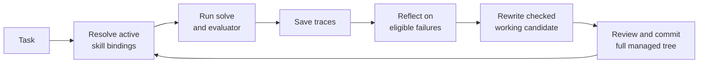
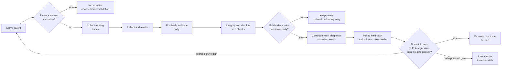

# Manual workflow architecture

This page describes the task/skill commands and their optimizer. For the Target Service and campaign workflow, read [How Evolution works](architecture.md).

Each rewrite mode finalizes a candidate body before one shared edit-brake seam measures normalized line churn. After integrity checks, the brake runs before optimizer evaluation and promotion. Its decay step uses retained parent ancestry, not a version label or attempt count.

Evolution is a file-backed Python package. It has no database or service requirement: tasks, immutable skill versions, traces, and optimizer checkpoints live in the caller's project.

## Core Objects

| Object | Meaning |
|---|---|
| Task | `task.toml`, `instruction.md`, optional inputs, and an evaluator below one task root. |
| Skill working tree | Editable `SKILL.md` plus optional `scripts/`, `references/`, and `assets/`. |
| Version | Immutable snapshot of the complete managed skill tree. |
| Active version | Saved version selected for default injection and full-tree restore. |
| Binding | Exact owner, version, full-tree SHA-256, source, and optional container provenance. |
| Trace | One recorded task attempt associated with one exact binding. |
| Optimizer run | Durable multi-round training and confidential scalar validation state. |

Task roots resolve as explicit path, then `EVO_TASKS_ROOT`, then `<cwd>/tasks`.

## Manual Lifecycle



The canonical commands are `evo run solve`, `evo trace ...`, `evo evolve reflect`, `evo evolve rewrite`, and `evo skill ...`. The CLI has no flat aliases.

A rewrite changes only the working tree. Default solves continue to inject the active version until a commit or promotion changes it. This prevents an uncommitted edit from silently changing an evaluation condition.

Bindings preserve the whole task requirement set. An explicit primary skill override replaces only the first requirement; supporting requirements stay pinned. Version and container-snapshot selection verifies recorded full-tree hashes before injection. Trace provenance records each exact binding.

## Production Optimizer

`evo evolve optimize` and `evolution.evolve.optimize_skill` provide automatic, conservative promotion over explicit training and validation task lists.



Plans with fewer than four pairs fail before model construction. Finalization, integrity checks, and absolute limits run before the shared edit brake. A brake rejection keeps the parent. Only `candidate_edit_budget_exceeded` can start another editor attempt. Candidate train diagnostics reuse collect seeds but are excluded from the gate. Parent and candidate promotion attempts share fresh seeds, with deterministic counterbalancing. Regression or no gain rejects. A positive but underpowered gain is terminally inconclusive and preserves candidate evidence for inspection.

Only current-round training traces can feed reflection. Validation remains confidential promotion-gate input, and test evaluation occurs only after selection for reporting. Saturation, candidate diagnostics, and validation calls do not create normal traces. Their checkpoints contain scalar measurements and aggregate gate information; Evolution does not expose their prompts, responses, generated code, outputs, or evaluator diagnostics to the editor.

The optimizer atomically checkpoints every phase. Resume identity hashes task trees, the initial skill tree, and supporting bindings. It also hashes model IDs, run settings, rewrite policy, tokens, permissions, manifests, and passed environment names. Resume rejects drift in that logical run definition. Old partial runs without the edit-brake identity require a fresh run. Promotion restores the candidate tree and is repairable after interruption.

`--dry-run` stops after preflight and returns the resolved call plan without model calls or state writes. `evo evolve status` reads checkpoint state without changing it.

## Storage

```text
.agents/skills/<name>/
├── SKILL.md
├── scripts/ | references/ | assets/       # optional managed resources
├── .traces/
│   ├── index.json
│   └── <trace-id>/
│       ├── prompt.md
│       ├── response.md
│       ├── solve.py
│       ├── result.json
│       ├── evidence.json                  # when evidence is available
│       └── reflection.json                # after reflection
└── .evolution/
    ├── lineage.json
    ├── versions/<version>/                # immutable complete managed trees
    ├── last_rewrite_audit.json
    └── runs/<run-id>/run.json             # durable optimizer checkpoint
```

Version hashes cover relative paths, entry kinds, executable bits, and file bytes. Symlinks and special files are rejected. Full-tree restore stages and verifies incoming content before replacing managed live entries; trace and lineage metadata stay outside that replacement.

Trace index and version/lineage updates use file locks and atomic writes. Optimizer runs also hold a per-skill lease so two processes cannot optimize the same canonical skill concurrently.

Agent CLI backends receive `safe` permission by default. Unsafe mode is an explicit caller choice. Safe calls use file tools only and fail closed unless Linux filesystem containment can start. Child programs and evaluators receive only the framework environment plus names explicitly admitted through repeatable `--pass-env` or the Python `pass_env` collection.

## Further Reading

- [CLI reference](cli.md)
- [Python API](api-usage.md)
- [Configuration](configuration.md)
- [Custom tasks](custom-tasks.md)
- [Split manifests](splits.md)
